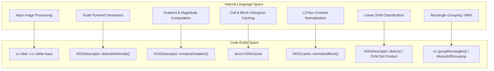
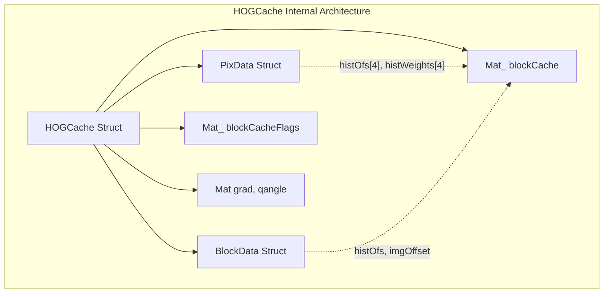
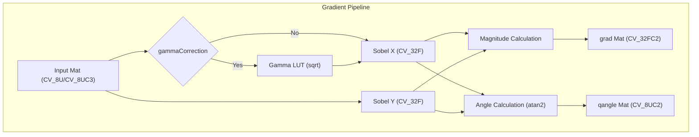
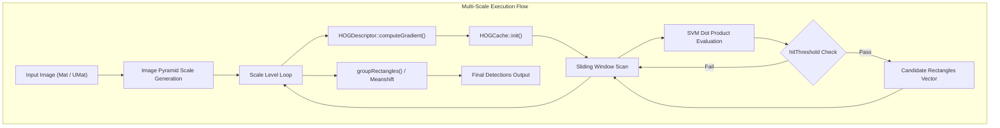

<!-- source: DeepWiki mcp.deepwiki.com · repo opencv/opencv · page 9.2 HOG Descriptor and SVM Detection · fetched 2026-10-30 -->

# HOG Descriptor and SVM Detection

Relevant source files

The following files were used as context for generating this wiki page:

- [doc/tutorials/dnn/dnn_face/dnn_face.markdown](doc/tutorials/dnn/dnn_face/dnn_face.markdown)
- [modules/flann/CMakeLists.txt](modules/flann/CMakeLists.txt)
- [modules/objdetect/CMakeLists.txt](modules/objdetect/CMakeLists.txt)
- [modules/objdetect/doc/pics/lena-face-detection.jpg](modules/objdetect/doc/pics/lena-face-detection.jpg)
- [modules/objdetect/include/opencv2/objdetect/face.hpp](modules/objdetect/include/opencv2/objdetect/face.hpp)
- [modules/objdetect/include/opencv2/objdetect/objdetect.hpp](modules/objdetect/include/opencv2/objdetect/objdetect.hpp)
- [modules/objdetect/src/face_detect.cpp](modules/objdetect/src/face_detect.cpp)
- [modules/objdetect/src/face_recognize.cpp](modules/objdetect/src/face_recognize.cpp)
- [modules/objdetect/src/precomp.hpp](modules/objdetect/src/precomp.hpp)
- [modules/objdetect/test/test_face.cpp](modules/objdetect/test/test_face.cpp)
- [modules/objdetect/test/test_main.cpp](modules/objdetect/test/test_main.cpp)
- [modules/video/src/precomp.hpp](modules/video/src/precomp.hpp)
- [samples/dnn/face_detect.cpp](samples/dnn/face_detect.cpp)
- [samples/dnn/face_detect.py](samples/dnn/face_detect.py)

## Purpose and Scope

This document details the Histogram of Oriented Gradients (HOG) feature descriptor and Support Vector Machine (SVM) detection framework implemented within OpenCV's `objdetect` module (`modules/objdetect/src/hog.cpp` [modules/objdetect/src/hog.cpp:1-200]()). The HOG descriptor computes dense grids of gradient orientation histograms over local image regions, utilizing overlapping block contrast normalization to achieve robust pedestrian and object detection. 

For related detection mechanisms using Haar or LBP features, refer to [Cascade Classifiers and Haar Features](#9.1). For an overview of the broader `opencv_objdetect` module, see [Object Detection (objdetect)](#9).

---

## System Overview

The HOG detection pipeline computes image gradients, bins orientations into spatial cells, groups cells into normalized blocks, and classifies the resulting feature vectors using a linear SVM. The architecture supports both CPU-bound execution paths and OpenCL-accelerated GPU kernels.

### HOG Detection Data Flow and Code Mapping

The following diagram bridges natural language concepts of the HOG detection pipeline to their concrete code entities within the OpenCV codebase.

Sources: [modules/objdetect/src/hog.cpp:52-59](), [modules/objdetect/src/cascadedetect.cpp:63-173]()

---

## Core Classes and Structures

### HOGDescriptor Class

The `cv::HOGDescriptor` class manages algorithm parameters, sliding window properties, and pre-trained SVM detector weights.

| Parameter / Field | Type | Description |
|-------------------|------|-------------|
| `winSize` | `Size` | Detection window dimensions (e.g., `Size(64,128)`) |
| `blockSize` | `Size` | Normalization block size (e.g., `Size(16,16)`) |
| `blockStride` | `Size` | Stride step for sliding blocks (e.g., `Size(8,8)`) |
| `cellSize` | `Size` | Spatial bin cell dimensions (e.g., `Size(8,8)`) |
| `nbins` | `int` | Number of orientation bins (typically `9`) |
| `svmDetector` | `vector<float>` | Linear SVM decision hyperplane coefficients |
| `oclSvmDetector` | `UMat` | Reordered SVM coefficients for OpenCL execution |
| `free_coef` | `double` | SVM classification bias term |

Sources: [modules/objdetect/src/hog.cpp:87-115](), [modules/objdetect/src/hog.cpp:141-143]()

### HOGCache Structure

The `HOGCache` internal helper class manages gradient caching, memory layouts, and block-level index lookups during sliding-window scanning.

Sources: [modules/objdetect/src/hog.cpp:589-743]()

---

## Gradient Computation Pipeline

Gradient calculation forms the base feature layer. The system extracts horizontal and vertical derivatives, computes gradient magnitude and quantized orientation angles, and supports optional gamma compression.

Sources: [modules/objdetect/src/hog.cpp:237-587]()

For multi-channel (color) inputs, `computeGradient` evaluates spatial derivatives across all channels independently and retains the maximum magnitude vector per pixel [modules/objdetect/src/hog.cpp:410-523]().

---

## Block Histogram Computation and Normalization

Gradients are binned into orientation histograms over individual cells, which are then grouped into larger overlapping blocks for contrast normalization.

### Normalization Process
1. **L2 Normalization**: Raw block vector $v$ is divided by its L2 norm: $v / \sqrt{\|v\|_2^2 + \epsilon^2}$ [modules/objdetect/src/hog.cpp:896-910]().
2. **Clipping**: Values are thresholded (capped) at `L2HysThreshold` (typically `0.2`) to limit high-magnitude illumination artifacts [modules/objdetect/src/hog.cpp:918-925]().
3. **Re-normalization**: A secondary L2 normalization pass is applied to the clipped vector [modules/objdetect/src/hog.cpp:932-943]().

Sources: [modules/objdetect/src/hog.cpp:880-950]()

---

## Multi-Scale Detection Pipeline

The `detectMultiScale` method evaluates the detector across an image pyramid to locate objects at varying scales.

Sources: [modules/objdetect/src/hog.cpp:1012-1250]()

---

## SVM Detector Organization and Pre-trained Models

The linear SVM classifier uses coefficients corresponding to the exact dimensionality of the descriptor window.

### Descriptor Vector Size Formula
$$\text{Size} = \text{nbins} \times \left(\frac{\text{blockSize.width}}{\text{cellSize.width}}\right) \times \left(\frac{\text{blockSize.height}}{\text{cellSize.height}}\right) \times \left(\frac{\text{winSize.width} - \text{blockSize.width}}{\text{blockStride.width}} + 1\right) \times \left(\frac{\text{winSize.height} - \text{blockSize.height}}{\text{blockStride.height}} + 1\right)$$
Sources: [modules/objdetect/src/hog.cpp:87-102]()

### Pre-trained Detectors
- **Default People Detector**: `HOGDescriptor::getDefaultPeopleDetector()` initializes coefficients trained on a $64 \times 128$ window [modules/objdetect/src/hog.cpp:1252-1287]().
- **Daimler People Detector**: `HOGDescriptor::getDaimlerPeopleDetector()` initializes coefficients optimized for a $48 \times 96$ window [modules/objdetect/src/hog.cpp:1289-1323]().

---

## OpenCL Acceleration Path

OpenCL acceleration offloads histogram computation, normalization, and classification to compatible GPU devices.

### OpenCL Kernels
- `compute_hists_lut_kernel`: Computes cell-level orientation histograms utilizing lookup tables [modules/objdetect/src/opencl/objdetect_hog.cl:65-152]().
- `normalize_hists_36_kernel`: Executes parallel L2-Hys block normalization [modules/objdetect/src/opencl/objdetect_hog.cl:157-197]().
- `classify_hists_kernel_many_scales`: Performs parallel sliding-window SVM dot-product evaluations across pyramid scales [modules/objdetect/src/opencl/objdetect_hog.cl:199-303]().

Sources: [modules/objdetect/src/opencl/objdetect_hog.cl:1-303]()

---

