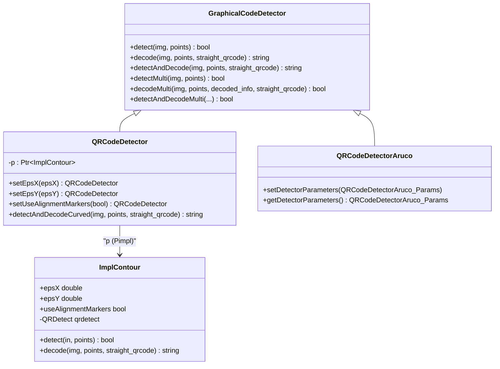
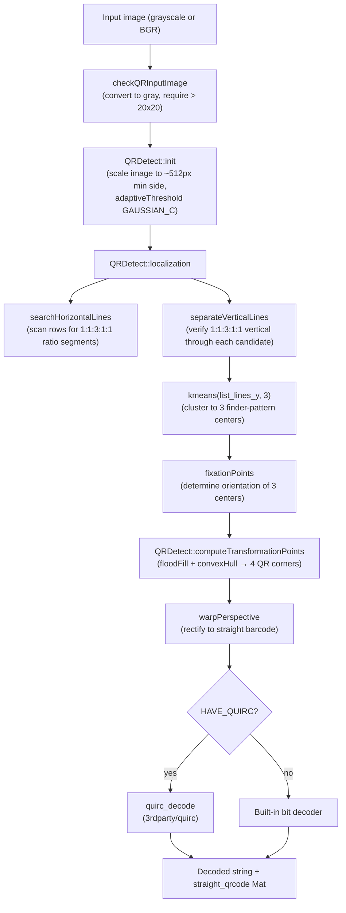
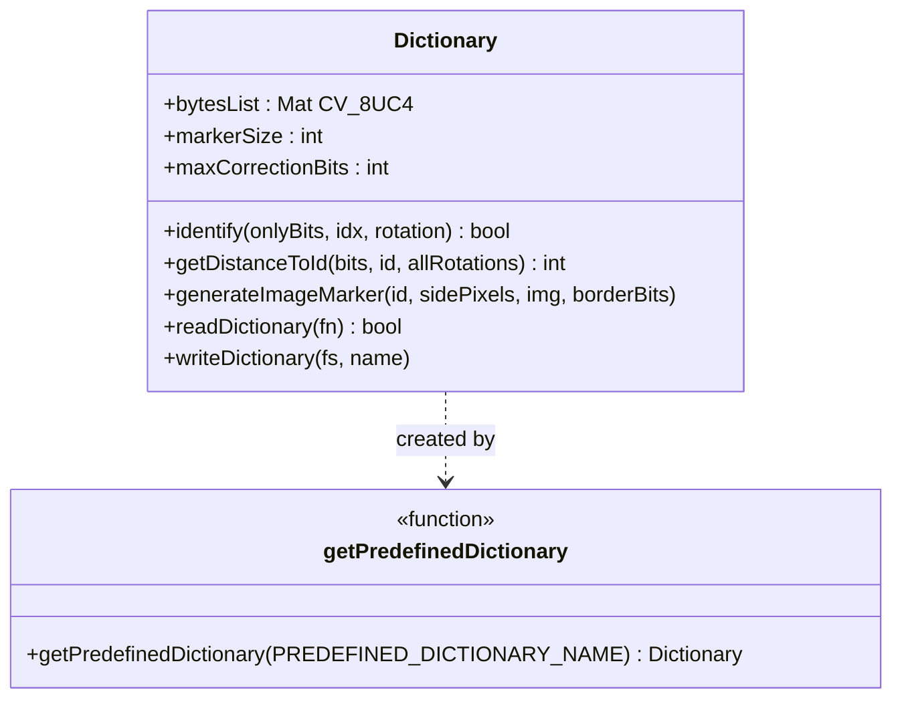
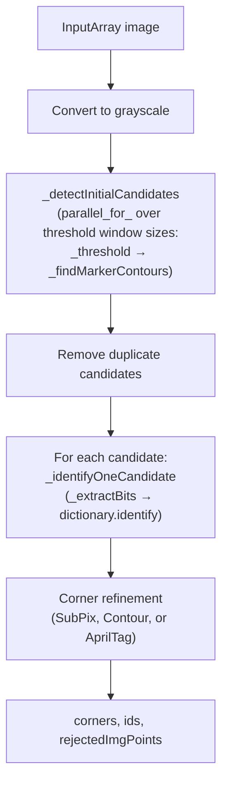
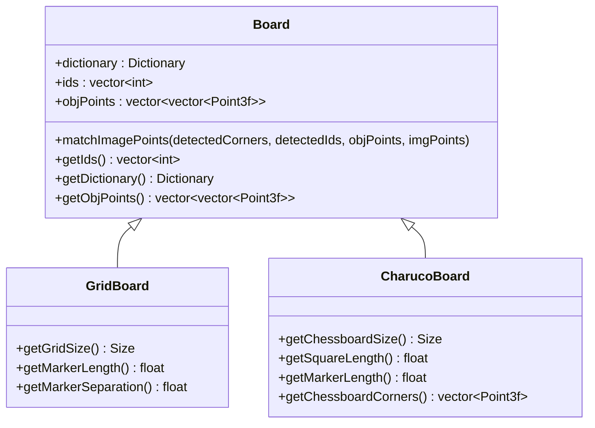
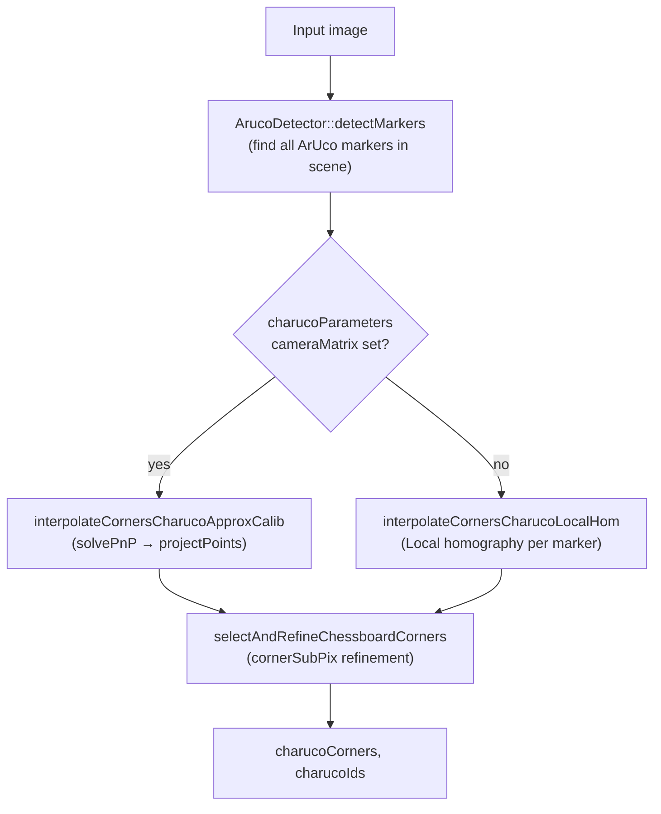

<!-- source: DeepWiki mcp.deepwiki.com · repo opencv/opencv · page 9.3 QR Code and ArUco Marker Detection · fetched 2026-10-30 -->

# QR Code and ArUco Marker Detection

<details>
<summary>Relevant source files</summary>

The following files were used as context for generating this wiki page:

- [modules/dnn/src/op_timvx.cpp](modules/dnn/src/op_timvx.cpp)
- [modules/objdetect/include/opencv2/objdetect.hpp](modules/objdetect/include/opencv2/objdetect.hpp)
- [modules/objdetect/include/opencv2/objdetect/aruco_board.hpp](modules/objdetect/include/opencv2/objdetect/aruco_board.hpp)
- [modules/objdetect/include/opencv2/objdetect/aruco_detector.hpp](modules/objdetect/include/opencv2/objdetect/aruco_detector.hpp)
- [modules/objdetect/include/opencv2/objdetect/aruco_dictionary.hpp](modules/objdetect/include/opencv2/objdetect/aruco_dictionary.hpp)
- [modules/objdetect/include/opencv2/objdetect/charuco_detector.hpp](modules/objdetect/include/opencv2/objdetect/charuco_detector.hpp)
- [modules/objdetect/include/opencv2/objdetect/graphical_code_detector.hpp](modules/objdetect/include/opencv2/objdetect/graphical_code_detector.hpp)
- [modules/objdetect/misc/java/filelist_common](modules/objdetect/misc/java/filelist_common)
- [modules/objdetect/misc/java/gen_dict.json](modules/objdetect/misc/java/gen_dict.json)
- [modules/objdetect/misc/java/src/cpp/objdetect_converters.cpp](modules/objdetect/misc/java/src/cpp/objdetect_converters.cpp)
- [modules/objdetect/misc/java/src/cpp/objdetect_converters.hpp](modules/objdetect/misc/java/src/cpp/objdetect_converters.hpp)
- [modules/objdetect/misc/java/test/ArucoTest.java](modules/objdetect/misc/java/test/ArucoTest.java)
- [modules/objdetect/misc/java/test/QRCodeDetectorTest.java](modules/objdetect/misc/java/test/QRCodeDetectorTest.java)
- [modules/objdetect/misc/objc/gen_dict.json](modules/objdetect/misc/objc/gen_dict.json)
- [modules/objdetect/misc/python/pyopencv_objdetect.hpp](modules/objdetect/misc/python/pyopencv_objdetect.hpp)
- [modules/objdetect/misc/python/test/test_qrcode_detect.py](modules/objdetect/misc/python/test/test_qrcode_detect.py)
- [modules/objdetect/perf/perf_aruco.cpp](modules/objdetect/perf/perf_aruco.cpp)
- [modules/objdetect/perf/perf_qrcode_pipeline.cpp](modules/objdetect/perf/perf_qrcode_pipeline.cpp)
- [modules/objdetect/src/aruco/aruco_board.cpp](modules/objdetect/src/aruco/aruco_board.cpp)
- [modules/objdetect/src/aruco/aruco_detector.cpp](modules/objdetect/src/aruco/aruco_detector.cpp)
- [modules/objdetect/src/aruco/aruco_dictionary.cpp](modules/objdetect/src/aruco/aruco_dictionary.cpp)
- [modules/objdetect/src/aruco/aruco_utils.cpp](modules/objdetect/src/aruco/aruco_utils.cpp)
- [modules/objdetect/src/aruco/aruco_utils.hpp](modules/objdetect/src/aruco/aruco_utils.hpp)
- [modules/objdetect/src/aruco/charuco_detector.cpp](modules/objdetect/src/aruco/charuco_detector.cpp)
- [modules/objdetect/src/aruco/predefined_dictionaries.hpp](modules/objdetect/src/aruco/predefined_dictionaries.hpp)
- [modules/objdetect/src/graphical_code_detector.cpp](modules/objdetect/src/graphical_code_detector.cpp)
- [modules/objdetect/src/graphical_code_detector_impl.hpp](modules/objdetect/src/graphical_code_detector_impl.hpp)
- [modules/objdetect/src/qrcode.cpp](modules/objdetect/src/qrcode.cpp)
- [modules/objdetect/src/qrcode_encoder.cpp](modules/objdetect/src/qrcode_encoder.cpp)
- [modules/objdetect/src/qrcode_encoder_table.inl.hpp](modules/objdetect/src/qrcode_encoder_table.inl.hpp)
- [modules/objdetect/test/test_aruco_tutorial.cpp](modules/objdetect/test/test_aruco_tutorial.cpp)
- [modules/objdetect/test/test_aruco_utils.cpp](modules/objdetect/test/test_aruco_utils.cpp)
- [modules/objdetect/test/test_aruco_utils.hpp](modules/objdetect/test/test_aruco_utils.hpp)
- [modules/objdetect/test/test_arucodetection.cpp](modules/objdetect/test/test_arucodetection.cpp)
- [modules/objdetect/test/test_boarddetection.cpp](modules/objdetect/test/test_boarddetection.cpp)
- [modules/objdetect/test/test_charucodetection.cpp](modules/objdetect/test/test_charucodetection.cpp)
- [modules/objdetect/test/test_chesscorners.cpp](modules/objdetect/test/test_chesscorners.cpp)
- [modules/objdetect/test/test_precomp.hpp](modules/objdetect/test/test_precomp.hpp)
- [modules/objdetect/test/test_qr_utils.hpp](modules/objdetect/test/test_qr_utils.hpp)
- [modules/objdetect/test/test_qrcode.cpp](modules/objdetect/test/test_qrcode.cpp)
- [modules/objdetect/test/test_qrcode_encode.cpp](modules/objdetect/test/test_qrcode_encode.cpp)
- [samples/cpp/qrcode.cpp](samples/cpp/qrcode.cpp)

</details>


This page covers the QR code and ArUco marker subsystems in the `opencv_objdetect` module. It describes the detection and encoding APIs, internal algorithms, dictionary structures, board types, and the ChArUco calibration target. For HOG/SVM people detection see [9.2](); for cascade face detection see [9.1](); for the camera calibration routines that consume ArUco/ChArUco output see [8.1]() and [8.2]().

---

## Module Organization

Both subsystems live under `modules/objdetect/`. The public API is declared in `modules/objdetect/include/opencv2/objdetect.hpp` and the ArUco-specific headers under `modules/objdetect/include/opencv2/objdetect/`.

```
modules/objdetect/
├── include/opencv2/objdetect/
│   ├── aruco_detector.hpp      # ArucoDetector, DetectorParameters, RefineParameters
│   ├── aruco_dictionary.hpp    # Dictionary
│   ├── aruco_board.hpp         # Board, GridBoard, CharucoBoard
│   └── charuco_detector.hpp    # CharucoDetector, CharucoParameters
├── src/
│   ├── qrcode.cpp              # QRDetect, ImplContour, QRCodeDetector
│   ├── qrcode_encoder.cpp      # QRCodeEncoderImpl
│   └── aruco/
│       ├── aruco_detector.cpp  # ArucoDetector internals
│       ├── aruco_dictionary.cpp
│       ├── aruco_board.cpp
│       └── charuco_detector.cpp
└── 3rdparty/quirc/             # Optional quirc QR decode library
```

Sources: [modules/objdetect/include/opencv2/objdetect.hpp:44-52](), [modules/objdetect/src/qrcode.cpp:8-13]()

---

## QR Code Detection

### Class Hierarchy and Entry Points

**Class hierarchy diagram: QR Code detection classes**



Sources: [modules/objdetect/include/opencv2/objdetect/graphical_code_detector.hpp:16-96](), [modules/objdetect/src/graphical_code_detector_impl.hpp:10-40]()

`QRCodeDetector` uses `ImplContour` as its internal implementation via a Pimpl pointer. `QRCodeDetectorAruco` is an alternative that reuses ArUco-style candidate detection before QR decoding — useful for multi-QR scenes.

---

### QR Code Detection Pipeline

The `ImplContour::detect()` path calls `QRDetect`, an internal class defined in `modules/objdetect/src/qrcode.cpp`.

**Flowchart: QR Code detection pipeline (contours-based)**



Sources: [modules/objdetect/src/qrcode.cpp:25-45](), [modules/objdetect/src/qrcode.cpp:122-164](), [modules/objdetect/src/qrcode.cpp:166-205]()

#### Scaling Logic

`QRDetect::init` normalizes the image before thresholding to maintain detection consistency across resolutions.

| Condition | Action | Logic |
|-----------|--------|-------|
| `min_side < 512.0` | `ZOOMING` | `coeff_expansion = 512.0 / min_side` |
| `min_side > 512.0` | `SHRINKING` | `coeff_expansion = min_side / 512.0` |
| `min_side == 512.0`| `UNCHANGED`| `coeff_expansion = 1.0` |

Sources: [modules/objdetect/src/qrcode.cpp:127-151]()

#### Finder Pattern Localization

`searchHorizontalLines` ([modules/objdetect/src/qrcode.cpp:166-232]()) scans each row of the thresholded image for runs of pixels with the ratio **1 : 1 : 3 : 1 : 1** (dark:light:dark:light:dark).

`separateVerticalLines` ([modules/objdetect/src/qrcode.cpp:234-260]()) then verifies the vertical signature through the center of each horizontal candidate. It checks verified candidates to yield three finder-pattern centers.

---

## QR Code Encoding

`QRCodeEncoder` generates a QR code image from an input string, supporting various encoding modes and error correction levels.

### `QRCodeEncoder::Params`

| Field | Type | Default | Description |
|-------|------|---------|-------------|
| `version` | `int` | `0` (auto) | QR version 1–40 |
| `correction_level` | `CorrectionLevel` | `CORRECT_LEVEL_L` | L=7%, M=15%, Q=25%, H=30% recovery |
| `mode` | `EncodeMode` | `MODE_AUTO` | Numeric / Alphanumeric / Byte / Kanji / ECI / Structured |
| `structure_number` | `int` | `1` | Number of symbols for structured append (1–16) |

Sources: [modules/objdetect/src/qrcode_encoder.cpp:166-172]()

### Encoding Pipeline

`QRCodeEncoderImpl` executes the following stages to generate the bit matrix:

```mermaid
flowchart LR
    A["input string"] --> B["autoEncodeMode / mode selection"]
    B --> C["stringToBits\n(encode data payload)"]
    C --> D["padBitStream\n(pad to version capacity)"]
    D --> E["eccGenerate\n(Reed-Solomon ECC codewords,\nGF(256) arithmetic)"]
    E --> F["rearrangeBlocks\n(interleave data + ECC)"]
    F --> G["writeReservedArea\n(timing, alignment, dark module)"]
    G --> H["writeData\n(zigzag bit placement)"]
    H --> I["findAutoMaskType\n(evaluate 8 mask patterns)"]
    I --> J["fillReserved\n(format info + version info)"]
    J --> K["Output Mat (CV_8UC1 binary image)"]
```



Sources: [modules/objdetect/src/qrcode_encoder.cpp:174-226](), [modules/objdetect/src/qrcode_encoder.cpp:45-120]()

---

## ArUco Marker Detection

ArUco markers are square binary fiducial patterns. Each marker belongs to a `Dictionary` which defines the set of valid codewords and the marker size (e.g., 4x4, 6x6).

### Dictionary System

**Dictionary class diagram**



Sources: [modules/objdetect/include/opencv2/objdetect/aruco_dictionary.hpp:54-90](), [modules/objdetect/src/aruco/aruco_dictionary.cpp:98-105]()

`bytesList` is stored as a `Mat` where each row represents a marker's bit pattern across 4 rotations. `maxCorrectionBits` determines how many bit errors `identify()` tolerates.

---

### DetectorParameters

`DetectorParameters` controls all aspects of the detection pipeline, from thresholding to corner refinement.

| Parameter | Default | Description |
|-----------|---------|-------------|
| `adaptiveThreshWinSizeMin` | 3 | Smallest window for adaptive threshold |
| `adaptiveThreshWinSizeMax` | 23 | Largest window |
| `minMarkerPerimeterRate` | 0.03 | Min marker perimeter as fraction of image max dim |
| `cornerRefinementMethod` | `CORNER_REFINE_NONE` | None / SubPix / Contour / AprilTag |
| `markerBorderBits` | 1 | Border width in bit units |
| `useAruco3Detection` | `false` | Enable Aruco3 pyramid algorithm for speed/distance |

Sources: [modules/objdetect/include/opencv2/objdetect/aruco_detector.hpp:27-63](), [modules/objdetect/src/aruco/aruco_detector.cpp:27-60]()

---

### ArucoDetector Detection Pipeline

**Flowchart: ArucoDetector::detectMarkers internals**



Sources: [modules/objdetect/src/aruco/aruco_detector.cpp:119-154](), [modules/objdetect/include/opencv2/objdetect/aruco_detector.hpp:16-21]()

#### `CornerRefineMethod`
The detector supports multiple refinement methods to improve pose estimation accuracy:
- `CORNER_REFINE_SUBPIX`: Uses standard sub-pixel corner refinement.
- `CORNER_REFINE_CONTOUR`: Uses contour-points line fitting.
- `CORNER_REFINE_APRILTAG`: Uses AprilTag 2 approach.

Sources: [modules/objdetect/include/opencv2/objdetect/aruco_detector.hpp:16-21]()

---

## ArUco Boards

### Board Class Hierarchy

**Class diagram: ArUco board types**



Sources: [modules/objdetect/include/opencv2/objdetect/aruco_board.hpp:20-100](), [modules/objdetect/src/aruco/aruco_board.cpp:37-73]()

### Pose Estimation from Markers
Pose estimation is typically performed by mapping detected marker corners to their known 3D positions (`objPoints`). The `Board::matchImagePoints` function facilitates this mapping, which can then be passed to `solvePnP`.

Sources: [modules/objdetect/src/aruco/aruco_board.cpp:37-73]()

---

## ChArUco Detection and Calibration

A `CharucoBoard` combines a standard chessboard with embedded ArUco markers. This hybrid target allows for robust corner detection even under partial occlusion, as the markers provide a rough pose to guide the search for chessboard corners.

### CharucoDetector Pipeline



Sources: [modules/objdetect/src/aruco/charuco_detector.cpp:17-128](), [modules/objdetect/include/opencv2/objdetect/charuco_detector.hpp:17-25]()

#### Interpolation Methods

| Method | Trigger | Approach |
|--------|---------|---------|
| `interpolateCornersCharucoLocalHom` | No camera matrix | Per-marker homography via `getPerspectiveTransform` |
| `interpolateCornersCharucoApproxCalib` | Camera matrix provided | `solvePnP` approximate pose → `projectPoints` for better corner prediction |

Sources: [modules/objdetect/src/aruco/charuco_detector.cpp:85-128]()

---

## Key API Summary

### QR Code

| Class / Function | File | Purpose |
|-----------------|------|---------|
| `QRCodeDetector` | `qrcode.cpp` | Detect + decode single or multiple QR codes |
| `GraphicalCodeDetector` | `graphical_code_detector.hpp` | Base class for detection interfaces |
| `QRCodeEncoder` | `qrcode_encoder.cpp` | Encode strings to QR code images |

### ArUco

| Class / Function | File | Purpose |
|-----------------|------|---------|
| `Dictionary` | `aruco_dictionary.hpp` | Marker codeword set and identification |
| `DetectorParameters` | `aruco_detector.hpp` | Detection tuning parameters |
| `ArucoDetector` | `aruco_detector.cpp` | Main marker detection logic |
| `Board` | `aruco_board.cpp` | Base class for marker board configurations |
| `CharucoDetector` | `charuco_detector.cpp` | Specialized detector for ChArUco boards |

Sources: [modules/objdetect/include/opencv2/objdetect/aruco_detector.hpp:25-63](), [modules/objdetect/include/opencv2/objdetect/aruco_board.hpp:20-50](), [modules/objdetect/include/opencv2/objdetect/charuco_detector.hpp:17-25]()

---

