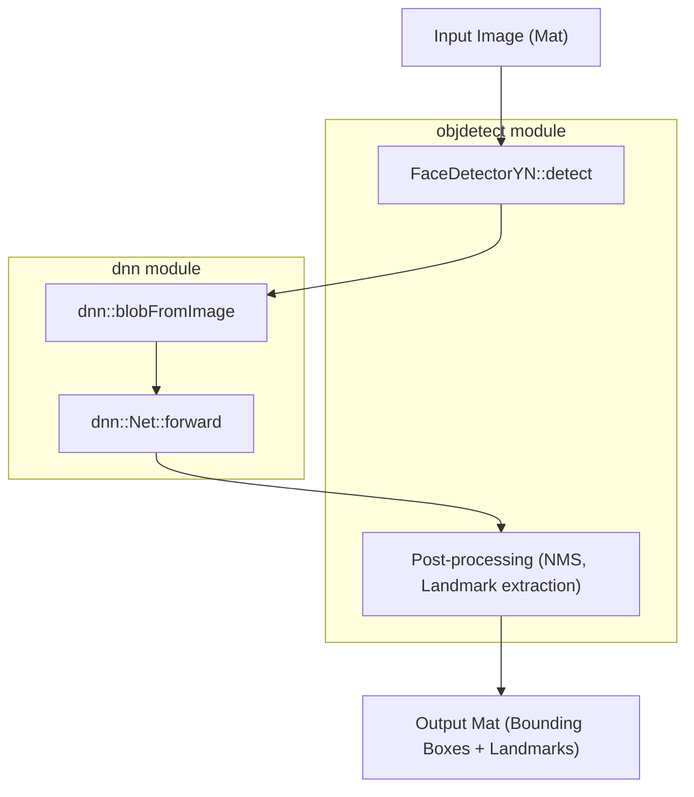

<!-- source: DeepWiki mcp.deepwiki.com · repo opencv/opencv · page 9.4 Face Detection APIs and DNN-based Helpers · fetched 2026-10-30 -->

# Face Detection APIs and DNN-based Helpers

Relevant source files

The following files were used as context for generating this wiki page:

- [doc/tutorials/dnn/dnn_custom_layers/dnn_custom_layers.md](doc/tutorials/dnn/dnn_custom_layers/dnn_custom_layers.md)
- [doc/tutorials/dnn/dnn_face/dnn_face.markdown](doc/tutorials/dnn/dnn_face/dnn_face.markdown)
- [modules/flann/CMakeLists.txt](modules/flann/CMakeLists.txt)
- [modules/objdetect/CMakeLists.txt](modules/objdetect/CMakeLists.txt)
- [modules/objdetect/doc/pics/lena-face-detection.jpg](modules/objdetect/doc/pics/lena-face-detection.jpg)
- [modules/objdetect/include/opencv2/objdetect/face.hpp](modules/objdetect/include/opencv2/objdetect/face.hpp)
- [modules/objdetect/src/face_detect.cpp](modules/objdetect/src/face_detect.cpp)
- [modules/objdetect/src/face_recognize.cpp](modules/objdetect/src/face_recognize.cpp)
- [modules/objdetect/src/precomp.hpp](modules/objdetect/src/precomp.hpp)
- [modules/objdetect/test/test_face.cpp](modules/objdetect/test/test_face.cpp)
- [modules/objdetect/test/test_main.cpp](modules/objdetect/test/test_main.cpp)
- [modules/video/src/precomp.hpp](modules/video/src/precomp.hpp)
- [samples/dnn/classification.cpp](samples/dnn/classification.cpp)
- [samples/dnn/classification.py](samples/dnn/classification.py)
- [samples/dnn/colorization.cpp](samples/dnn/colorization.cpp)
- [samples/dnn/colorization.py](samples/dnn/colorization.py)
- [samples/dnn/common.hpp](samples/dnn/common.hpp)
- [samples/dnn/common.py](samples/dnn/common.py)
- [samples/dnn/custom_layer_onnx.cpp](samples/dnn/custom_layer_onnx.cpp)
- [samples/dnn/download_models.py](samples/dnn/download_models.py)
- [samples/dnn/edge_detection.cpp](samples/dnn/edge_detection.cpp)
- [samples/dnn/edge_detection.py](samples/dnn/edge_detection.py)
- [samples/dnn/face_detect.cpp](samples/dnn/face_detect.cpp)
- [samples/dnn/face_detect.py](samples/dnn/face_detect.py)
- [samples/dnn/ldm_inpainting.py](samples/dnn/ldm_inpainting.py)
- [samples/dnn/models.yml](samples/dnn/models.yml)
- [samples/dnn/object_detection.cpp](samples/dnn/object_detection.cpp)
- [samples/dnn/object_detection.py](samples/dnn/object_detection.py)
- [samples/dnn/object_tracker.cpp](samples/dnn/object_tracker.cpp)
- [samples/dnn/object_tracker.py](samples/dnn/object_tracker.py)
- [samples/dnn/person_reid.cpp](samples/dnn/person_reid.cpp)
- [samples/dnn/person_reid.py](samples/dnn/person_reid.py)
- [samples/dnn/segmentation.cpp](samples/dnn/segmentation.cpp)
- [samples/dnn/segmentation.py](samples/dnn/segmentation.py)

OpenCV provides modern face detection capabilities primarily through the `objdetect` module, utilizing Deep Neural Network (DNN) backends for high-accuracy inference. These APIs provide a high-level interface for detecting faces and facial landmarks, abstracting the underlying complexity of tensor manipulation and model execution.

## Face Detection Architecture

The face detection system is built upon the `cv::FaceDetectorYN` class, which implements a specific DNN-based face detector (often referred to as YuNet). This class bridges the gap between the `objdetect` module's domain-specific requirements and the `dnn` module's general-purpose inference engine.

### System Entity Map

The following diagram illustrates how high-level face detection concepts map to specific code entities within the OpenCV repository.

| System Concept | Code Entity | File Path |
| :--- | :--- | :--- |
| **Face Detector Interface** | `cv::FaceDetectorYN` | [modules/objdetect/include/opencv2/objdetect/face.hpp:51-140]() |
| **Detection Result** | `cv::Mat` (15 columns per face) | [modules/objdetect/src/face_detect.cpp:188-193]() |
| **Inference Engine** | `cv::dnn::Net` | [modules/dnn/include/opencv2/dnn/dnn.hpp:463-1002]() |
| **Input Preprocessing** | `cv::dnn::blobFromImage` | [modules/dnn/include/opencv2/dnn/dnn.hpp:1232-1260]() |

Sources: [modules/objdetect/include/opencv2/objdetect/face.hpp:51-140](), [modules/objdetect/src/face_detect.cpp:188-193](), [modules/dnn/include/opencv2/dnn/dnn.hpp:463-1002]()

### Data Flow for Face Detection

Sources: [modules/objdetect/src/face_detect.cpp:134-167](), [modules/dnn/include/opencv2/dnn/dnn.hpp:71-108]()

## FaceDetectorYN API

The `FaceDetectorYN` class is the primary entry point for DNN-based face detection. It supports various backends and targets, including CPU, OpenCL, and CUDA.

### Key Functions and Parameters
- **Creation**: The static `create` method initializes the detector with a model path, configuration, and input size [modules/objdetect/include/opencv2/objdetect/face.hpp:74-88]().
- **Detection**: The `detect` method processes an input image and returns a `Mat` where each row represents a detected face [modules/objdetect/src/face_detect.cpp:134-167]().
- **Output Format**: The output `Mat` contains 15 columns:
    - `[0-3]`: Bounding box (x, y, width, height).
    - `[4-13]`: Five facial landmarks (x, y for right eye, left eye, nose tip, right mouth corner, left mouth corner).
    - `[14]`: Confidence score.

Sources: [modules/objdetect/include/opencv2/objdetect/face.hpp:74-88](), [modules/objdetect/src/face_detect.cpp:188-193]()

### Typical Parameters
| Parameter | Default Value | Description |
| :--- | :--- | :--- |
| `score_threshold` | 0.9 | Threshold to filter out low-confidence detections. |
| `nms_threshold` | 0.3 | Non-Maximum Suppression threshold to remove overlapping boxes. |
| `top_k` | 5000 | Keep only the top K detections before NMS. |

Sources: [modules/objdetect/include/opencv2/objdetect/face.hpp:58-62]()

## Integration with DNN Helpers

The face detection APIs rely on the `dnn` module for model execution. This allows users to leverage different hardware accelerators by setting the backend and target.

### Backend and Target Selection
Users can configure the detector to use specific hardware via `setPreferableBackend` and `setPreferableTarget` [modules/dnn/include/opencv2/dnn/dnn.hpp:544-555](). Supported combinations include:
- `DNN_BACKEND_OPENCV` with `DNN_TARGET_CPU` (Default)
- `DNN_BACKEND_CUDA` with `DNN_TARGET_CUDA` [modules/dnn/include/opencv2/dnn/dnn.hpp:79-103]()
- `DNN_BACKEND_INFERENCE_ENGINE` for Intel OpenVINO [modules/dnn/include/opencv2/dnn/dnn.hpp:75-76]()

Sources: [modules/dnn/include/opencv2/dnn/dnn.hpp:544-555](), [modules/dnn/include/opencv2/dnn/dnn.hpp:75-103]()

### Preprocessing Logic
Internally, the face detector uses `blobFromImage` to convert the input `Mat` into a 4D tensor required by the network after padding the input with a divisor of 32 [modules/objdetect/src/face_detect.cpp:143-156]().

Sources: [modules/objdetect/src/face_detect.cpp:143-156]()

## Testing and Validation

Face detection functionality is validated through extensive unit tests and performance benchmarks.

### Testing Entry Points
- **Unit Tests**: Located in `modules/objdetect/test/test_face.cpp`. These tests verify detection accuracy and landmark placement against reference data.
- **Performance Tests**: Performance is measured using standard performance evaluation structures to ensure inference times meet requirements across different backends.

Sources: [modules/objdetect/test/test_main.cpp:1-18]()

### Sample Implementation
OpenCV provides samples in both C++ and Python to demonstrate the usage of `FaceDetectorYN`:
- **C++ Sample**: `samples/dnn/face_detect.cpp`
- **Python Sample**: `samples/dnn/face_detect.py`

These samples demonstrate the standard pipeline: loading the model, setting the input size, performing detection, and drawing the results.

Sources: [samples/dnn/object_detection.cpp:1-40](), [samples/dnn/object_detection.py:1-40]()

---

