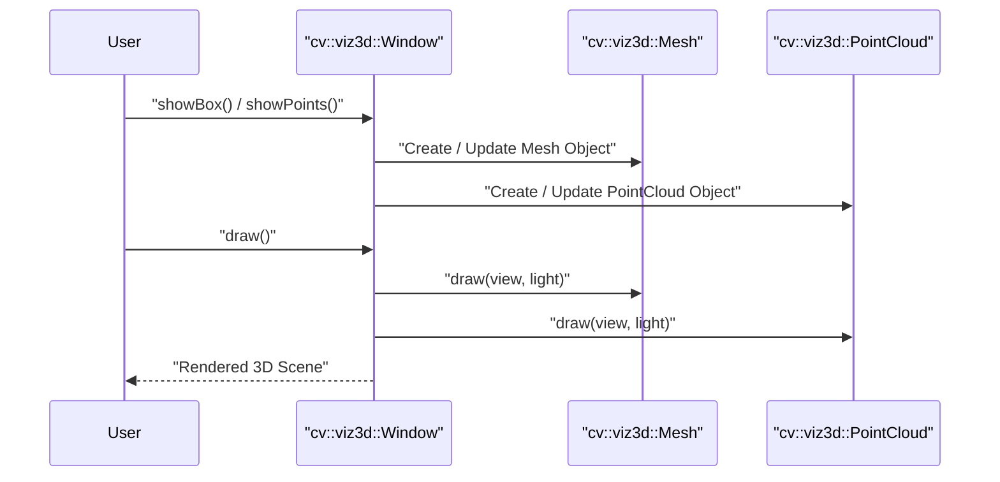

<!-- source: DeepWiki mcp.deepwiki.com · repo opencv/opencv · extra page Monocular Visual Odometry and SLAM Pipeline · fetched 2026-10-30 -->

# Monocular Visual Odometry and SLAM Pipeline

<details>
<summary>Relevant source files</summary>

The following files were used as context for generating this wiki page:

- [apps/multiview-calibration/multiview_calibration.py](apps/multiview-calibration/multiview_calibration.py)
- [apps/multiview-calibration/requirements.txt](apps/multiview-calibration/requirements.txt)
- [doc/tutorials/calib3d/camera_multiview_calibration/multiview_calibration.markdown](doc/tutorials/calib3d/camera_multiview_calibration/multiview_calibration.markdown)
- [modules/calib/include/opencv2/calib.hpp](modules/calib/include/opencv2/calib.hpp)
- [modules/calib/misc/java/test/CalibTest.java](modules/calib/misc/java/test/CalibTest.java)
- [modules/calib/misc/python/test/test_calibration.py](modules/calib/misc/python/test/test_calibration.py)
- [modules/calib/src/calibration.cpp](modules/calib/src/calibration.cpp)
- [modules/calib/src/fisheye.cpp](modules/calib/src/fisheye.cpp)
- [modules/calib/src/multiview_calibration.cpp](modules/calib/src/multiview_calibration.cpp)
- [modules/calib/test/test_cameracalibration.cpp](modules/calib/test/test_cameracalibration.cpp)
- [modules/calib/test/test_fisheye.cpp](modules/calib/test/test_fisheye.cpp)
- [modules/calib/test/test_multiview_calib.cpp](modules/calib/test/test_multiview_calib.cpp)
- [modules/highgui/cmake/detect_wayland.cmake](modules/highgui/cmake/detect_wayland.cmake)
- [modules/highgui/src/window_wayland.cpp](modules/highgui/src/window_wayland.cpp)
- [modules/highgui/test/test_gui.cpp](modules/highgui/test/test_gui.cpp)
- [modules/ptcloud/CMakeLists.txt](modules/ptcloud/CMakeLists.txt)
- [modules/ptcloud/include/opencv2/ptcloud.hpp](modules/ptcloud/include/opencv2/ptcloud.hpp)
- [modules/ptcloud/include/opencv2/ptcloud/viz3d.hpp](modules/ptcloud/include/opencv2/ptcloud/viz3d.hpp)
- [modules/ptcloud/src/viz3d/grid_ticks.hpp](modules/ptcloud/src/viz3d/grid_ticks.hpp)
- [modules/ptcloud/src/viz3d/viz3d.cpp](modules/ptcloud/src/viz3d/viz3d.cpp)
- [modules/ptcloud/src/viz3d/viz3d_private.hpp](modules/ptcloud/src/viz3d/viz3d_private.hpp)
- [modules/ptcloud/test/test_viz3d.cpp](modules/ptcloud/test/test_viz3d.cpp)
- [modules/stereo/src/stereo_geom.cpp](modules/stereo/src/stereo_geom.cpp)
- [modules/stereo/test/test_geometry.cpp](modules/stereo/test/test_geometry.cpp)
- [samples/cpp/multiview_calibration_sample.cpp](samples/cpp/multiview_calibration_sample.cpp)
- [samples/data/rgbd-color.jpg](samples/data/rgbd-color.jpg)
- [samples/data/rgbd-depth.png](samples/data/rgbd-depth.png)

</details>


The `cv::slam::VisualOdometry` class provides a high-level entry point for monocular visual odometry and SLAM (Simultaneous Localization and Mapping). It integrates feature detection, descriptor matching, robust pose estimation, and map management into a unified pipeline suitable for estimating camera trajectories from image sequences.

### System Overview and Entry Point

The pipeline is primarily defined in the `ptcloud` module [modules/ptcloud/include/opencv2/ptcloud.hpp:1-30](). Users interact with the system via the `VisualOdometry` interface, which is instantiated through a factory method [modules/ptcloud/src/viz3d/viz3d.cpp:13-65]().

The core processing loop revolves around frame management and map updates.

#### Data Flow and Code Entities
The following diagram maps the high-level SLAM concepts to their specific implementation classes and visualization interfaces within the codebase.

**SLAM Pipeline Architecture**
```mermaid
graph TD
    subgraph "Public API"
        VO["cv::slam::VisualOdometry"]
    end

    subgraph "Visualization (viz3d.cpp)"
        VizWin["cv::viz3d::Window"]
        VizObj["cv::viz3d::Object"]
        Mesh["cv::viz3d::Mesh"]
        Points["cv::viz3d::PointCloud"]
    end

    subgraph "Point Cloud Module"
        PtCloudCMake["modules/ptcloud/CMakeLists.txt"]
    end

    VO -- "Renders via" --> VizWin
    VizWin -- "Contains" --> VizObj
    VizObj <|-- Mesh
    VizObj <|-- Points
    PtCloudCMake -- "Builds" --> VizWin
```
**Sources:** [modules/ptcloud/src/viz3d/viz3d.cpp:13-65](), [modules/ptcloud/src/viz3d/viz3d_private.hpp:66-205](), [modules/ptcloud/CMakeLists.txt:1-11]()

---

### Pipeline Execution Flow

The visual odometry pipeline executes a state-machine-driven sequence to estimate the camera pose across frames.

1.  **Feature Extraction**: For every frame, the system detects keypoints and computes descriptors using feature extractors [modules/ptcloud/CMakeLists.txt:1-8]().
2.  **Two-View Bootstrap**: When initializing, the pipeline attempts to find a valid relative pose between the reference frame and the current frame to define the initial map scale and coordinate system [modules/ptcloud/src/viz3d/viz3d.cpp:31-65]().
3.  **PnP Tracking**: Once initialized, the system tracks incoming frames by projecting existing map points and solving the Perspective-n-Point (PnP) problem to determine camera orientation and position [modules/calib/src/calibration.cpp:59-110]().
4.  **Keyframe Selection & Map Growth**: Periodically, the system designates frames as keyframes to add new map points via triangulation, ensuring the map expands smoothly as the camera moves [modules/ptcloud/src/viz3d/viz3d_private.hpp:94-126]().

**Logic Flow Diagram**

**Sources:** [modules/ptcloud/src/viz3d/viz3d.cpp:68-179](), [modules/ptcloud/src/viz3d/viz3d_private.hpp:128-205]()

---

### Key Components

#### 1. Two-View Bootstrap
The bootstrap process relies on finding a fundamental or essential matrix between the initial frames with sufficient parallax. This stage establishes the initial 3D map points and the relative transformation between keyframes [modules/calib/src/calibration.cpp:59-110]().

#### 2. PnP Tracking
Steady-state tracking uses PnP solvers to estimate the pose of the current frame relative to the world map by matching current descriptors against stored map points [modules/calib/src/calibration.cpp:77-109]().

#### 3. Map Management
The global state of the SLAM session manages:
*   **MapPoints**: 3D coordinates in the world frame, associated with descriptors and observation lists [modules/ptcloud/src/viz3d/viz3d_private.hpp:184-205]().
*   **KeyFrames**: Subsets of processed frames containing pose information and references to observed map points [modules/ptcloud/src/viz3d/viz3d_private.hpp:94-126]().

---

### Visualization with Viz3d

The `ptcloud` module provides `cv::viz3d` for real-time visualization of SLAM output, rendering estimated trajectories and sparse point clouds using OpenGL [modules/ptcloud/src/viz3d/viz3d.cpp:13-65]().

A typical integration involves:
1.  Initializing a window context via `cv::viz3d` window handlers [modules/ptcloud/src/viz3d/viz3d.cpp:38-65]().
2.  Adding geometry elements such as point clouds, lines, and boxes [modules/ptcloud/src/viz3d/viz3d_private.hpp:128-205]().
3.  Rendering and updating the scene within the event loop [modules/ptcloud/src/viz3d/viz3d.cpp:17-36]().

**Sources:** [modules/ptcloud/src/viz3d/viz3d.cpp:13-179](), [modules/ptcloud/src/viz3d/viz3d_private.hpp:22-205](), [modules/ptcloud/test/test_viz3d.cpp:31-75]()

---

