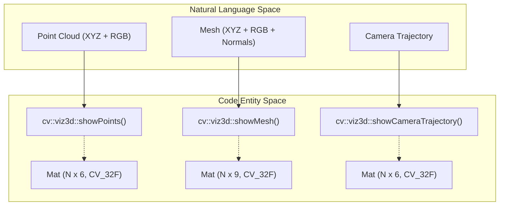
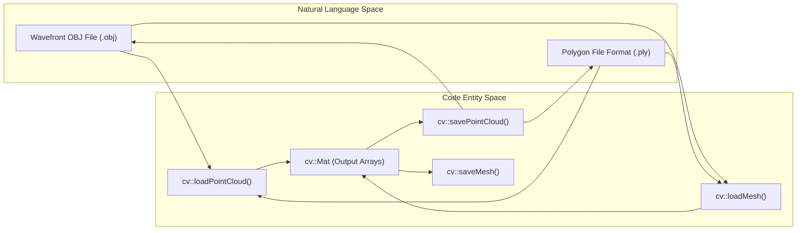

<!-- source: DeepWiki mcp.deepwiki.com · repo opencv/opencv · extra page Point Cloud and Mesh I/O + Basic Data Layout · fetched 2026-10-30 -->

# Point Cloud and Mesh I/O + Basic Data Layout

Relevant source files

The following files were used as context for generating this wiki page:

- [modules/highgui/cmake/detect_wayland.cmake](modules/highgui/cmake/detect_wayland.cmake)
- [modules/highgui/src/window_wayland.cpp](modules/highgui/src/window_wayland.cpp)
- [modules/highgui/test/test_gui.cpp](modules/highgui/test/test_gui.cpp)
- [modules/ptcloud/CMakeLists.txt](modules/ptcloud/CMakeLists.txt)
- [modules/ptcloud/include/opencv2/ptcloud.hpp](modules/ptcloud/include/opencv2/ptcloud.hpp)
- [modules/ptcloud/include/opencv2/ptcloud/viz3d.hpp](modules/ptcloud/include/opencv2/ptcloud/viz3d.hpp)
- [modules/ptcloud/src/viz3d/grid_ticks.hpp](modules/ptcloud/src/viz3d/grid_ticks.hpp)
- [modules/ptcloud/src/viz3d/viz3d.cpp](modules/ptcloud/src/viz3d/viz3d.cpp)
- [modules/ptcloud/src/viz3d/viz3d_private.hpp](modules/ptcloud/src/viz3d/viz3d_private.hpp)
- [modules/ptcloud/test/test_viz3d.cpp](modules/ptcloud/test/test_viz3d.cpp)
- [samples/data/rgbd-color.jpg](samples/data/rgbd-color.jpg)
- [samples/data/rgbd-depth.png](samples/data/rgbd-depth.png)

The `ptcloud` module provides high-level operations for 3D data processing, including point cloud and mesh I/O, RGB-D odometry, volumetric reconstruction, and rendering utilities [modules/ptcloud/CMakeLists.txt:1-6](), [modules/ptcloud/include/opencv2/ptcloud.hpp:17-27](). This section documents public I/O functions, expected shapes and dtypes for vertices, normals, and colors, supported file formats (OBJ and PLY), and common integration pitfalls.

## Basic Data Layout

OpenCV represents point clouds and meshes using `cv::Mat`. The layout depends on the requested geometric attributes (position, color, normals). Data is generally structured as a 2D `cv::Mat` where each row represents a single vertex or point [modules/ptcloud/include/opencv2/ptcloud/viz3d.hpp:103-107]().

### Expected Shapes and Dtypes

| Attribute Type | Channels/Columns | Data Type | Description |
| :--- | :--- | :--- | :--- |
| **Position Only** | 3 (XYZ) | `CV_32F` | Standard 3D Cartesian coordinates |
| **Position + Color** | 6 (XYZ, RGB) | `CV_32F` | XYZ spatial coordinates followed by RGB color values (normalized 0.0 to 1.0) |
| **Position + Color + Normal** | 9 (XYZ, RGB, UVW) | `CV_32F` | XYZ spatial coordinates, RGB colors, and UVW normal vectors |

### Rendering Modes
The `cv::viz3d` submodule interprets these layouts during visualization based on the selected `RenderMode` [modules/ptcloud/include/opencv2/ptcloud/viz3d.hpp:15-20]():
*   `RENDER_SIMPLE`: Expects 6 floats per vertex (XYZ, RGB) [modules/ptcloud/src/viz3d/viz3d.cpp:72-73]().
*   `RENDER_SHADING`: Expects 9 floats per vertex (XYZ, RGB, Normal) with lighting calculations enabled [modules/ptcloud/src/viz3d/viz3d.cpp:70-71]().
*   `RENDER_WIREFRAME`: Expects 6 floats per vertex (XYZ, RGB) rendering edges explicitly [modules/ptcloud/src/viz3d/viz3d.cpp:74-75]().

### Point Cloud Representation (Code to Layout)

The following diagram maps high-level 3D structures from natural language concepts to their concrete internal `cv::Mat` memory layouts used in code.

**Point Cloud Data Mapping**

Sources: [modules/ptcloud/include/opencv2/ptcloud/viz3d.hpp:98-138](), [modules/ptcloud/src/viz3d/viz3d.cpp:70-76]()

## Point Cloud and Mesh I/O

The `ptcloud` module exposes public functions to read and write point clouds and meshes from disk [modules/ptcloud/include/opencv2/ptcloud.hpp:34-102](). Supported file formats include Wavefront OBJ (`.obj`) and Polygon File Format PLY (`.ply`) [modules/ptcloud/include/opencv2/ptcloud.hpp:42-44]().

### Key Functions
*   `loadPointCloud`: Loads vertex coordinates, optional per-vertex normals, and optional per-vertex colors from a file into `cv::Mat` output arrays [modules/ptcloud/include/opencv2/ptcloud.hpp:34-51]().
*   `savePointCloud`: Serializes vertex, normal, and color `cv::Mat` structures to disk [modules/ptcloud/include/opencv2/ptcloud.hpp:53-63](). File format dispatching is automatically handled based on the file extension [modules/ptcloud/include/opencv2/ptcloud.hpp:57-58]().
*   `loadMesh` / `saveMesh`: Handles full mesh topologies containing vertices, per-face index lists (`OutputArrayOfArrays`), normals, colors, and texture coordinates [modules/ptcloud/include/opencv2/ptcloud.hpp:65-102]().

### I/O and Format Processing Flow

The following diagram illustrates how file-based formats map to internal serialization routines and matrix structures.

**I/O Processing Flow**

Sources: [modules/ptcloud/include/opencv2/ptcloud.hpp:34-102]()

## Visualization (`viz3d`) and Common Pitfalls

Visualization is managed via the `cv::viz3d` namespace, which relies on `highgui` for window creation and OpenGL context binding [modules/ptcloud/src/viz3d/viz3d.cpp:38-45]().

### Common Pitfalls
1.  **Missing OpenGL Context**: If a window is created without the `WINDOW_OPENGL` flag, `viz3d` functions will raise a `cv::Error::StsBadArg` exception [modules/ptcloud/src/viz3d/viz3d.cpp:42-43]().
2.  **Headless Environments**: Automated tests for `viz3d` verify GL availability and safely skip execution if no OpenGL context is present (e.g., standard headless CI runners) [modules/ptcloud/test/test_viz3d.cpp:31-44]().
3.  **Data Type Mismatches**: `viz3d` buffers expect `CV_32F` precision. Passing `CV_64F` or integer matrices without explicit conversion causes shader pipeline failures or rendering corruption [modules/ptcloud/src/viz3d/viz3d.cpp:117-128]().
4.  **Wayland Backend Limitations**: Window geometry queries such as `getWindowImageRect()` are unsupported on Wayland backends, which can impact window layout routines [modules/highgui/test/test_gui.cpp:52-59]().

### Grid and Ticks
`viz3d` includes a utility to compute grid line spacing dynamically based on distance scaling, ensuring grid density stays within bounds (ratio between 2 and 4) [modules/ptcloud/src/viz3d/grid_ticks.hpp:12-21](). This prevents infinite loops and numerical instability during camera zoom operations [modules/ptcloud/test/test_viz3d.cpp:15-29]().

Sources:
*   [modules/ptcloud/include/opencv2/ptcloud.hpp:34-102]()
*   [modules/ptcloud/include/opencv2/ptcloud/viz3d.hpp:14-151]()
*   [modules/ptcloud/src/viz3d/viz3d.cpp:38-131]()
*   [modules/ptcloud/src/viz3d/viz3d_private.hpp:129-204]()
*   [modules/ptcloud/src/viz3d/grid_ticks.hpp:10-21]()
*   [modules/ptcloud/test/test_viz3d.cpp:15-75]()
*   [modules/highgui/test/test_gui.cpp:52-64]()

---

