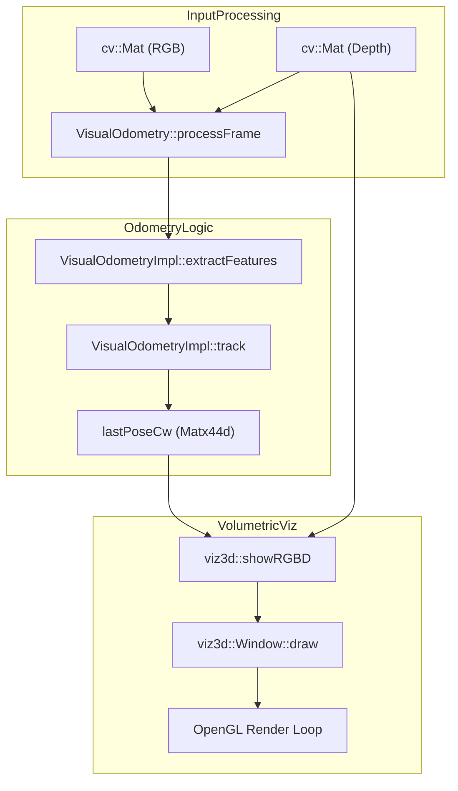

<!-- source: DeepWiki mcp.deepwiki.com · repo opencv/opencv · extra page RGB-D Odometry and TSDF/Volume Reconstruction · fetched 2026-10-30 -->

# RGB-D Odometry and TSDF/Volume Reconstruction

Relevant source files

The following files were used as context for generating this wiki page:

- [modules/highgui/cmake/detect_wayland.cmake](modules/highgui/cmake/detect_wayland.cmake)
- [modules/highgui/src/window_wayland.cpp](modules/highgui/src/window_wayland.cpp)
- [modules/highgui/test/test_gui.cpp](modules/highgui/test/test_gui.cpp)
- [modules/ptcloud/CMakeLists.txt](modules/ptcloud/CMakeLists.txt)
- [modules/ptcloud/include/opencv2/ptcloud.hpp](modules/ptcloud/include/opencv2/ptcloud.hpp)
- [modules/ptcloud/include/opencv2/ptcloud/viz3d.hpp](modules/ptcloud/include/opencv2/ptcloud/viz3d.hpp)
- [modules/ptcloud/src/viz3d/grid_ticks.hpp](modules/ptcloud/src/viz3d/grid_ticks.hpp)
- [modules/ptcloud/src/viz3d/viz3d.cpp](modules/ptcloud/src/viz3d/viz3d.cpp)
- [modules/ptcloud/src/viz3d/viz3d_private.hpp](modules/ptcloud/src/viz3d/viz3d_private.hpp)
- [modules/ptcloud/test/test_viz3d.cpp](modules/ptcloud/test/test_viz3d.cpp)
- [samples/data/rgbd-color.jpg](samples/data/rgbd-color.jpg)
- [samples/data/rgbd-depth.png](samples/data/rgbd-depth.png)

The `ptcloud` module provides high-level components for processing 3D data, focusing on RGB-D (Red-Green-Blue-Depth) processing and volumetric reconstruction. These components facilitate camera movement estimation (Odometry) and the integration of multiple depth observations into a unified 3D model using Truncated Signed Distance Fields (TSDF).

Sources: `[modules/ptcloud/include/opencv2/ptcloud.hpp:17-27]()`, `[modules/ptcloud/CMakeLists.txt:1-6]()`

---

## 1. RGB-D Odometry Frame Representation and Lifecycle

RGB-D Odometry in the `ptcloud` module estimates the relative transformation between successive frames using both intensity and depth information. The system relies on a structured representation of frames to manage keypoints, descriptors, and spatial data.

### Data Structures and Frame Handling
The core of the odometry pipeline is the `cv::slam::Frame` structure, which stores:
*   **Visual Data**: Original and grayscale images for feature extraction and optical flow fallback `[modules/ptcloud/src/slam/odometry/visual_odometry.cpp:101-115]`.
*   **Geometric Data**: Raw and undistorted keypoint coordinates `[modules/ptcloud/src/slam/odometry/visual_odometry.cpp:117-128]`.
*   **Spatial Mapping**: Associations between 2D keypoints and 3D map points `[modules/ptcloud/src/slam/odometry/visual_odometry.cpp:79-80]`.

### Odometry State Machine
The odometry lifecycle is managed by the `cv::slam::VisualOdometry` interface:
1.  **NOT_INITIALIZED**: The system awaits the first valid frame `[modules/ptcloud/src/slam/odometry/visual_odometry.cpp:85-88]`.
2.  **INITIALIZING**: Performs a bootstrap operation, requiring minimum parallax or map points to establish a reference frame `[modules/ptcloud/src/slam/odometry/visual_odometry.cpp:90-91]`.
3.  **TRACKING**: Estimates the current pose relative to the established map `[modules/ptcloud/src/slam/odometry/visual_odometry.cpp:93-94]`.

### Code Entity Mapping: Odometry

| Concept | Code Entity | File |
| :--- | :--- | :--- |
| **Odometry Engine** | `cv::slam::VisualOdometry` | `[modules/ptcloud/include/opencv2/ptcloud/slam/visual_odometry.hpp]()` |
| **Implementation** | `cv::slam::VisualOdometryImpl` | `[modules/ptcloud/src/slam/odometry/visual_odometry.cpp:37]()` |
| **Frame Container** | `cv::slam::Frame` | `[modules/ptcloud/src/slam/odometry/frame.hpp]()` |
| **State Tracking** | `cv::slam::OdometryState` | `[modules/ptcloud/include/opencv2/ptcloud/slam/types.hpp]()` |
| **Configuration** | `cv::slam::OdometryParams` | `[modules/ptcloud/include/opencv2/ptcloud/slam/odometry_params.hpp]()` |

Sources: `[modules/ptcloud/src/slam/odometry/visual_odometry.cpp:68-97]()`, `[modules/ptcloud/include/opencv2/ptcloud/slam/visual_odometry.hpp]()`

---

## 2. TSDF Volume Settings and Integration Patterns

Volumetric reconstruction in `ptcloud` integrates depth maps into a voxel grid using the Truncated Signed Distance Field (TSDF) algorithm, producing smooth, denoised surfaces from noisy depth sensor inputs.

### Integration Patterns
*   **Pose Estimation**: Camera poses are computed via RGB-D Odometry.
*   **Volume Updates**: Depth frames are integrated into the TSDF volume using estimated poses and truncation parameters.
*   **Surface Extraction**: Meshes or synthetic views are generated from the accumulated volume data.

Sources: `[modules/ptcloud/include/opencv2/ptcloud/volume.hpp]()`, `[modules/ptcloud/include/opencv2/ptcloud.hpp:17-27]()`

---

## 3. Visualization (`viz3d`) and Architecture Bridge

The `ptcloud` module includes a specialized 3D visualizer, `viz3d`, integrated with `highgui` for OpenGL context management `[modules/ptcloud/src/viz3d/viz3d_private.hpp:13]`.

### Architecture Components
*   **Window Management**: Creates windows with OpenGL contexts and registers callbacks for drawing and mouse events `[modules/ptcloud/src/viz3d/viz3d.cpp:38-55]`.
*   **Object Representation**: The `cv::viz3d::Object` base class handles 3D transformations and defines interfaces for `Mesh`, `PointCloud`, and `Lines` `[modules/ptcloud/src/viz3d/viz3d_private.hpp:67-91]`.
*   **Grid Rendering**: Automatically adjusts line spacing based on distance scale via `gridTickStep` `[modules/ptcloud/src/viz3d/grid_ticks.hpp:13-21]`.

### Code Entity Mapping: Visualization

| Feature | Code Entity | File |
| :--- | :--- | :--- |
| **RGB-D Display** | `cv::viz3d::showRGBD` | `[modules/ptcloud/include/opencv2/ptcloud/viz3d.hpp:151]()` |
| **Point Cloud Display** | `cv::viz3d::showPoints` | `[modules/ptcloud/include/opencv2/ptcloud/viz3d.hpp:138]()` |
| **Trajectory Display** | `cv::viz3d::showCameraTrajectory` | `[modules/ptcloud/include/opencv2/ptcloud/viz3d.hpp:98]()` |
| **Mesh Rendering** | `cv::viz3d::Mesh` | `[modules/ptcloud/src/viz3d/viz3d_private.hpp:129]()` |

Sources: `[modules/ptcloud/src/viz3d/viz3d.cpp:17-65]`, `[modules/ptcloud/src/viz3d/viz3d_private.hpp:129-157]`, `[modules/ptcloud/include/opencv2/ptcloud/viz3d.hpp:14-20]`

---

## 4. Pipeline Structure and Data Flow

The following diagram illustrates how input frames flow from `VisualOdometry` through pose estimation into the volumetric visualization pipeline using `viz3d`.

Diagram: Reconstruction Data Flow

Sources: `[modules/ptcloud/src/slam/odometry/visual_odometry.cpp:68-129]`, `[modules/ptcloud/src/viz3d/viz3d.cpp:49-65]`, `[modules/ptcloud/include/opencv2/ptcloud/viz3d.hpp:140-151]`

---

