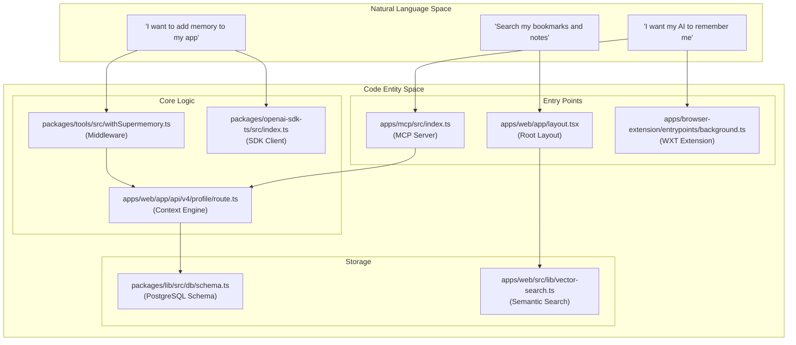
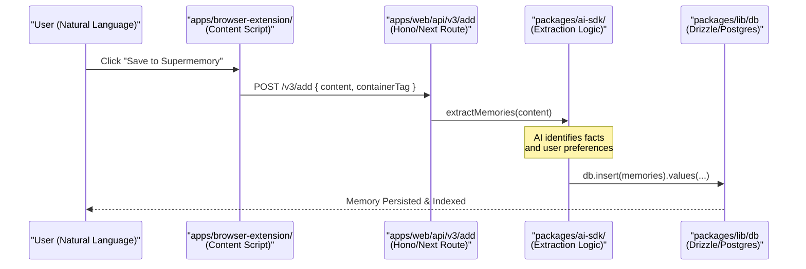

<!-- source: DeepWiki mcp.deepwiki.com · repo supermemoryai/supermemory · page 1 Overview · fetched 2026-10-30 -->

# Overview

Relevant source files

The following files were used as context for generating this wiki page:

- [.gitignore](.gitignore)
- [CONTRIBUTING.md](CONTRIBUTING.md)
- [README.md](README.md)
- [README.zh-CN.md](README.zh-CN.md)
- [apps/docs/cookbook/overview.mdx](apps/docs/cookbook/overview.mdx)
- [apps/docs/docs.json](apps/docs/docs.json)
- [apps/docs/integrations/claude-code.mdx](apps/docs/integrations/claude-code.mdx)
- [apps/docs/integrations/codex.mdx](apps/docs/integrations/codex.mdx)
- [apps/docs/integrations/openclaw.mdx](apps/docs/integrations/openclaw.mdx)
- [apps/docs/integrations/opencode.mdx](apps/docs/integrations/opencode.mdx)
- [apps/docs/integrations/supermemory-sdk.mdx](apps/docs/integrations/supermemory-sdk.mdx)
- [apps/docs/intro.mdx](apps/docs/intro.mdx)
- [apps/docs/memory-api/sdks/overview.mdx](apps/docs/memory-api/sdks/overview.mdx)
- [apps/docs/migration/from-mem0.mdx](apps/docs/migration/from-mem0.mdx)
- [apps/docs/migration/mem0-migration-script.py](apps/docs/migration/mem0-migration-script.py)
- [apps/docs/quickstart.mdx](apps/docs/quickstart.mdx)
- [apps/docs/self-hosting/configuration.mdx](apps/docs/self-hosting/configuration.mdx)
- [apps/docs/self-hosting/local-vs-enterprise.mdx](apps/docs/self-hosting/local-vs-enterprise.mdx)
- [apps/web/.gitignore](apps/web/.gitignore)
- [apps/web/app/global-error.tsx](apps/web/app/global-error.tsx)
- [apps/web/app/layout.tsx](apps/web/app/layout.tsx)
- [apps/web/package.json](apps/web/package.json)
- [apps/web/public/OG.png](apps/web/public/OG.png)
- [apps/web/tsconfig.json](apps/web/tsconfig.json)
- [apps/web/wrangler.jsonc](apps/web/wrangler.jsonc)
- [bun.lock](bun.lock)
- [package.json](package.json)
- [turbo.json](turbo.json)

Supermemory is a state-of-the-art memory and context engine for AI applications. It solves the "Goldfish Memory" problem where AI systems forget everything between sessions. It automatically extracts facts from conversations, builds evolving user profiles, resolves knowledge contradictions, and delivers relevant context on demand. The system ranks #1 on **LongMemEval**, **LoCoMo**, and **ConvoMem** — the three major benchmarks for AI memory evaluation. [README.md:33-40]()

**Who it's for:**
- **AI Users**: Get persistent memory across Claude Desktop, Cursor, Windsurf, and VS Code via the MCP server (`apps/mcp/`) and browser extension (`apps/browser-extension/`). [README.md:102-106](), [README.md:160-163]()
- **AI Builders**: Add memory, RAG, user profiles, and connectors to agents via the REST API, TypeScript/Python SDKs, or `@supermemory/tools` middleware. [README.md:73-79](), [apps/docs/quickstart.mdx:21-36]()

This page maps the major components of the codebase at a high level. Detailed coverage is split across child pages:

| Section | Covers |
|---------|--------|
| [System Architecture](#1.1) | Component diagrams, data flow, and deployment topology. |
| [Core Features](#1.2) | Memory extraction, user profiles, hybrid search, and connectors. |
| [Monorepo Structure](#1.3) | Workspace layout, Turbo task orchestration, and package roles. |

## High-Level System Map

Supermemory is organized as a monorepo using **Turbo** (`turbo@2.5.4`) and **Bun** (`bun@1.3.6`). [package.json:16-64]()

### Bridge: Natural Language to Code Entities
The following diagram associates high-level system concepts with the specific code entities that implement them.

Sources: [package.json:17-22](), [apps/web/package.json:22-118](), [apps/mcp/package.json:86-108](), [CONTRIBUTING.md:58-83]()

## Core Components

The repository is divided into applications (`apps/`) and shared logic (`packages/`). [package.json:17-22]()

### Applications
- **Web Application** (`apps/web/`): A Next.js 16 application deployed to Cloudflare via `opennextjs-cloudflare`. It provides the dashboard, chat interface (Nova), and memory management. [apps/web/package.json:9-18](), [apps/web/app/layout.tsx:83-115]()
- **MCP Server** (`apps/mcp/`): Implements the Model Context Protocol, allowing tools like Cursor or Claude Desktop to call `memory()` and `recall()` tools. [apps/mcp/package.json:86-98](), [README.md:131-139]()
- **Browser Extension** (`apps/browser-extension/`): A WXT-based extension for capturing web content and importing Twitter bookmarks. [apps/browser-extension/package.json:53-74]()
- **Memory Graph Playground** (`apps/memory-graph-playground/`): A demo for the `@supermemory/memory-graph` visualization package. [apps/memory-graph-playground/package.json:110-118]()

### Major Packages
- **@supermemory/tools** (`packages/tools/`): Provides the `withSupermemory` higher-order function to wrap LLM calls with memory injection. [CONTRIBUTING.md:74]()
- **Memory Graph** (`packages/memory-graph/`): A React component library for visualizing knowledge relationships. [apps/web/package.json:56]()
- **Shared Libraries**: Includes `@repo/lib` (utilities), `@repo/ui` (Shadcn/Tailwind components), and `@repo/validation` (Zod schemas). [apps/web/package.json:53-54](), [CONTRIBUTING.md:69-73]()

## Technical Stack & Infrastructure

Supermemory leverages a modern, high-performance stack optimized for edge deployment and AI orchestration.

| Layer | Technology | Code Reference |
|-------|------------|----------------|
| **Runtime** | Bun & Cloudflare Workers | [package.json:16](), [apps/mcp/package.json:100]() |
| **Framework** | Next.js 16 (App Router) & React 19 | [apps/web/package.json:95-102]() |
| **Database** | PostgreSQL + Drizzle ORM | [package.json:44-52]() |
| **AI Orchestration** | Vercel AI SDK (`ai`) | [package.json:35](), [apps/web/package.json:77]() |
| **Styling** | Tailwind CSS 4 & Radix UI | [apps/web/package.json:129](), [apps/web/package.json:35-49]() |
| **Observability** | Sentry & PostHog | [apps/web/package.json:55](), [apps/web/package.json:99]() |

### Data Flow Architecture
The following diagram bridges the "Natural Language" intent of saving a memory to the "Code Entity" flow that persists it.

Sources: [README.md:143-148](), [apps/docs/quickstart.mdx:116-120](), [apps/docs/intro.mdx:21-23]()

## Development Orchestration

The monorepo uses `turbo` to manage tasks across all workspaces. [package.json:4-11]()

- **Build Pipeline**: `turbo run build` handles dependencies between `@repo/lib` and `apps/web`. [package.json:5]()
- **Type Safety**: `turbo run check-types` ensures consistency across the TypeScript 5.8.3 codebase. [package.json:9](), [package.json:65]()
- **Code Quality**: **Biome** (`@biomejs/biome@2.2.0`) is used for unified linting and formatting instead of ESLint/Prettier. [package.json:59](), [package.json:8]()
- **Error Tracking**: A `postbuild` hook automatically triggers `sentry-cli` to upload source maps for the `consumer-app` project. [package.json:10-11]()

Sources: [package.json:1-67](), [CONTRIBUTING.md:85-109]()

---

