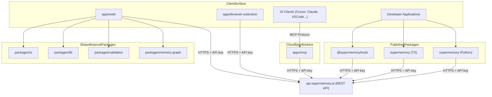
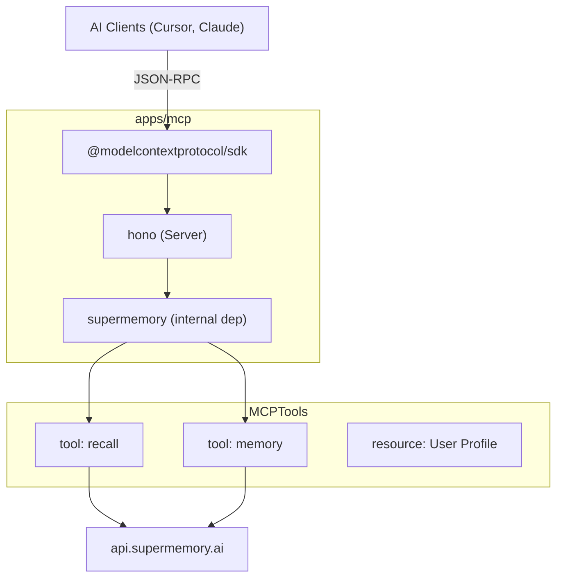
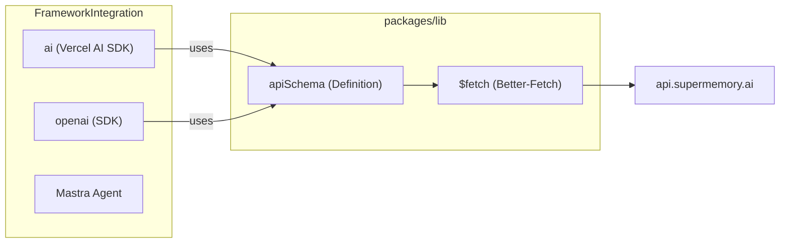

<!-- source: DeepWiki mcp.deepwiki.com · repo supermemoryai/supermemory · page 1.1 System Architecture · fetched 2026-10-30 -->

# System Architecture

Relevant source files

The following files were used as context for generating this wiki page:

- [.gitignore](.gitignore)
- [CONTRIBUTING.md](CONTRIBUTING.md)
- [README.md](README.md)
- [README.zh-CN.md](README.zh-CN.md)
- [apps/docs/cookbook/overview.mdx](apps/docs/cookbook/overview.mdx)
- [apps/docs/memory-api/sdks/overview.mdx](apps/docs/memory-api/sdks/overview.mdx)
- [apps/docs/migration/from-mem0.mdx](apps/docs/migration/from-mem0.mdx)
- [apps/docs/migration/mem0-migration-script.py](apps/docs/migration/mem0-migration-script.py)
- [apps/web/.gitignore](apps/web/.gitignore)
- [apps/web/app/global-error.tsx](apps/web/app/global-error.tsx)
- [apps/web/app/layout.tsx](apps/web/app/layout.tsx)
- [apps/web/hooks/use-container-tags.ts](apps/web/hooks/use-container-tags.ts)
- [apps/web/hooks/use-project-mutations.ts](apps/web/hooks/use-project-mutations.ts)
- [apps/web/package.json](apps/web/package.json)
- [apps/web/public/OG.png](apps/web/public/OG.png)
- [apps/web/stores/index.ts](apps/web/stores/index.ts)
- [apps/web/tsconfig.json](apps/web/tsconfig.json)
- [apps/web/wrangler.jsonc](apps/web/wrangler.jsonc)
- [bun.lock](bun.lock)
- [package.json](package.json)
- [packages/lib/api.ts](packages/lib/api.ts)
- [packages/lib/types.ts](packages/lib/types.ts)
- [packages/validation/api.ts](packages/validation/api.ts)
- [turbo.json](turbo.json)

This page describes the overall structure of the supermemory monorepo: what the major components are, how they relate to each other, and how data flows between them. It covers `apps/web`, `apps/mcp`, `apps/browser-extension`, the published SDK packages, shared internal packages, and the backend API they all communicate with.

For monorepo workspace configuration and build orchestration details, see [1.3](). For a summary of the capabilities each component exposes, see [1.2]().

---

## Component Summary

The monorepo is structured as a Bun workspace with two top-level groups, `apps/*` and `packages/*`, as defined in [package.json:17-22](). The table below maps each deployable component to its directory, runtime, and public endpoint.

| Component | Directory | Runtime | Public Endpoint |
|---|---|---|---|
| Web Application | `apps/web` | Cloudflare Pages (via `opennextjs-cloudflare`) | `app.supermemory.ai` |
| MCP Server | `apps/mcp` | Cloudflare Workers + DurableObjects | `mcp.supermemory.ai/mcp` |
| Browser Extension | `apps/browser-extension` | Chrome / Firefox (WXT-based) | — |
| Memory Graph Playground | `apps/memory-graph-playground` | Next.js | — |
| Docs Site | `apps/docs` | Static (Mintlify) | `supermemory.ai/docs` |
| Backend API | (external service) | — | `api.supermemory.ai` |
| TypeScript SDK | `packages/openai-sdk-ts` | npm (`supermemory`) | — |
| Python SDK | `packages/openai-sdk-python` | PyPI (`supermemory`) | — |
| AI Tools Package | `packages/tools` | npm (`@supermemory/tools`) | — |
| Memory Graph Component | `packages/memory-graph` | React/WebGL | — |

Sources: [package.json:17-22](), [CONTRIBUTING.md:63-79](), [apps/web/package.json:15-17](), [apps/mcp/package.json:86-108](), [apps/memory-graph-playground/package.json:110-118]()

---

## Architecture Overview

The following diagram shows the runtime components and the communication paths between them. All client-facing components call `api.supermemory.ai` over HTTPS. The MCP server acts as a protocol adapter between AI clients speaking the Model Context Protocol and the REST backend API.

**Top-level component and communication diagram**

Sources: [package.json:17-22](), [README.md:102-140](), [CONTRIBUTING.md:63-79]()

---

## Web Application (`apps/web`)

`apps/web` is a Next.js 16 application deployed to Cloudflare Pages via `opennextjs-cloudflare` [apps/web/package.json:34](). It is the primary consumer-facing UI, accessible at `app.supermemory.ai`.

All HTTP calls to the backend are authenticated and typically use the `Authorization: Bearer <api_key>` pattern. The web app integrates various AI models through `@ai-sdk/google`, `@ai-sdk/react`, and `@ai-sdk/xai` [apps/web/package.json:23-25]().

**Key responsibilities:**
- Memory and document CRUD, displayed in a masonry grid via `masonic` [apps/web/package.json:93]().
- Chat interface (Nova agent) using the Vercel AI SDK [apps/web/package.json:77]().
- Knowledge visualization using the internal `@supermemory/memory-graph` package [apps/web/package.json:56]().
- Connector management (Google Drive, Notion, OneDrive, GitHub) via `$fetch` wrapper using `apiSchema` [packages/lib/api.ts:59-167]().
- User onboarding and profile management.

**Client-side state** uses `zustand` for local stores [apps/web/package.json:117]() and TanStack Query (`@tanstack/react-query`) for server state [apps/web/package.json:59](). Authentication is handled by `better-auth` [package.json:38]().

**Build and deployment scripts** are defined in [apps/web/package.json:9-21]():

| Script | Command |
|---|---|
| `dev` | `next dev` |
| `build` | `next build` |
| `preview` | `opennextjs-cloudflare build && opennextjs-cloudflare preview` |
| `deploy` | `opennextjs-cloudflare build && opennextjs-cloudflare deploy` |
| `cf-typegen` | `wrangler types --env-interface CloudflareEnv cloudflare-env.d.ts` |

Sources: [apps/web/package.json:1-137](), [apps/web/app/layout.tsx:1-115](), [packages/lib/api.ts:59-167]()

---

## MCP Server (`apps/mcp`)

`apps/mcp` is a Cloudflare Worker that implements the [Model Context Protocol](https://modelcontextprotocol.io). It bridges AI clients (Cursor, Claude Desktop, VS Code, etc.) to the Supermemory REST API.

**MCP server code entity map**

The MCP server uses `hono` for request handling [apps/mcp/package.json:94]() and the `@modelcontextprotocol/sdk` [apps/mcp/package.json:92](). It allows AI assistants to automatically call `memory` to save facts and `recall` to search memories [README.md:143-148]().

Sources: [apps/mcp/package.json:86-108](), [README.md:131-177]()

---

## AI Tools and SDKs

The repository provides multiple entry points for developers to integrate memory into AI applications. The core logic for these integrations is centralized in `packages/lib/api.ts`, which defines the `apiSchema` using `@better-fetch/fetch` [packages/lib/api.ts:1-59]().

**SDK and tools integration map**

The system uses `containerTags` to scope memories and profiles, allowing developers to separate work and personal context [README.md:157-158](). Scoped API keys can be managed via the `@post/auth/scoped-key` endpoint defined in the API schema.

Sources: [packages/lib/api.ts:1-270](), [README.md:141-158](), [CONTRIBUTING.md:73-77]()

---

## Shared Packages

Shared internal packages provide the foundation for the applications in the monorepo.

| Package | Contents |
|---|---|
| `packages/ui` | Shared Shadcn UI components and Tailwind configuration [CONTRIBUTING.md:70](). |
| `packages/lib` | Shared utilities, API client logic (`apiSchema`), and auth context [CONTRIBUTING.md:71](). |
| `packages/validation` | Zod schemas for shared data structures and API validation [CONTRIBUTING.md:73](). |
| `packages/memory-graph` | React component for knowledge graph visualization [apps/web/package.json:56](). |

The monorepo uses `turbo` to orchestrate tasks across these packages, ensuring that dependencies are built in the correct order [turbo.json:1-25]().

Sources: [CONTRIBUTING.md:63-79](), [package.json:17-22](), [turbo.json:1-25]()

---

