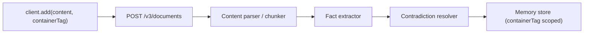
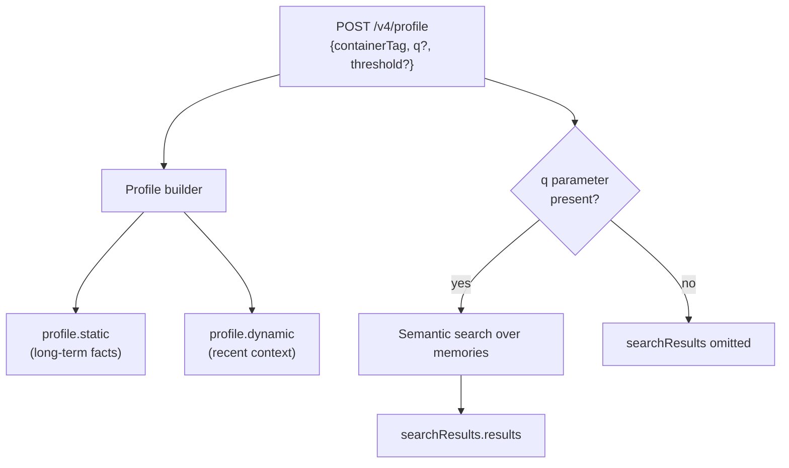
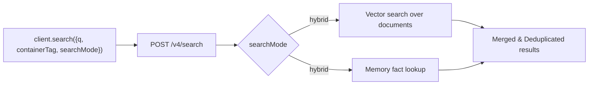
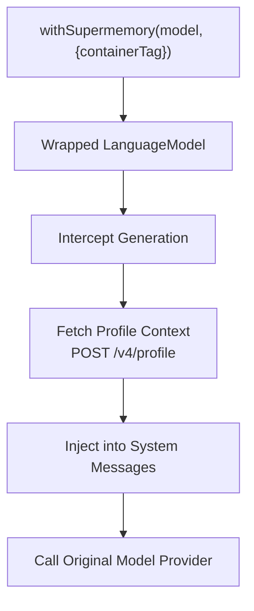

<!-- source: DeepWiki mcp.deepwiki.com · repo supermemoryai/supermemory · page 1.2 Core Features · fetched 2026-10-30 -->

# Core Features

<details>
<summary>Relevant source files</summary>

The following files were used as context for generating this wiki page:

- [CONTRIBUTING.md](CONTRIBUTING.md)
- [README.md](README.md)
- [README.zh-CN.md](README.zh-CN.md)
- [apps/docs/add-memories.mdx](apps/docs/add-memories.mdx)
- [apps/docs/concepts/customization.mdx](apps/docs/concepts/customization.mdx)
- [apps/docs/cookbook/overview.mdx](apps/docs/cookbook/overview.mdx)
- [apps/docs/docs.json](apps/docs/docs.json)
- [apps/docs/images/memory-graph.png](apps/docs/images/memory-graph.png)
- [apps/docs/install.md](apps/docs/install.md)
- [apps/docs/integrations/claude-code.mdx](apps/docs/integrations/claude-code.mdx)
- [apps/docs/integrations/codex.mdx](apps/docs/integrations/codex.mdx)
- [apps/docs/integrations/openclaw.mdx](apps/docs/integrations/openclaw.mdx)
- [apps/docs/integrations/opencode.mdx](apps/docs/integrations/opencode.mdx)
- [apps/docs/integrations/supermemory-sdk.mdx](apps/docs/integrations/supermemory-sdk.mdx)
- [apps/docs/intro.mdx](apps/docs/intro.mdx)
- [apps/docs/memory-api/sdks/overview.mdx](apps/docs/memory-api/sdks/overview.mdx)
- [apps/docs/migration/from-mem0.mdx](apps/docs/migration/from-mem0.mdx)
- [apps/docs/migration/mem0-migration-script.py](apps/docs/migration/mem0-migration-script.py)
- [apps/docs/quickstart.mdx](apps/docs/quickstart.mdx)
- [apps/docs/self-hosting/configuration.mdx](apps/docs/self-hosting/configuration.mdx)
- [apps/docs/self-hosting/local-vs-enterprise.mdx](apps/docs/self-hosting/local-vs-enterprise.mdx)
- [apps/docs/test.py](apps/docs/test.py)
- [apps/docs/test.ts](apps/docs/test.ts)
- [apps/docs/user-profiles.mdx](apps/docs/user-profiles.mdx)
- [apps/docs/user-profiles/api.mdx](apps/docs/user-profiles/api.mdx)
- [apps/docs/user-profiles/examples.mdx](apps/docs/user-profiles/examples.mdx)
- [apps/docs/vibe-coding.mdx](apps/docs/vibe-coding.mdx)
- [packages/docs-test/tests/integrations/ai-sdk.ts](packages/docs-test/tests/integrations/ai-sdk.ts)
- [turbo.json](turbo.json)

</details>


This page summarizes the key capabilities that supermemory exposes across its components. It describes what each feature does and which code entities implement it, without going deep into any single component's internals. For architecture and component relationships, see [System Architecture](#1.1). For monorepo layout and package roles, see [Monorepo Structure](#1.3).

---

## Overview

Supermemory provides a unified context and memory layer for AI applications. Its features span the REST API, TypeScript/Python SDKs, the `@supermemory/tools` middleware package, an MCP server, and a browser extension. All features are built around a single memory ontology indexed under **container tags** — string identifiers that scope memories and profiles to a user, project, or session. [README.md:156-157](), [apps/docs/intro.mdx:72-74](), [apps/docs/install.md:60-61]()

**Feature summary:**

| Feature | What it does | Primary entry point |
|---|---|---|
| Memory extraction | Extracts and stores facts from conversations | `client.add()` / `POST /v3/documents` |
| User profiles | Auto-maintained static + dynamic user context | `client.profile()` / `POST /v4/profile` |
| Hybrid search | RAG + memory retrieval in one query | `client.search()` / `POST /v4/search` |
| Connectors | OAuth sync from Drive, Gmail, Notion, GitHub, etc. | `POST /v3/connections/{provider}` |
| MCP server | Tool-based memory for AI coding clients | `mcp.supermemory.ai/mcp` |
| SDK middleware | Drop-in memory for Vercel AI SDK, Mastra, etc. | `withSupermemory()` in `@supermemory/tools` |
| File processing | PDFs, images, video, code → searchable chunks | `client.documents.uploadFile()` |
| SMFS | Virtual filesystem for agentic memory access | `curl -fsSL https://supermemory.ai/install` |

Sources: [README.md:36-47](), [apps/docs/intro.mdx:9-13](), [apps/docs/install.md:124-130](), [apps/docs/docs.json:160-165]()

---

## Memory Extraction

The core function of supermemory is converting raw conversations or text into structured, queryable facts. When content is submitted via `client.add()` or `POST /v3/documents`, the backend extracts discrete facts and preferences, resolves contradictions, and handles temporal expiry. [README.md:32-34](), [apps/docs/add-memories.mdx:8-9]()

Content types accepted include plain text, conversation transcripts, URLs, PDFs, images (OCR), video (transcription), and code (AST-aware chunking). [README.md:47-47](), [apps/docs/add-memories.mdx:181-189]()

**Memory submission flow:**



Sources: [apps/docs/add-memories.mdx:24-28](), [apps/docs/add-memories.mdx:196-205](), [apps/docs/intro.mdx:21-23]()

---

## User Profiles (Static and Dynamic)

The profile feature auto-maintains two classes of user context without requiring explicit queries. This is implemented via the `POST /v4/profile` endpoint. [apps/docs/intro.mdx:50-52](), [apps/docs/install.md:221-224]()

- **`profile.static`**: Long-term, stable facts about the user (e.g., information that the agent should **always** know). [apps/docs/intro.mdx:55-55](), [apps/docs/quickstart.mdx:61-62]()
- **`profile.dynamic`**: Recent context and episodic information (e.g., recent conversations or current tasks). [apps/docs/intro.mdx:56-56](), [apps/docs/quickstart.mdx:64-65]()

The profile can be retrieved standalone or combined with semantic search results by providing a `q` parameter. [apps/docs/quickstart.mdx:95-99](), [apps/docs/install.md:31-32]()

**Profile API response shape:**

```json
{
  "profile": {
    "static": ["User is a software engineer", "Prefers dark mode"],
    "dynamic": ["Working on Project Alpha", "Learning Rust"]
  },
  "searchResults": {
    "results": [...],
    "total": 15
  }
}
```

**Profile endpoint data flow:**



Sources: [apps/docs/quickstart.mdx:54-68](), [apps/docs/intro.mdx:50-58](), [apps/docs/install.md:132-136]()

---

## Hybrid Search and RAG

Supermemory provides hybrid search capabilities that combine traditional RAG (document chunks) with personalized memory context. [README.md:45-45]()

- **Search Modes**: The API supports `hybrid` mode which searches both memories and document chunks. [apps/docs/install.md:166-170](), [apps/docs/install.md:230-230]()
- **Metadata Filtering**: Supports advanced metadata filtering for precise retrieval. [apps/docs/intro.mdx:63-63](), [apps/docs/add-memories.mdx:201-202]()

**Search call path:**



Sources: [apps/docs/intro.mdx:60-66](), [apps/docs/install.md:166-172](), [apps/docs/install.md:227-231]()

---

## Connectors

Connectors sync external data sources into the supermemory index automatically using real-time webhooks where supported. [README.md:46-46]()

| Provider | Sync Type |
|---|---|
| Google Drive | OAuth + Auto-sync |
| Gmail | OAuth + Auto-sync |
| Notion | OAuth + Auto-sync |
| OneDrive | OAuth + Auto-sync |
| GitHub | OAuth + Webhooks |
| Web Crawler | URL-based ingestion |

Sources: [README.md:46-46](), [apps/docs/docs.json:119-127]()

---

## MCP Integration

The MCP server (`apps/mcp`) implements the Model Context Protocol, exposing supermemory as tools for AI clients like Claude Desktop, Cursor, and VS Code. [README.md:104-105](), [README.md:139-140]()

**Registered MCP tools:** [README.md:143-148]()
- `memory`: Save or forget information.
- `recall`: Search memories by query.
- `context`: Injects full profile (preferences, recent activity) into the conversation.

Sources: [README.md:133-134](), [README.md:141-148]()

---

## SMFS (Supermemory Filesystem)

SMFS allows AI agents to interact with memory as if it were a local filesystem. This is particularly useful for agents running in sandboxed environments like E2B or Daytona. [apps/docs/docs.json:160-165]()

- **Mount**: Mounts a container as a directory using NFSv3 or FUSE. [apps/docs/docs.json:165-165]()
- **Bash Tool**: A programmatic interface for agents to execute shell commands against memory. [apps/docs/docs.json:166-167]()

Sources: [apps/docs/docs.json:160-180](), [README.md:91-91]()

---

## SDK and Middleware Support

### TypeScript/Python SDKs
Official SDKs provide typed wrappers for the REST API, including `client.add`, `client.profile`, and `client.search`. [apps/docs/quickstart.mdx:43-45](), [apps/docs/quickstart.mdx:84-86]()

### AI SDK Middleware
The `@supermemory/tools` package provides `withSupermemory`, a higher-order function that wraps models from the Vercel AI SDK. [apps/docs/install.md:111-112]()

**Middleware logic:**
1. **Intercepts** LLM calls. [apps/docs/install.md:121-121]()
2. **Fetches** user profile context automatically. [apps/docs/install.md:111-115]()
3. **Injects** data into the context window. [apps/docs/install.md:121-121]()

**Middleware data flow:**



Sources: [apps/docs/install.md:93-122](), [apps/docs/vibe-coding.mdx:182-194]()

---

