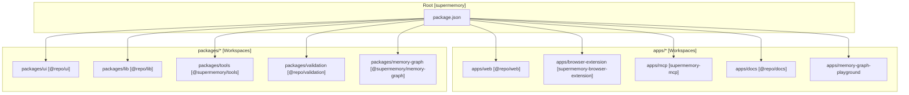
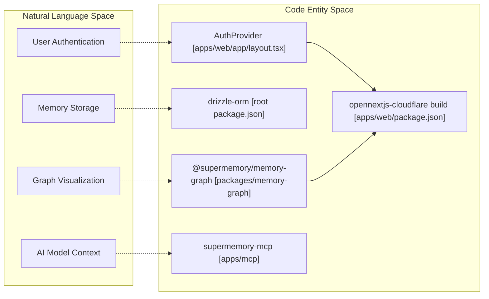
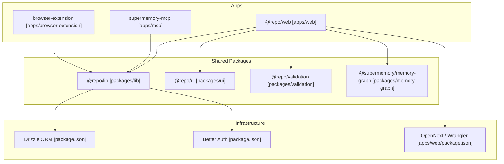
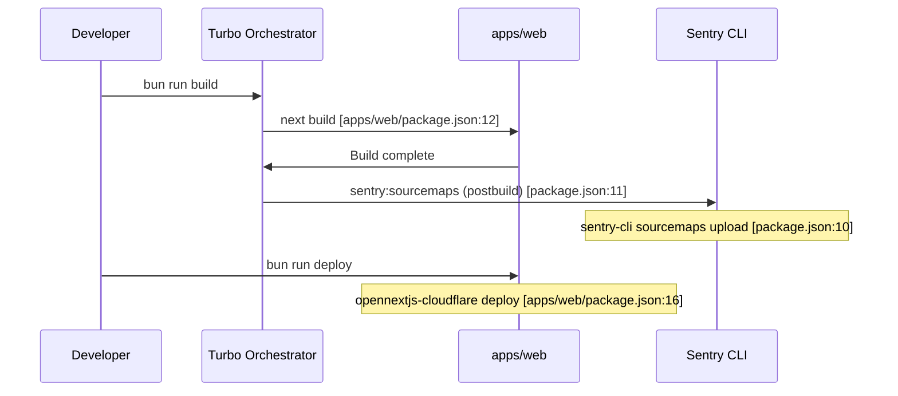

<!-- source: DeepWiki mcp.deepwiki.com · repo supermemoryai/supermemory · page 1.3 Monorepo Structure · fetched 2026-10-30 -->

# Monorepo Structure

<details>
<summary>Relevant source files</summary>

The following files were used as context for generating this wiki page:

- [.gitignore](.gitignore)
- [CONTRIBUTING.md](CONTRIBUTING.md)
- [README.md](README.md)
- [README.zh-CN.md](README.zh-CN.md)
- [apps/browser-extension/utils/posthog.ts](apps/browser-extension/utils/posthog.ts)
- [apps/docs/cookbook/overview.mdx](apps/docs/cookbook/overview.mdx)
- [apps/docs/memory-api/sdks/overview.mdx](apps/docs/memory-api/sdks/overview.mdx)
- [apps/docs/migration/from-mem0.mdx](apps/docs/migration/from-mem0.mdx)
- [apps/docs/migration/mem0-migration-script.py](apps/docs/migration/mem0-migration-script.py)
- [apps/docs/package.json](apps/docs/package.json)
- [apps/memory-graph-playground/package.json](apps/memory-graph-playground/package.json)
- [apps/web/.gitignore](apps/web/.gitignore)
- [apps/web/app/global-error.tsx](apps/web/app/global-error.tsx)
- [apps/web/app/layout.tsx](apps/web/app/layout.tsx)
- [apps/web/package.json](apps/web/package.json)
- [apps/web/public/OG.png](apps/web/public/OG.png)
- [apps/web/tsconfig.json](apps/web/tsconfig.json)
- [apps/web/wrangler.jsonc](apps/web/wrangler.jsonc)
- [bun.lock](bun.lock)
- [package.json](package.json)
- [packages/docs-test/package.json](packages/docs-test/package.json)
- [packages/tools/test/chatapp/package.json](packages/tools/test/chatapp/package.json)
- [portless.json](portless.json)
- [turbo.json](turbo.json)

</details>


This document describes the organization of the Supermemory codebase as a Turborepo monorepo, including workspace structure, package management with Bun, shared packages, build orchestration, and dependency relationships between workspaces.

## Overview

Supermemory is organized as a monorepo using Turbo for build orchestration and Bun as the primary package manager [package.json:1-66](). The repository contains multiple applications (`apps/*`) and shared packages (`packages/*`) that enable code reuse across the platform, from the Next.js web application to the browser extension and Model Context Protocol (MCP) server.

**Sources:** [package.json:1-70](), [README.md:1-120]()

## Workspace Organization

The monorepo uses Bun workspaces to manage multiple packages within a single repository. Workspaces are defined in the root `package.json` [package.json:16-21]():

### Monorepo Workspace Map



The workspace configuration explicitly excludes certain directories to avoid dependency conflicts or because they have independent build processes [package.json:18-20]():
- `!apps/raycast-extension`: Managed separately for the Raycast store.
- `!tools/test/chatapp`: Internal testing sandbox.

**Sources:** [package.json:16-21](), [bun.lock:4-127](), [CONTRIBUTING.md:58-81]()

## Package Manager: Bun

The project uses Bun as the package manager, specified in `package.json` [package.json:15-16]():

| Configuration | Value |
|---------------|-------|
| Package Manager | `bun@1.3.6` [package.json:16]() |
| Node Version Requirement | `>=20` [package.json:14]() |
| Lockfile | `bun.lock` |

Bun provides fast dependency installation and native TypeScript execution. The lockfile format tracks all workspace dependencies and their versions across the entire tree [bun.lock:1-41]().

**Sources:** [package.json:12-16](), [bun.lock:1-52](), [CONTRIBUTING.md:9-11]()

## Build System: Turbo

Turbo orchestrates builds across the monorepo, enabling parallel execution and intelligent caching. The root `package.json` defines workspace-level scripts that delegate to `turbo` [package.json:4-11]():

```json
{
  "scripts": {
    "build": "turbo run build",
    "dev": "turbo run dev",
    "check-types": "turbo run check-types"
  }
}
```

### Task Orchestration

Task behavior is defined in `turbo.json`, which configures task dependencies and cache outputs [turbo.json:1-25]().

1. **Build Dependencies**: The `build` task depends on the build of upstream workspaces (`^build`) [turbo.json:6]().
2. **Input Tracking**: Turbo tracks `.env` files and default inputs to determine cache hits [turbo.json:7]().
3. **Caching**: Build outputs for Next.js apps are stored in `.next/**`, excluding the cache directory [turbo.json:8]().
4. **Persistent Tasks**: Development tasks like `dev` and `dev:app` are marked as persistent and do not use the cache [turbo.json:16-23]().

**Sources:** [package.json:4-11](), [turbo.json:1-25](), [.gitignore:21-22]()

## Shared Root Dependencies

The root `package.json` contains shared dependencies hoisted to the monorepo level. This includes major AI SDKs and infrastructure tools used by multiple packages [package.json:23-57]():

### Infrastructure & Tooling Matrix

| Category | Key Code Entities / Packages |
|----------|---------------------------|
| **AI Providers** | `@ai-sdk/anthropic`, `@ai-sdk/google`, `@ai-sdk/openai`, `ai` [package.json:24-35]() |
| **Database** | `drizzle-orm`, `pg`, `postgres`, `drizzle-zod` [package.json:44-52]() |
| **Auth & API** | `better-auth`, `hono-openapi`, `zod-openapi` [package.json:38-56]() |
| **Build/Lint** | `typescript@5.8.3`, `@biomejs/biome@2.2.0`, `turbo@2.5.4`, `wrangler` [package.json:59-66]() |

**Sources:** [package.json:23-67]()

## Shared Packages

### packages/ui (@repo/ui)
Provides shared UI components built on Radix UI primitives with Tailwind CSS styling. It is imported by apps and other packages to maintain visual consistency [apps/web/tsconfig.json:7-8]().

### packages/lib (@repo/lib)
Contains shared business logic, utility functions, and custom hooks. It is imported by `apps/web` via workspace linking [apps/web/package.json:53]() and configured in path aliases [apps/web/tsconfig.json:9]().

### packages/tools (@supermemory/tools)
The core package for AI middleware. It provides drop-in tools for search and memory injection for frameworks like Vercel AI SDK [README.md:143-148]().

### packages/memory-graph (@supermemory/memory-graph)
A specialized package for knowledge graph visualization using D3-force [apps/web/package.json:56](), [apps/web/package.json:82](). It is demonstrated in the `apps/memory-graph-playground` [apps/memory-graph-playground/package.json:13]().

**Sources:** [CONTRIBUTING.md:67-77](), [apps/web/package.json:53-56](), [apps/web/tsconfig.json:5-11](), [apps/memory-graph-playground/package.json:12-17]()

## Application Packages

### apps/web (@repo/web)
The primary Next.js consumer application. It is deployed to Cloudflare Workers using `@opennextjs/cloudflare` [apps/web/package.json:34](). It depends on several internal workspaces including `@repo/lib`, `@repo/validation`, and `@supermemory/memory-graph` [apps/web/package.json:53-56]().

### apps/mcp (supermemory-mcp)
The Model Context Protocol server implementation. It enables AI clients like Claude Desktop or Cursor to access Supermemory tools [README.md:131-139](). It depends on the `supermemory` package [bun.lock:96]().

### apps/browser-extension (supermemory-browser-extension)
A WXT-based extension [bun.lock:72](). It uses `@tanstack/react-query` for state management and `posthog-js` for analytics [bun.lock:58-59]().

**Sources:** [apps/web/package.json:1-137](), [bun.lock:53-109](), [README.md:102-140]()

## Dependency Flow & Code Associations

The following diagrams bridge the high-level architecture to specific code entities and workspace relationships.

### System Entity Mapping



### Component Relationship Diagram



**Sources:** [apps/web/app/layout.tsx:5](), [package.json:44](), [apps/web/package.json:15-17](), [bun.lock:87](), [apps/web/package.json:53-56](), [apps/web/tsconfig.json:5-11]()

## Deployment & CI/CD Orchestration

Deployment is handled via workspace-specific scripts coordinated by the root build task [package.json:5]().

### Deployment Flow



**Sources:** [package.json:5-11](), [apps/web/package.json:9-21](), [CONTRIBUTING.md:103-109]()

---

