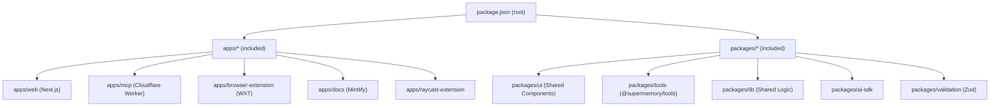
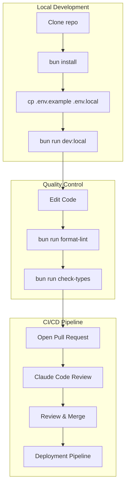

<!-- source: DeepWiki mcp.deepwiki.com · repo supermemoryai/supermemory · page 10 Development Guide · fetched 2026-10-30 -->

# Development Guide

Relevant source files

The following files were used as context for generating this wiki page:

- [.github/workflows/ci.yml](.github/workflows/ci.yml)
- [.github/workflows/claude-auto-fix-ci.yml](.github/workflows/claude-auto-fix-ci.yml)
- [.github/workflows/claude-code-review.yml](.github/workflows/claude-code-review.yml)
- [.github/workflows/claude.yml](.github/workflows/claude.yml)
- [CONTRIBUTING.md](CONTRIBUTING.md)
- [README.md](README.md)
- [README.zh-CN.md](README.zh-CN.md)
- [apps/docs/cookbook/overview.mdx](apps/docs/cookbook/overview.mdx)
- [apps/docs/memory-api/sdks/overview.mdx](apps/docs/memory-api/sdks/overview.mdx)
- [apps/docs/migration/from-mem0.mdx](apps/docs/migration/from-mem0.mdx)
- [apps/docs/migration/mem0-migration-script.py](apps/docs/migration/mem0-migration-script.py)
- [turbo.json](turbo.json)

This section covers everything needed to work on the supermemory codebase as a contributor or internal developer. It spans local environment setup, the build system, code quality tooling, deployment pipelines, and contribution workflows.

This page gives a high-level orientation. Detailed information is in the child pages:

- Environment setup → [Local Development Setup](#10.1)
- Build orchestration → [Build System & Turbo](#10.2)
- Linting, formatting, and tests → [Code Quality & Testing](#10.3)
- Cloudflare and CI/CD deployment → [Deployment & CI/CD](#10.4)
- Branching, PRs, and code style → [Contributing Guidelines](#10.5)

For information on the overall monorepo layout (apps, packages, workspace relationships), see [Monorepo Structure](#1.3).

---

## Toolchain at a Glance

The project uses a consistent set of modern tools across all workspaces to ensure high performance and developer velocity:

| Tool | Version | Role |
|---|---|---|
| **Bun** | `>=1.2.17` | Primary package manager and runtime [CONTRIBUTING.md:11]() |
| **Node.js** | `>=20` | Required runtime floor |
| **Turbo** | `^2.x` | Task orchestration and build caching [CONTRIBUTING.md:60]() |
| **Biome** | `^1.x` | Linter and formatter (replacing ESLint/Prettier) [CONTRIBUTING.md:99]() |
| **TypeScript** | `^5.x` | Static typing for all new code [CONTRIBUTING.md:166]() |
| **Next.js** | `15` | Web application framework [CONTRIBUTING.md:113]() |
| **React** | `19` | UI Library [CONTRIBUTING.md:113]() |

Sources: [CONTRIBUTING.md:11-13](), [CONTRIBUTING.md:60-118]()

---

## Workspace Layout

**Monorepo workspace configuration** — how Bun and Turbo see the project:

The monorepo structure allows for shared logic across different surfaces (web, extension, MCP) while maintaining clear boundaries [CONTRIBUTING.md:60-83]().

Sources: [CONTRIBUTING.md:60-83]()

---

## Root-Level Scripts

All primary workflows run from the repository root using `bun run <script>`:

| Script | Command | Description |
|---|---|---|
| `dev:local` | `bun run dev:local` | Start dev servers on plain localhost ports [CONTRIBUTING.md:89]() |
| `dev` | `bun run dev` | Start dev servers through portless (internal team) [CONTRIBUTING.md:90]() |
| `build` | `bun run build` | Build all applications in the monorepo [CONTRIBUTING.md:91]() |
| `format-lint` | `bun run format-lint` | Format and lint code using Biome [CONTRIBUTING.md:92]() |
| `check-types` | `bun run check-types` | Run TypeScript type checking across all packages [CONTRIBUTING.md:93]() |

Sources: [CONTRIBUTING.md:87-93]()

---

## Developer Workflow Overview

**End-to-end developer workflow** from local setup to production deployment:

The workflow is supported by automated CI checks that run type checking and linting on every PR [ci.yml:1-29](). Additionally, an automated **Claude Code Review** job scans PRs for logic errors and security bugs [claude-code-review.yml:1-123](). If CI fails, the **Auto Fix CI Failures** workflow uses Claude to attempt automatic remediation [claude-auto-fix-ci.yml:1-103]().

Sources: [CONTRIBUTING.md:14-54](), [CONTRIBUTING.md:138-160](), [CONTRIBUTING.md:205-236](), [ci.yml:1-29](), [claude-code-review.yml:1-123](), [claude-auto-fix-ci.yml:1-103]()

---

## Coding Standards

Contributors are expected to follow these core guidelines to maintain consistency:

- **Language**: Use **TypeScript** for all new code [CONTRIBUTING.md:166]().
- **Components**: Use functional components with hooks and prefer composition [CONTRIBUTING.md:174-175]().
- **Naming**: `kebab-case` for file names, `PascalCase` for component files, and `camelCase` for utility functions [CONTRIBUTING.md:181-183]().
- **Organization**: Follow the standard import order: React/Next.js -> Third-party -> Internal packages -> Relative imports [CONTRIBUTING.md:187-203]().

Sources: [CONTRIBUTING.md:162-203]()

---

## Where to Go Next

| Goal | Page |
|---|---|
| Run the project locally for the first time | [Local Development Setup](#10.1) |
| Understand how Turbo pipelines work | [Build System & Turbo](#10.2) |
| Configure Biome or run tests | [Code Quality & Testing](#10.3) |
| Deploy to Cloudflare | [Deployment & CI/CD](#10.4) |
| Submit a pull request | [Contributing Guidelines](#10.5) |

---

