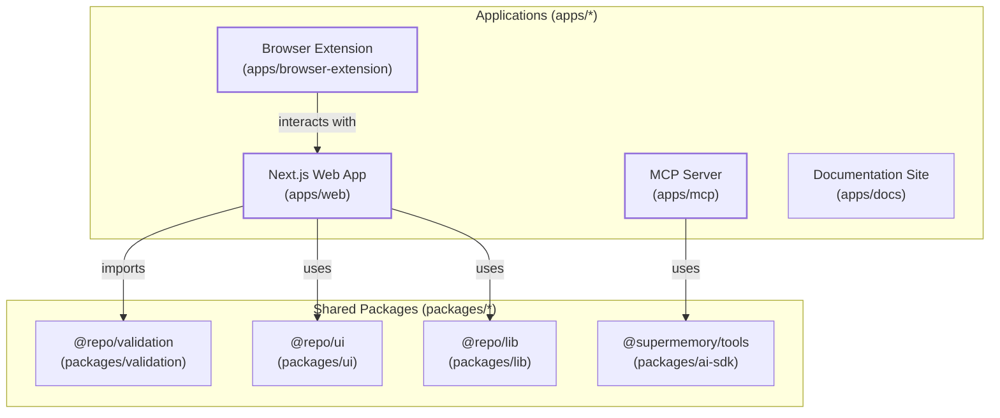
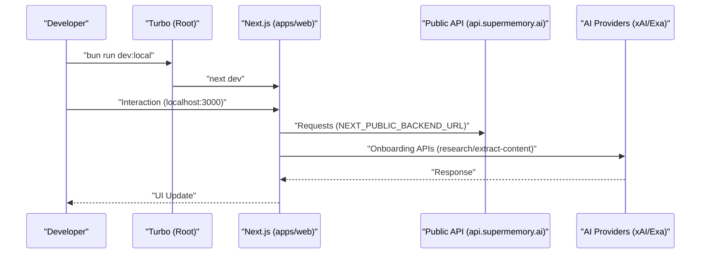

<!-- source: DeepWiki mcp.deepwiki.com · repo supermemoryai/supermemory · page 10.1 Local Development Setup · fetched 2026-10-30 -->

# Local Development Setup

<details>
<summary>Relevant source files</summary>

The following files were used as context for generating this wiki page:

- [CONTRIBUTING.md](CONTRIBUTING.md)
- [README.md](README.md)
- [README.zh-CN.md](README.zh-CN.md)
- [apps/docs/cookbook/overview.mdx](apps/docs/cookbook/overview.mdx)
- [apps/docs/memory-api/sdks/overview.mdx](apps/docs/memory-api/sdks/overview.mdx)
- [apps/docs/migration/from-mem0.mdx](apps/docs/migration/from-mem0.mdx)
- [apps/docs/migration/mem0-migration-script.py](apps/docs/migration/mem0-migration-script.py)
- [apps/web/.env.example](apps/web/.env.example)
- [apps/web/app/api/onboarding/extract-content/route.ts](apps/web/app/api/onboarding/extract-content/route.ts)
- [apps/web/app/api/onboarding/research/route.ts](apps/web/app/api/onboarding/research/route.ts)
- [packages/hooks/use-org-onboarding.ts](packages/hooks/use-org-onboarding.ts)
- [turbo.json](turbo.json)

</details>


This page provides a step-by-step guide for setting up a local development environment for Supermemory. It covers cloning the repository, installing dependencies with Bun, configuring environment variables, and starting development servers across the monorepo.

## Prerequisites

Before setting up the development environment, ensure the following tools are installed:

| Tool | Minimum Version | Purpose |
|------|----------------|---------|
| **Bun** | 1.2.17 | Primary package manager and runtime [CONTRIBUTING.md:11]() |
| **Git** | Any recent | Version control [CONTRIBUTING.md:12]() |
| **Node.js** | 20 or higher | Runtime for specific build tools |

The codebase explicitly requires Bun as the package manager for performance and workspace management [CONTRIBUTING.md:11]().

**Sources:** [CONTRIBUTING.md:7-13]()

## Monorepo Structure & Data Flow

Supermemory is organized as a Turbo monorepo. The following diagram bridges the natural language components to their specific code entities and locations.

### Component to Code Entity Mapping



**Workspace Configuration**
The monorepo uses Bun and Turbo for orchestration, defined in `package.json` and `turbo.json` [turbo.json:1-25](). Shared logic is encapsulated in `packages/` while consumer-facing interfaces reside in `apps/` [CONTRIBUTING.md:58-83]().

**Sources:** [CONTRIBUTING.md:58-83](), [turbo.json:1-25]()

## Initial Setup

### 1. Clone and Install
```bash
git clone https://github.com/supermemoryai/supermemory.git
cd supermemory
bun install
```
The `bun install` command resolves dependencies for the entire workspace [CONTRIBUTING.md:23-27]().

### 2. Environment Variables
You must set up environment variables for the applications to function.
```bash
# Copy the example environment file
cp .env.example .env.local
```
Key variables required across the stack include API keys for AI providers and database URLs [CONTRIBUTING.md:29-37](). For the web application, specific keys like `EXA_API_KEY` are used for content extraction [apps/web/.env.example:3](), [apps/web/app/api/onboarding/extract-content/route.ts:12-17](), and `XAI_API_KEY` is used for user research [apps/web/.env.example:4](), [apps/web/app/api/onboarding/research/route.ts:1-2]().

### 3. Local Proxy Configuration
For local development of the web application, you must bypass the session retrieval for `localhost` in `apps/web/proxy.ts` [CONTRIBUTING.md:39-47]().

```typescript
if (url.hostname === "localhost") {
  return NextResponse.next();
}
```

**Sources:** [CONTRIBUTING.md:14-47](), [apps/web/.env.example:1-4](), [apps/web/app/api/onboarding/extract-content/route.ts:12-17]()

## Running Development Servers

### Development Modes
Supermemory supports two primary development modes:

1.  **OSS/Local Mode:** Recommended for outside contributors. Starts servers on standard `localhost` ports [CONTRIBUTING.md:54-55]().
    ```bash
    bun run dev:local
    ```
2.  **Internal/Portless Mode:** Used by the internal team to provide `*.dev.supermemory.ai` HTTPS URLs with shared cookies [CONTRIBUTING.md:56-57]().
    ```bash
    bun run dev
    ```

### Port Assignments (Local Mode)

| Application | Port | Location |
|-------------|------|----------|
| **Web App** | 3000 | [apps/web]() |
| **MCP Server** | 8788 | [apps/mcp]() |
| **Docs** | 3003 | [apps/docs]() |
| **Graph Playground** | 3004 | [apps/memory-graph-playground]() |

**Sources:** [CONTRIBUTING.md:49-57](), [CONTRIBUTING.md:87-94]()

## Local Development Workflow

### Code Quality Tools
Before submitting a Pull Request, ensure your code passes linting, type checking, and build tests [CONTRIBUTING.md:103-109]().

- **Format & Lint:** `bun run format-lint` (uses Biome) [CONTRIBUTING.md:92]().
- **Type Check:** `bun run check-types` [CONTRIBUTING.md:93]().
- **Build:** `bun run build` [CONTRIBUTING.md:91]().

### Development Architecture Diagram

This diagram illustrates the interaction between local entities during a development session.



### Troubleshooting Local Setup

| Symptom | Potential Cause | Fix |
|---------|----------------|-----|
| OAuth Sign-in Fails | Redirect URL mismatch | Use Magic Link/Email OTP for localhost; OAuth requires the `dev.supermemory.ai` proxy [CONTRIBUTING.md:54-55](). |
| Missing Research Data | Missing `XAI_API_KEY` | Ensure `XAI_API_KEY` is set in `.env.local` for the research route [apps/web/app/api/onboarding/research/route.ts:1-2](). |
| Extraction Fails | Missing `EXA_API_KEY` | Check if `EXA_API_KEY` is configured in the environment [apps/web/app/api/onboarding/extract-content/route.ts:12-17](). |

**Sources:** [CONTRIBUTING.md:54-57](), [apps/web/app/api/onboarding/research/route.ts:1-2](), [apps/web/app/api/onboarding/extract-content/route.ts:12-17]()

---

