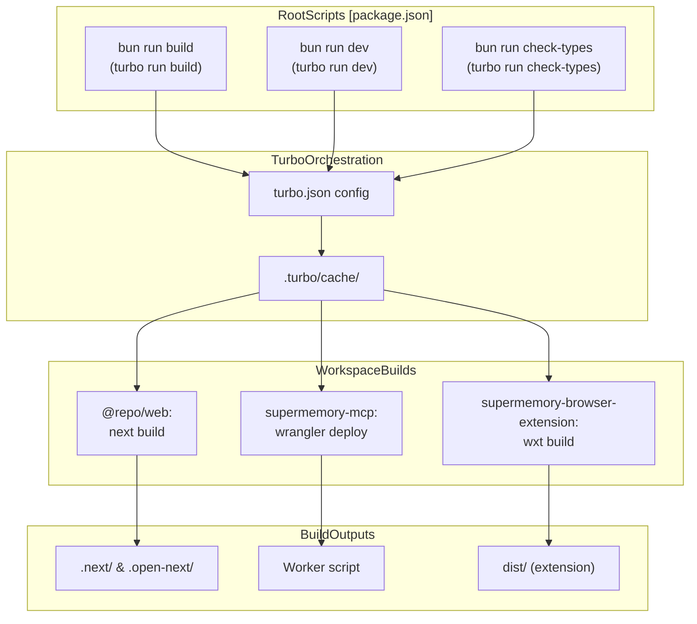
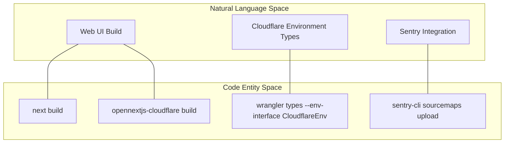
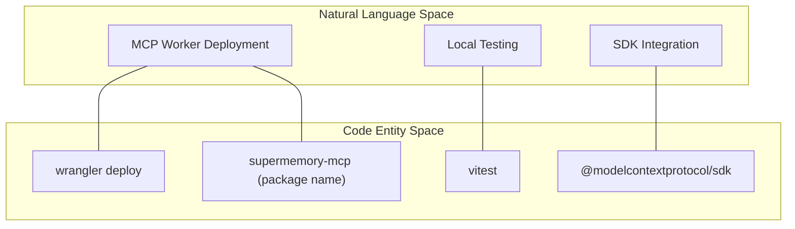
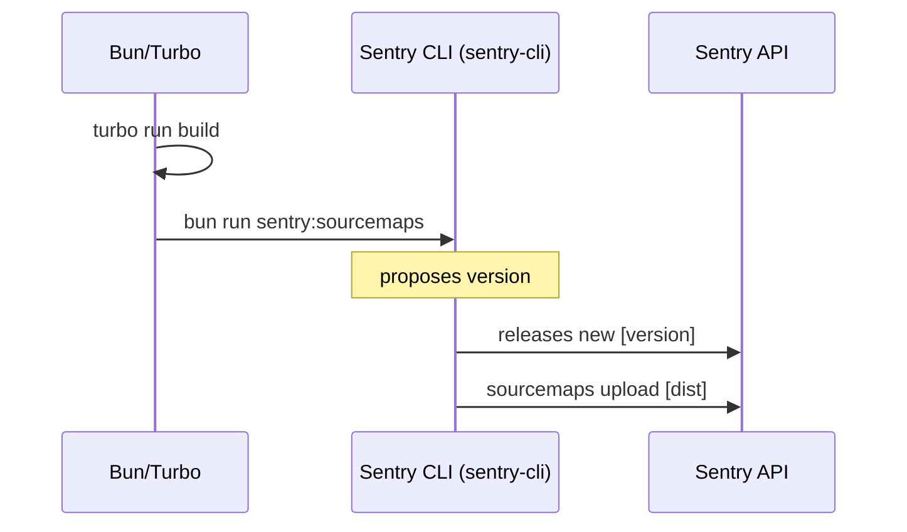

<!-- source: DeepWiki mcp.deepwiki.com · repo supermemoryai/supermemory · page 10.2 Build System & Turbo · fetched 2026-10-30 -->

# Build System & Turbo

<details>
<summary>Relevant source files</summary>

The following files were used as context for generating this wiki page:

- [.gitignore](.gitignore)
- [CONTRIBUTING.md](CONTRIBUTING.md)
- [README.md](README.md)
- [README.zh-CN.md](README.zh-CN.md)
- [apps/docs/cookbook/overview.mdx](apps/docs/cookbook/overview.mdx)
- [apps/docs/memory-api/sdks/overview.mdx](apps/docs/memory-api/sdks/overview.mdx)
- [apps/docs/migration/from-mem0.mdx](apps/docs/migration/from-mem0.mdx)
- [apps/docs/migration/mem0-migration-script.py](apps/docs/migration/mem0-migration-script.py)
- [apps/web/.gitignore](apps/web/.gitignore)
- [apps/web/app/global-error.tsx](apps/web/app/global-error.tsx)
- [apps/web/app/layout.tsx](apps/web/app/layout.tsx)
- [apps/web/package.json](apps/web/package.json)
- [apps/web/public/OG.png](apps/web/public/OG.png)
- [apps/web/tsconfig.json](apps/web/tsconfig.json)
- [apps/web/wrangler.jsonc](apps/web/wrangler.jsonc)
- [bun.lock](bun.lock)
- [package.json](package.json)
- [turbo.json](turbo.json)

</details>


## Purpose and Scope

This document explains the build system architecture of the supermemory monorepo, including Turborepo task orchestration, Bun package management, workspace exclusions, and production build pipelines. It details how tasks are scoped across the repository and how individual workspace builds are executed.

## Overview

The supermemory monorepo uses a modern toolchain optimized for speed and Cloudflare-native deployment:

| Tool | Version | Role |
|------|---------|------|
| **Turborepo** | `^2.5.4` | Parallel task execution and intelligent caching |
| **Bun** | `1.3.6` | Package manager and workspace orchestration |
| **TypeScript** | `5.8.3` | Static type checking across all packages |
| **Biome** | `^2.2.0` | Unified linter and formatter |
| **Wrangler** | `^4.42.2` | Cloudflare Workers CLI for deployment and type generation |

The build system coordinates multiple complex outputs, including a Next.js app adapted for Cloudflare via `opennextjs-cloudflare`, a WXT-based browser extension, and a Model Context Protocol (MCP) server.

Sources: [package.json:15-67](), [bun.lock:48-50]()

## Build System Architecture

The build system is designed around a Directed Acyclic Graph (DAG) managed by Turbo. Root-level scripts delegate to Turbo to ensure that shared packages (like `@repo/lib` or `@repo/validation`) are built before the applications that consume them.

**Root Build Pipeline**



Sources: [package.json:4-12](), [apps/web/package.json:9-21](), [apps/mcp/package.json:106-107]()

## Workspace Configuration & Exclusions

The monorepo structure is defined in the root `package.json`. While most projects are part of the unified build graph, specific workspaces are excluded to prevent dependency conflicts or because they require specialized build environments.

### Included and Excluded Workspaces

Workspaces are configured in [package.json:17-22]():

```json
"workspaces": [
  "apps/*",
  "!apps/raycast-extension",
  "!tools/test/chatapp",
  "packages/*"
]
```

| Workspace Path | Status | Reason for Exclusion |
|---|---|---|
| `apps/web` | **Included** | Core Next.js application |
| `apps/mcp` | **Included** | Cloudflare Worker MCP server |
| `packages/*` | **Included** | Shared libraries (UI, Lib, Validation) |
| `apps/raycast-extension` | **Excluded** | Requires native Raycast environment and `npm`-specific tooling |
| `tools/test/chatapp` | **Excluded** | Isolated test harness for tools |

To run builds for excluded workspaces, developers must navigate into the specific directory and use the local package manager (often `npm` for Raycast or `bun` for the test app).

Sources: [package.json:17-22](), [bun.lock:5-52](), [CONTRIBUTING.md:58-83]()

## Turborepo Task Orchestration

### Core Tasks

Turbo orchestrates the following primary tasks defined in `turbo.json` and the root `package.json`:

| Task | Configuration | Behavior |
|--------|---------|----------|
| `build` | `dependsOn: ["^build"]` | Builds workspaces. Caches `.next/**` and `.env*` inputs. |
| `lint` | `dependsOn: ["^lint"]` | Runs linting across the graph. |
| `check-types` | `dependsOn: ["^check-types"]` | Validates types without emitting files. |
| `dev` | `cache: false` | Starts persistent dev servers. |

Sources: [turbo.json:1-25](), [package.json:4-12]()

### Running Individual Workspace Builds

Individual builds can be triggered using the `--filter` flag, which targets the `name` field in a workspace's `package.json`.

*   **Build Web App:** `turbo run build --filter=@repo/web`
*   **Build MCP Server:** `turbo run build --filter=supermemory-mcp`
*   **Build Browser Extension:** `turbo run build --filter=supermemory-browser-extension`

Sources: [package.json:1-12](), [apps/web/package.json:2](), [apps/mcp/package.json:87](), [bun.lock:54]()

## App-Specific Build Pipelines

### Web Application (`apps/web`)

The web app uses `opennextjs-cloudflare` to bridge Next.js with the Cloudflare ecosystem. It utilizes path aliases to reference shared packages such as `@ui/*`, `@lib/*`, and `@hooks/*`.

**Web Build Entity Mapping**



Key scripts in `apps/web/package.json`:
*   `cf-typegen`: Generates TypeScript interfaces for Cloudflare bindings via `wrangler types` [apps/web/package.json:18]().
*   `deploy`: Executes the OpenNext build and deploys to Cloudflare [apps/web/package.json:16]().
*   `sentry:sourcemaps`: Uploads sourcemaps to Sentry for production error tracking [apps/web/package.json:19]().

Sources: [apps/web/package.json:9-21](), [apps/web/tsconfig.json:5-11](), [CONTRIBUTING.md:111-119]()

### Browser Extension (`apps/browser-extension`)

Built using the WXT framework. The build command `wxt build` (invoked via Turbo) generates extension bundles for multiple browsers. It uses `turndown` for markdown conversion and `react` for UI components.

Sources: [bun.lock:72](), [apps/browser-extension/package.json:53-73]()

### MCP Server (`apps/mcp`)

The MCP server is a Cloudflare Worker application. Its build process involves `wrangler` and specialized plugins like `vite-plugin-singlefile` for bundling.

**MCP Build Entity Mapping**



Sources: [apps/mcp/package.json:87-108](), [bun.lock:86-108]()

## Production Build & Sentry Integration

The production build includes a `postbuild` hook at the root level to ensure sourcemaps are synced with Sentry.

**Sentry Release Flow**



The root `sentry:sourcemaps` script handles the organization (`supermemory`) and project (`consumer-app`) targeting [package.json:10](). In the web app, this is triggered after deployment via `postdeploy` [apps/web/package.json:20]().

Sources: [package.json:10-11](), [apps/web/package.json:19-20]()

## TypeScript & Type Checking

The repo uses TypeScript `5.8.3`. Type checking is performed globally via `turbo run check-types`. 

Workspaces extend a shared base configuration:
*   `@total-typescript/tsconfig` is used as a base [package.json:61]().
*   The `check-types` task ensures consistency across the monorepo without requiring individual workspace `tsc` calls during every development iteration [turbo.json:13-15]().

Sources: [package.json:65](), [turbo.json:13-15](), [CONTRIBUTING.md:93-102]()

---

