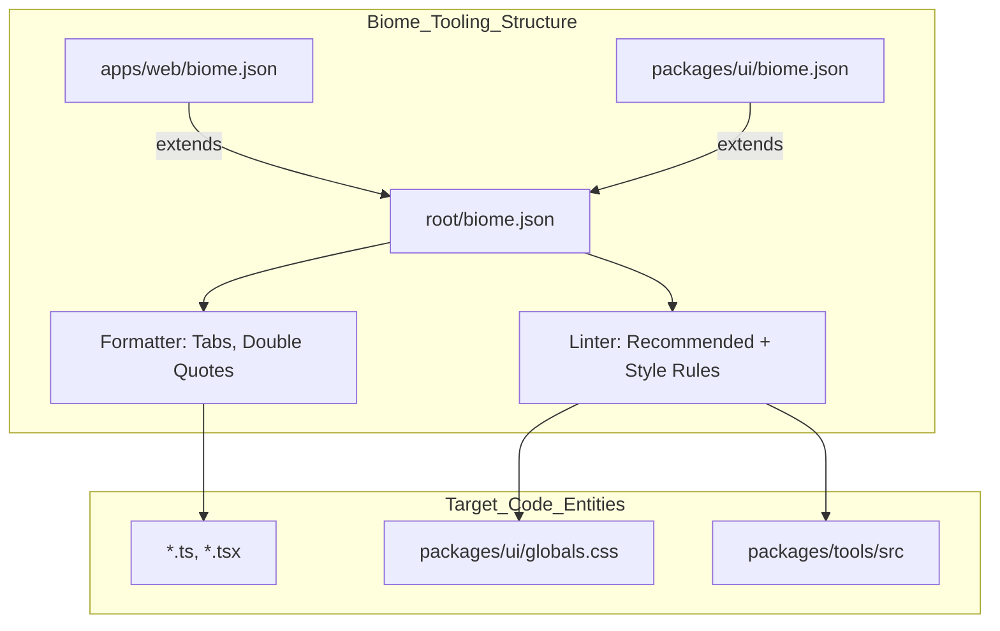
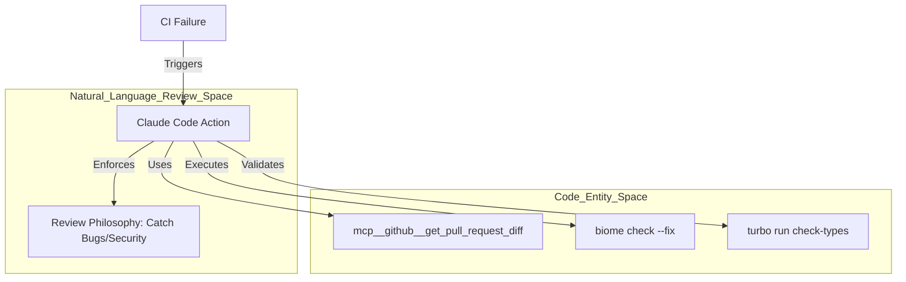

<!-- source: DeepWiki mcp.deepwiki.com · repo supermemoryai/supermemory · page 10.3 Code Quality & Testing · fetched 2026-10-30 -->

# Code Quality & Testing

<details>
<summary>Relevant source files</summary>

The following files were used as context for generating this wiki page:

- [.github/workflows/ci.yml](.github/workflows/ci.yml)
- [.github/workflows/claude-auto-fix-ci.yml](.github/workflows/claude-auto-fix-ci.yml)
- [.github/workflows/claude-code-review.yml](.github/workflows/claude-code-review.yml)
- [.github/workflows/claude.yml](.github/workflows/claude.yml)
- [apps/web/biome.json](apps/web/biome.json)
- [packages/tools/test/ai-sdk-test.ts](packages/tools/test/ai-sdk-test.ts)
- [packages/tools/test/chatapp/app/api/chat/route.ts](packages/tools/test/chatapp/app/api/chat/route.ts)
- [packages/tools/test/chatapp/app/api/stream/route.ts](packages/tools/test/chatapp/app/api/stream/route.ts)
- [packages/tools/test/chatapp/app/stream/page.tsx](packages/tools/test/chatapp/app/stream/page.tsx)
- [packages/tools/test/chatapp/bun.lock](packages/tools/test/chatapp/bun.lock)
- [packages/tools/test/with-supermemory/integration.test.ts](packages/tools/test/with-supermemory/integration.test.ts)
- [packages/tools/test/with-supermemory/unit.test.ts](packages/tools/test/with-supermemory/unit.test.ts)
- [packages/ui/assets/Logo.tsx](packages/ui/assets/Logo.tsx)
- [packages/ui/biome.json](packages/ui/biome.json)
- [packages/ui/globals.css](packages/ui/globals.css)

</details>


## Purpose and Scope

This document covers the code quality tools, testing infrastructure, and quality standards used across the Supermemory monorepo. It details the linting and formatting setup with Biome, TypeScript type checking orchestration via Turborepo, the testing structure for AI tools, and automated AI-driven code reviews and CI self-healing.

---

## Code Formatting & Linting with Biome

The repository uses **Biome** as the primary code quality tool, replacing ESLint and Prettier. Biome provides high-performance code formatting and lint checking across all packages and applications.

### Configuration

Biome is configured via a root `biome.json` file. It is set to use `tab` indentation and `double` quotes for JavaScript. Individual packages, such as `packages/ui` and `apps/web`, contain their own `biome.json` files that extend the root configuration [.github/workflows/ci.yml:27-28](), [packages/ui/biome.json:1-5](), [apps/web/biome.json:1-5]().

Key linter rules include:
- **Correctness**: `noUnusedVariables` and `noUnusedImports` are prioritized.
- **Tailwind Support**: The CSS parser is configured to support Tailwind directives, specifically used in `packages/ui/globals.css` [packages/ui/globals.css:1-8]().


**Biome Tooling Structure**

**Sources:** [packages/ui/biome.json:1-5](), [apps/web/biome.json:1-5](), [packages/ui/globals.css:1-8](), [.github/workflows/ci.yml:27-28]()

---

## TypeScript Type Checking

TypeScript type checking is orchestrated through **Turborepo** to run across workspace members in parallel. The CI pipeline specifically targets core packages like `@supermemory/ai-sdk` and `@supermemory/memory-graph` [.github/workflows/ci.yml:24-25]().

### Type Checking Flow

The root `package.json` defines a `check-types` script that triggers `turbo run check-types`.

```mermaid
graph LR
    "Developer/CI" -- "bunx turbo run check-types" --> Turbo["Turbo Orchestrator"]
    
    subgraph "Parallel_Execution"
        Turbo -- "--filter=@supermemory/ai-sdk" --> SDK["packages/tools: tsc"]
        Turbo -- "--filter=@supermemory/memory-graph" --> Graph["packages/memory-graph: tsc"]
    end
    
    SDK --> Results["Aggregated CI Results"]
    Graph --> Results
```
**Type Checking Orchestration**

**Sources:** [.github/workflows/ci.yml:24-25]()

---

## Testing Infrastructure

Testing is concentrated in `packages/tools` to ensure the reliability of the AI middleware and SDK wrappers. The project uses **Vitest** for unit and integration testing [packages/tools/test/with-supermemory/unit.test.ts:5]().

### SDK Middleware Testing
Tests verify the `withSupermemory` wrapper which enhances AI models with long-term memory.

*   **Unit Tests**: Located in `packages/tools/test/with-supermemory/unit.test.ts`. These tests mock `LanguageModelV2` and verify the `transformParamsWithMemory` logic and the `memoryCache` mechanism [packages/tools/test/with-supermemory/unit.test.ts:6-15](), [packages/tools/test/with-supermemory/unit.test.ts:140-179]().
*   **Integration Tests**: Located in `packages/tools/test/with-supermemory/integration.test.ts`. These run against the real Supermemory API (e.g., `https://api.supermemory.ai`) when a `SUPERMEMORY_API_KEY` is provided [packages/tools/test/with-supermemory/integration.test.ts:13-17](), [packages/tools/test/with-supermemory/integration.test.ts:94-113]().
*   **Chat App Simulation**: A test chat application in `packages/tools/test/chatapp` provides a real-world environment for testing `streamText` with `withSupermemory` [packages/tools/test/chatapp/app/api/stream/route.ts:36-47](), [packages/tools/test/chatapp/app/stream/page.tsx:10-14]().

**Sources:** [packages/tools/test/with-supermemory/unit.test.ts:5-15](), [packages/tools/test/with-supermemory/integration.test.ts:13-17](), [packages/tools/test/chatapp/app/api/stream/route.ts:36-47]()

---

## Automated AI Quality Control

Supermemory utilizes **Claude Code** via GitHub Actions for both proactive code reviews and reactive CI self-healing.

### 1. Claude Code Review
The `Claude Code Review` workflow triggers on PR events [.github/workflows/claude-code-review.yml:3-5](). It acts as a senior engineer, focusing on:
*   **Logic Errors**: Race conditions, null access, and incorrect `await` usage [.github/workflows/claude-code-review.yml:73]().
*   **Security**: SQL injection, XSS, and auth bypass [.github/workflows/claude-code-review.yml:74]().
*   **Data Integrity**: Missing transactions or incorrect cascade deletes [.github/workflows/claude-code-review.yml:75]().

### 2. Auto-Fix CI Failures
The `Auto Fix CI Failures` workflow triggers when the standard CI (Type Check, Format & Lint) fails [.github/workflows/claude-auto-fix-ci.yml:4-7](). It uses Claude to:
1.  Analyze failure details via `actions/github-script` [.github/workflows/claude-auto-fix-ci.yml:41-43]().
2.  Run `biome check --fix` or fix type errors [.github/workflows/claude-auto-fix-ci.yml:78-79]().
3.  Commit and push fixes directly back to the PR branch [.github/workflows/claude-auto-fix-ci.yml:82-83]().


**AI-Driven Quality Loop**

**Sources:** [.github/workflows/claude-code-review.yml:1-123](), [.github/workflows/claude-auto-fix-ci.yml:1-103](), [.github/workflows/ci.yml:1-29]()

---

## Summary of Quality Commands

| Command | Scope | Purpose |
|---------|-------|---------|
| `bunx biome ci --changed` | CI | Lints and formats changed files against `origin/main` [.github/workflows/ci.yml:28]() |
| `bunx turbo run check-types` | Root | Parallel TypeScript validation across workspaces [.github/workflows/ci.yml:25]() |
| `vitest` | `packages/tools` | Executes unit and integration tests for AI SDK wrappers [packages/tools/test/with-supermemory/unit.test.ts:5]() |
| `biome check --fix .` | Local | Automatically fixes linting and formatting issues [.github/workflows/claude-auto-fix-ci.yml:78]() |

**Sources:** [.github/workflows/ci.yml:24-28](), [packages/tools/test/with-supermemory/unit.test.ts:5](), [.github/workflows/claude-auto-fix-ci.yml:78-79]()

---

