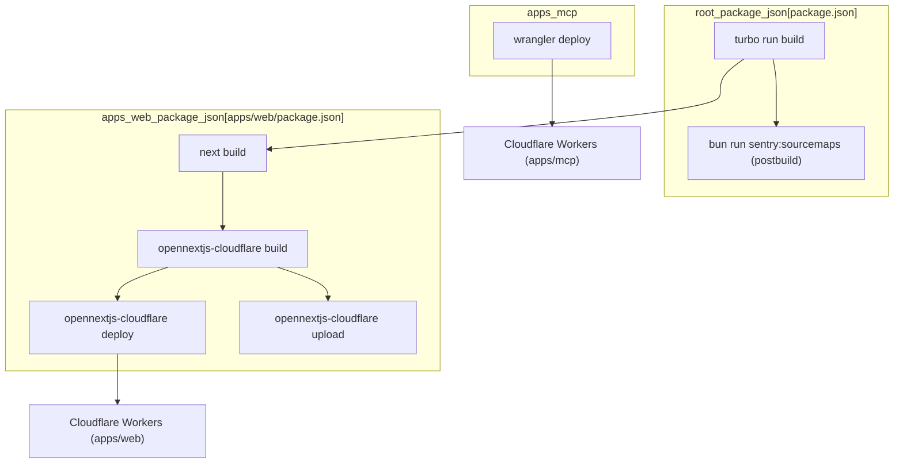
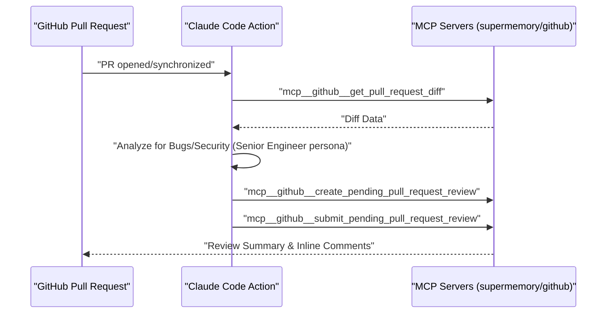
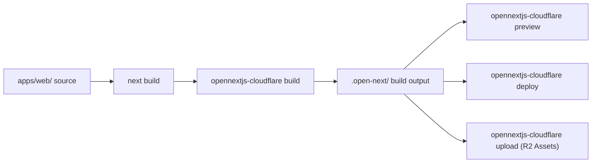
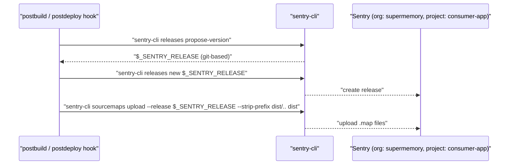

<!-- source: DeepWiki mcp.deepwiki.com · repo supermemoryai/supermemory · page 10.4 Deployment & CI/CD · fetched 2026-10-30 -->

# Deployment & CI/CD

Relevant source files

The following files were used as context for generating this wiki page:

- [.github/workflows/ci.yml](.github/workflows/ci.yml)
- [.github/workflows/claude-auto-fix-ci.yml](.github/workflows/claude-auto-fix-ci.yml)
- [.github/workflows/claude-code-review.yml](.github/workflows/claude-code-review.yml)
- [.github/workflows/claude.yml](.github/workflows/claude.yml)
- [.github/workflows/publish-agent-framework-python.yml](.github/workflows/publish-agent-framework-python.yml)
- [.github/workflows/publish-ai-sdk.yml](.github/workflows/publish-ai-sdk.yml)
- [.github/workflows/publish-cartesia-sdk-python.yml](.github/workflows/publish-cartesia-sdk-python.yml)
- [.github/workflows/publish-memory-graph.yml](.github/workflows/publish-memory-graph.yml)
- [.github/workflows/publish-openai-sdk-python.yml](.github/workflows/publish-openai-sdk-python.yml)
- [.github/workflows/publish-pipecat-sdk-python.yml](.github/workflows/publish-pipecat-sdk-python.yml)
- [.github/workflows/publish-tools.yml](.github/workflows/publish-tools.yml)
- [.gitignore](.gitignore)
- [apps/web/.gitignore](apps/web/.gitignore)
- [apps/web/app/global-error.tsx](apps/web/app/global-error.tsx)
- [apps/web/app/layout.tsx](apps/web/app/layout.tsx)
- [apps/web/package.json](apps/web/package.json)
- [apps/web/public/OG.png](apps/web/public/OG.png)
- [apps/web/tsconfig.json](apps/web/tsconfig.json)
- [apps/web/wrangler.jsonc](apps/web/wrangler.jsonc)
- [bun.lock](bun.lock)
- [package.json](package.json)

This document covers the deployment pipeline and CI/CD configuration for the Supermemory project. It focuses on how `apps/web` is deployed to Cloudflare via `opennextjs-cloudflare`, how `apps/mcp` is deployed as a Cloudflare Worker via `wrangler`, and the automated CI workflows using GitHub Actions and Claude.

## Build System Overview

The project uses **Turbo** to orchestrate builds across the monorepo with **Bun** as the package manager [package.json:5-16](). Deployable apps include `apps/web` (Next.js on Cloudflare Workers) and `apps/mcp` (Cloudflare Worker).

**Diagram: Monorepo build and deployment flow**

Sources: [package.json:5-12](), [apps/web/package.json:12-20]().

## CI Configuration

The repository uses several GitHub Action workflows to ensure code quality and automate fixes.

### Quality Checks (CI)
The primary CI workflow `CI - Type Check, Format & Lint` runs on every pull request. It performs:
1. **Type Checking**: Runs `turbo run check-types` across the workspace [package.json:9-9]().
2. **Linting & Formatting**: Uses `bunx biome check --write` to maintain code standards [package.json:8-8]().

### Automated Fixes with Claude
Supermemory integrates `claude-code-action` to automatically fix CI failures and perform deep code reviews.

- **Claude Code Review**: A "Senior Engineer" persona review triggered on pull requests [ .github/workflows/claude-code-review.yml:3-5](). It focuses on production incidents, security vulnerabilities (SQLi, XSS), and data loss risks [.github/workflows/claude-code-review.yml:62-78](). It utilizes MCP tools like `mcp__github__get_pull_request_diff` to analyze code intent [.github/workflows/claude-code-review.yml:88-88]().
- **Interactive Claude**: A workflow that allows developers to tag `@claude` in comments or issue descriptions to trigger automated tasks [.github/workflows/claude.yml:15-19](). It uses the `claude-opus-4-5-20251101` model with access to both `supermemory` and `github` MCP servers [.github/workflows/claude.yml:44-56]().

**Diagram: Claude Code Review workflow**

Sources: [.github/workflows/claude-code-review.yml:1-123](), [.github/workflows/claude.yml:1-57]().

## Automated Package Publishing

The repository includes several workflows for publishing packages to npm and PyPI upon version changes in the `main` branch.

### NPM Publishing
Workflows for `@supermemory/ai-sdk`, `@supermemory/tools`, and `@supermemory/memory-graph` follow a standard pattern:
1. **Version Check**: Compares the local version in `package.json` with the latest version on npm using `npm view` [.github/workflows/publish-ai-sdk.yml:38-50]().
2. **Build**: Runs `bun run build` if the version has changed [.github/workflows/publish-ai-sdk.yml:52-54]().
3. **Publish**: Executes `npm publish --access public --provenance` [.github/workflows/publish-ai-sdk.yml:56-58]().

### Python (PyPI) Publishing
Python SDKs (Pipecat, OpenAI, Agent Framework, Cartesia) are published using GitHub Actions that trigger on path changes to their respective directories. These workflows handle building the distribution and uploading to PyPI.

Sources: [.github/workflows/publish-ai-sdk.yml:1-59](), [.github/workflows/publish-memory-graph.yml:1-59](), [.github/workflows/publish-tools.yml:1-59]().

## apps/web Deployment (Cloudflare via opennextjs-cloudflare)

`apps/web` is a Next.js application deployed to Cloudflare Workers using the `@opennextjs/cloudflare` adapter [apps/web/package.json:34-34](). This adapter transforms the Next.js build output into a format compatible with the Cloudflare Workers runtime.

**Diagram: apps/web deployment pipeline**

Sources: [apps/web/package.json:15-17]().

### Environment Typing
The deployment process relies on generated types for Cloudflare bindings. The `cf-typegen` script runs `wrangler types` to generate `cloudflare-env.d.ts`, ensuring that references to KV namespaces or D1 databases are type-safe within the Next.js application code [apps/web/package.json:18-18]().

## Error Tracking & Sentry

Supermemory uses Sentry for error tracking in the web application.

### Sourcemap Upload
Both the root workspace and `apps/web` upload sourcemaps to Sentry after builds complete. This is critical for de-obfuscating stack traces in the Cloudflare Worker environment. The `postbuild` and `postdeploy` hooks trigger this process [package.json:11-11](), [apps/web/package.json:20-20]().

**Diagram: Sentry sourcemap upload sequence**

Sources: [package.json:10-11](), [apps/web/package.json:19-20]().

## Build Tool Versions

| Tool | Version | Purpose |
|------|---------|---------|
| `bun` | 1.3.6 | Package manager and runner [package.json:16-16]() |
| `turbo` | ^2.5.4 | Monorepo task orchestration [package.json:64-64]() |
| `typescript` | 5.8.3 | Type checking and compilation [package.json:65-65]() |
| `@biomejs/biome` | ^2.2.0 | Linting and formatting [package.json:59-59]() |
| `wrangler` | ^4.42.2 | Cloudflare deployment CLI [package.json:66-66]() |
| `@opennextjs/cloudflare` | ^1.12.0 | Next.js to Cloudflare adapter [apps/web/package.json:34-34]() |
| `@sentry/cli` | ^2.52.0 | Sourcemap upload utility [package.json:60-60]() |

Sources: [package.json:58-67](), [apps/web/package.json:119-132]().

---

