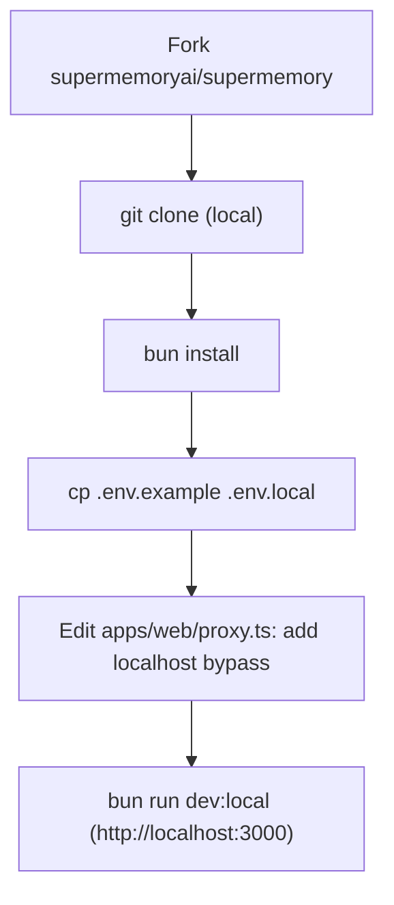
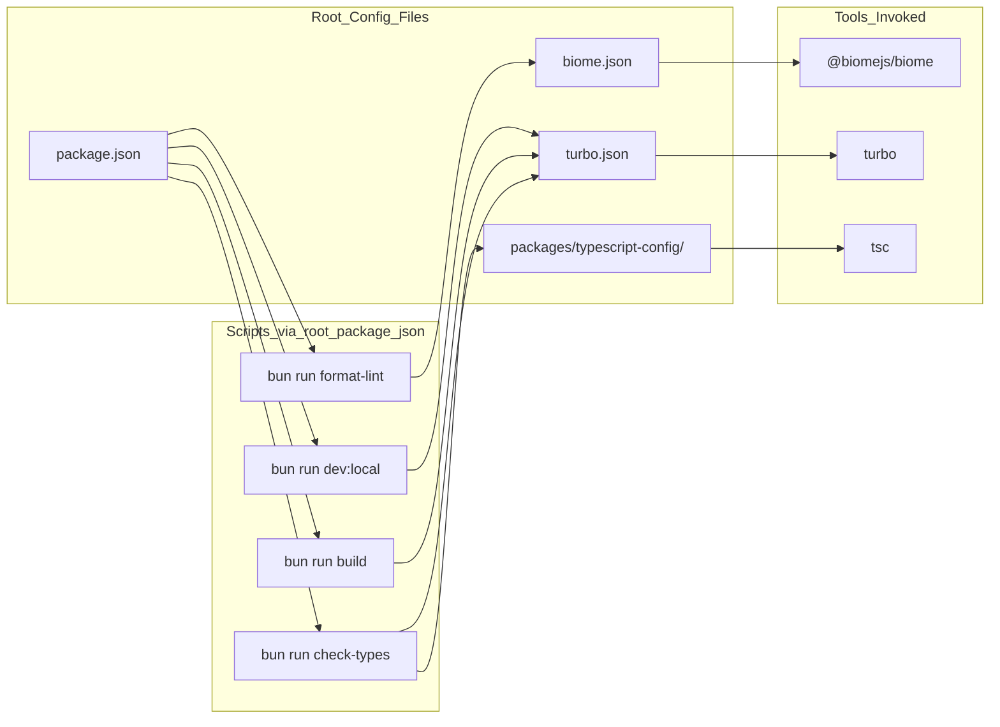
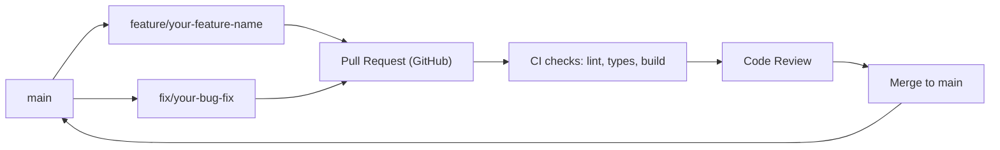
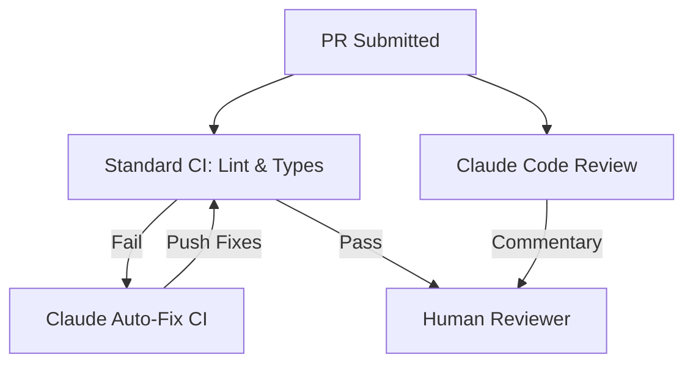

<!-- source: DeepWiki mcp.deepwiki.com · repo supermemoryai/supermemory · page 10.5 Contributing Guidelines · fetched 2026-10-30 -->

# Contributing Guidelines

<details>
<summary>Relevant source files</summary>

The following files were used as context for generating this wiki page:

- [.github/workflows/ci.yml](.github/workflows/ci.yml)
- [.github/workflows/claude-auto-fix-ci.yml](.github/workflows/claude-auto-fix-ci.yml)
- [.github/workflows/claude-code-review.yml](.github/workflows/claude-code-review.yml)
- [.github/workflows/claude.yml](.github/workflows/claude.yml)
- [CONTRIBUTING.md](CONTRIBUTING.md)
- [README.md](README.md)
- [README.zh-CN.md](README.zh-CN.md)
- [apps/docs/cookbook/overview.mdx](apps/docs/cookbook/overview.mdx)
- [apps/docs/memory-api/sdks/overview.mdx](apps/docs/memory-api/sdks/overview.mdx)
- [apps/docs/migration/from-mem0.mdx](apps/docs/migration/from-mem0.mdx)
- [apps/docs/migration/mem0-migration-script.py](apps/docs/migration/mem0-migration-script.py)
- [turbo.json](turbo.json)

</details>


This document provides technical guidelines for contributing code to the Supermemory monorepo. It covers development setup, code quality standards, workflow processes, pull request requirements, and the automated CI/CD review systems.

For information about local development setup details, see [Local Development Setup](#10.1). For build system configuration, see [Build System & Turbo](#10.2). For code quality tooling, see [Code Quality & Testing](#10.3).

Sources: [CONTRIBUTING.md:1-307](), [README.md:85-99]()

## Overview

Supermemory is an open-source project licensed under MIT ([LICENSE:1-21]()) that welcomes contributions from developers of all skill levels. The project uses a monorepo structure with Turbo for build orchestration, Biome for linting/formatting, and TypeScript for type safety [CONTRIBUTING.md:58-80]().

**Key Contribution Types:**
- 🐛 **Bug fixes** and issue resolution [CONTRIBUTING.md:126-126]()
- ✨ **New features** and enhancements [CONTRIBUTING.md:127-127]()
- 🎨 **UI/UX enhancements** [CONTRIBUTING.md:128-128]()
- ⚡ **Performance optimizations** [CONTRIBUTING.md:129-129]()
- 📄 **Documentation updates** [CONTRIBUTING.md:152-152]()

Sources: [CONTRIBUTING.md:1-6](), [LICENSE:1-21](), [README.md:85-99]()

## Prerequisites

Before contributing, ensure the following tools are installed:

| Tool | Version | Purpose |
|------|---------|---------|
| **Bun** | >= 1.2.17 | Our preferred package manager and runtime [CONTRIBUTING.md:11-11]() |
| **Git** | Latest | Version control [CONTRIBUTING.md:12-12]() |

Sources: [CONTRIBUTING.md:8-13]()

## Code Quality Standards

### Linting and Formatting

All code must pass Biome checks before submission. Biome is configured via `biome.json` at the repository root [CONTRIBUTING.md:81-81]().

**Required Commands:**
```bash
bun run format-lint    # Format and lint all code using Biome [CONTRIBUTING.md:92-92]()
bun run check-types    # Type check all packages [CONTRIBUTING.md:93-93]()
```

The `format-lint` script applies automatic fixes where possible. Manual intervention is required for remaining issues.

Sources: [CONTRIBUTING.md:85-109]()

### TypeScript Configuration

The monorepo uses shared TypeScript configuration from `packages/typescript-config/` for consistency across all apps and packages [CONTRIBUTING.md:79-79](). All new code must be written in TypeScript with proper type annotations [CONTRIBUTING.md:166-166]().

**Type Safety Requirements:**
- Use **TypeScript** for all new code [CONTRIBUTING.md:166-166]()
- Follow existing code style and patterns [CONTRIBUTING.md:167-167]()
- Write self-documenting code with clear variable names [CONTRIBUTING.md:168-168]()
- Add JSDoc comments for complex functions [CONTRIBUTING.md:169-169]()
- Use proper TypeScript types for props in functional components [CONTRIBUTING.md:177-177]()

Sources: [CONTRIBUTING.md:162-178]()

### File Naming Conventions

```
kebab-case      # General file names [CONTRIBUTING.md:181-181]()
PascalCase      # Component files [CONTRIBUTING.md:182-182]()
camelCase       # Utility functions [CONTRIBUTING.md:183-183]()
```

Sources: [CONTRIBUTING.md:179-184]()

### Import Organization

Imports must follow this hierarchy [CONTRIBUTING.md:187-203]():

```typescript
// 1. React and Next.js imports
import React from 'react';
import { NextPage } from 'next';

// 2. Third-party libraries
import { clsx } from 'clsx';
import { motion } from 'motion';

// 3. Internal packages
import { Button } from '@repo/ui';
import { useAuth } from '@repo/lib';

// 4. Relative imports
import { Header } from './header';
import { Footer } from './footer';
```

Sources: [CONTRIBUTING.md:185-204]()

## Development Workflow

### Initial Setup Process

**Local Environment Setup Flow:**



**Proxy Configuration for Local Development:**

Add this check in `apps/web/proxy.ts` before retrieving the cookie (`getSessionCookie(request)`) [CONTRIBUTING.md:41-43]():

```typescript
if (url.hostname === "localhost") {
  return NextResponse.next();
}
```

This bypasses session validation during local development [CONTRIBUTING.md:44-46]().

Sources: [CONTRIBUTING.md:14-57]()

### Available Scripts

The root `package.json` defines monorepo-wide scripts orchestrated by Turbo [CONTRIBUTING.md:82-82]():

| Script | Command | Purpose |
|--------|---------|---------|
| `dev:local` | `bun run dev:local` | Start dev servers on plain localhost ports (recommended for OSS) [CONTRIBUTING.md:89-89]() |
| `dev` | `bun run dev` | Start dev servers through portless (*.dev.supermemory.ai) [CONTRIBUTING.md:90-90]() |
| `build` | `bun run build` | Build all applications [CONTRIBUTING.md:91-91]() |
| `format-lint` | `bun run format-lint` | Format and lint code using Biome [CONTRIBUTING.md:92-92]() |
| `check-types` | `bun run check-types` | Type check all packages [CONTRIBUTING.md:93-93]() |

**Quality Tools and Configuration Map:**



Sources: [CONTRIBUTING.md:78-94](), [turbo.json:1-25]()

## Contribution Workflow

### Branch Strategy

**Branch and PR Lifecycle:**



**Branch Naming:**
- `feature/your-feature-name` — New functionality [CONTRIBUTING.md:143-143]()
- `fix/your-bug-fix` — Bug fixes [CONTRIBUTING.md:145-145]()

Sources: [CONTRIBUTING.md:138-146]()

### Making Changes

**Step-by-Step Process:**

1. **Create Feature Branch** [CONTRIBUTING.md:140-143]()
   ```bash
   git checkout -b feature/your-feature-name
   ```

2. **Develop and Test Locally** [CONTRIBUTING.md:156-157]()
   ```bash
   bun run dev:local    # Test functionality locally
   bun run build        # Ensure it builds
   ```

3. **Run Quality Checks** [CONTRIBUTING.md:158-159]()
   ```bash
   bun run format-lint  # Check formatting
   bun run check-types  # Check types
   ```

Sources: [CONTRIBUTING.md:148-160]()

## Pull Request Requirements

### PR Title Convention

Follow the Conventional Commits specification [CONTRIBUTING.md:215-220]():

| Prefix | Description | Example |
|--------|-------------|---------|
| `feat:` | New feature | `feat: add semantic search to memory graph` |
| `fix:` | Bug fix | `fix: resolve authentication redirect loop` |

Sources: [CONTRIBUTING.md:215-220]()

### PR Description Template

**Required Sections:**

1. **What & Why** - What changes you made and why [CONTRIBUTING.md:222-222]().
2. **Screenshots** - Include screenshots for UI changes [CONTRIBUTING.md:223-223]().
3. **Breaking Changes** - List any breaking changes [CONTRIBUTING.md:224-224]().
4. **Related Issues** - Include related issue numbers [CONTRIBUTING.md:225-225]().

Sources: [CONTRIBUTING.md:221-226]()

### PR Size Guidelines

- **Keep PRs focused:** Prefer multiple small PRs over one large PR [CONTRIBUTING.md:228-228]().
- **Single Concern:** Each PR should address a single concern [CONTRIBUTING.md:229-229]().

Sources: [CONTRIBUTING.md:227-230]()

### Automated CI & Review

Supermemory employs AI-powered review and auto-fix mechanisms to maintain high code quality:

1. **Claude Code Review**: Triggered on PR events (opened, synchronize, etc.) [.github/workflows/claude-code-review.yml:3-5](). It uses the `claude-opus-4-5-20251101` model to catch logic errors, security issues, and breaking changes [.github/workflows/claude-code-review.yml:41-78]().
2. **Auto Fix CI Failures**: If the standard CI (Type Check, Format & Lint) fails, this workflow attempts to fix Biome lint errors or type errors automatically using Claude [.github/workflows/claude-auto-fix-ci.yml:4-79]().
3. **Quality Gates**: Standard CI runs `turbo run check-types` and `biome ci` on changed files [.github/workflows/ci.yml:24-28]().

**Automated Quality Flow:**



Sources: [.github/workflows/ci.yml:1-29](), [.github/workflows/claude-code-review.yml:1-123](), [.github/workflows/claude-auto-fix-ci.yml:1-103]()

## Component Development Guidelines

### React Component Standards

**Functional Components with Hooks:**
- Use functional components with hooks [CONTRIBUTING.md:174-174]().
- Prefer composition over inheritance [CONTRIBUTING.md:175-175]().
- Use proper TypeScript types for props [CONTRIBUTING.md:177-177]().

Sources: [CONTRIBUTING.md:172-178]()

### Custom Hooks

Extract reusable logic into custom hooks to maintain small and focused components [CONTRIBUTING.md:170-176]().

Sources: [CONTRIBUTING.md:172-178]()

## State Management Patterns

The codebase uses multiple state management approaches [CONTRIBUTING.md:115-115]():

| Tool | Use Case |
|------|----------|
| **Zustand** | Client-side state (chat persistence, drafts) |
| **TanStack Query** | Server state management (React Query) |

Sources: [CONTRIBUTING.md:115-115]()

## Review Process

### Review Requirements

- All PRs require at least one review [CONTRIBUTING.md:233-233]().
- Address feedback promptly and professionally [CONTRIBUTING.md:234-234]().
- Maintain a collaborative attitude [CONTRIBUTING.md:236-236]().

Sources: [CONTRIBUTING.md:231-237]()

---

**License:** All contributions will be licensed under the MIT License, consistent with the project ([LICENSE:1-21]()).

For questions about contributing, join the [Discord community](https://supermemory.link/discord) or email [support@supermemory.ai](mailto:support@supermemory.ai).

Sources: [CONTRIBUTING.md:1-307](), [LICENSE:1-21]()

---

