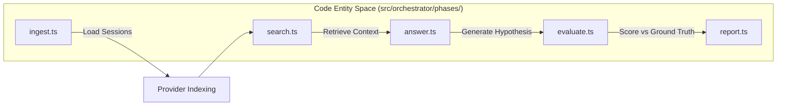
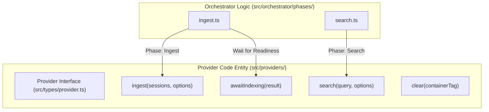

<!-- source: DeepWiki mcp.deepwiki.com · repo supermemoryai/supermemory · page 11.1 Architecture & MemScore · fetched 2026-10-30 -->

# Architecture & MemScore

Relevant source files

The following files were used as context for generating this wiki page:

- [apps/docs/memorybench/architecture.mdx](apps/docs/memorybench/architecture.mdx)
- [apps/docs/memorybench/cli.mdx](apps/docs/memorybench/cli.mdx)
- [apps/docs/memorybench/contributing.mdx](apps/docs/memorybench/contributing.mdx)
- [apps/docs/memorybench/extend-benchmark.mdx](apps/docs/memorybench/extend-benchmark.mdx)
- [apps/docs/memorybench/extend-provider.mdx](apps/docs/memorybench/extend-provider.mdx)
- [apps/docs/memorybench/github.mdx](apps/docs/memorybench/github.mdx)
- [apps/docs/memorybench/installation.mdx](apps/docs/memorybench/installation.mdx)
- [apps/docs/memorybench/integrations.mdx](apps/docs/memorybench/integrations.mdx)
- [apps/docs/memorybench/memscore.mdx](apps/docs/memorybench/memscore.mdx)
- [apps/docs/memorybench/overview.mdx](apps/docs/memorybench/overview.mdx)
- [apps/docs/memorybench/quickstart.mdx](apps/docs/memorybench/quickstart.mdx)

MemoryBench is an open-source benchmarking framework designed to provide standardized, reproducible evaluations of memory layer providers. It allows developers to measure the performance of memory systems like Supermemory, Mem0, and Zep across dimensions of quality, speed, and efficiency [apps/docs/memorybench/overview.mdx:2-8]().

## System Architecture

MemoryBench operates as an orchestrated pipeline that coordinates between datasets (Benchmarks), memory services (Providers), and LLM evaluators (Judges) [apps/docs/memorybench/architecture.mdx:7-17]().

### Core Components
The system is divided into three primary functional areas:
*   **Benchmarks**: Responsible for loading test data, managing sessions, and providing questions with ground truth answers [apps/docs/memorybench/architecture.mdx:41]().
*   **Providers**: The memory services being evaluated. They handle the ingestion of benchmark data and subsequent search/retrieval requests [apps/docs/memorybench/architecture.mdx:42]().
*   **Judges**: LLM-based evaluators (e.g., GPT-4o, Claude) that score the generated answers against the benchmark's ground truth [apps/docs/memorybench/architecture.mdx:43]().

### Execution Pipeline
The evaluation process follows a linear progression, with independent checkpoints at each stage to allow for resuming failed runs [apps/docs/memorybench/architecture.mdx:70-72](). Runs persist state to `data/runs/{runId}/checkpoint.json` [apps/docs/memorybench/architecture.mdx:74-81]().

**MemoryBench Pipeline Flow**

Sources: [apps/docs/memorybench/architecture.mdx:49-68](), [apps/docs/memorybench/architecture.mdx:88-99]()

## MemScore Metric

MemScore is the primary composite metric used by MemoryBench to compare providers. It avoids collapsing performance into a single number, instead presenting a triple that highlights trade-offs between accuracy, speed, and cost [apps/docs/memorybench/memscore.mdx:6-12]().

### Metric Components
| Component | Metric | Calculation / Source |
| :--- | :--- | :--- |
| **Quality** | Accuracy % | `(correct / total) * 100` determined by the Judge [apps/docs/memorybench/memscore.mdx:26]() |
| **Latency** | Milliseconds (ms) | Mean duration of all search phase requests [apps/docs/memorybench/memscore.mdx:27]() |
| **Tokens** | Context Tokens | Average tokens of retrieved context sent to the answering model [apps/docs/memorybench/memscore.mdx:28]() |

### Token Counting Implementation
MemoryBench performs client-side token counting using provider-specific tokenizers to ensure precision [apps/docs/memorybench/memscore.mdx:34-36]():
*   **OpenAI**: Uses `js-tiktoken` with `o200k_base` or `cl100k_base` [apps/docs/memorybench/memscore.mdx:40]().
*   **Anthropic**: Uses `@anthropic-ai/tokenizer` [apps/docs/memorybench/memscore.mdx:41]().
*   **Google**: Uses an approximation: `Math.ceil(text.length / 4)` [apps/docs/memorybench/memscore.mdx:42]().

The score specifically tracks `contextTokens` (the content retrieved from memory) to isolate the provider's contribution from the base prompt instructions [apps/docs/memorybench/memscore.mdx:44-50]().

Sources: [apps/docs/memorybench/memscore.mdx:6-32](), [apps/docs/memorybench/memscore.mdx:34-50]()

## Supported Datasets (Benchmarks)

MemoryBench implements a standard `Benchmark` interface [apps/docs/memorybench/extend-benchmark.mdx:9-18]() to support various research datasets:

| Benchmark | Description | Key Focus |
| :--- | :--- | :--- |
| **LoCoMo** | Long context memory testing | Fact recall across extended conversations [apps/docs/memorybench/integrations.mdx:11]() |
| **LongMemEval** | Long-term memory evaluation | Knowledge updates and temporal reasoning [apps/docs/memorybench/integrations.mdx:12]() |
| **ConvoMem** | Conversational memory | Personalization and preference learning [apps/docs/memorybench/integrations.mdx:13]() |

Sources: [apps/docs/memorybench/integrations.mdx:7-14](), [apps/docs/memorybench/extend-benchmark.mdx:9-18]()

## Provider Evaluation & Integration

Providers are evaluated by implementing the `Provider` interface, which defines how the orchestrator interacts with the memory layer [apps/docs/memorybench/extend-provider.mdx:9-19]().

**Provider Interface Implementation Map**

### Supported Providers
The framework currently includes built-in support for:
*   **Supermemory**: Chunk-based semantic search [apps/docs/memorybench/integrations.mdx:24-26]().
*   **Mem0**: LLM-powered memory extraction [apps/docs/memorybench/integrations.mdx:28-30]().
*   **Zep**: Knowledge graph construction [apps/docs/memorybench/integrations.mdx:32-34]().

### Custom Prompts
Providers can override default behavior by providing a `ProviderPrompts` object. This allows for specialized `answerPrompt` logic (how context is formatted for the LLM) and `judgePrompt` logic (how the judge should interpret specific question types like `temporal` or `adversarial`) [apps/docs/memorybench/extend-provider.mdx:91-108]().

Sources: [apps/docs/memorybench/extend-provider.mdx:7-19](), [apps/docs/memorybench/extend-provider.mdx:91-118](), [apps/docs/memorybench/integrations.mdx:21-35]()

---

