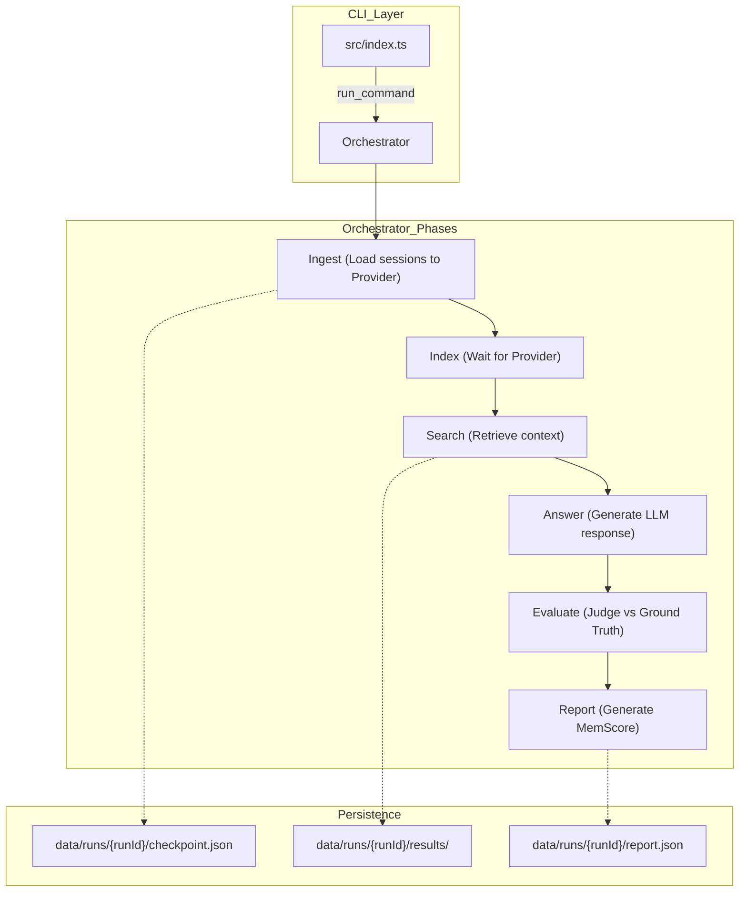
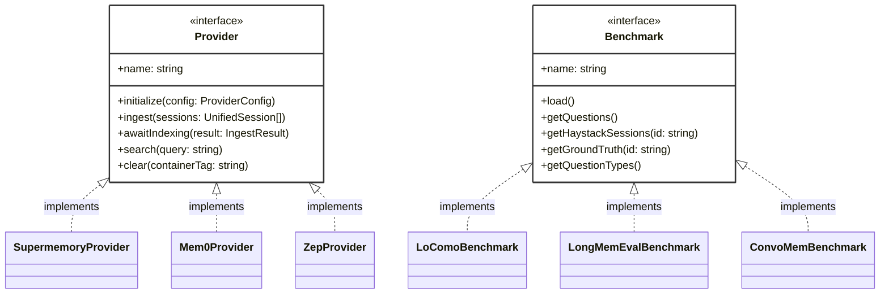

<!-- source: DeepWiki mcp.deepwiki.com · repo supermemoryai/supermemory · page 11.2 CLI & Extending MemoryBench · fetched 2026-10-30 -->

# CLI & Extending MemoryBench

Relevant source files

The following files were used as context for generating this wiki page:

- [apps/docs/memorybench/architecture.mdx](apps/docs/memorybench/architecture.mdx)
- [apps/docs/memorybench/cli.mdx](apps/docs/memorybench/cli.mdx)
- [apps/docs/memorybench/contributing.mdx](apps/docs/memorybench/contributing.mdx)
- [apps/docs/memorybench/extend-benchmark.mdx](apps/docs/memorybench/extend-benchmark.mdx)
- [apps/docs/memorybench/extend-provider.mdx](apps/docs/memorybench/extend-provider.mdx)
- [apps/docs/memorybench/github.mdx](apps/docs/memorybench/github.mdx)
- [apps/docs/memorybench/installation.mdx](apps/docs/memorybench/installation.mdx)
- [apps/docs/memorybench/integrations.mdx](apps/docs/memorybench/integrations.mdx)
- [apps/docs/memorybench/memscore.mdx](apps/docs/memorybench/memscore.mdx)
- [apps/docs/memorybench/overview.mdx](apps/docs/memorybench/overview.mdx)
- [apps/docs/memorybench/quickstart.mdx](apps/docs/memorybench/quickstart.mdx)

MemoryBench is an open-source benchmarking framework designed to evaluate memory layer providers (like Supermemory, Mem0, and Zep) using standardized datasets and metrics. This page documents the command-line interface, the internal orchestration logic, and the process for extending the framework with new providers or benchmarks.

## CLI Reference

The MemoryBench CLI is the primary interface for executing evaluations. It manages the lifecycle of a benchmark run, from data ingestion to final report generation. [apps/docs/memorybench/cli.mdx:3-5]()

### Core Commands

| Command | Usage | Description |
| :--- | :--- | :--- |
| `run` | `bun run src/index.ts run -p <provider> -b <benchmark>` | Executes the full pipeline for a specific provider and benchmark. [apps/docs/memorybench/cli.mdx:9-15]() |
| `compare` | `bun run src/index.ts compare -p p1,p2 -b <benchmark>` | Runs the same benchmark across multiple providers in parallel for direct comparison. [apps/docs/memorybench/cli.mdx:33-38]() |
| `status` | `bun run src/index.ts status -r <run-id>` | Checks the current progress and checkpoint state of a specific run. [apps/docs/memorybench/cli.mdx:53-58]() |
| `serve` | `bun run src/index.ts serve` | Launches the Next.js Web UI (at `localhost:3000`) to visualize results. [apps/docs/memorybench/cli.mdx:93-98]() |
| `show-failures`| `bun run src/index.ts show-failures -r <run-id>` | Displays detailed logs for questions that failed the evaluation phase. [apps/docs/memorybench/cli.mdx:63-68]() |
| `list-questions`| `bun run src/index.ts list-questions -b <benchmark>` | Browse available questions within a specific benchmark. [apps/docs/memorybench/cli.mdx:73-78]() |
| `test` | `bun run src/index.ts test -r <run-id> -q <q-id>` | Evaluate a single specific question for debugging purposes. [apps/docs/memorybench/cli.mdx:43-48]() |

### Execution Options
When using the `run` command, several flags control the scope and behavior of the evaluation:
*   `-j, --judge`: Specifies the LLM model used for scoring (e.g., `gpt-4o`). [apps/docs/memorybench/cli.mdx:21-21]()
*   `-m, --answering-model`: Model used for answer generation (default: `gpt-4o`). [apps/docs/memorybench/cli.mdx:23-23]()
*   `-l, --limit`: Limits the total number of questions processed. [apps/docs/memorybench/cli.mdx:24-24]()
*   `-s, --sample`: Samples $N$ questions per category from the benchmark. [apps/docs/memorybench/cli.mdx:25-25]()
*   `--sample-type`: Strategy for sampling (`consecutive` or `random`). [apps/docs/memorybench/cli.mdx:26-26]()
*   `--force`: Bypasses existing checkpoints and restarts the run from the `Ingest` phase. [apps/docs/memorybench/cli.mdx:27-27]()

### Data Flow: CLI to Orchestrator
The following diagram illustrates how CLI commands trigger the internal `Orchestrator` phases.

**MemoryBench Pipeline Flow**

**Sources:** [apps/docs/memorybench/architecture.mdx:49-59](), [apps/docs/memorybench/architecture.mdx:74-81](), [apps/docs/memorybench/architecture.mdx:88-99]()

## Extending MemoryBench

MemoryBench is designed as a modular system where providers and benchmarks are abstracted behind TypeScript interfaces. [apps/docs/memorybench/architecture.mdx:37-43]()

### Adding a New Memory Provider
To add a new provider (e.g., "MyProvider"), you must implement the `Provider` interface. [apps/docs/memorybench/extend-provider.mdx:9-19]()

1.  **Define the Provider Class**: Create a file at `src/providers/myprovider/index.ts`. [apps/docs/memorybench/extend-provider.mdx:27-30]()
2.  **Implement Interface Methods**:
    *   `initialize(config)`: Setup API clients and handle authentication via `ProviderConfig`. [apps/docs/memorybench/extend-provider.mdx:35-37]()
    *   `ingest(sessions, options)`: Convert `UnifiedSession[]` to provider-specific format and push to the memory service. [apps/docs/memorybench/extend-provider.mdx:39-49]()
    *   `awaitIndexing(result)`: Poll or wait until the provider confirms the ingested data is searchable. [apps/docs/memorybench/extend-provider.mdx:51-53]()
    *   `search(query, options)`: Execute retrieval against the ingested data and return raw results. [apps/docs/memorybench/extend-provider.mdx:55-57]()
    *   `clear(containerTag)`: Cleanup data or namespaces after the run. [apps/docs/memorybench/extend-provider.mdx:59-61]()
3.  **Register the Provider**: Add your class to the `providers` export in `src/providers/index.ts`. [apps/docs/memorybench/extend-provider.mdx:67-77]()
4.  **Add Configuration**: Map required environment variables (like API keys) in `src/utils/config.ts`. [apps/docs/memorybench/extend-provider.mdx:81-87]()

### Adding a New Benchmark Dataset
Benchmarks must implement the `Benchmark` interface to provide questions and context ("haystack") to the orchestrator. [apps/docs/memorybench/extend-benchmark.mdx:9-18]()

1.  **Create the Adapter**: Create a file at `src/benchmarks/mybenchmark/index.ts`. [apps/docs/memorybench/extend-benchmark.mdx:26-29]()
2.  **Implement Logic**:
    *   `load()`: Fetch the dataset (e.g., from HuggingFace, local JSON, or `snap-research/locomo`). [apps/docs/memorybench/extend-benchmark.mdx:35-38](), [apps/docs/memorybench/integrations.mdx:11-11]()
    *   `getQuestions()`: Return a list of `UnifiedQuestion` objects containing IDs and metadata. [apps/docs/memorybench/extend-benchmark.mdx:40-44]()
    *   `getHaystackSessions(questionId)`: Provide the historical messages (`UnifiedSession[]`) that the memory provider should ingest. [apps/docs/memorybench/extend-benchmark.mdx:46-48]()
    *   `getQuestionTypes()`: Register types like `temporal`, `adversarial`, or `knowledge-update` for the UI. [apps/docs/memorybench/extend-benchmark.mdx:54-59](), [apps/docs/memorybench/integrations.mdx:12-13]()
3.  **Register**: Add to the `benchmarks` object in `src/benchmarks/index.ts`. [apps/docs/memorybench/extend-benchmark.mdx:65-75]()

**Code Entity Mapping: Interfaces to Implementation**

**Sources:** [apps/docs/memorybench/extend-provider.mdx:9-19](), [apps/docs/memorybench/extend-benchmark.mdx:9-18](), [apps/docs/memorybench/integrations.mdx:7-35]()

## MemScore & Results

Every run concludes with the calculation of a **MemScore**, a composite metric designed to prevent hidden trade-offs between quality and cost. [apps/docs/memorybench/memscore.mdx:6-8]()

### Metric Components
MemScore is represented as a triple: `accuracy% / latencyMs / contextTok`. [apps/docs/memorybench/memscore.mdx:10-12]()

| Metric | Definition | Implementation |
| :--- | :--- | :--- |
| **Quality** | Accuracy % | Calculated as `(correct / total) * 100` based on LLM Judge output. [apps/docs/memorybench/memscore.mdx:26-26]() |
| **Latency** | Avg Search Time | The mean duration of all search phase durations in milliseconds. [apps/docs/memorybench/memscore.mdx:27-27]() |
| **Tokens** | Avg Context Tokens | Client-side token count of retrieved context using `js-tiktoken` (OpenAI) or `@anthropic-ai/tokenizer`. [apps/docs/memorybench/memscore.mdx:28-41]() |

### Contributing Results
To contribute results or new integrations back to the project:
1.  **Fork & Branch**: Create a feature branch in the `memorybench` repository. [apps/docs/memorybench/contributing.mdx:9-19]()
2.  **Validation**: Ensure all tests pass via `bun test`. [apps/docs/memorybench/contributing.mdx:25-27]()
3.  **Documentation**: If adding a benchmark, document the `QuestionTypeRegistry` so the Web UI can categorize results. [apps/docs/memorybench/extend-benchmark.mdx:54-59]()
4.  **Pull Request**: Submit a PR focusing on a single provider or benchmark change, following the style guidelines. [apps/docs/memorybench/contributing.mdx:80-86]()

**Sources:** [apps/docs/memorybench/memscore.mdx:1-121](), [apps/docs/memorybench/contributing.mdx:1-90]()

---

