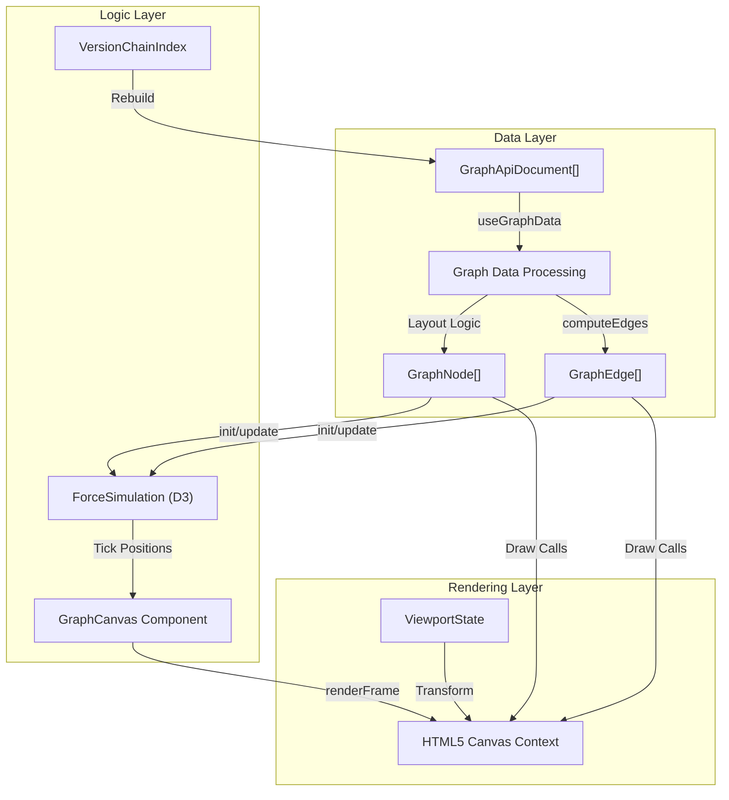
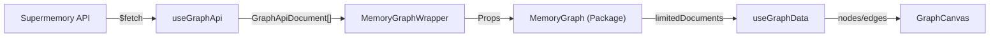

<!-- source: DeepWiki mcp.deepwiki.com · repo supermemoryai/supermemory · page 12 Memory Graph Package · fetched 2026-10-30 -->

# Memory Graph Package

Relevant source files

The following files were used as context for generating this wiki page:

- [apps/docs/memory-graph/api-reference.mdx](apps/docs/memory-graph/api-reference.mdx)
- [apps/docs/memory-graph/examples.mdx](apps/docs/memory-graph/examples.mdx)
- [apps/docs/memory-graph/installation.mdx](apps/docs/memory-graph/installation.mdx)
- [apps/docs/memory-graph/npm.mdx](apps/docs/memory-graph/npm.mdx)
- [apps/docs/memory-graph/overview.mdx](apps/docs/memory-graph/overview.mdx)
- [apps/docs/memory-graph/quickstart.mdx](apps/docs/memory-graph/quickstart.mdx)
- [apps/web/components/document-modal/graph-list-memories.tsx](apps/web/components/document-modal/graph-list-memories.tsx)
- [apps/web/components/graph-layout-view.tsx](apps/web/components/graph-layout-view.tsx)
- [apps/web/components/memory-graph/graph-card.tsx](apps/web/components/memory-graph/graph-card.tsx)
- [apps/web/components/memory-graph/hooks/use-graph-api.ts](apps/web/components/memory-graph/hooks/use-graph-api.ts)
- [apps/web/components/memory-graph/memory-graph-wrapper.tsx](apps/web/components/memory-graph/memory-graph-wrapper.tsx)
- [packages/memory-graph/README.md](packages/memory-graph/README.md)
- [packages/memory-graph/package.json](packages/memory-graph/package.json)
- [packages/memory-graph/src/__tests__/node-hover-popover.test.tsx](packages/memory-graph/src/__tests__/node-hover-popover.test.tsx)
- [packages/memory-graph/src/__tests__/setup.ts](packages/memory-graph/src/__tests__/setup.ts)
- [packages/memory-graph/src/components/legend.tsx](packages/memory-graph/src/components/legend.tsx)
- [packages/memory-graph/src/components/memory-graph.tsx](packages/memory-graph/src/components/memory-graph.tsx)
- [packages/memory-graph/src/components/node-hover-popover.tsx](packages/memory-graph/src/components/node-hover-popover.tsx)
- [packages/memory-graph/src/types.ts](packages/memory-graph/src/types.ts)
- [packages/memory-graph/vite.config.ts](packages/memory-graph/vite.config.ts)

The `memory-graph` package is a specialized React component library designed to visualize the relationships between documents and extracted memories within the Supermemory ecosystem. It provides a high-performance, interactive knowledge graph using a high-DPI HTML5 Canvas renderer and a D3-force simulation engine.

## Overview

The package is structured as a standalone library located in `packages/memory-graph` [[packages/memory-graph/package.json:2-4]](). It is primarily consumed by the main web application to show users how their captured information interrelates.

### Key Capabilities
*   **Hybrid Visualization**: Displays both "Document" nodes (source entities) and "Memory" nodes (extracted atomic facts) [[packages/memory-graph/src/types.ts:76-78]]().
*   **Version Chains**: Visualizes the evolution of memories through "updates", "extends", and "derives" relationships [[packages/memory-graph/src/types.ts:39-43]]().
*   **High Performance**: Uses a simulation engine with a threshold for static vs. dynamic rendering to handle dense graphs [[packages/memory-graph/src/components/memory-graph.tsx:137-143]]().
*   **Contextual UI**: Provides a `NodeHoverPopover` for quick inspection and `NavigationControls` for viewport manipulation [[packages/memory-graph/src/components/memory-graph.tsx:18-19]]().

### System Component Map

The following diagram illustrates how the memory graph components relate to the underlying data and the rendering layer.

**Graph Architecture: Data to Pixels**

Sources: [packages/memory-graph/src/components/memory-graph.tsx:52-56](), [packages/memory-graph/src/components/memory-graph.tsx:103-109](), [packages/memory-graph/src/components/memory-graph.tsx:153-169]()

## Package Structure

The package is organized into functional modules for data processing, physics, and UI components.

| Module | Purpose | Key Files |
| :--- | :--- | :--- |
| **Components** | React UI elements for the graph and its controls. | `memory-graph.tsx`, `graph-canvas.tsx`, `legend.tsx`, `node-hover-popover.tsx` |
| **Canvas Engine** | Rendering, physics, and viewport logic. | `simulation.ts`, `viewport.ts`, `version-chain.ts` |
| **Hooks** | Logic for data transformation and theme management. | `use-graph-data.ts`, `use-graph-theme.ts` |
| **API Integration** | Types and data fetching hooks for the web app. | `types.ts`, `use-graph-api.ts` |

Sources: [packages/memory-graph/src/components/memory-graph.tsx:1-19](), [packages/memory-graph/package.json:9-13](), [apps/web/components/memory-graph/hooks/use-graph-api.ts:118-120]()

## Graph Components & Hooks

The core of the package is the `MemoryGraph` component, which orchestrates several specialized classes and hooks to manage the graph lifecycle.

*   **`useGraphData`**: Processes raw document arrays into `GraphNode` and `GraphEdge` objects. It limits total node count based on `maxNodes` to maintain performance [[packages/memory-graph/src/components/memory-graph.tsx:67-99]]().
*   **`ForceSimulation`**: Wraps `d3-force` to handle node physics. It supports append-only pagination by keeping existing coordinates stable while rendering new nodes [[packages/memory-graph/src/components/memory-graph.tsx:124-126]]().
*   **`GraphCanvas`**: The primary rendering component that handles user interactions like hovering, clicking, and dragging nodes [[packages/memory-graph/src/types.ts:135-153]]().

For more details on the rendering engine and physics, see [Graph Components & Hooks](#12.1).

## Integration & Playground

The package is used across the Supermemory web application and includes a dedicated playground for testing.

### Usage in apps/web
The web application uses `MemoryGraph` in several contexts:
1.  **Main View**: The `GraphLayoutView` provides a full-screen interactive experience [[apps/web/components/graph-layout-view.tsx:38-49]]().
2.  **Document Modal**: The `GraphListMemories` component embeds the graph within a tabbed interface to show local connections for a specific document [[apps/web/components/document-modal/graph-list-memories.tsx:208-215]]().
3.  **Dashboard Preview**: The `GraphCard` provides a static preview with a simplified SVG-based rendering for quick loading [[apps/web/components/memory-graph/graph-card.tsx:27-37]]().

### Data Fetching
The `useGraphApi` hook integrates with the Supermemory backend to fetch documents and their associated memories, supporting infinite scrolling and filtering by `containerTags` [[apps/web/components/memory-graph/hooks/use-graph-api.ts:131-159]]().

**Data Flow: API to Graph**

Sources: [apps/web/components/memory-graph/memory-graph-wrapper.tsx:37-49](), [packages/memory-graph/src/components/memory-graph.tsx:103-109](), [apps/web/components/memory-graph/hooks/use-graph-api.ts:140-159]()

For details on implementation and deployment, see [Integration & Playground](#12.2).

## Visual Constants & Configuration

The graph's appearance is highly configurable through themes and node-specific data.

*   **Themes**: The `GraphThemeColors` interface defines colors for backgrounds, nodes, edges (by type), and UI controls [[packages/memory-graph/src/types.ts:106-133]]().
*   **Node Status**: Memories are visually distinguished based on their state, such as "latest", "static", "expiring", or "forgotten" [[apps/web/components/document-modal/graph-list-memories.tsx:19-23]]().
*   **Legend**: The `Legend` component provides a breakdown of memory types, document types, and connection counts [[packages/memory-graph/src/components/legend.tsx:289-315]]().

Sources: [packages/memory-graph/src/types.ts:106-133](), [apps/web/components/document-modal/graph-list-memories.tsx:19-167]()

---

