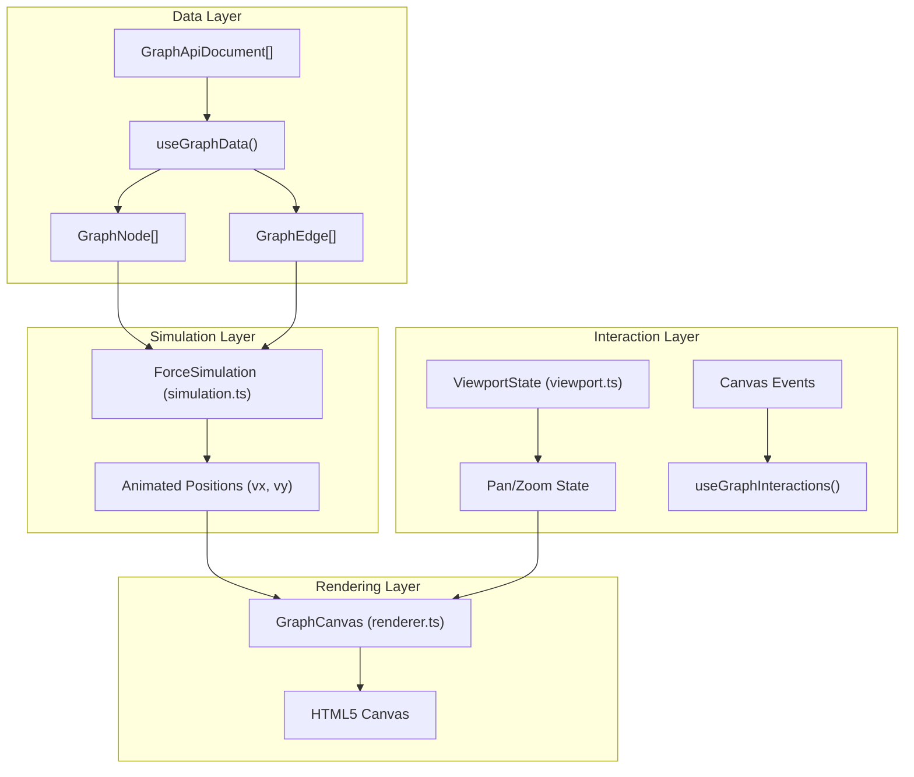
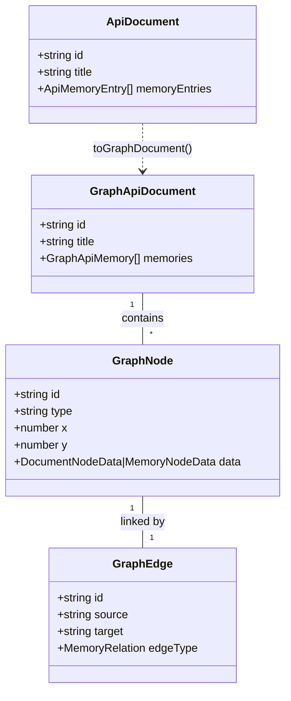
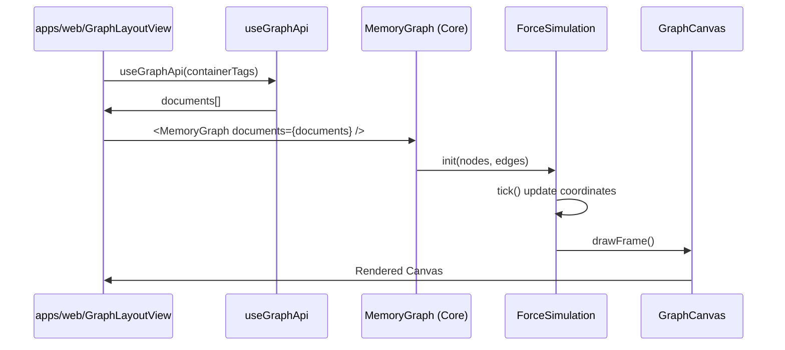

<!-- source: DeepWiki mcp.deepwiki.com · repo supermemoryai/supermemory · page 12.1 Graph Components & Hooks · fetched 2026-10-30 -->

# Graph Components & Hooks

Relevant source files

The following files were used as context for generating this wiki page:

- [apps/memory-graph-playground/src/app/page.tsx](apps/memory-graph-playground/src/app/page.tsx)
- [apps/web/components/document-modal/graph-list-memories.tsx](apps/web/components/document-modal/graph-list-memories.tsx)
- [apps/web/components/graph-layout-view.tsx](apps/web/components/graph-layout-view.tsx)
- [apps/web/components/memory-graph/graph-card.tsx](apps/web/components/memory-graph/graph-card.tsx)
- [apps/web/components/memory-graph/hooks/use-graph-api.ts](apps/web/components/memory-graph/hooks/use-graph-api.ts)
- [apps/web/components/memory-graph/memory-graph-wrapper.tsx](apps/web/components/memory-graph/memory-graph-wrapper.tsx)
- [packages/memory-graph/package.json](packages/memory-graph/package.json)
- [packages/memory-graph/src/__tests__/edge-logic.test.ts](packages/memory-graph/src/__tests__/edge-logic.test.ts)
- [packages/memory-graph/src/__tests__/graph-data-utils.test.ts](packages/memory-graph/src/__tests__/graph-data-utils.test.ts)
- [packages/memory-graph/src/__tests__/node-hover-popover.test.tsx](packages/memory-graph/src/__tests__/node-hover-popover.test.tsx)
- [packages/memory-graph/src/__tests__/renderer-utils.test.ts](packages/memory-graph/src/__tests__/renderer-utils.test.ts)
- [packages/memory-graph/src/__tests__/setup.ts](packages/memory-graph/src/__tests__/setup.ts)
- [packages/memory-graph/src/__tests__/simulation.test.ts](packages/memory-graph/src/__tests__/simulation.test.ts)
- [packages/memory-graph/src/__tests__/version-chain.test.ts](packages/memory-graph/src/__tests__/version-chain.test.ts)
- [packages/memory-graph/src/__tests__/viewport.test.ts](packages/memory-graph/src/__tests__/viewport.test.ts)
- [packages/memory-graph/src/canvas/renderer.ts](packages/memory-graph/src/canvas/renderer.ts)
- [packages/memory-graph/src/components/graph-canvas.tsx](packages/memory-graph/src/components/graph-canvas.tsx)
- [packages/memory-graph/src/components/legend.tsx](packages/memory-graph/src/components/legend.tsx)
- [packages/memory-graph/src/components/memory-graph.tsx](packages/memory-graph/src/components/memory-graph.tsx)
- [packages/memory-graph/src/components/node-hover-popover.tsx](packages/memory-graph/src/components/node-hover-popover.tsx)
- [packages/memory-graph/src/constants.ts](packages/memory-graph/src/constants.ts)
- [packages/memory-graph/src/hooks/use-graph-data.ts](packages/memory-graph/src/hooks/use-graph-data.ts)
- [packages/memory-graph/src/types.ts](packages/memory-graph/src/types.ts)
- [packages/memory-graph/vite.config.ts](packages/memory-graph/vite.config.ts)

The `@supermemory/memory-graph` package provides a high-performance visualization system for knowledge graphs, representing the relationship between documents and their extracted memories. It utilizes a specialized rendering architecture to support both interactive exploration and large-scale data visualization.

## Architecture Overview

The graph system is built around the `MemoryGraph` React component, which orchestrates data processing via `useGraphData`, interaction logic via `useGraphInteractions`, and physics simulation using `d3-force`.

### Data Flow and Component Hierarchy

The system follows a unidirectional data flow where raw API data is transformed into graph entities, simulated in a physical space, and rendered to a canvas.

**Sources:**
- [packages/memory-graph/src/components/memory-graph.tsx:50-109]()
- [packages/memory-graph/src/canvas/simulation.ts:1-31]()
- [packages/memory-graph/src/types.ts:155-198]()

---

## Core Hooks & API Integration

### `useGraphApi`
This hook, used within the web application, manages the fetching of graph data from the Supermemory API using `@tanstack/react-query`.
- **Infinite Loading:** Implements `useInfiniteQuery` to fetch documents and their associated memories in pages of 500 `[apps/web/components/memory-graph/hooks/use-graph-api.ts:12-131]()`.
- **Filtering:** Supports filtering by `containerTags` and specific `documentIds` `[apps/web/components/memory-graph/hooks/use-graph-api.ts:120-159]()`.
- **Node Capping:** Provides a `maxNodes` constraint to prevent browser performance degradation when visualizing extremely large datasets `[apps/web/components/memory-graph/hooks/use-graph-api.ts:169-175]()`.
- **Data Transformation:** Converts backend `ApiDocument` and `ApiMemoryEntry` types into the visualization-ready `GraphApiDocument` and `GraphApiMemory` formats `[apps/web/components/memory-graph/hooks/use-graph-api.ts:70-116]()`.

### `useGraphData`
This hook transforms `GraphApiDocument` arrays into visual `GraphNode` and `GraphEdge` objects.
- **Initial Placement:** Uses a spiral layout for documents and an orbital layout for memories to ensure a clean starting state before the simulation begins `[packages/memory-graph/src/hooks/use-graph-data.ts:70-103]()`.
- **Clustering:** Implements `computeClusterAssignments` to group nodes based on their semantic relationships and shared parent documents using a BFS-based component discovery `[packages/memory-graph/src/hooks/use-graph-data.ts:114-191]()`.
- **Dynamic Coloring:** Assigns colors based on clusters or memory status (forgotten, expiring, or recent) via `getMemoryBorderColor` `[packages/memory-graph/src/hooks/use-graph-data.ts:43-55]()`.

**Sources:**
- [apps/web/components/memory-graph/hooks/use-graph-api.ts:118-225]()
- [packages/memory-graph/src/hooks/use-graph-data.ts:1-258]()

---

## Rendering and Physics

### `GraphCanvas` & `renderer.ts`
The rendering engine for the `@supermemory/memory-graph` package. It uses a high-DPI 2D canvas context and a custom level-of-detail (LOD) system.
- **Level of Detail (LOD):** To maintain performance, the renderer samples edges based on zoom level and density using `getRelationEdgeStride` and `getDerivesEdgeStride` `[packages/memory-graph/src/canvas/renderer.ts:94-115]()`.
- **Hit Testing:** Implements spatial detection for node hover and selection `[packages/memory-graph/src/types.ts:143-146]()`.
- **Batch Rendering:** Groups draw calls by color and style to minimize canvas state changes `[packages/memory-graph/src/canvas/renderer.ts:39-60]()`.
- **Viewport Management:** Integrates with `ViewportState` to handle zooming and panning, including auto-fitting the graph to the container size `[packages/memory-graph/src/components/memory-graph.tsx:180-223]()`.

### `ForceSimulation`
The physics engine based on `d3-force`.
- **Configuration:** Physics are tuned via `FORCE_CONFIG` for organic clustering, including specific strengths for document-memory links and collision radii `[packages/memory-graph/src/constants.ts:10-31]()`.
- **Lifecycle:** The simulation is initialized, updated, or stopped based on whether data updates are "append-only" (stable) or require a full re-settle `[packages/memory-graph/src/components/memory-graph.tsx:127-169]()`.
- **Dense Graphs:** For graphs exceeding `DENSE_GRAPH_STATIC_THRESHOLD` (set to 800), the simulation is bypassed for static rendering to maintain performance `[packages/memory-graph/src/canvas/simulation.ts:3]()`.

**Sources:**
- [packages/memory-graph/src/canvas/simulation.ts:1-31]()
- [packages/memory-graph/src/canvas/renderer.ts:66-212]()
- [packages/memory-graph/src/constants.ts:10-31]()
- [packages/memory-graph/src/components/memory-graph.tsx:21-169]()

---

## D3-Force Configuration Parameters

The physics simulation is tuned via `FORCE_CONFIG` to create organic clusters while maintaining legibility.

| Parameter | Value | Description |
| :--- | :--- | :--- |
| `linkStrength.docMemory` | 0.35 | Strength of the bond between a document and its memories. |
| `chargeStrength` | -2400 | Global repulsion (Many-Body force) to prevent overlapping. |
| `collisionRadius.document`| 80 | Minimum distance around document nodes. |
| `velocityDecay` | 0.45 | Friction applied to node movement. |
| `alphaDecay` | 0.025 | Rate at which the simulation settles (cools down). |

**Sources:**
- [packages/memory-graph/src/constants.ts:10-31]()

---

## System Entity Mapping

### Data Structure Mapping
Mapping the API concepts to the internal graph visualization types.

### Component & Hook Interaction
This diagram shows how the components in `apps/web` interact with the core package.

**Sources:**
- [apps/web/components/graph-layout-view.tsx:16-49]()
- [apps/web/components/memory-graph/hooks/use-graph-api.ts:118-212]()
- [packages/memory-graph/src/components/memory-graph.tsx:21-169]()
- [packages/memory-graph/src/types.ts:76-104]()

---

