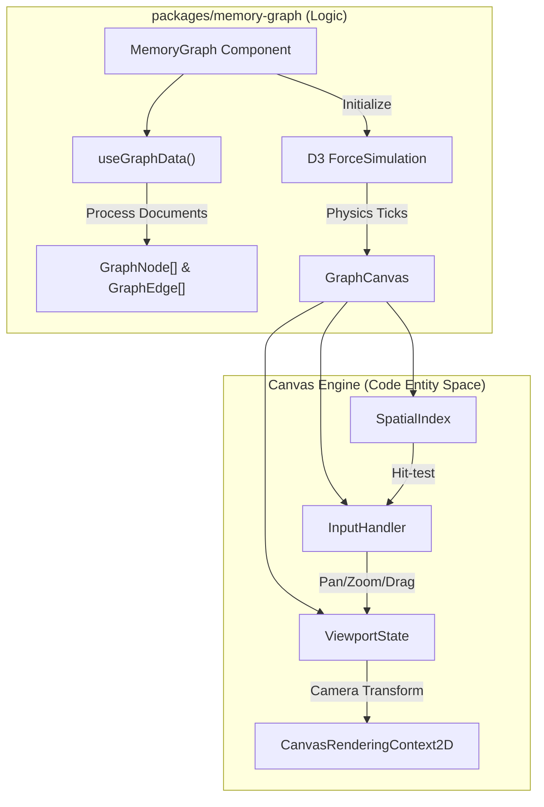
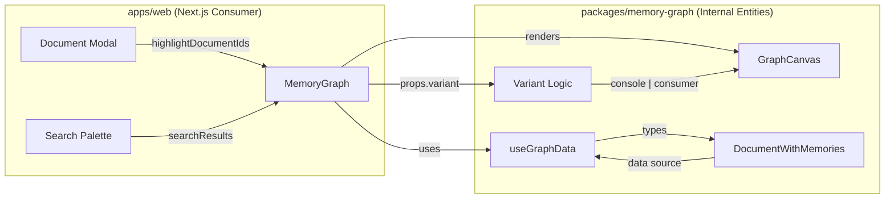

<!-- source: DeepWiki mcp.deepwiki.com · repo supermemoryai/supermemory · page 12.2 Integration & Playground · fetched 2026-10-30 -->

# Integration & Playground

Relevant source files

The following files were used as context for generating this wiki page:

- [apps/browser-extension/utils/posthog.ts](apps/browser-extension/utils/posthog.ts)
- [apps/docs/memory-graph/api-reference.mdx](apps/docs/memory-graph/api-reference.mdx)
- [apps/docs/memory-graph/examples.mdx](apps/docs/memory-graph/examples.mdx)
- [apps/docs/memory-graph/installation.mdx](apps/docs/memory-graph/installation.mdx)
- [apps/docs/memory-graph/npm.mdx](apps/docs/memory-graph/npm.mdx)
- [apps/docs/memory-graph/overview.mdx](apps/docs/memory-graph/overview.mdx)
- [apps/docs/memory-graph/quickstart.mdx](apps/docs/memory-graph/quickstart.mdx)
- [apps/docs/package.json](apps/docs/package.json)
- [apps/memory-graph-playground/package.json](apps/memory-graph-playground/package.json)
- [packages/docs-test/package.json](packages/docs-test/package.json)
- [packages/memory-graph/README.md](packages/memory-graph/README.md)
- [packages/tools/test/chatapp/package.json](packages/tools/test/chatapp/package.json)
- [portless.json](portless.json)

The Supermemory ecosystem provides a dedicated visualization package, `@supermemory/memory-graph`, and a corresponding playground application to test graph interactions. This page documents the implementation of the graph visualization, its integration into the primary web application, and the standalone playground environment.

## 1. The Memory Graph Package

The `@supermemory/memory-graph` package is a React-based component library built on top of `d3-force` for physics simulations and a high-performance HTML5 Canvas renderer. It is designed to visualize the relationships between documents and extracted memories.

### Key Components & Hooks
- **`MemoryGraph`**: The primary entry point component that orchestrates the canvas, simulation, and data flow [packages/memory-graph/README.md:39-43]().
- **`GraphCanvas`**: A specialized component that handles the low-level 2D Canvas rendering of nodes and edges, optimized with a `requestAnimationFrame` (rAF) loop.
- **`useGraphData`**: A hook that transforms raw document data into a graph structure consisting of nodes and edges.
- **`SpatialIndex`**: A utility used within the canvas to perform efficient hit-testing for mouse interactions (hover/click) [apps/docs/memory-graph/overview.mdx:24-24]().
- **`InputHandler`**: Manages user interactions like panning, zooming, and node dragging [apps/docs/memory-graph/overview.mdx:10-10]().

### Data Flow & Simulation
The graph utilizes a force-directed layout where documents act as central nodes (rectangles) and memories (hexagons) are linked to them [apps/docs/memory-graph/overview.mdx:8-8](). The system supports relationship visualization including document similarity and memory version chains [packages/memory-graph/README.md:53-53]().

Sources: [packages/memory-graph/README.md:51-57](), [apps/docs/memory-graph/overview.mdx:8-11]()

## 2. Integration in Web Application

The memory graph is integrated into `apps/web` to provide a visual representation of the user's knowledge base, specifically within document views and search contexts.

### Visual Variants
The component supports two primary variants [packages/memory-graph/README.md:65-65]():
- **`console`**: Full-featured dashboard view for navigating memory spaces [apps/docs/memory-graph/quickstart.mdx:41-41]().
- **`consumer`**: Embedded widget view used for document modals or smaller UI sections [apps/docs/memory-graph/quickstart.mdx:153-153]().

### Features & Optimization
- **Space Filtering**: Allows users to filter the graph by workspace or view all memories [packages/memory-graph/README.md:54-54]().
- **Pagination**: Supports loading more documents on demand for large datasets [packages/memory-graph/README.md:56-56]().
- **Performance**: Uses viewport culling and level-of-detail optimization to handle hundreds of nodes smoothly [apps/docs/memory-graph/overview.mdx:22-27]().

### Component Relationship Diagram
This diagram maps the high-level UI features to the underlying code implementation.

Sources: [packages/memory-graph/README.md:22-22](), [apps/docs/memory-graph/examples.mdx:78-128](), [apps/docs/memory-graph/quickstart.mdx:13-14]()

## 3. Memory Graph Playground

The `apps/memory-graph-playground` is a standalone Next.js application used for development and testing of the visualization package [apps/memory-graph-playground/package.json:2-17]().

### Playground Features
- **Development Environment**: Configured with `portless` to run on `graph.dev.supermemory` at port 3004 [apps/memory-graph-playground/package.json:5-8]().
- **Real-time Testing**: Enables developers to test new layout algorithms or rendering optimizations without reloading the entire main application.
- **Dependency Management**: Uses the workspace version of `@supermemory/memory-graph` to ensure changes in the package are immediately reflected [apps/memory-graph-playground/package.json:13-13]().

## 4. Technical Configuration

### Installation & Requirements
The package requires React 18+ and can be installed via standard package managers [packages/memory-graph/README.md:10-16]().

| Requirement | Specification |
|-------------|---------------|
| React Version | ^18.0.0 [apps/docs/memory-graph/installation.mdx:16-16]() |
| DOM Library | react-dom ^18.0.0 [apps/docs/memory-graph/installation.mdx:17-17]() |
| Browser Support | Canvas 2D, ES2020 [apps/docs/memory-graph/overview.mdx:33-36]() |

### API Integration
To populate the graph, developers typically fetch data from the Supermemory `v3/documents/documents` endpoint [apps/docs/memory-graph/quickstart.mdx:59-59](). This requires a `SUPERMEMORY_API_KEY` which should be kept on the server-side to avoid exposure [apps/docs/memory-graph/quickstart.mdx:129-131]().

### Styling
The component includes bundled styles that are automatically injected when the component mounts [apps/docs/memory-graph/quickstart.mdx:159-159](). For explicit control, developers can import `@supermemory/memory-graph/styles.css` [apps/docs/memory-graph/quickstart.mdx:164-164]().

Sources: [packages/memory-graph/README.md:1-95](), [apps/docs/memory-graph/quickstart.mdx:1-208](), [apps/docs/memory-graph/overview.mdx:1-39](), [apps/memory-graph-playground/package.json:1-27]()

---

