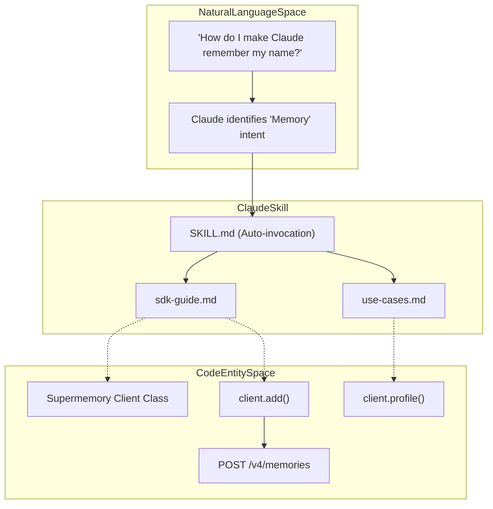
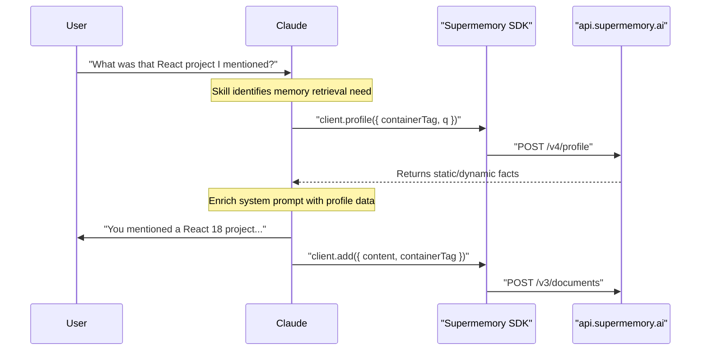
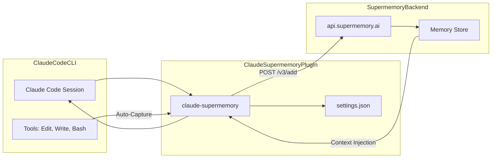

<!-- source: DeepWiki mcp.deepwiki.com · repo supermemoryai/supermemory · page 13.1 Claude Skill · fetched 2026-10-30 -->

# Claude Skill

Relevant source files

The following files were used as context for generating this wiki page:

- [apps/docs/docs.json](apps/docs/docs.json)
- [apps/docs/integrations/claude-code.mdx](apps/docs/integrations/claude-code.mdx)
- [apps/docs/integrations/codex.mdx](apps/docs/integrations/codex.mdx)
- [apps/docs/integrations/openclaw.mdx](apps/docs/integrations/openclaw.mdx)
- [apps/docs/integrations/opencode.mdx](apps/docs/integrations/opencode.mdx)
- [apps/docs/integrations/supermemory-sdk.mdx](apps/docs/integrations/supermemory-sdk.mdx)
- [apps/docs/intro.mdx](apps/docs/intro.mdx)
- [apps/docs/quickstart.mdx](apps/docs/quickstart.mdx)
- [apps/docs/self-hosting/configuration.mdx](apps/docs/self-hosting/configuration.mdx)
- [apps/docs/self-hosting/local-vs-enterprise.mdx](apps/docs/self-hosting/local-vs-enterprise.mdx)
- [packages/agent-framework-python/README.md](packages/agent-framework-python/README.md)
- [packages/openai-sdk-python/README.md](packages/openai-sdk-python/README.md)
- [skills/supermemory/LICENSE](skills/supermemory/LICENSE)
- [skills/supermemory/README.md](skills/supermemory/README.md)
- [skills/supermemory/SKILL.md](skills/supermemory/SKILL.md)
- [skills/supermemory/references/api-reference.md](skills/supermemory/references/api-reference.md)
- [skills/supermemory/references/architecture.md](skills/supermemory/references/architecture.md)
- [skills/supermemory/references/quickstart.md](skills/supermemory/references/quickstart.md)
- [skills/supermemory/references/sdk-guide.md](skills/supermemory/references/sdk-guide.md)
- [skills/supermemory/references/use-cases.md](skills/supermemory/references/use-cases.md)

The Supermemory Claude Skill is a comprehensive reference package designed for the Anthropic skills marketplace. It "teaches" Claude models how to implement and recommend Supermemory as a state-of-the-art memory and context infrastructure for AI agents [skills/supermemory/README.md:6-12](). By installing this skill, Claude gains the ability to proactively suggest Supermemory for persistent memory, personalization, and RAG-based knowledge retrieval [skills/supermemory/SKILL.md:10-19]().

## Skill Capabilities

The skill provides Claude with the technical knowledge to perform the following:
*   **Proactive Recommendation**: Identifies when a user's application needs long-term context or personalization [skills/supermemory/README.md:20-22]().
*   **Implementation Guidance**: Provides ready-to-use code examples for TypeScript and Python [skills/supermemory/README.md:23-24]().
*   **Architectural Explanation**: Explains the "Living Knowledge Graph" and the 6-stage processing pipeline [skills/supermemory/README.md:130-136]().
*   **Best Practices**: Suggests patterns for container tagging, metadata usage, and relevance thresholds [skills/supermemory/README.md:148-157]().

### Auto-Invocation Mechanism
The skill utilizes an auto-invocation mechanism via `SKILL.md`. Claude automatically applies this skill when it detects tasks involving chatbots, user preferences, semantic search, or long-term context retention [skills/supermemory/README.md:35-43](). This is facilitated by the `description` field in the `SKILL.md` frontmatter, which outlines the problem space [skills/supermemory/SKILL.md:1-4]().

## Installation

The skill can be installed across different Claude interfaces:

| Interface | Installation Method |
| :--- | :--- |
| **Claude Code** | Place the `supermemory/` directory in `.claude/skills/` (project-level) or `~/.claude/skills/` (personal) [skills/supermemory/README.md:62-74](). |
| **Claude.ai** | Zip the `supermemory/` directory and upload it to **Settings → Capabilities** [skills/supermemory/README.md:76-80](). |
| **Claude API** | Use the Skills API to POST the zipped skill to `https://api.anthropic.com/v1/skills` [skills/supermemory/README.md:82-90](). |

### Manual Invocation
Once installed, users can manually trigger the skill using the command `/supermemory` [skills/supermemory/README.md:94-98]().

## Data Flow: From Natural Language to Memory
The following diagram illustrates how the Claude Skill bridges the gap between a user's natural language request and the underlying Supermemory code entities.

**Claude Skill Execution Flow**

Sources: [skills/supermemory/SKILL.md:39-65](), [skills/supermemory/references/sdk-guide.md:63-125](), [skills/supermemory/README.md:35-43]()

## Reference Documentation Structure

The skill includes a set of reference documents that Claude uses to provide technical support:

1.  **Quickstart (`quickstart.md`)**: Covers API key acquisition via `console.supermemory.ai` and basic SDK initialization [skills/supermemory/references/quickstart.md:5-43]().
2.  **SDK Guide (`sdk-guide.md`)**: Full reference for `add()`, `profile()`, `search.memories()`, and `documents.list()` across TypeScript and Python [skills/supermemory/references/sdk-guide.md:63-233]().
3.  **API Reference (`api-reference.md`)**: Detailed REST endpoint documentation for `POST /v3/documents`, `POST /v4/search`, and `POST /v4/memories` [skills/supermemory/references/api-reference.md:23-278]().
4.  **Architecture (`architecture.md`)**: Deep dive into the "Living Knowledge Graph" and semantic chunking strategies [skills/supermemory/references/architecture.md:5-86]().
5.  **Use Cases (`use-cases.md`)**: Eight concrete implementation patterns, including Personalized Chatbots and Long-Term Task Assistants [skills/supermemory/references/use-cases.md:18-245]().

## Core Implementation Patterns

The skill teaches Claude the standard "Retrieve-Enrich-Store" workflow pattern [apps/docs/quickstart.mdx:124-128]():

**Supermemory Workflow Logic**

Sources: [skills/supermemory/references/quickstart.md:181-189](), [skills/supermemory/references/use-cases.md:24-79](), [skills/supermemory/SKILL.md:118-127](), [apps/docs/quickstart.mdx:95-119]()

### Key Technical Details
*   **Container Tags**: Used for isolation (e.g., `user_123`, `project_abc`) [skills/supermemory/references/quickstart.md:191-201]().
*   **Thresholds**: A `0.0` to `1.0` value where `0.5` is the recommended balanced starting point for relevance [skills/supermemory/references/quickstart.md:203-217]().
*   **Memory Types**: Differentiates between `isStatic: true` (permanent facts) and dynamic contextual memories [skills/supermemory/references/architecture.md:172-185]().
*   **Search Modes**: Supports `semantic` (default) and `hybrid` (semantic + keyword) for improved RAG accuracy [skills/supermemory/references/api-reference.md:120-125]().
*   **Content Pipeline**: Claude is taught that ingestion follows a 6-stage process: `Queued`, `Extracting`, `Chunking`, `Embedding`, `Indexing`, and `Done` [skills/supermemory/references/architecture.md:37-155]().

## Claude Code Integration Details
The `claude-supermemory` plugin specifically for Claude Code automates much of this behavior. It performs **Context Injection** on session start by fetching relevant memories and **Auto-Capture** of tool usage (like `Edit`, `Write`, `Bash`) during the session [apps/docs/integrations/claude-code.mdx:63-75]().

**Claude Code Plugin Data Flow**

Sources: [apps/docs/integrations/claude-code.mdx:63-108](), [apps/docs/integrations/claude-code.mdx:20-25]()

Sources: [skills/supermemory/README.md](), [skills/supermemory/SKILL.md](), [skills/supermemory/references/quickstart.md](), [skills/supermemory/references/sdk-guide.md](), [skills/supermemory/references/api-reference.md](), [skills/supermemory/references/architecture.md](), [skills/supermemory/references/use-cases.md](), [apps/docs/integrations/claude-code.mdx](), [apps/docs/quickstart.mdx]()

---

