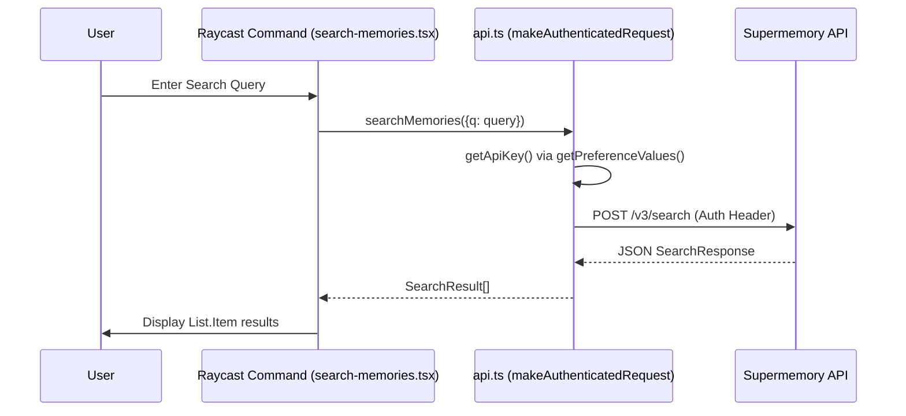

<!-- source: DeepWiki mcp.deepwiki.com · repo supermemoryai/supermemory · page 13.2 Raycast Extension · fetched 2026-10-30 -->

# Raycast Extension

<details>
<summary>Relevant source files</summary>

The following files were used as context for generating this wiki page:

- [apps/raycast-extension/.gitignore](apps/raycast-extension/.gitignore)
- [apps/raycast-extension/CHANGELOG.md](apps/raycast-extension/CHANGELOG.md)
- [apps/raycast-extension/README.md](apps/raycast-extension/README.md)
- [apps/raycast-extension/assets/extension-icon.png](apps/raycast-extension/assets/extension-icon.png)
- [apps/raycast-extension/eslint.config.js](apps/raycast-extension/eslint.config.js)
- [apps/raycast-extension/metadata/supermemory-1.png](apps/raycast-extension/metadata/supermemory-1.png)
- [apps/raycast-extension/metadata/supermemory-2.png](apps/raycast-extension/metadata/supermemory-2.png)
- [apps/raycast-extension/package-lock.json](apps/raycast-extension/package-lock.json)
- [apps/raycast-extension/package.json](apps/raycast-extension/package.json)
- [apps/raycast-extension/src/add-memory.tsx](apps/raycast-extension/src/add-memory.tsx)
- [apps/raycast-extension/src/api.ts](apps/raycast-extension/src/api.ts)
- [apps/raycast-extension/src/search-memories.tsx](apps/raycast-extension/src/search-memories.tsx)
- [apps/raycast-extension/src/search-projects.tsx](apps/raycast-extension/src/search-projects.tsx)
- [apps/raycast-extension/src/withSupermemory.tsx](apps/raycast-extension/src/withSupermemory.tsx)

</details>


The Supermemory Raycast extension brings the power of your personal AI knowledge base directly to macOS. It allows users to capture information, search through their memories, and manage projects without leaving their current workflow.

## Architecture & Integration

The extension is built using the Raycast SDK and communicates with the Supermemory backend via a dedicated API client. It leverages Raycast's native UI components like `List`, `Form`, and `ActionPanel` to provide a seamless macOS experience.

### Data Flow Diagram

This diagram illustrates how the Raycast extension interacts with the Supermemory API and the local macOS environment, specifically highlighting the transition from user intent to code-level execution.

```mermaid
graph TD
    subgraph "macOS / Raycast UI"
        USER["User Input / Selection"] --> |"getSelectedText()"| CMD["Raycast Command"]
        PREF["Preferences"] --> |"getApiKey()"| API_C["api.ts Client"]
    end

    subgraph "apps/raycast-extension/src"
        CMD --> |"calls"| API_C
        API_C --> |"makeAuthenticatedRequest"| REQ["fetch()"]
        
        subgraph "CommandLogicEntities [Command Logic Entities]"
            ADD["add-memory.tsx:Command"]
            SEARCH["search-memories.tsx:Command"]
            PROJ["search-projects.tsx:Command"]
        end
        
        WRAP["withSupermemory.tsx:SupermemoryWrappedComponent"] --> |"Guards"| CommandLogicEntities
    end

    subgraph "Supermemory Backend"
        REQ --> |"HTTPS /v3/*"| BE["API Gateway"]
        BE --> DB[("Vector & Relational DB")]
    end

    Sources: [apps/raycast-extension/src/api.ts:54-135](), [apps/raycast-extension/src/add-memory.tsx:21-43](), [apps/raycast-extension/src/withSupermemory.tsx:13-48]()
```

### Authentication Guard: `withSupermemory`

To ensure a valid user session, all commands are wrapped in a Higher-Order Component (HOC) called `withSupermemory` [apps/raycast-extension/src/withSupermemory.tsx:13-48](). This wrapper performs a pre-flight check by calling the `/v3/settings` endpoint via `fetchSettings` [apps/raycast-extension/src/api.ts:219-222]().

*   **Behavior:** Uses `usePromise(fetchSettings)` to validate the key [apps/raycast-extension/src/withSupermemory.tsx:15-21](). 
*   **Error Handling:** If the API key is missing or the request fails, it renders a `List.EmptyView` with an action to `openExtensionPreferences`, guiding the user to configure their credentials [apps/raycast-extension/src/withSupermemory.tsx:27-43]().

## Core Commands

The extension provides three primary commands defined in the `package.json` manifest [apps/raycast-extension/package.json:21-43]().

### 1. Add Memory (`add-memory.tsx`)
Allows users to save text snippets or URLs to their knowledge base.

*   **Context Awareness:** On mount, the command attempts to fetch currently selected text from macOS using `getSelectedText()` and pre-fills the content area [apps/raycast-extension/src/add-memory.tsx:29-43]().
*   **Project Scoping:** Users can select a project (container tag) via a `Form.Dropdown` populated by `fetchProjects` [apps/raycast-extension/src/add-memory.tsx:97-111]().
*   **Implementation:** Calls `addMemory` which hits the `POST /v3/documents` endpoint [apps/raycast-extension/src/api.ts:169-192]().

### 2. Search Memories (`search-memories.tsx`)
A real-time search interface for retrieving saved information.

*   **Context Awareness:** Similar to Add Memory, it can automatically fill the search field with currently selected text [apps/raycast-extension/src/search-memories.tsx:59-72]().
*   **Search Logic:** Uses `usePromise` with the `searchText` state to trigger `searchMemories` [apps/raycast-extension/src/search-memories.tsx:74-93]().
*   **Result Processing:** 
    *   `extractContent`: Flattens complex chunk objects (supporting `string`, `content`, or `text` fields) into a single string for display [apps/raycast-extension/src/search-memories.tsx:16-41]().
    *   `extractUrl`: Retrieves source URLs from metadata [apps/raycast-extension/src/search-memories.tsx:43-48]().
*   **Detail View:** Selecting a memory opens a `MemoryDetail` component [apps/raycast-extension/src/search-memories.tsx:180-217](). This provides a full Markdown preview of the content, creation date, and relevance score [apps/raycast-extension/src/search-memories.tsx:184-194]().

### 3. Search Projects (`search-projects.tsx`)
Manages organizational units (projects/container tags).

*   **Listing:** Displays all projects with their `containerTag` as an accessory [apps/raycast-extension/src/search-projects.tsx:41-60]().
*   **Creation:** Includes a `CreateProject` sub-view that uses the `useForm` hook from `@raycast/utils` to validate and submit new project names via `addProject` [apps/raycast-extension/src/search-projects.tsx:65-106]().

## API Integration Details

The extension uses a centralized API utility to handle communication with `https://api.supermemory.ai` [apps/raycast-extension/src/api.ts:54]().

### Code Entity Mapping

| Raycast Component | Code Entity | API Endpoint |
| :--- | :--- | :--- |
| **Add Memory** | `addMemory` [apps/raycast-extension/src/api.ts:169]() | `POST /v3/documents` |
| **Search Memories** | `searchMemories` [apps/raycast-extension/src/api.ts:194]() | `POST /v3/search` |
| **List Projects** | `fetchProjects` [apps/raycast-extension/src/api.ts:137]() | `GET /v3/projects` |
| **Add Project** | `addProject` [apps/raycast-extension/src/api.ts:154]() | `POST /v3/projects` |
| **Settings Check** | `fetchSettings` [apps/raycast-extension/src/api.ts:219]() | `GET /v3/settings` |

Sources: [apps/raycast-extension/src/api.ts:137-222]()

### Request Handling
All requests pass through `makeAuthenticatedRequest`, which injects the `Authorization: Bearer <apiKey>` header retrieved from Raycast preferences using `getPreferenceValues<Preferences>()` [apps/raycast-extension/src/api.ts:73-135]().



Sources: [apps/raycast-extension/src/api.ts:73-135](), [apps/raycast-extension/src/search-memories.tsx:79-82]()

## Installation & Configuration

### From Raycast Store
1. Search for "Supermemory" in the Raycast Store.
2. Click **Install Extension**.

### Configuration
The extension requires an API key to function. 
1. Obtain an API key from [supermemory.link/raycast](https://supermemory.link/raycast) [apps/raycast-extension/package.json:50]().
2. Open Raycast Preferences (`Cmd + ,`).
3. Navigate to the **Extensions** tab and select **Supermemory**.
4. Paste the key into the **API Key** field [apps/raycast-extension/package.json:44-53]().

### Development Setup
To run the extension locally for development:
1. Clone the repository.
2. Navigate to `apps/raycast-extension`.
3. Install dependencies: `npm install`.
4. Run development mode: `npm run dev` (executes `ray develop`) [apps/raycast-extension/package.json:68]().
5. Build for production: `npm run build` (executes `ray build`) [apps/raycast-extension/package.json:67]().

Sources: [apps/raycast-extension/package.json:66-73](), [apps/raycast-extension/README.md]()

---

