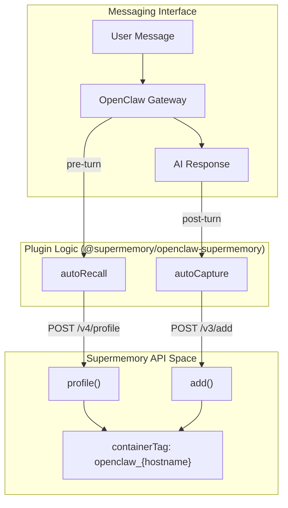
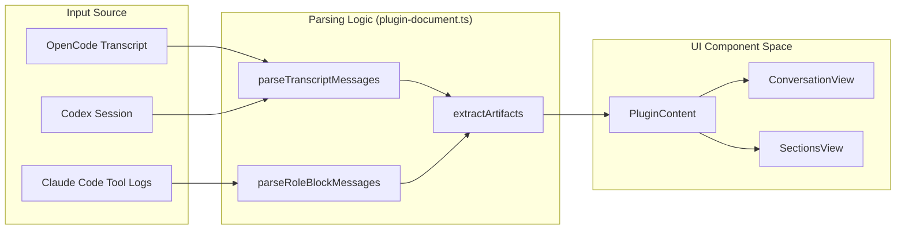

<!-- source: DeepWiki mcp.deepwiki.com · repo supermemoryai/supermemory · page 13.3 Coding Assistant Plugins · fetched 2026-10-30 -->

# Coding Assistant Plugins

<details>
<summary>Relevant source files</summary>

The following files were used as context for generating this wiki page:

- [apps/docs/docs.json](apps/docs/docs.json)
- [apps/docs/images/hermes.svg](apps/docs/images/hermes.svg)
- [apps/docs/integrations/claude-code.mdx](apps/docs/integrations/claude-code.mdx)
- [apps/docs/integrations/codex.mdx](apps/docs/integrations/codex.mdx)
- [apps/docs/integrations/hermes.mdx](apps/docs/integrations/hermes.mdx)
- [apps/docs/integrations/openclaw.mdx](apps/docs/integrations/openclaw.mdx)
- [apps/docs/integrations/opencode.mdx](apps/docs/integrations/opencode.mdx)
- [apps/docs/integrations/supermemory-sdk.mdx](apps/docs/integrations/supermemory-sdk.mdx)
- [apps/docs/intro.mdx](apps/docs/intro.mdx)
- [apps/docs/quickstart.mdx](apps/docs/quickstart.mdx)
- [apps/docs/self-hosting/configuration.mdx](apps/docs/self-hosting/configuration.mdx)
- [apps/docs/self-hosting/local-vs-enterprise.mdx](apps/docs/self-hosting/local-vs-enterprise.mdx)
- [apps/web/app/auth/agent-connect/page.tsx](apps/web/app/auth/agent-connect/page.tsx)
- [apps/web/components/document-cards/mcp-preview.tsx](apps/web/components/document-cards/mcp-preview.tsx)
- [apps/web/components/document-cards/note-preview.tsx](apps/web/components/document-cards/note-preview.tsx)
- [apps/web/components/document-cards/plugin-preview.tsx](apps/web/components/document-cards/plugin-preview.tsx)
- [apps/web/components/document-modal/content/plugin-content.tsx](apps/web/components/document-modal/content/plugin-content.tsx)
- [apps/web/components/document-modal/title.tsx](apps/web/components/document-modal/title.tsx)
- [apps/web/lib/plugin-catalog.ts](apps/web/lib/plugin-catalog.ts)
- [apps/web/lib/plugin-document.ts](apps/web/lib/plugin-document.ts)
- [apps/web/lib/plugin-space.ts](apps/web/lib/plugin-space.ts)

</details>


Supermemory extends its persistent memory and context capabilities into the developer workflow through a suite of plugins for coding assistants, CLIs, and messaging gateways. These integrations allow AI agents to maintain state across different coding sessions, projects, and communication platforms by bridging the gap between ephemeral sessions and long-term knowledge.

## Claude Code (claude-supermemory)

The `claude-supermemory` plugin integrates Supermemory directly into the Claude Code CLI, providing persistent memory that spans multiple terminal sessions and distinct projects.

### Installation and Setup
To install the plugin within the Claude Code environment:
1.  **API Key:** Set the `SUPERMEMORY_CC_API_KEY` environment variable in your shell profile (`.zshrc` or `.bashrc`) [apps/docs/integrations/claude-code.mdx:33-41]().
2.  **Marketplace:** Add the plugin source: `/plugin marketplace add supermemoryai/claude-supermemory` [apps/docs/integrations/claude-code.mdx:55-55]().
3.  **Install:** Run `/plugin install supermemory` [apps/docs/integrations/claude-code.mdx:58-58]().

### Data Flow and Behavior
The plugin operates through two primary mechanisms:
*   **Context Injection:** Upon starting a session, relevant memories are fetched and injected into Claude's context, including user preferences and project knowledge [apps/docs/integrations/claude-code.mdx:65-65]().
*   **Auto-Capture:** The plugin monitors tool execution and automatically stores the results. It captures `Edit`, `Write`, `Bash` command outputs, and `Task` (agent spawning) actions [apps/docs/integrations/claude-code.mdx:70-76]().

### Configuration
Users can tune the plugin behavior via `~/.supermemory-claude/settings.json`:
| Option | Description |
| :--- | :--- |
| `skipTools` | List of tools to ignore during capture (e.g., `Read`, `Glob`, `Grep`) [apps/docs/integrations/claude-code.mdx:103-103]() |
| `maxContextMemories` | Number of general memories to inject [apps/docs/integrations/claude-code.mdx:105-105]() |
| `maxProjectMemories` | Number of project-specific memories to inject [apps/docs/integrations/claude-code.mdx:106-106]() |

**Sources:** [apps/docs/integrations/claude-code.mdx:20-109](), [apps/web/lib/plugin-catalog.ts:32-53]()

---

## OpenCode Plugin (opencode-supermemory)

The `opencode-supermemory` plugin provides long-term memory for OpenCode sessions, focusing on codebase structure and architectural patterns.

### Core Features
*   **Context Injection:** Automatically fetches relevant memories on session start [apps/docs/integrations/opencode.mdx:67-67]().
*   **Keyword Detection:** Phrases like "remember" or "save this" trigger automatic storage [apps/docs/integrations/opencode.mdx:68-68]().
*   **Smart Compaction:** When the context window reaches 80% capacity (defined by `compactionThreshold`), the session is summarized and saved [apps/docs/integrations/opencode.mdx:69-69](), [apps/docs/integrations/opencode.mdx:125-125]().
*   **Memory Types:** Categorizes data into `project-config`, `architecture`, `error-solution`, and `preference` [apps/docs/integrations/opencode.mdx:83-87]().

### Installation
```bash
bunx opencode-supermemory@latest install
bunx opencode-supermemory@latest login
```
[apps/docs/integrations/opencode.mdx:46-53]()

**Sources:** [apps/docs/integrations/opencode.mdx:12-127](), [apps/web/lib/plugin-catalog.ts:113-141]()

---

## OpenAI Codex (codex-supermemory)

The `codex-supermemory` plugin wires Supermemory into the OpenAI Codex CLI via hooks and skills.

### Implementation Logic
*   **Implicit Memory:** Uses `UserPromptSubmit` hooks for recall and `Stop` hooks for capture [apps/docs/integrations/codex.mdx:51-51]().
*   **Explicit Skills:** Installs `supermemory-search`, `supermemory-save`, and `supermemory-forget` as native Codex skills [apps/docs/integrations/codex.mdx:52-52]().
*   **Memory Scopes:** Automatically derives User tags from `git config` and Project tags from the current directory [apps/docs/integrations/codex.mdx:70-71]().

**Sources:** [apps/docs/integrations/codex.mdx:8-152](), [apps/web/lib/plugin-catalog.ts:54-76]()

---

## OpenClaw Gateway Plugin

OpenClaw is a multi-platform AI messaging gateway. The `@supermemory/openclaw-supermemory` plugin provides a unified memory layer across Telegram, WhatsApp, Discord, Slack, and iMessage.

### Implementation Logic
The plugin implements a middleware-style pattern for OpenClaw:
1.  **Auto-Recall:** Before an AI turn, the plugin calls the Supermemory `profile()` endpoint to fetch context [apps/docs/integrations/openclaw.mdx:56-56]().
2.  **Auto-Capture:** After the AI responds, the exchange is sent to the `add()` endpoint [apps/docs/integrations/openclaw.mdx:57-57]().
3.  **Custom Containers:** Supports routing memories to specific containers like `work` or `personal` via AI instructions [apps/docs/integrations/openclaw.mdx:58-58]().

### System-to-Code Mapping
Title: OpenClaw Plugin Integration Architecture

**Sources:** [apps/docs/integrations/openclaw.mdx:12-111](), [apps/web/lib/plugin-catalog.ts:142-161]()

---

## Hermes Agent Memory Provider

Hermes is a persistent memory provider for the Hermes agent, optimized for fact extraction and profile building.

### Configuration and Setup
On the machine where Hermes is deployed, the setup wizard is triggered via:
```bash
hermes memory setup
```
[apps/web/lib/plugin-catalog.ts:173-173]()

The provider focuses on building a "Living Knowledge Graph" by mapping conversation turns to static facts (e.g., user name, age) and dynamic context [apps/docs/quickstart.mdx:124-127]().

**Sources:** [apps/web/lib/plugin-catalog.ts:162-176](), [apps/docs/quickstart.mdx:124-127]()

---

## Plugin Document Processing

Supermemory handles data from these plugins using specialized parsing logic to render structured views in the web application.

### Entity Relationship Diagram
Title: Plugin Data Transformation Flow


### Document Kinds
The system categorizes plugin data into specific `PluginDocumentKind` types for rendering:
*   `claude-code-doc`: Specialized view for Claude Code tool usage [apps/web/lib/plugin-document.ts:20-20]().
*   `opencode-session`: Structured session transcripts [apps/web/lib/plugin-document.ts:91-91]().
*   `openclaw-session`: Multi-platform chat logs [apps/web/lib/plugin-document.ts:19-19]().
*   `codex-session`: Implicit memory logs from Codex CLI [apps/web/lib/plugin-document.ts:14-14]().

**Sources:** [apps/web/lib/plugin-document.ts:13-62](), [apps/web/lib/plugin-space.ts:17-54](), [apps/web/components/document-cards/plugin-preview.tsx:8-48]()

---

