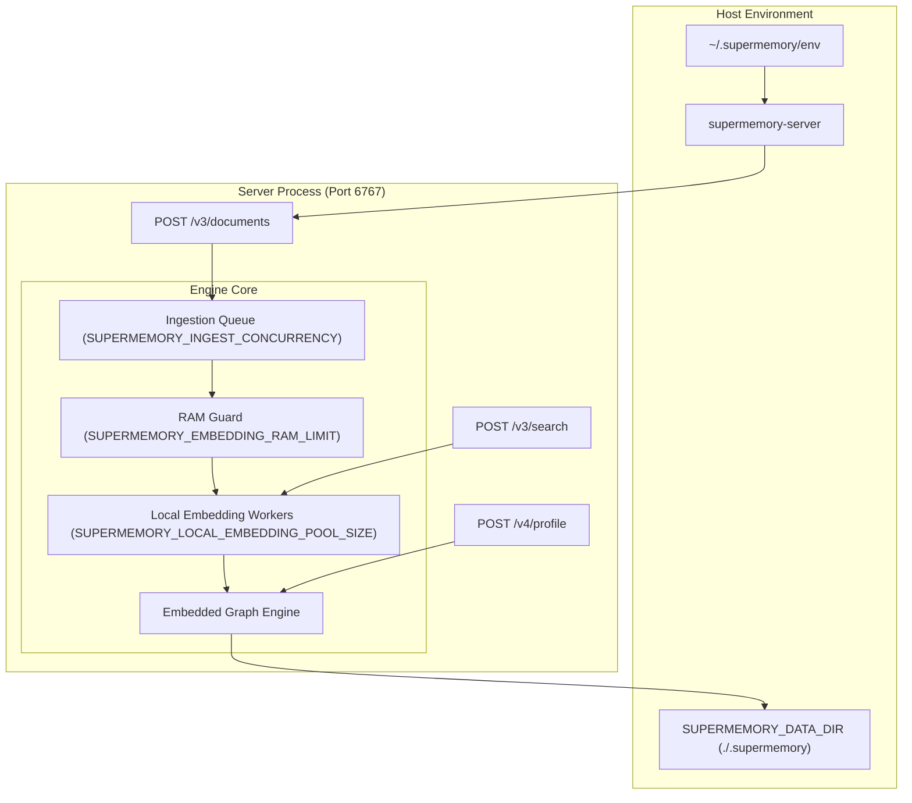
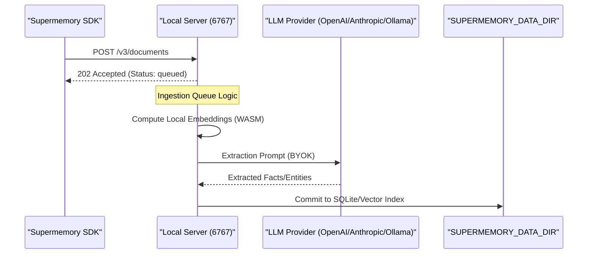

<!-- source: DeepWiki mcp.deepwiki.com · repo supermemoryai/supermemory · page 14.1 Local Server Setup · fetched 2026-10-30 -->

# Local Server Setup

<details>
<summary>Relevant source files</summary>

The following files were used as context for generating this wiki page:

- [apps/docs/docs.json](apps/docs/docs.json)
- [apps/docs/integrations/claude-code.mdx](apps/docs/integrations/claude-code.mdx)
- [apps/docs/integrations/codex.mdx](apps/docs/integrations/codex.mdx)
- [apps/docs/integrations/openclaw.mdx](apps/docs/integrations/openclaw.mdx)
- [apps/docs/integrations/opencode.mdx](apps/docs/integrations/opencode.mdx)
- [apps/docs/integrations/supermemory-sdk.mdx](apps/docs/integrations/supermemory-sdk.mdx)
- [apps/docs/intro.mdx](apps/docs/intro.mdx)
- [apps/docs/quickstart.mdx](apps/docs/quickstart.mdx)
- [apps/docs/self-hosting/configuration.mdx](apps/docs/self-hosting/configuration.mdx)
- [apps/docs/self-hosting/local-vs-enterprise.mdx](apps/docs/self-hosting/local-vs-enterprise.mdx)
- [apps/docs/self-hosting/quickstart.mdx](apps/docs/self-hosting/quickstart.mdx)

</details>


The Supermemory local server is a single-binary distribution of the Supermemory engine, designed for private, high-performance, and air-gapped memory workloads. It provides the same ingestion, memory extraction, and hybrid semantic search capabilities as the hosted platform but runs entirely on local hardware [apps/docs/self-hosting/overview.mdx:8-8]().

## Installation and Execution

The local server can be installed via a shell script or executed directly using `npx` or `bunx`. The installer automatically detects the host operating system (macOS Intel/Silicon, Linux x64/arm64) and architecture [apps/docs/self-hosting/quickstart.mdx:28-28]().

### Installation Methods

| Method | Command |
| :--- | :--- |
| **curl** | `curl -fsSL https://supermemory.ai/install \| bash` |
| **npx** | `npx supermemory local` |
| **bunx** | `bunx supermemory local` |

Sources: [apps/docs/quickstart.mdx:12-12](), [apps/docs/self-hosting/quickstart.mdx:10-26]()

### Execution
Once installed, the server is started using the `supermemory-server` command [apps/docs/self-hosting/quickstart.mdx:32-34](). On the first boot, the server:
1.  Initializes the embedded **Supermemory graph engine** [apps/docs/self-hosting/quickstart.mdx:36-36]().
2.  Generates a unique **API Key** (printed to the console in a terminal box) [apps/docs/self-hosting/quickstart.mdx:39-45]().
3.  Caches local embedding models in the data directory [apps/docs/self-hosting/quickstart.mdx:139-139]().
4.  Launches an interactive setup wizard if no LLM provider keys are detected to collect `OPENAI_API_KEY`, `ANTHROPIC_API_KEY`, etc [apps/docs/self-hosting/configuration.mdx:32-34]().

## System Configuration

The server defaults to **port 6767** and stores all state in a local directory [apps/docs/self-hosting/configuration.mdx:16-17]().

### Data Persistence
The environment variable `SUPERMEMORY_DATA_DIR` controls where the server stores its database and configuration [apps/docs/self-hosting/configuration.mdx:17-17]().

| Variable | Default Path | Purpose |
| :--- | :--- | :--- |
| `SUPERMEMORY_DATA_DIR` | `./.supermemory` | Stores the graph engine data, auth secrets, and embedding cache [apps/docs/self-hosting/configuration.mdx:17-17](). |
| `PORT` | `6767` | HTTP listen port for the API [apps/docs/self-hosting/configuration.mdx:16-16](). |
| N/A | `~/.supermemory/env` | Stores API keys and environment variables loaded on launch [apps/docs/self-hosting/configuration.mdx:10-10](). |

Sources: [apps/docs/self-hosting/configuration.mdx:12-18](), [apps/docs/self-hosting/quickstart.mdx:133-141]()

### LLM Providers and Offline Mode
While the hosted platform uses proprietary models, the local server allows users to bring their own models. It is compatible with any OpenAI-compliant endpoint, enabling fully offline operation via tools like Ollama or LM Studio [apps/docs/self-hosting/configuration.mdx:42-51]().

```bash
# Example: Running with local Ollama
OPENAI_BASE_URL=http://localhost:11434/v1 \
OPENAI_API_KEY=ollama \
OPENAI_MODEL=gpt-oss:20b \
supermemory-server
```
Sources: [apps/docs/self-hosting/configuration.mdx:46-51]()

## Data Flow and Architecture

The local server manages ingestion through a queue to control memory usage, specifically via `SUPERMEMORY_EMBEDDING_RAM_LIMIT` [apps/docs/self-hosting/configuration.mdx:83-84]().

### Local Server Entity Mapping
This diagram bridges the conceptual setup to the internal server entities and configuration.


Sources: [apps/docs/self-hosting/configuration.mdx:12-18](), [apps/docs/self-hosting/configuration.mdx:64-74](), [apps/docs/self-hosting/configuration.mdx:78-98]()

## SDK Integration

To point official SDKs or third-party tools (like Claude Code, OpenCode, or Codex) at the local server, the `baseURL` or `SUPERMEMORY_API_URL` must be updated to `http://localhost:6767` [apps/docs/integrations/supermemory-sdk.mdx:17-19]().

### TypeScript SDK Example
```typescript
import Supermemory from "supermemory"

const client = new Supermemory({
  apiKey: "sm_xxxxxxxx", // Printed on first boot
  baseURL: "http://localhost:6767",
})

// Adding a memory to a specific container
await client.memories.add({
  content: "User prefers dark mode and is allergic to peanuts.",
  containerTag: "user_123",
})
```
Sources: [apps/docs/self-hosting/quickstart.mdx:57-69]()

### Request Flow: SDK to Local Server
This diagram illustrates how an SDK call is processed by the local binary using local embeddings and remote LLM extraction.


Sources: [apps/docs/self-hosting/configuration.mdx:21-30](), [apps/docs/self-hosting/configuration.mdx:78-84](), [apps/docs/self-hosting/quickstart.mdx:86-96]()

## Comparison: Local vs. Enterprise

| Feature | Supermemory Local | Supermemory Enterprise |
| :--- | :--- | :--- |
| **Memory Engine** | Full graph engine (Embedded) | Full graph engine (Managed) |
| **Models** | Bring Your Own Key (BYOK) | Proprietary tuned models |
| **Connectors** | Not Supported | Supported (Gmail, Drive, Notion, etc.) |
| **Auth** | Single auto-generated API key | Org-wide RBAC & Scoped Keys |
| **Observability** | Terminal Logs | Console Dashboard & Analytics |
| **Scale** | Single Machine | Globally Distributed |

Sources: [apps/docs/self-hosting/local-vs-enterprise.mdx:14-25](), [apps/docs/self-hosting/configuration.mdx:114-123]()

---

