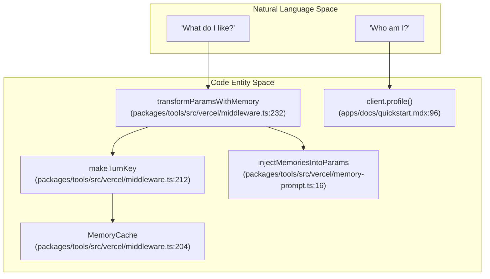
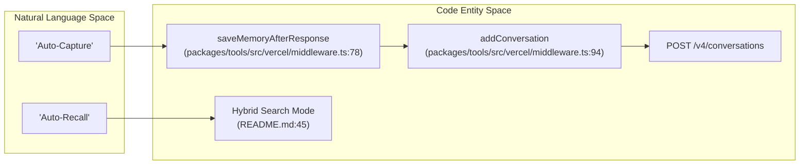

<!-- source: DeepWiki mcp.deepwiki.com · repo supermemoryai/supermemory · page 15 Glossary · fetched 2026-10-30 -->

# Glossary

Relevant source files

The following files were used as context for generating this wiki page:

- [CONTRIBUTING.md](CONTRIBUTING.md)
- [README.md](README.md)
- [README.zh-CN.md](README.zh-CN.md)
- [apps/docs/changelog/developer-platform.mdx](apps/docs/changelog/developer-platform.mdx)
- [apps/docs/changelog/overview.mdx](apps/docs/changelog/overview.mdx)
- [apps/docs/concepts/container-tags.mdx](apps/docs/concepts/container-tags.mdx)
- [apps/docs/connectors/google-drive.mdx](apps/docs/connectors/google-drive.mdx)
- [apps/docs/cookbook/overview.mdx](apps/docs/cookbook/overview.mdx)
- [apps/docs/docs.json](apps/docs/docs.json)
- [apps/docs/integrations/claude-code.mdx](apps/docs/integrations/claude-code.mdx)
- [apps/docs/integrations/codex.mdx](apps/docs/integrations/codex.mdx)
- [apps/docs/integrations/openclaw.mdx](apps/docs/integrations/openclaw.mdx)
- [apps/docs/integrations/opencode.mdx](apps/docs/integrations/opencode.mdx)
- [apps/docs/integrations/supermemory-sdk.mdx](apps/docs/integrations/supermemory-sdk.mdx)
- [apps/docs/intro.mdx](apps/docs/intro.mdx)
- [apps/docs/introduction.mdx](apps/docs/introduction.mdx)
- [apps/docs/memory-api/sdks/overview.mdx](apps/docs/memory-api/sdks/overview.mdx)
- [apps/docs/migration/from-mem0.mdx](apps/docs/migration/from-mem0.mdx)
- [apps/docs/migration/mem0-migration-script.py](apps/docs/migration/mem0-migration-script.py)
- [apps/docs/quickstart.mdx](apps/docs/quickstart.mdx)
- [apps/docs/self-hosting/configuration.mdx](apps/docs/self-hosting/configuration.mdx)
- [apps/docs/self-hosting/local-vs-enterprise.mdx](apps/docs/self-hosting/local-vs-enterprise.mdx)
- [apps/web/components/dashboard-view.tsx](apps/web/components/dashboard-view.tsx)
- [apps/web/components/highlights-card.tsx](apps/web/components/highlights-card.tsx)
- [apps/web/components/select-spaces-modal.tsx](apps/web/components/select-spaces-modal.tsx)
- [apps/web/components/space-selector.tsx](apps/web/components/space-selector.tsx)
- [apps/web/globals.css](apps/web/globals.css)
- [apps/web/hooks/use-personalization.ts](apps/web/hooks/use-personalization.ts)
- [apps/web/lib/chat-space-label.ts](apps/web/lib/chat-space-label.ts)
- [apps/web/lib/ingest-auto-space.ts](apps/web/lib/ingest-auto-space.ts)
- [apps/web/public/images/plugins/openclaw.svg](apps/web/public/images/plugins/openclaw.svg)
- [packages/tools/README.md](packages/tools/README.md)
- [packages/tools/package.json](packages/tools/package.json)
- [packages/tools/src/vercel/index.ts](packages/tools/src/vercel/index.ts)
- [packages/tools/src/vercel/memory-prompt.ts](packages/tools/src/vercel/memory-prompt.ts)
- [packages/tools/src/vercel/middleware.ts](packages/tools/src/vercel/middleware.ts)
- [packages/tools/src/vercel/util.ts](packages/tools/src/vercel/util.ts)
- [turbo.json](turbo.json)

This glossary defines the technical terms, architectural concepts, and domain-specific jargon used within the Supermemory codebase. It is intended to help onboarding engineers navigate the multi-surface ecosystem (Web, MCP, Extension, SDKs, and Filesystem).

## Core Concepts

### Container Tag
The primary scoping mechanism for memories. A `containerTag` acts as a unique identifier (e.g., a user ID, a project ID, or a specific workspace) that partitions data. All search and retrieval operations are scoped to one or more tags to ensure data isolation.
*   **Implementation:** Used as a required field in the `createSupermemoryContext` function to isolate context [packages/tools/src/vercel/middleware.ts:119-120]().
*   **Context:** Memory is scoped with projects (container tags) to separate work and personal context [README.md:157-158]().
*   **Multi-tag Keys:** Scoped API keys can now be assigned to multiple container tags simultaneously [apps/docs/changelog/overview.mdx:36-38]().

### Brain / Space
In the consumer-facing Web UI, "Spaces" (often referred to as a personal "Brain") are the user-friendly representation of `containerTags`.
*   **Space Selector:** The `SpaceSelector` component manages the selection of these partitions [apps/web/components/space-selector.tsx:109-120]().
*   **Default Space:** Every user has a default project identified by `DEFAULT_PROJECT_ID` [apps/web/components/select-spaces-modal.tsx:135-144]().

### Nova
The name of the internal AI agent embedded within the Supermemory application. It handles chat, memory retrieval, and auto-capture within the UI.
*   **Reference:** Mentioned as the agent embedded inside the app [README.md:114-114]().
*   **Visuals:** Represented in code by the `NovaOrb` and `AutoSpaceIcon` components [apps/web/components/space-selector.tsx:45-46]().

### Memory vs. Document
The codebase distinguishes between atomic extracted "memories" and source "documents."
*   **Memory:** Extracts facts from conversations. Handles temporal changes, contradictions, and automatic forgetting [README.md:43-43]().
*   **Document:** A larger source of information (PDFs, images, videos, code) processed via multi-modal extractors [README.md:47-48]().
*   **Smart Compaction:** The process of grouping related documents into coherent units, controlled by the `dreaming` parameter [apps/docs/changelog/overview.mdx:8-10]().

Sources: [packages/tools/src/vercel/middleware.ts:119-120](), [README.md:43-158](), [apps/web/components/space-selector.tsx:109-144](), [apps/docs/changelog/overview.mdx:8-38]()

---

## Architectural Terms

### MCP (Model Context Protocol)
An open standard that enables AI models (like Claude or Cursor) to connect to external data sources. Supermemory implements an MCP server to provide AI assistants with direct access to a user's memory.
*   **Tools:** Registered tools include `memory` (save/forget), `recall` (search), and `context` (profile injection) [README.md:143-148]().
*   **Visuals:** The MCP server includes an interactive graph visualization app for exploring memory connections [apps/docs/changelog/overview.mdx:56-59]().

### SMFS (Supermemory Filesystem)
A virtual filesystem that mounts Supermemory containers as local directories. This allows agents to use standard shell commands (`ls`, `cat`, `grep`) to interact with memory.
*   **Mounting:** Can be mounted via NFSv3 on macOS or FUSE on Linux [apps/docs/docs.json:160-165]().
*   **Bash Tool:** A package (`@supermemory/bash`) that allows LLMs to execute shell commands against this virtual drive [apps/docs/docs.json:166-167]().

### Memory Mode
A configuration for the AI middleware that determines what context is fetched for the LLM.
*   `profile`: Retrieves user profile memories (static + dynamic) without query filtering [packages/tools/src/vercel/middleware.ts:129-129]().
*   `query`: Searches memories based on semantic similarity to the user's message [packages/tools/src/vercel/middleware.ts:130-130]().
*   `full`: Combines both profile and query-based results [packages/tools/src/vercel/middleware.ts:131-131]().

### Per-Turn Caching
A performance optimization in the `@supermemory/tools` package. It prevents redundant API calls during multi-step AI interactions by caching the injected memories string.
*   **Implementation:** Managed via `MemoryCache` and the `makeTurnKey` function [packages/tools/src/vercel/middleware.ts:209-222]().

Sources: [README.md:134-148](), [packages/tools/src/vercel/middleware.ts:128-222](), [apps/docs/docs.json:160-167](), [apps/docs/changelog/overview.mdx:56-59]()

---

## Technical Entities Map

### Natural Language to Code Entity Space

The following diagrams bridge conceptual terms to their implementation sites in the codebase.

**Retrieval Flow: Concept to Function**

Sources: [packages/tools/src/vercel/middleware.ts:204-232](), [apps/docs/quickstart.mdx:96-100]()

**Persistence Flow: Concept to API**

Sources: [packages/tools/src/vercel/middleware.ts:78-94](), [README.md:45-45]()

---

## Glossary Table

| Term | Definition | Code Pointer |
| :--- | :--- | :--- |
| **withSupermemory** | Higher-order function for Vercel AI SDK/OpenAI to inject memory context. | [packages/tools/src/vercel/index.ts:111-111]() |
| **MemScore** | The primary metric used by MemoryBench to evaluate memory accuracy. | [apps/docs/docs.json:270-270]() |
| **Autumn** | The entitlement/billing management system used in the web app. | [apps/web/components/header.tsx:70-71]() |
| **Better-Auth** | The authentication framework handling sessions and user identity. | [apps/web/lib/auth.ts:28-28]() |
| **Drizzle ORM** | The TypeScript ORM used for database interactions (SQLite/Postgres). | [README.md:200-205]() |
| **Dreaming** | Parameter (`dynamic` or `instant`) for document grouping and memory formation. | [apps/docs/changelog/overview.mdx:8-10]() |
| **Daily Brief** | Feature that resurfaces relevant memories to the user periodically. | [apps/web/components/dashboard-view.tsx:158-158]() |
| **Plugin Auth Key** | Specialized keys for connecting tools like Claude Code or Raycast. | [apps/docs/changelog/overview.mdx:166-168]() |
| **Rail Entry** | Internal terminology for items appearing in the sidebar/navigation rail. | [apps/web/components/header.tsx:1-20]() |
| **Graph Memory** | Visualization of knowledge entities and their relationships. | [apps/docs/docs.json:87-87]() |

Sources: [packages/tools/src/vercel/index.ts:111-111](), [apps/docs/docs.json:270-270](), [apps/docs/changelog/overview.mdx:8-168](), [apps/web/components/dashboard-view.tsx:158-158](), [apps/web/lib/auth.ts:28-28]()