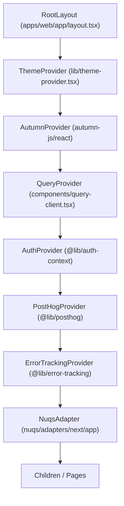
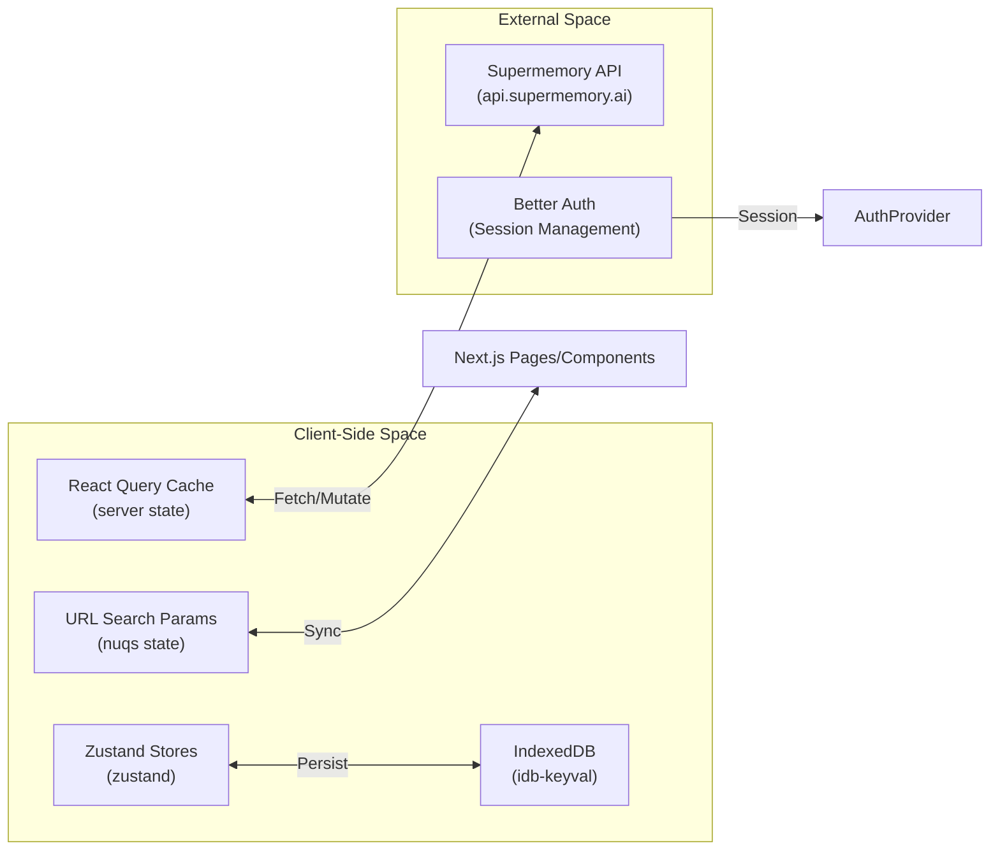

<!-- source: DeepWiki mcp.deepwiki.com · repo supermemoryai/supermemory · page 2 Web Application · fetched 2026-10-30 -->

# Web Application

Relevant source files

The following files were used as context for generating this wiki page:

- [.gitignore](.gitignore)
- [apps/web/.gitignore](apps/web/.gitignore)
- [apps/web/app/global-error.tsx](apps/web/app/global-error.tsx)
- [apps/web/app/layout.tsx](apps/web/app/layout.tsx)
- [apps/web/components/dashboard-view.tsx](apps/web/components/dashboard-view.tsx)
- [apps/web/components/highlights-card.tsx](apps/web/components/highlights-card.tsx)
- [apps/web/components/select-spaces-modal.tsx](apps/web/components/select-spaces-modal.tsx)
- [apps/web/components/space-selector.tsx](apps/web/components/space-selector.tsx)
- [apps/web/globals.css](apps/web/globals.css)
- [apps/web/hooks/use-personalization.ts](apps/web/hooks/use-personalization.ts)
- [apps/web/lib/chat-space-label.ts](apps/web/lib/chat-space-label.ts)
- [apps/web/lib/ingest-auto-space.ts](apps/web/lib/ingest-auto-space.ts)
- [apps/web/package.json](apps/web/package.json)
- [apps/web/public/OG.png](apps/web/public/OG.png)
- [apps/web/tsconfig.json](apps/web/tsconfig.json)
- [apps/web/wrangler.jsonc](apps/web/wrangler.jsonc)
- [bun.lock](bun.lock)
- [package.json](package.json)

## Purpose and Scope

This document provides an overview of the Supermemory web application, a Next.js-based consumer interface deployed on Cloudflare Workers. The application serves as the primary user interface for interacting with the Supermemory memory system, providing chat functionality, document management, search capabilities, and integration management.

For detailed information about specific subsystems:

| Page | Topic |
|------|-------|
| [Application Structure & Providers](#2.1) | Document the `RootLayout`, provider stack, global styles, and font configuration. |
| [Chat Interface](#2.2) | Document the chat UI: messages, model selector, input, sidebar, and conversation storage. |
| [Memory Management](#2.3) | Document memory creation, grid display, optimistic updates, and project organization. |
| [Document Display & Search](#2.4) | Document document cards, command palette, graph view, and URL-driven state. |
| [Integrations & Connections](#2.5) | Document the integrations view, `ConnectAIModal` for MCP, and data source management. |
| [Settings & Profile](#2.6) | Document settings tab structure, onboarding profile steps, and account configuration. |
| [State Management](#2.7) | Document Zustand stores, React Query server state, and auth context. |
| [Onboarding Flow](#2.8) | Document the multi-step onboarding system and completion tracking. |
| [Cloudflare Deployment](#2.9) | Document `opennextjs-cloudflare` deployment, `wrangler.toml`, and build scripts. |
| [UI Component System](#2.10) | Document Shadcn UI setup, Tailwind configuration, and shared UI packages. |
| [Analytics & Error Tracking](#2.11) | Document PostHog, Sentry, and interaction tracking hooks. |

Sources: [apps/web/package.json:1-138]()

## Technology Stack

The web application is built using the following core technologies:

| Technology | Purpose |
|------------|---------|
| **Next.js 16** | React framework with App Router and server components [apps/web/package.json:95](). |
| **Cloudflare Workers** | Edge runtime deployment target using `opennextjs-cloudflare` [apps/web/package.json:34](). |
| **Tailwind CSS 4** | Utility-first styling with shared configuration and `@theme` variables [apps/web/globals.css:2-30](). |
| **Shadcn UI** | Component library using Radix UI primitives and `lucide-react` [apps/web/package.json:35-49, 92](). |
| **Zustand** | Client-side state management with `IndexedDB` persistence via `idb-keyval` [apps/web/package.json:90, 117](). |
| **React Query** | Server state management, caching, and optimistic mutations [apps/web/package.json:59](). |
| **Nuqs** | Type-safe URL search params state management [apps/web/package.json:97](). |

Sources: [apps/web/package.json:22-118](), [apps/web/globals.css:1-30]()

## Application Architecture

### Provider Hierarchy

The `RootLayout` in [apps/web/app/layout.tsx:64-115]() establishes the global context for the application. It wraps the component tree in a specific order of providers to ensure dependencies (like authentication for API calls) are met.

**System-to-Code Provider Mapping:**

Sources: [apps/web/app/layout.tsx:83-111]()

### Global Styling and Fonts

The application uses `Space_Grotesk` as the primary sans-serif font [apps/web/app/layout.tsx:15-18](). Global styles are managed through a combination of local styles and shared UI package styles [apps/web/app/layout.tsx:3-4](). Tailwind CSS 4 variables define the color palette for the surface and foreground [apps/web/globals.css:8-18]().

Sources: [apps/web/app/layout.tsx:15-18](), [apps/web/globals.css:5-30]()

## Core Architectural Layers

### UI Component System
The UI is built on a Shadcn implementation using Lucide for icons [apps/web/package.json:92](). It utilizes Radix UI primitives for accessible components like dialogs, dropdowns, and tabs [apps/web/package.json:35-49]().

### Deployment & Environment
The app is configured for Cloudflare deployment. It uses `opennextjs-cloudflare` for building and previewing [apps/web/package.json:15-17](). Environment variable typing is handled via `cf-typegen` [apps/web/package.json:18]().

### State and Data Flow
Data fetching and mutation are handled via `QueryProvider` [apps/web/app/layout.tsx:98](), while URL-based UI state is synchronized using the `NuqsAdapter` [apps/web/app/layout.tsx:102]().

**Data Interaction Model:**

Sources: [apps/web/app/layout.tsx:90-110](), [apps/web/package.json:90, 117]()

## Key Interface Components

### Main Dashboard View
The `DashboardView` [apps/web/components/dashboard-view.tsx:1-45]() provides a personalized landing experience. It features dynamic headlines [apps/web/components/dashboard-view.tsx:62-78]() and profession-based taglines for plugins [apps/web/components/dashboard-view.tsx:80-137]() to guide users based on their `Profession` [apps/web/components/dashboard-view.tsx:40]().

### Space Management
The application uses "Spaces" (backed by `containerTag` in the API) to organize content. The `SpaceSelector` [apps/web/components/space-selector.tsx:109-120]() and `SelectSpacesModal` [apps/web/components/select-spaces-modal.tsx:93-106]() allow users to switch between their own spaces or plugin-generated spaces detected via `detectPluginSpace` [apps/web/components/select-spaces-modal.tsx:127]().

### Content Highlights
The `HighlightsCard` component [apps/web/components/highlights-card.tsx:74-80]() visualizes extracted memories. It supports multiple formats like `paragraph`, `bullets`, `quote`, and `one_liner` [apps/web/components/highlights-card.tsx:25-34](). It allows users to chat directly about a specific highlight via the `onChat` callback [apps/web/components/highlights-card.tsx:38]().

### Chat and Interaction
The chat interface utilizes the `ai` package for streaming responses and `react-markdown` for rendering [apps/web/package.json:77, 105](). It supports specific AI features like "Auto" space routing via `AUTO_CHAT_SPACE_ID` [apps/web/components/space-selector.tsx:12]().

## Key Metadata and Assets

The application identifies itself via global metadata and a custom font configuration in the root layout:
- **Font**: `Space_Grotesk` is used as the primary sans-serif font, injected via the `--font-sans` CSS variable [apps/web/app/layout.tsx:15-18]().
- **Metadata**: The base URL is set to `https://app.supermemory.ai` [apps/web/app/layout.tsx:21-21]().
- **Styling**: Scrollbars are customized globally to be thin and themed [apps/web/globals.css:39-66]().

Sources: [apps/web/app/layout.tsx:15-55](), [apps/web/globals.css:32-70]()

---

