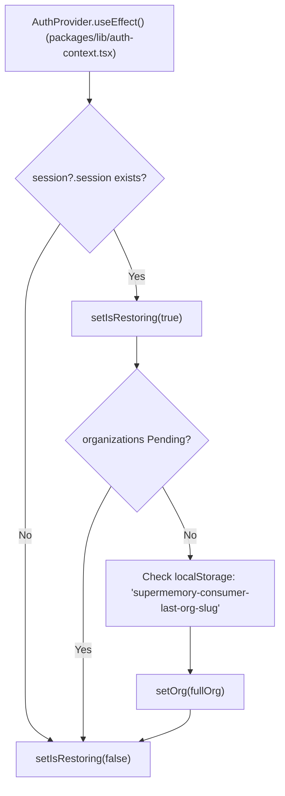

<!-- source: DeepWiki mcp.deepwiki.com · repo supermemoryai/supermemory · page 2.1 Application Structure & Providers · fetched 2026-10-30 -->

# Application Structure & Providers

Relevant source files

The following files were used as context for generating this wiki page:

- [.gitignore](.gitignore)
- [apps/web/.gitignore](apps/web/.gitignore)
- [apps/web/app/(app)/layout.tsx](apps/web/app/(app)/layout.tsx)
- [apps/web/app/global-error.tsx](apps/web/app/global-error.tsx)
- [apps/web/app/layout.tsx](apps/web/app/layout.tsx)
- [apps/web/components/ensure-workspace.tsx](apps/web/components/ensure-workspace.tsx)
- [apps/web/components/pwa-install-prompt.tsx](apps/web/components/pwa-install-prompt.tsx)
- [apps/web/middleware.ts](apps/web/middleware.ts)
- [apps/web/package.json](apps/web/package.json)
- [apps/web/public/OG.png](apps/web/public/OG.png)
- [apps/web/tsconfig.json](apps/web/tsconfig.json)
- [apps/web/wrangler.jsonc](apps/web/wrangler.jsonc)
- [bun.lock](bun.lock)
- [package.json](package.json)
- [packages/lib/auth-context.tsx](packages/lib/auth-context.tsx)
- [packages/lib/error-tracking.tsx](packages/lib/error-tracking.tsx)
- [packages/lib/posthog.tsx](packages/lib/posthog.tsx)
- [packages/ui/components/dialog.tsx](packages/ui/components/dialog.tsx)

This page documents the foundational architecture of the `apps/web` Next.js application, focusing on the `RootLayout`, the hierarchical provider stack, font configuration, and global styling.

---

## RootLayout

The `RootLayout` defined in [apps/web/app/layout.tsx:64-115]() serves as the entry point for the entire web application. It is a Next.js App Router layout that wraps every page, ensuring a consistent environment for fonts, styles, and context providers.

**Key Responsibilities:**
- **HTML/Body Setup**: Configures the `<html>` and `<body>` tags with `suppressHydrationWarning` and applies global font variables [apps/web/app/layout.tsx:70-82]().
- **Development Tooling**: Injects `react-scan` for performance monitoring when `NODE_ENV` is "development" [apps/web/app/layout.tsx:72-78]().
- **Metadata**: Defines the application title, description, and base URL for SEO and social sharing [apps/web/app/layout.tsx:20-55]().
- **Viewport**: Configures mobile-responsive settings including `viewportFit: "cover"` and `interactiveWidget: "resizes-content"` [apps/web/app/layout.tsx:57-62]().
- **Toast Notifications**: Mounts the `<Toaster />` component from `@ui/components/sonner` at the root [apps/web/app/layout.tsx:104]().

**Sources:** [apps/web/app/layout.tsx:1-115]()

---

## Font & Style Configuration

### Typeface
The application uses **Space Grotesk** as its primary typeface, loaded via `next/font/google` [apps/web/app/layout.tsx:2-18]().
- **Variable**: `--font-sans`
- **Subsets**: `latin`
- **Application**: Applied to the `body` class via `${font.variable}` [apps/web/app/layout.tsx:80]().

### Global Stylesheets
The application imports two primary CSS entry points [apps/web/app/layout.tsx:3-4]():
1. `../globals.css`: Local styles specific to the web application.
2. `@ui/globals.css`: Shared global styles from the `@supermemory/ui` package.

The UI package utilizes **Tailwind CSS v4** (via `@tailwindcss/postcss`) and `tw-animate-css` [apps/web/package.json:114-129](). 

**Sources:** [apps/web/app/layout.tsx:2-18](), [apps/web/package.json:114-129]()

---

## Provider Stack

The application uses a deeply nested provider pattern to manage theme, billing, data fetching, authentication, and analytics. The order is critical as inner providers often depend on the context of outer ones (e.g., `AuthProvider` using the query client).

**Code-to-Entity Provider Hierarchy:**

Title: Web Application Provider Stack

```mermaid
graph TD
    subgraph "RootLayout (apps/web/app/layout.tsx)"
        TP["ThemeProvider (apps/web/lib/theme-provider.tsx)"]
        AP["AutumnProvider (autumn-js/react)"]
        QP["QueryProvider (apps/web/components/query-client.tsx)"]
        AUP["AuthProvider (packages/lib/auth-context.tsx)"]
        PHP["PostHogProvider (packages/lib/posthog.tsx)"]
        ETP["ErrorTrackingProvider (packages/lib/error-tracking.tsx)"]
        NA["NuqsAdapter (nuqs/adapters/next/app)"]
        SUS["Suspense (react)"]
        CHILD["{children}"]
    end

    TP --> AP
    AP --> QP
    QP --> AUP
    AUP --> PHP
    PHP --> ETP
    ETP --> NA
    NA --> SUS
    SUS --> CHILD
```

### Provider Details

| Provider | Purpose | Key Configuration |
| :--- | :--- | :--- |
| **ThemeProvider** | Manages light/dark mode using `next-themes`. | Forced to `dark` [apps/web/app/layout.tsx:83-89](). |
| **AutumnProvider** | Handles billing and subscription logic via `autumn-js`. | Points to `NEXT_PUBLIC_BACKEND_URL` or `api.supermemory.ai` [apps/web/app/layout.tsx:90-97](). |
| **QueryProvider** | Initializes the `TanStack Query` client for server state. | Wraps all data-fetching hooks [apps/web/app/layout.tsx:98](). |
| **AuthProvider** | Manages sessions and active organization state using `better-auth`. | Context provider for `useAuth` hook [apps/web/app/layout.tsx:99](), [packages/lib/auth-context.tsx:37-226](). |
| **PostHogProvider** | Client-side analytics tracking and pageview capture. | Initialized with `api_host` pointing to `/orange` proxy [packages/lib/posthog.tsx:36-75](). |
| **NuqsAdapter** | URL search param state management. | Enables type-safe query params [apps/web/app/layout.tsx:102](). |

**Sources:** [apps/web/app/layout.tsx:83-111](), [packages/lib/posthog.tsx:36-75](), [packages/lib/auth-context.tsx:37-226]()

---

## Authentication & Middleware

Authentication is handled by `better-auth`. The application uses a `middleware.ts` file to protect routes and handle redirects.

### Middleware Logic
The middleware in [apps/web/middleware.ts:12-83]() performs the following:
- **Public Paths**: Allows access to `/login`, `/login/new`, and specific views like `mcp` or `integrations` (in guest mode) [apps/web/middleware.ts:23-37]().
- **API Protection**: Returns a `401 Unauthorized` for `/api/` routes if no session cookie exists [apps/web/middleware.ts:39-49]().
- **Redirects**: Unauthenticated users trying to access private routes are redirected to `/login` with a `redirect` parameter [apps/web/middleware.ts:52-59]().

### Auth Restoration Flow
The `AuthProvider` manages the restoration of the user's active organization from `localStorage` using the key `supermemory-consumer-last-org-slug` [packages/lib/auth-context.tsx:19-177]().

Title: AuthProvider Session Restoration

**Sources:** [apps/web/middleware.ts:1-83](), [packages/lib/auth-context.tsx:19-177]()

---

## Workspace Enforcement

The `EnsureWorkspace` component [apps/web/components/ensure-workspace.tsx:19-68]() acts as a client-side guard within the `AppLayout` [apps/web/app/(app)/layout.tsx:7-14](). It monitors the `AuthProvider` state and enforces the following:
1. **Unauthenticated Users**: Redirected to `/login` with the current URL as a redirect target [apps/web/components/ensure-workspace.tsx:34-39]().
2. **New Users**: If a user is authenticated but has no organizations (`organizations.length === 0`), they are redirected to `/onboarding` [apps/web/components/ensure-workspace.tsx:41-43]().
3. **Loading State**: Displays a `WorkspaceLoadingShell` with a spinner while session or organization data is being restored [apps/web/components/ensure-workspace.tsx:53-65]().

Additionally, the `AppLayout` provides the `SettingsModalProvider` and the `PWAInstallPrompt` for mobile users [apps/web/app/(app)/layout.tsx:9-12]().

**Sources:** [apps/web/components/ensure-workspace.tsx:1-68](), [apps/web/app/(app)/layout.tsx:1-14](), [apps/web/components/pwa-install-prompt.tsx:168-232]()

---

