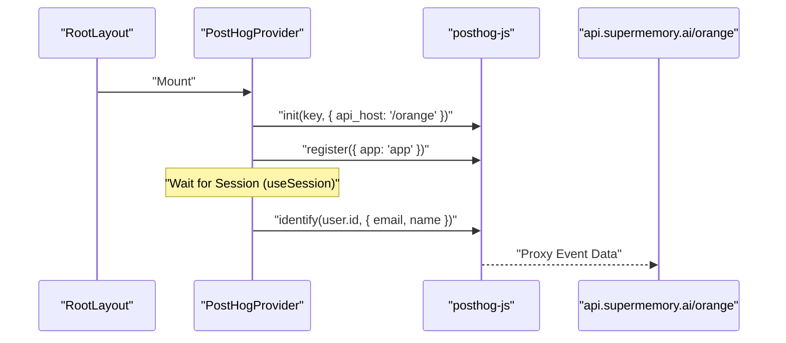

<!-- source: DeepWiki mcp.deepwiki.com · repo supermemoryai/supermemory · page 2.11 Analytics & Error Tracking · fetched 2026-10-30 -->

# Analytics & Error Tracking

<details>
<summary>Relevant source files</summary>

The following files were used as context for generating this wiki page:

- [apps/web/app/(app)/brain-home/page.tsx](apps/web/app/(app)/brain-home/page.tsx)
- [apps/web/app/(app)/onboarding/page.tsx](apps/web/app/(app)/onboarding/page.tsx)
- [apps/web/components/brain-home/data.ts](apps/web/components/brain-home/data.ts)
- [apps/web/components/brain-home/widgets.tsx](apps/web/components/brain-home/widgets.tsx)
- [apps/web/components/initial-header.tsx](apps/web/components/initial-header.tsx)
- [apps/web/components/onboarding-brain/onboarding-confetti.tsx](apps/web/components/onboarding-brain/onboarding-confetti.tsx)
- [apps/web/components/onboarding-brain/shell.tsx](apps/web/components/onboarding-brain/shell.tsx)
- [apps/web/components/onboarding-brain/step-about.tsx](apps/web/components/onboarding-brain/step-about.tsx)
- [apps/web/components/onboarding-brain/step-ingest.tsx](apps/web/components/onboarding-brain/step-ingest.tsx)
- [apps/web/components/onboarding-brain/step-sources.tsx](apps/web/components/onboarding-brain/step-sources.tsx)
- [apps/web/components/onboarding-brain/step-team.tsx](apps/web/components/onboarding-brain/step-team.tsx)
- [apps/web/lib/analytics.ts](apps/web/lib/analytics.ts)
- [apps/web/lib/constants.ts](apps/web/lib/constants.ts)
- [packages/lib/error-tracking.tsx](packages/lib/error-tracking.tsx)
- [packages/lib/posthog.tsx](packages/lib/posthog.tsx)

</details>


This page documents the observability stack used in the supermemory ecosystem. It covers the PostHog analytics integration for user behavior tracking across the web app, Sentry for runtime error monitoring, and the structured event catalog used to maintain data consistency.

---

## Overview

Supermemory uses a dual-tool strategy for observability:

| Tool | Purpose | Primary Implementation |
|---|---|---|
| **PostHog** | Product analytics, feature usage, user identification, and interaction tracking. | [packages/lib/posthog.tsx:36-75](), [apps/web/lib/analytics.ts:7-220]() |
| **Sentry** | Exception tracking, performance monitoring, and session replays. | [packages/lib/error-tracking.tsx:8-72]() |

PostHog events are proxied through the backend to prevent ad-blocker interference, while Sentry is integrated into the client runtime and build process.

---

## PostHog Analytics Integration

### Web Application Provider

The `PostHogProvider` manages the initialization and lifecycle of the PostHog SDK. It is mounted in the root provider stack of the application.

**Key Implementation Details:**
- **Initialization**: PostHog is initialized with a proxy `api_host` pointing to `${backendUrl}/orange` to bypass client-side blockers [packages/lib/posthog.tsx:41-51]().
- **User Identification**: When a user session is active, the provider calls `posthog.identify` to link the anonymous ID with the user's email, name, and internal `userId` [packages/lib/posthog.tsx:56-65]().
- **Page Tracking**: The `PostHogPageTracking` component captures `$pageview` events on route changes, including context like `page_type` and `org_slug` extracted from the URL [packages/lib/posthog.tsx:8-31]().

**PostHog Initialization Flow:**


Sources: [packages/lib/posthog.tsx:8-75]()

---

### Structured Event Catalog

The `analytics` object in `apps/web/lib/analytics.ts` provides a type-safe interface for capturing business events. It uses a `safeCapture` helper that buffers events if the SDK is not yet loaded [apps/web/lib/analytics.ts:40-51]().

#### Buffering Logic
If `posthog.__loaded` is false, events are pushed to `pendingEvents` [apps/web/lib/analytics.ts:49](). A `flushTimer` periodically checks for readiness and dispatches buffered events once the SDK is available [apps/web/lib/analytics.ts:11-38]().

#### Key Event Categories

| Category | Events | Implementation Site |
|---|---|---|
| **Memories** | `memoryAdded`, `memoryDetailOpened`, `documentAdded` | [apps/web/lib/analytics.ts:56-64](), [apps/web/lib/analytics.ts:110-113]() |
| **Chat** | `chatMessageSent`, `chatMessageLiked`, `chatMemoryExpanded` | [apps/web/lib/analytics.ts:196-201](), [apps/web/lib/analytics.ts:206-207](), [apps/web/lib/analytics.ts:215-216]() |
| **Onboarding** | `onboardingStarted`, `onboardingStepViewed`, `onboardingCompleted` | [apps/web/lib/analytics.ts:122-132](), [apps/web/lib/analytics.ts:173-178]() |
| **Integrations** | `connectionAuthStarted`, `mcpViewOpened`, `mcpInstallCmdCopied` | [apps/web/lib/analytics.ts:84-85](), [apps/web/lib/analytics.ts:104-105]() |

**Onboarding Analytics Implementation:**
The `BrainOnboardingPage` uses these methods to track the funnel. It triggers `onboardingStarted` and `onboardingStepViewed` on mount [apps/web/app/(app)/onboarding/page.tsx:115-123](). Navigation between steps (e.g., `StepAbout`, `StepSources`) triggers `onboardingStepCompleted` [apps/web/app/(app)/onboarding/page.tsx:183]().

Sources: [apps/web/lib/analytics.ts:1-220](), [apps/web/app/(app)/onboarding/page.tsx:112-183]()

---

## Error Tracking Hooks

The `packages/lib/error-tracking.tsx` file provides specialized hooks for capturing errors and interactions.

### `useErrorTracking`
This hook provides functions to track different failure modes [packages/lib/error-tracking.tsx:8-72]():
- `trackError`: Generic error capture with stack traces.
- `trackApiError`: Specifically for failed network requests, including `endpoint` and `status`.
- `trackComponentError`: For UI-level failures.
- `trackValidationError`: For form submission failures.

### `useInteractionTracking`
Designed for granular UI analytics, this hook tracks how users navigate the interface [packages/lib/error-tracking.tsx:115-194]():
- `trackButtonClick`: Logs the button name and context.
- `trackModalOpen` / `trackModalClose`: Monitors dialog lifecycle.
- `trackTabChange`: Captures navigation between UI sections.

### `ErrorTrackingProvider`
A global component that attaches listeners to the `window` object to catch unhandled promise rejections and global runtime errors [packages/lib/error-tracking.tsx:75-112]().

Sources: [packages/lib/error-tracking.tsx:1-194]()

---

## Observability Data Flow

The following diagram bridges the Natural Language concepts (Tracking, Analytics) to Code Entities (`safeCapture`, `PostHogProvider`, `trackError`).

**Observability Architecture:**

```mermaid
graph TD
    subgraph "Client Runtime [apps/web]"
        "useErrorTracking"["useErrorTracking (packages/lib)"]
        "ErrorTrackingProvider"["ErrorTrackingProvider (packages/lib)"]
        "analytics"["analytics object (lib/analytics.ts)"]
        "safeCapture"["safeCapture function (lib/analytics.ts)"]
    end

    subgraph "Tracking Libraries"
        "posthog-js"["posthog-js SDK"]
    end

    subgraph "External Collectors"
        "PostHog_Ingest"["PostHog Ingest (/orange proxy)"]
    end

    "analytics" --> "safeCapture"
    "safeCapture" -->|posthog.capture| "posthog-js"
    "useErrorTracking" -->|trackError| "posthog-js"
    "ErrorTrackingProvider" -->|window.onerror| "posthog-js"
    "posthog-js" --> "PostHog_Ingest"
```
Sources: [apps/web/lib/analytics.ts:40-51](), [packages/lib/error-tracking.tsx:8-72](), [packages/lib/error-tracking.tsx:75-112](), [packages/lib/posthog.tsx:41-51]()

---

## Usage in Components

### Onboarding tracking
In `StepIngest`, when a user selects an agent like Cursor or Claude Desktop, it calls `analytics.onboardingAgentSelected` [apps/web/components/onboarding-brain/step-ingest.tsx:124-126](). Skipping the step triggers `analytics.onboardingIngestSkipped` [apps/web/components/onboarding-brain/step-ingest.tsx:134]().

### Integration tracking
In `StepSources`, when a user interacts with integration cards, the system tracks which source is being connected via `analytics.onboardingIntegrationClicked` [apps/web/components/onboarding-brain/step-sources.tsx:111]().

Sources: [apps/web/components/onboarding-brain/step-ingest.tsx:124-134](), [apps/web/components/onboarding-brain/step-sources.tsx:111]()

---

