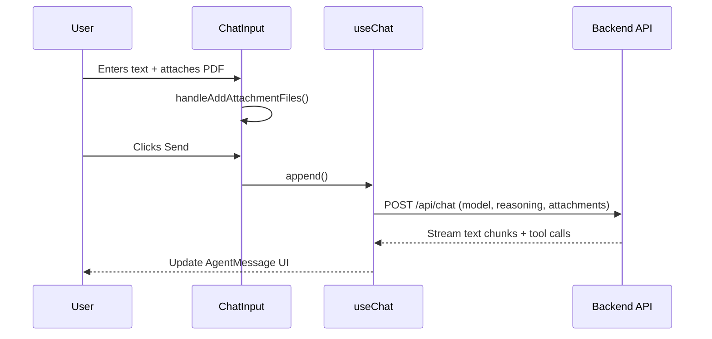

<!-- source: DeepWiki mcp.deepwiki.com · repo supermemoryai/supermemory · page 2.2 Chat Interface · fetched 2026-10-30 -->

# Chat Interface

<details>
<summary>Relevant source files</summary>

The following files were used as context for generating this wiki page:

- [apps/web/app/(app)/page.tsx](apps/web/app/(app)/page.tsx)
- [apps/web/components/chat/attachments.ts](apps/web/components/chat/attachments.ts)
- [apps/web/components/chat/home-chat-composer.tsx](apps/web/components/chat/home-chat-composer.tsx)
- [apps/web/components/chat/index.tsx](apps/web/components/chat/index.tsx)
- [apps/web/components/chat/input/actions.tsx](apps/web/components/chat/input/actions.tsx)
- [apps/web/components/chat/input/chain-of-thought.tsx](apps/web/components/chat/input/chain-of-thought.tsx)
- [apps/web/components/chat/input/index.tsx](apps/web/components/chat/input/index.tsx)
- [apps/web/components/chat/message/agent-message.tsx](apps/web/components/chat/message/agent-message.tsx)
- [apps/web/components/chat/message/memory-search-result-card.tsx](apps/web/components/chat/message/memory-search-result-card.tsx)
- [apps/web/components/chat/message/related-memories.tsx](apps/web/components/chat/message/related-memories.tsx)
- [apps/web/components/chat/message/user-message.tsx](apps/web/components/chat/message/user-message.tsx)
- [apps/web/components/chat/model-selector.tsx](apps/web/components/chat/model-selector.tsx)
- [apps/web/components/chat/reasoning-selector.tsx](apps/web/components/chat/reasoning-selector.tsx)
- [apps/web/components/document-modal/content/image-preview.tsx](apps/web/components/document-modal/content/image-preview.tsx)
- [apps/web/components/document-modal/content/index.tsx](apps/web/components/document-modal/content/index.tsx)
- [apps/web/components/document-modal/content/pdf.tsx](apps/web/components/document-modal/content/pdf.tsx)
- [apps/web/components/superloader.tsx](apps/web/components/superloader.tsx)
- [apps/web/lib/chat-search-memory-results.ts](apps/web/lib/chat-search-memory-results.ts)
- [apps/web/lib/chat-web-search-tools.ts](apps/web/lib/chat-web-search-tools.ts)
- [apps/web/lib/file-cache.ts](apps/web/lib/file-cache.ts)
- [apps/web/lib/models.tsx](apps/web/lib/models.tsx)
- [apps/web/stores/chat.ts](apps/web/stores/chat.ts)
- [apps/web/stores/indexeddb-storage.ts](apps/web/stores/indexeddb-storage.ts)

</details>


## Purpose and Scope

The Chat Interface is the primary conversational surface for interacting with Nova, Supermemory's AI assistant. It enables users to ask questions and receive personalized responses that incorporate their stored memories and documents. This page documents the chat system's architecture, AI model selection, message threading, memory injection mechanism, and user interaction features.

The interface is implemented primarily in `apps/web/components/chat/index.tsx` [apps/web/components/chat/index.tsx:1-223](), utilizing the Vercel AI SDK for streaming and state management.

## Chat Activation and Entry Points

The chat interface can be triggered from multiple locations within the web application. The primary entry point is the `ChatLaunchFab` [apps/web/components/chat/index.tsx:103-143](), which renders a floating action button (FAB) containing the `NovaOrb` component.

**Chat Interface Entry Points:**

| Surface | Code Location | Component |
|---------|--------------|-----------|
| Floating Action Button | [apps/web/components/chat/index.tsx:103-143]() | `ChatLaunchFab` |
| Home Dashboard | [apps/web/app/(app)/page.tsx:15-16]() | `HomeChatComposer` |
| Mobile Navigation | [apps/web/app/(app)/page.tsx:14]() | `MobileBottomNav` |

**`HomeChatComposer` component:**
The `HomeChatComposer` [apps/web/components/chat/home-chat-composer.tsx:22-170]() provides a large, centered input area on the landing dashboard. It allows users to select a model, reasoning effort, and target space before initiating a chat session via the `onStartChat` callback [apps/web/components/chat/home-chat-composer.tsx:26-33]().

**Entry point flow diagram:**

```mermaid
graph TB
    subgraph "apps/web/app/(app)/page.tsx"
        [NewPage] --> [HomeChatComposer]
        [NewPage] --> [ChatSidebar]
        [NewPage] --> [ChatLaunchFab]
    end

    subgraph "apps/web/components/chat/index.tsx"
        [ChatSidebar] --> [ChatInput]
        [ChatSidebar] --> [ChatModelSelector]
        [ChatSidebar] --> [ReasoningSelector]
    end

    subgraph "nuqs"
        [threadParam]
    end

    [HomeChatComposer] -->|"onStartChat"| [threadParam]
    [ChatLaunchFab] -->|"onOpen"| [ChatSidebar]
```

Sources: [apps/web/app/(app)/page.tsx:109-180](), [apps/web/components/chat/index.tsx:103-143](), [apps/web/components/chat/home-chat-composer.tsx:22-34]()

## AI Model Selection and Reasoning

Nova supports multiple AI models and reasoning modes. These are defined in `apps/web/lib/models.tsx`.

### Supported Models
| Model ID | Display Name | Version | Description |
|----------|--------------|---------|-------------|
| `grok-4.3` | Grok | 4.3 | xAI's latest model [apps/web/lib/models.tsx:3-6]() |
| `gpt-5.1` | GPT | 5.1 | OpenAI's latest model [apps/web/lib/models.tsx:8-11]() |
| `claude-sonnet-4.6` | Claude | 4.6 | Anthropic's advanced model [apps/web/lib/models.tsx:13-16]() |
| `gemini-2.5-pro` | Gemini | 3 Pro | Google's most capable model [apps/web/lib/models.tsx:18-21]() |

### Reasoning Effort
Users can toggle between two reasoning modes via the `ReasoningSelector` [apps/web/components/chat/reasoning-selector.tsx:1-73]():
- **Instant**: Faster answers for everyday prompts [apps/web/lib/models.tsx:40-43]().
- **Thinking**: Deeper reasoning for harder questions [apps/web/lib/models.tsx:45-48]().

**Model data flow diagram:**

```mermaid
graph LR
    subgraph "apps/web/lib/models.tsx"
        [models] --> [ModelId]
        [reasoningOptions] --> [ReasoningEffort]
    end

    subgraph "apps/web/components/chat/model-selector.tsx"
        [ChatModelSelector]
    end

    subgraph "apps/web/components/chat/index.tsx"
        [selectedModel]
        [reasoningEffort]
    end

    [ModelId] --> [ChatModelSelector]
    [ChatModelSelector] --> [selectedModel]
    [ReasoningEffort] --> [reasoningEffort]
```

Sources: [apps/web/lib/models.tsx:1-53](), [apps/web/components/chat/model-selector.tsx:20-58](), [apps/web/components/chat/reasoning-selector.tsx:7-27]()

## Message Flow and Attachments

Conversations are managed using the `useChat` hook from `@ai-sdk/react` [apps/web/components/chat/index.tsx:9]().

### Chat Attachments
The interface supports uploading files as context for the conversation. 
- **Drafting**: `createChatAttachmentDraft` [apps/web/components/chat/attachments.ts:66]() creates a local preview.
- **Persistence**: Attachments can be toggled to `saveToMemory` [apps/web/components/chat/index.tsx:96]().
- **Caching**: Files are cached locally using `cacheFileBlob` [apps/web/lib/file-cache.ts]() to avoid re-uploading.

### Message Rendering
- **`UserMessage`**: Handles text display, attachment chips, and inline editing [apps/web/components/chat/message/user-message.tsx:31-193](). It allows switching models and reasoning effort during a regeneration [apps/web/components/chat/message/user-message.tsx:62]().
- **`AgentMessage`**: Renders AI responses with markdown support and specialized tool-call UI [apps/web/components/chat/message/agent-message.tsx:1-25]().

**Message Interaction Sequence:**



Sources: [apps/web/components/chat/index.tsx:79-101](), [apps/web/components/chat/message/user-message.tsx:102-160](), [apps/web/components/chat/message/agent-message.tsx:26-37](), [apps/web/components/chat/home-chat-composer.tsx:75-114]()

## Tool Call Visualization and Context

When the AI assistant performs actions, the `AgentMessage` component visualizes these as tool calls [apps/web/components/chat/message/agent-message.tsx:39-46]().

### Supported Tools
- **Memory Tools**: `bash` (SMFS interface), `searchMemories`, `addMemory`, `fetchMemory` [apps/web/components/chat/message/agent-message.tsx:26-37]().
- **Search Tools**: `web_search`, `google_search` [apps/web/components/chat/message/agent-message.tsx:28-29]().
- **Task Tools**: `scheduleTask`, `listSchedules`, `cancelSchedule` [apps/web/components/chat/message/agent-message.tsx:34-36]().

### Document Integration
If the AI references specific documents, the `DocumentContent` component [apps/web/components/document-modal/content/index.tsx:76-153]() handles rendering based on type:
- **PDF**: `PdfViewer` using `react-pdf` [apps/web/components/document-modal/content/pdf.tsx:21-170]().
- **Images**: `ImagePreview` with blur-up loading [apps/web/components/document-modal/content/image-preview.tsx:13-96]().
- **External**: `TweetContent`, `NotionDoc`, `YoutubeVideo`, and `GoogleDocViewer` [apps/web/components/document-modal/content/index.tsx:99-148]().

Sources: [apps/web/components/chat/message/agent-message.tsx:26-37](), [apps/web/components/document-modal/content/index.tsx:54-74](), [apps/web/components/document-modal/content/pdf.tsx:3-12]()

## Conversation Storage and Threading

Conversation state is persisted locally using `usePersistentChatStore` with IndexedDB [apps/web/stores/chat.ts:73-185]().

### Thread Management
- **Persistence**: Threads are identified by `threadId` in the URL [apps/web/app/(app)/page.tsx:160]() and stored in the `byProject` map in Zustand [apps/web/stores/chat.ts:57-71]().
- **Space Selection**: Users can scope chats to specific "Spaces" (projects) using the `SpaceSelector` [apps/web/components/chat/home-chat-composer.tsx:157-165]().
- **Auto-Space**: The `AUTO_CHAT_SPACE_ID` [apps/web/components/chat/home-chat-composer.tsx:45]() allows the AI to automatically determine the most relevant context.
- **Summaries**: The store maintains `ConversationSummary` objects containing `id`, `title`, and `lastUpdated` [apps/web/stores/chat.ts:40-44]().

**Conversation State Diagram:**

```mermaid
graph TB
    subgraph "Client State (nuqs)"
        [threadParam]
    end

    subgraph "Zustand / IndexedDB (usePersistentChatStore)"
        [byProject]
        [conversations_Record]
        [messages_UIMessage]
    end

    subgraph "Components"
        [ChatSidebar]
        [HomeChatComposer]
    end

    [threadParam] --> [ChatSidebar]
    [byProject] --> [conversations_Record]
    [conversations_Record] --> [messages_UIMessage]
    [ChatSidebar] -->|"Switch Thread"| [threadParam]
```

Sources: [apps/web/app/(app)/page.tsx:151-180](), [apps/web/components/chat/home-chat-composer.tsx:43-46](), [apps/web/components/chat/index.tsx:59-60](), [apps/web/stores/chat.ts:46-56]()

## Analytics and Error Tracking

### Interaction Tracking
The chat interface tracks several events via the `analytics` utility:
- **Model Changes**: `analytics.modelChanged({ model })` [apps/web/components/chat/model-selector.tsx:56]().
- **Message Sending**: Captured within the `useChat` submission flow.

### Error Handling
Streaming errors are caught and transformed into user-friendly copy using `getNovaChatErrorCopy` [apps/web/components/chat/index.tsx:38](), which handles common issues like rate limits or model-specific availability.

Sources: [apps/web/components/chat/model-selector.tsx:56](), [apps/web/components/chat/index.tsx:38]()

---

