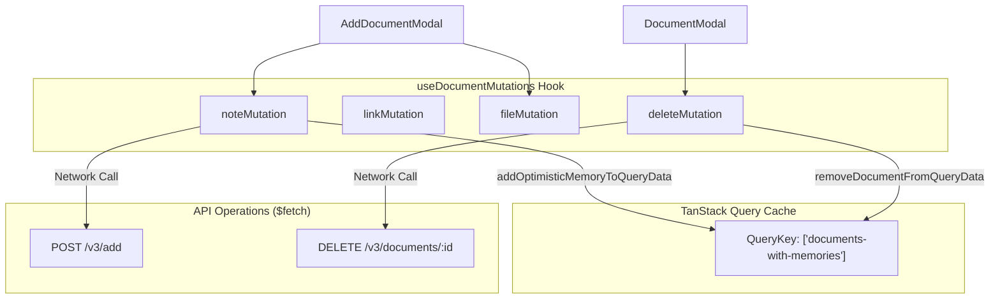
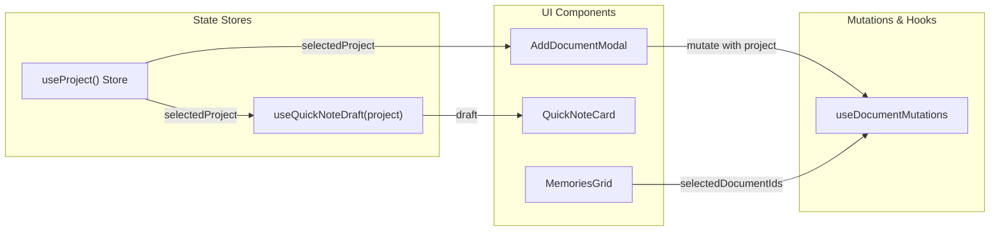

<!-- source: DeepWiki mcp.deepwiki.com · repo supermemoryai/supermemory · page 2.3 Memory Management · fetched 2026-10-30 -->

# Memory Management

Relevant source files

The following files were used as context for generating this wiki page:

- [apps/web/components/add-document/file.tsx](apps/web/components/add-document/file.tsx)
- [apps/web/components/add-document/index.tsx](apps/web/components/add-document/index.tsx)
- [apps/web/components/add-document/link.tsx](apps/web/components/add-document/link.tsx)
- [apps/web/components/add-document/note.tsx](apps/web/components/add-document/note.tsx)
- [apps/web/components/document-cards/file-preview.tsx](apps/web/components/document-cards/file-preview.tsx)
- [apps/web/components/document-cards/google-docs-preview.tsx](apps/web/components/document-cards/google-docs-preview.tsx)
- [apps/web/components/document-cards/notion-preview.tsx](apps/web/components/document-cards/notion-preview.tsx)
- [apps/web/components/document-cards/tweet-preview.tsx](apps/web/components/document-cards/tweet-preview.tsx)
- [apps/web/components/document-cards/website-preview.tsx](apps/web/components/document-cards/website-preview.tsx)
- [apps/web/components/document-cards/youtube-preview.tsx](apps/web/components/document-cards/youtube-preview.tsx)
- [apps/web/components/document-icon.tsx](apps/web/components/document-icon.tsx)
- [apps/web/components/document-modal/content/text-editor-content.tsx](apps/web/components/document-modal/content/text-editor-content.tsx)
- [apps/web/components/document-modal/index.tsx](apps/web/components/document-modal/index.tsx)
- [apps/web/components/fullscreen-note-modal.tsx](apps/web/components/fullscreen-note-modal.tsx)
- [apps/web/components/memories-grid.tsx](apps/web/components/memories-grid.tsx)
- [apps/web/components/quick-note-card.tsx](apps/web/components/quick-note-card.tsx)
- [apps/web/components/text-editor/extensions.tsx](apps/web/components/text-editor/extensions.tsx)
- [apps/web/components/text-editor/index.tsx](apps/web/components/text-editor/index.tsx)
- [apps/web/components/text-editor/slash-command.tsx](apps/web/components/text-editor/slash-command.tsx)
- [apps/web/components/timeline-view.tsx](apps/web/components/timeline-view.tsx)
- [apps/web/hooks/use-document-mutations.ts](apps/web/hooks/use-document-mutations.ts)
- [apps/web/hooks/use-full-document.ts](apps/web/hooks/use-full-document.ts)
- [apps/web/lib/url-helpers.ts](apps/web/lib/url-helpers.ts)

This page covers how the web application (`apps/web`) creates, displays, and deletes memory documents—and how documents are organized by projects and spaces. It focuses on the client-side implementation using React Query mutations, optimistic updates, and the masonry grid display.

---

## Data Model

A document (or "memory") is the core unit of storage. The TypeScript interface is derived from the `DocumentsWithMemoriesResponseSchema` [apps/web/components/memories-grid.tsx:96-97]().

| Field | Type | Description |
|---|---|---|
| `id` | `string` | Unique identifier for the document [apps/web/hooks/use-document-mutations.ts:26-26]() |
| `content` | `string` | The raw text, URL, or note content [apps/web/hooks/use-document-mutations.ts:36-36]() |
| `title` | `string` | User-provided or AI-generated title [apps/web/hooks/use-document-mutations.ts:38-38]() |
| `containerTags`| `string[]` | Scoping tags (e.g., project IDs) [apps/web/hooks/use-document-mutations.ts:40-40]() |
| `status` | `string` | Processing state (e.g., `pending`, `success`, `error`) [apps/web/hooks/use-document-mutations.ts:43-43]() |
| `type` | `string` | Category (e.g., `note`, `link`, `tweet`, `file`) [apps/web/hooks/use-document-mutations.ts:44-44]() |

Sources: [apps/web/hooks/use-document-mutations.ts:34-48](), [apps/web/components/memories-grid.tsx:75-97]()

---

## Memories Grid Implementation

The `MemoriesGrid` [apps/web/components/memories-grid.tsx:247-247]() is the primary interface for browsing memories. It uses a masonry layout via the `Masonry` component [apps/web/components/memories-grid.tsx:11-11]() to handle varying card heights and supports infinite scrolling.

### Data Fetching and Display
It utilizes `useInfiniteQuery` to fetch documents from the backend [apps/web/components/memories-grid.tsx:6-6]().
- **Filtering**: The grid supports filtering by categories such as `webpage`, `tweet`, `google_drive`, `notion`, `files`, and `mcp` [apps/web/components/memories-grid.tsx:75-83]().
- **Loading States**: A rotating label system provides feedback during data fetching [apps/web/components/memories-grid.tsx:150-172]().
- **Timeline View**: Alternatively, memories can be viewed in a `TimelineView` [apps/web/components/timeline-view.tsx:189-189]() which groups documents by time periods like "Today", "Yesterday", or specific dates [apps/web/components/timeline-view.tsx:18-35]().

### Specialized Preview Components
The grid maps documents to specialized preview components based on their metadata and type:
- **TweetPreview**: For Twitter/X content [apps/web/components/memories-grid.tsx:18-18]().
- **WebsitePreview**: For standard web links [apps/web/components/memories-grid.tsx:19-19]().
- **FilePreview**: Handles images (with blur-up loading), PDFs, and other uploads [apps/web/components/document-cards/file-preview.tsx:47-47]().
- **NotePreview**: Displays user-created markdown notes [apps/web/components/memories-grid.tsx:22-22]().

Sources: [apps/web/components/memories-grid.tsx:1-83](), [apps/web/components/timeline-view.tsx:18-189](), [apps/web/components/document-cards/file-preview.tsx:75-135]()

---

## Document Mutations & Optimistic Updates

The `useDocumentMutations` hook [apps/web/hooks/use-document-mutations.ts:224-225]() centralizes all write operations. It ensures the UI feels instantaneous by updating the React Query cache before the server responds.

### Optimistic Logic Flow
1. **Cancel & Snapshot**: In-flight queries for `["documents-with-memories"]` are cancelled to prevent race conditions, and current data is snapshotted for potential rollback [apps/web/hooks/use-document-mutations.ts:195-200]().
2. **Cache Mutation**:
    - **Add**: `addOptimisticMemoryToQueryData` prepends a temporary object with `isOptimistic: true` to the query cache [apps/web/hooks/use-document-mutations.ts:50-90]().
    - **Delete**: `removeDocumentFromQueryData` [apps/web/hooks/use-document-mutations.ts:92-95]() or `removeDocumentsFromQueryData` (for bulk) [apps/web/hooks/use-document-mutations.ts:139-142]() filters out the target IDs immediately.
3. **Settlement**: On success, queries are invalidated. On failure, the snapshot is restored using `restoreQueriesFromSnapshot` [apps/web/hooks/use-document-mutations.ts:202-210]().

### Code Entity Relationship Diagram

Sources: [apps/web/hooks/use-document-mutations.ts:50-245](), [apps/web/components/add-document/index.tsx:150-152](), [apps/web/components/document-modal/index.tsx:200-200]()

---

## Projects and Spaces Organization

Memories are organized into "Spaces" (projects), which act as containers for related information using `containerTags`.

### Scoping via Container Tags
Every document creation request includes a `project` (containerTag) [apps/web/hooks/use-document-mutations.ts:248-253]().
- **Contextual Context**: When adding a memory, the system resolves an `entityContext` for the space to provide better AI understanding [apps/web/hooks/use-document-mutations.ts:232-245]().
- **Space Profiles**: Each space has a profile consisting of `static` and `dynamic` traits derived from its memories, fetched via `useSpaceProfile` (see glossary for containerTag relationships).

### Space Selection and Management
The `SpaceSelector` [apps/web/components/add-document/index.tsx:21-21]() allows users to choose which project a new document should be added to. The `useProject` store [apps/web/components/add-document/index.tsx:15-15]() tracks the currently active global project, which is used as the default for new memories [apps/web/components/add-document/index.tsx:130-133]().

### Space Logic Diagram

Sources: [apps/web/hooks/use-document-mutations.ts:248-253](), [apps/web/components/add-document/index.tsx:121-133](), [apps/web/components/quick-note-card.tsx:50-51]()

---

## Creation Workflows

### 1. Manual Creation (AddDocumentModal)
The `AddDocumentModal` [apps/web/components/add-document/index.tsx:32-32]() provides a tabbed interface for:
- **Notes**: Direct text entry using a Tiptap-based `TextEditor` [apps/web/components/add-document/note.tsx:38-44]().
- **Links**: URL ingestion for webpages [apps/web/components/add-document/index.tsx:188-197]().
- **Files**: Multi-file upload for PDFs, images, and markdown [apps/web/components/add-document/file.tsx:10-11](). It uses a `FileContent` component to manage a queue of `pending`, `uploading`, `success`, or `error` items [apps/web/components/add-document/file.tsx:13-20]().

### 2. Quick Notes
The `QuickNoteCard` [apps/web/components/quick-note-card.tsx:43-43]() allows for rapid thought capture directly from the memories grid.
- **Draft Persistence**: Drafts are stored per-project using the `useQuickNoteDraft` store [apps/web/components/quick-note-card.tsx:51-51]().
- **Expansion**: Notes can be expanded to a larger overlay [apps/web/components/quick-note-card.tsx:67-82]() or a `FullscreenNoteModal` [apps/web/components/fullscreen-note-modal.tsx:23-23]().

### 3. Deletion
- **Single Delete**: The `DeleteButton` in the `DocumentModal` handles single document removal with a confirmation state [apps/web/components/document-modal/index.tsx:83-106]().
- **Bulk Delete**: The `MemoriesGrid` supports a selection mode where multiple documents can be selected and deleted at once via `onBulkDelete` [apps/web/components/memories-grid.tsx:234-241]().

Sources: [apps/web/components/add-document/index.tsx:82-112](), [apps/web/components/quick-note-card.tsx:43-105](), [apps/web/components/document-modal/index.tsx:83-159](), [apps/web/hooks/use-document-mutations.ts:212-212]()

---

