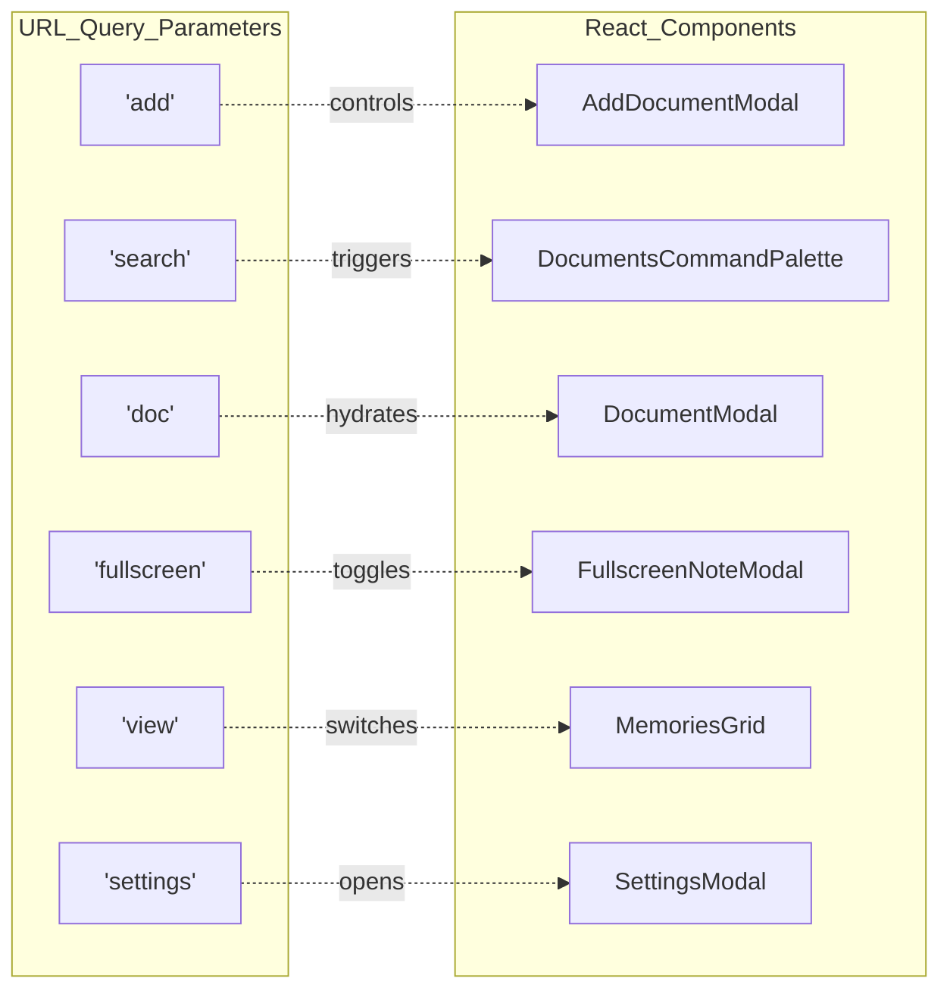
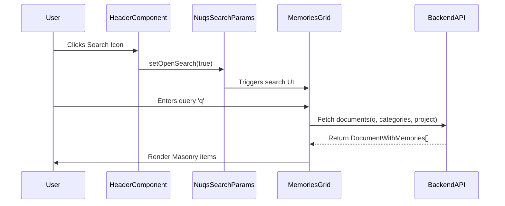

<!-- source: DeepWiki mcp.deepwiki.com · repo supermemoryai/supermemory · page 2.4 Document Display & Search · fetched 2026-10-30 -->

# Document Display & Search

Relevant source files

The following files were used as context for generating this wiki page:

- [apps/web/app/(app)/settings/page.tsx](apps/web/app/(app)/settings/page.tsx)
- [apps/web/components/add-document/note.tsx](apps/web/components/add-document/note.tsx)
- [apps/web/components/bottom-nav.tsx](apps/web/components/bottom-nav.tsx)
- [apps/web/components/digests-view.tsx](apps/web/components/digests-view.tsx)
- [apps/web/components/document-modal/content/text-editor-content.tsx](apps/web/components/document-modal/content/text-editor-content.tsx)
- [apps/web/components/document-modal/index.tsx](apps/web/components/document-modal/index.tsx)
- [apps/web/components/documents-command-palette.tsx](apps/web/components/documents-command-palette.tsx)
- [apps/web/components/fullscreen-note-modal.tsx](apps/web/components/fullscreen-note-modal.tsx)
- [apps/web/components/header.tsx](apps/web/components/header.tsx)
- [apps/web/components/memories-grid.tsx](apps/web/components/memories-grid.tsx)
- [apps/web/components/org-plan-badge.tsx](apps/web/components/org-plan-badge.tsx)
- [apps/web/components/quick-note-card.tsx](apps/web/components/quick-note-card.tsx)
- [apps/web/components/settings/account.tsx](apps/web/components/settings/account.tsx)
- [apps/web/components/settings/billing.tsx](apps/web/components/settings/billing.tsx)
- [apps/web/components/settings/cancel-reasons.ts](apps/web/components/settings/cancel-reasons.ts)
- [apps/web/components/settings/connections-mcp.tsx](apps/web/components/settings/connections-mcp.tsx)
- [apps/web/components/settings/org-context.tsx](apps/web/components/settings/org-context.tsx)
- [apps/web/components/text-editor/extensions.tsx](apps/web/components/text-editor/extensions.tsx)
- [apps/web/components/text-editor/index.tsx](apps/web/components/text-editor/index.tsx)
- [apps/web/components/text-editor/slash-command.tsx](apps/web/components/text-editor/slash-command.tsx)
- [apps/web/components/timeline-view.tsx](apps/web/components/timeline-view.tsx)
- [apps/web/components/user-profile-menu.tsx](apps/web/components/user-profile-menu.tsx)
- [apps/web/hooks/use-digests.ts](apps/web/hooks/use-digests.ts)
- [apps/web/lib/search-params.ts](apps/web/lib/search-params.ts)
- [apps/web/public/images/digest/feat-fs.svg](apps/web/public/images/digest/feat-fs.svg)

This page documents how documents are displayed, browsed, and searched in the `apps/web` Next.js application. It covers the URL-driven state system that drives UI visibility, the command palette search interface, the masonry document grid, the timeline view, and the specialized cards for highlights and quick notes.

---

## URL-Driven UI State

The application uses a "URL-as-state" architecture where major modal and view states are encoded as query parameters. This is implemented using the `nuqs` library, enabling deep-linking and consistent browser history behavior.

### Parameter Definitions
All parameters are centralized in `apps/web/lib/search-params.ts`.

| Parameter | Type | Default | Purpose |
|-----------|------|---------|---------|
| `add` | `StringLiteral` | `null` | Controls `AddDocumentModal` tab (`note`, `link`, `file`, `connect`) [apps/web/lib/search-params.ts:9-14]() |
| `search` | `boolean` | `false` | Opens/closes the document search command palette [apps/web/lib/search-params.ts:16-16]() |
| `q` | `string` | `""` | The active search query string [apps/web/lib/search-params.ts:17-17]() |
| `doc` | `string` | `null` | ID of the document currently open in the `DocumentModal` [apps/web/lib/search-params.ts:18-18]() |
| `fullscreen`| `boolean` | `false` | Toggles `FullscreenNoteModal` for the text editor [apps/web/lib/search-params.ts:19-19]() |
| `view` | `StringLiteral` | `dashboard` | Main content view: `dashboard`, `graph`, `list`, `integrations`, etc. [apps/web/lib/search-params.ts:26-44]() |
| `categories`| `string[]` | `[]` | Filter for document types (e.g., `tweet`, `webpage`) [apps/web/lib/search-params.ts:58-60]() |
| `settings` | `string` | `null` | Opens the settings modal to a specific tab [apps/web/app/(app)/settings/page.tsx:17-19]() |

**Sources:** [apps/web/lib/search-params.ts:1-61](), [apps/web/app/(app)/settings/page.tsx:1-24]()

---

## Component & Parameter Wiring

The following diagram maps how specific URL parameters drive the visibility and state of high-level UI components.

**Diagram: URL Parameters to Code Entities**

**Sources:** [apps/web/lib/search-params.ts:1-61](), [apps/web/app/(app)/settings/page.tsx:11-20](), [apps/web/components/memories-grid.tsx:247-255]()

---

## Memories Grid & Timeline View

The application provides two primary ways to browse documents: a masonry grid and a grouped timeline.

### 1. Memories Grid
The `MemoriesGrid` component uses `masonic` for a high-performance masonry layout [apps/web/components/memories-grid.tsx:11](). It renders specialized preview cards based on the document type:
- `TweetPreview`: Renders tweets using `react-tweet` [apps/web/components/memories-grid.tsx:18]().
- `WebsitePreview`: Displays OpenGraph metadata fetched via `/api/og` [apps/web/components/memories-grid.tsx:109-144]().
- `FilePreview`: Handles images, PDFs, and code files [apps/web/components/memories-grid.tsx:21]().
- `NotePreview`: Displays markdown content created via the internal editor [apps/web/components/memories-grid.tsx:22]().
- `McpPreview` & `NotionPreview`: Specialized cards for external integrations [apps/web/components/memories-grid.tsx:31-32]().

### 2. Timeline View
The `TimelineView` groups documents by time periods (e.g., "Today", "Yesterday") and then by category [apps/web/components/timeline-view.tsx:142-187](). 
- **Grouping Logic:** It uses `getTimePeriodLabel` to calculate human-readable date strings [apps/web/components/timeline-view.tsx:18-35]().
- **Data Flow:** Documents are fetched via `useInfiniteQuery` and processed into facets (categories) like `webpage`, `tweet`, and `files` [apps/web/components/memories-grid.tsx:75-94]().

**Sources:** [apps/web/components/memories-grid.tsx:1-246](), [apps/web/components/timeline-view.tsx:1-233]()

---

## Document Detail & Editing

### Document Modal
When a document is selected (`?doc=ID`), the `DocumentModal` opens. It provides:
- **Tabs:** Switches between "Summary", "Content", and "Memories" (graph list) [apps/web/components/document-modal/index.tsx:6-22]().
- **Source Links:** Resolves original URLs for Google Docs/Sheets/Slides using `getDocumentSourceUrl` [apps/web/components/document-modal/index.tsx:35-59]().
- **Mutations:** Allows updating titles or deleting documents via `useDocumentMutations` [apps/web/components/document-modal/index.tsx:200-201](). It includes a `DeleteButton` with confirmation logic and temporary ID checking to prevent deleting documents still in processing [apps/web/components/document-modal/index.tsx:83-159]().

### Fullscreen Editor
The `FullscreenNoteModal` provides a focused writing environment using the `TextEditor` component [apps/web/components/fullscreen-note-modal.tsx:10-153]().
- **Implementation:** Built on Tiptap with markdown support [apps/web/components/text-editor/index.tsx:14-92]().
- **Persistence:** Uses `useQuickNoteDraft` to save progress to local storage/Zustand during the session [apps/web/components/fullscreen-note-modal.tsx:33-67]().
- **Keyboard Shortcuts:** Supports `Mod+Enter` for saving and `Esc` for closing [apps/web/components/fullscreen-note-modal.tsx:73-88]().

**Sources:** [apps/web/components/document-modal/index.tsx:1-205](), [apps/web/components/fullscreen-note-modal.tsx:1-226]()

---

## Dashboard & Highlights

The `DashboardView` serves as the home surface, displaying high-level context and quick actions.

### Highlights Card
The `HighlightsCard` displays AI-generated summaries and key insights from the user's knowledge base.
- **Interaction:** Users can click "Chat" to open a focused conversation about a specific highlight or "Related" to search for connected concepts [apps/web/components/memories-grid.tsx:217-221]().
- **Quick Notes:** Integrated `QuickNoteCard` allows users to save notes directly from the grid or maximize them into the fullscreen editor [apps/web/components/memories-grid.tsx:210-214]().

### Data Flow for Search & Display

**Sources:** [apps/web/components/header.tsx:68-83](), [apps/web/components/memories-grid.tsx:247-270](), [apps/web/lib/search-params.ts:16-17]()

---

## Document Search & Palette

Search is driven by the `q` parameter and the `DocumentsCommandPalette`.

1. **Search Parameter:** `qParam` in `nuqs` syncs the search input with the URL [apps/web/lib/search-params.ts:17]().
2. **Command Palette:** Triggered by `onOpenSearch` from the `Header` [apps/web/components/header.tsx:68](). It performs hybrid search across the user's documents.
3. **Filtering:** Filters are applied via `categoriesParam` and `projectParam`, which are passed to the backend API to scope the results [apps/web/lib/search-params.ts:58-61]().
4. **Mobile Navigation:** The `MobileBottomNav` provides a dedicated search trigger in the "More" dropdown for mobile users [apps/web/components/bottom-nav.tsx:110-133]().

**Sources:** [apps/web/lib/search-params.ts:1-61](), [apps/web/components/header.tsx:105-122](), [apps/web/components/bottom-nav.tsx:45-137]()

---

