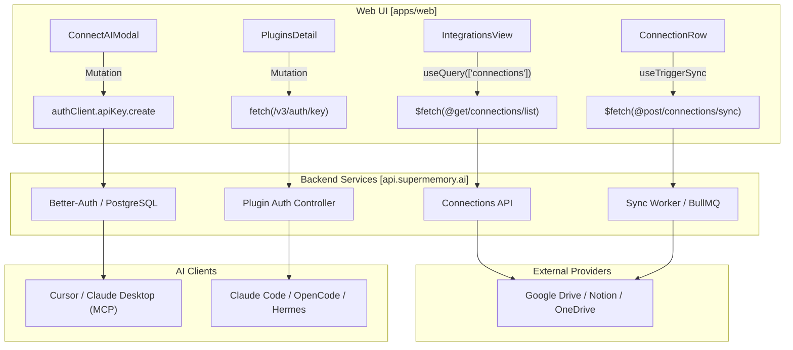
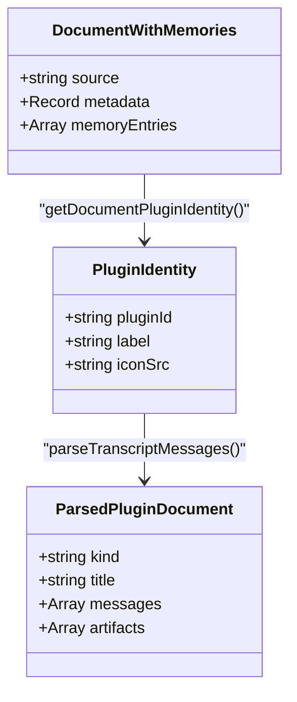

<!-- source: DeepWiki mcp.deepwiki.com · repo supermemoryai/supermemory · page 2.5 Integrations & Connections · fetched 2026-10-30 -->

# Integrations & Connections

Relevant source files

The following files were used as context for generating this wiki page:

- [apps/web/app/auth/agent-connect/page.tsx](apps/web/app/auth/agent-connect/page.tsx)
- [apps/web/app/auth/connect/page.tsx](apps/web/app/auth/connect/page.tsx)
- [apps/web/components/add-document/connections.tsx](apps/web/components/add-document/connections.tsx)
- [apps/web/components/connect-ai-modal.tsx](apps/web/components/connect-ai-modal.tsx)
- [apps/web/components/document-cards/mcp-preview.tsx](apps/web/components/document-cards/mcp-preview.tsx)
- [apps/web/components/document-cards/note-preview.tsx](apps/web/components/document-cards/note-preview.tsx)
- [apps/web/components/document-cards/plugin-preview.tsx](apps/web/components/document-cards/plugin-preview.tsx)
- [apps/web/components/document-modal/content/plugin-content.tsx](apps/web/components/document-modal/content/plugin-content.tsx)
- [apps/web/components/document-modal/title.tsx](apps/web/components/document-modal/title.tsx)
- [apps/web/components/integrations-view.tsx](apps/web/components/integrations-view.tsx)
- [apps/web/components/integrations/plugins-detail.tsx](apps/web/components/integrations/plugins-detail.tsx)
- [apps/web/components/mcp-modal/mcp-detail-view.tsx](apps/web/components/mcp-modal/mcp-detail-view.tsx)
- [apps/web/hooks/use-token-usage.ts](apps/web/hooks/use-token-usage.ts)
- [apps/web/lib/billing-utils.ts](apps/web/lib/billing-utils.ts)
- [apps/web/lib/mcp-client-setup.ts](apps/web/lib/mcp-client-setup.ts)
- [apps/web/lib/mcp-manual-instructions.ts](apps/web/lib/mcp-manual-instructions.ts)
- [apps/web/lib/plugin-catalog.ts](apps/web/lib/plugin-catalog.ts)
- [apps/web/lib/plugin-document.ts](apps/web/lib/plugin-document.ts)
- [apps/web/lib/plugin-space.ts](apps/web/lib/plugin-space.ts)
- [apps/web/public/mcp-supported-tools/antigravity.png](apps/web/public/mcp-supported-tools/antigravity.png)
- [packages/lib/queries.ts](packages/lib/queries.ts)

This document covers the external service integrations and connection management system in the Supermemory web application. It explains how users connect cloud storage providers (Google Drive, Notion, OneDrive), manage MCP (Model Context Protocol) setups via the `ConnectAIModal`, and configure programmatic access for tools like Claude Code and Raycast.

**Sources:** [apps/web/components/connect-ai-modal.tsx:1-50](), [apps/web/components/integrations-view.tsx:1-100](), [apps/web/components/add-document/connections.tsx:1-45]()

---

## Integration Architecture Overview

The integrations system distinguishes between **OAuth-based Connections** (managed via the Connections tab) and **API Key-based Plugins/MCP** (managed via the Integrations view).

### Natural Language to Code Entity Mapping

The following table maps high-level integration concepts to their implementation entities in the codebase.

| System Name | Code Entity | Purpose |
| :--- | :--- | :--- |
| **Integrations View** | `IntegrationsView` | Main hub for browsing and managing all external tools and connectors. [apps/web/components/integrations-view.tsx:1]() |
| **Connection Row** | `ConnectionRow` | UI component for individual OAuth connections with sync status and history. [apps/web/components/add-document/connections.tsx:103]() |
| **MCP Setup Modal** | `ConnectAIModal` | Handles multi-step setup for AI clients like Cursor and Claude Desktop. [apps/web/components/connect-ai-modal.tsx:126]() |
| **Plugin Registry** | `PLUGIN_CATALOG` | Defines metadata and install steps for external AI tools. [apps/web/lib/plugin-catalog.ts:31]() |
| **Auth Client** | `authClient.apiKey` | Better-auth wrapper for managing keys and metadata. [apps/web/components/connect-ai-modal.tsx:245]() |
| **Billing Guard** | `hasActivePlan` | Utility to check subscription status before allowing connection. [packages/lib/queries.ts:59]() |

**Sources:** [apps/web/components/integrations-view.tsx:155-235](), [apps/web/components/add-document/connections.tsx:103-125](), [apps/web/components/integrations/plugins-detail.tsx:26-31](), [packages/lib/queries.ts:59-64]()

### Data Flow Diagram

**Sources:** [apps/web/components/integrations-view.tsx:3-10](), [apps/web/components/add-document/connections.tsx:3-6](), [apps/web/components/connect-ai-modal.tsx:239-250](), [apps/web/hooks/use-trigger-sync.ts:1-10]()

---

## Cloud Storage Connections

Cloud storage integrations (Google Drive, Notion, OneDrive, and Granola) use OAuth 2.0 or workspace-level syncing. These are managed in the "Connections" tab and the "Add Document" modal.

### Provider Configuration
Providers are defined in a `CONNECTORS` map which provides metadata for UI rendering.

| Provider | Title | Description |
| :--- | :--- | :--- |
| `google-drive` | Google Drive | Connect Google docs, sheets and slides |
| `notion` | Notion | Import Notion pages and databases |
| `onedrive` | OneDrive | Access Microsoft Office documents |
| `granola` | Granola | Sync AI meeting notes and transcripts |

**Sources:** [apps/web/components/add-document/connections.tsx:57-90]()

### Connection Management & Health
- **Sync Triggering**: The `useTriggerSync` hook allows users to manually initiate a refresh of their data from the UI. [apps/web/components/add-document/connections.tsx:39-39]()
- **Health Checks**: `useConnectionHealth` monitors if a connection has expired and needs re-authentication. If `needsReauth` is true, the UI displays a "Reconnect" button. [apps/web/components/add-document/connections.tsx:124-129](), [apps/web/components/add-document/connections.tsx:179-198]()
- **Sync History**: The `SyncHistoryPanel` provides visibility into past synchronization runs, including status (success/failure) and document counts. [apps/web/components/add-document/connections.tsx:37-37](), [apps/web/components/add-document/connections.tsx:93-101]()

---

## MCP & AI Client Integration (`ConnectAIModal`)

The `ConnectAIModal` provides a specialized setup flow for the Model Context Protocol (MCP), enabling Supermemory as a tool for local LLM clients.

### Supported MCP Clients
The modal and `MCPSteps` component map specialized setup instructions for various clients.

| Client Key | Name | Implementation Detail |
| :--- | :--- | :--- |
| `cursor` | Cursor | Uses `getCursorDeeplink` for one-click install. [apps/web/components/mcp-modal/mcp-detail-view.tsx:222]() |
| `claude` | Claude Desktop | Renders `Claude Desktop Manual Timeline`. [apps/web/components/mcp-modal/mcp-detail-view.tsx:32]() |
| `chatgpt` | ChatGPT | Uses `CHATGPT_REMOTE_MCP_URL`. [apps/web/lib/mcp-manual-instructions.ts:1]() |
| `mcp-url` | MCP URL | Generic SSE endpoint: `https://mcp.supermemory.ai/userId/sse`. [apps/web/components/connect-ai-modal.tsx:69]() |

**Sources:** [apps/web/components/connect-ai-modal.tsx:51-61](), [apps/web/components/integrations-view.tsx:168-235](), [apps/web/components/mcp-modal/mcp-detail-view.tsx:95-106]()

### Setup Logic
1. **API Key Generation**: For manual or one-click setups, the modal uses `authClient.apiKey.create` with metadata `{ type: "mcp-manual" }`. [apps/web/components/connect-ai-modal.tsx:239-250]()
2. **Instruction Rendering**: `getMcpClientSetup` and `getManualInstallEntry` resolve the specific JSON configuration snippets or terminal commands needed for the selected client. [apps/web/components/connect-ai-modal.tsx:34-46]()
3. **Migration**: A migration utility allows users to move documents from a legacy user-scoped MCP URL to a project-scoped container using `migrateMCPMutation`. [apps/web/components/connect-ai-modal.tsx:206-225]()

---

## Plugins & Programmatic Access

Supermemory supports "Plugins"—external tools that integrate via API keys rather than OAuth. These are managed through `IntegrationsView` and `PluginsDetail`.

### Key Generation Flow
Plugins like **Claude Code**, **OpenCode**, and **Hermes** require a specific handshake. The `AuthConnectContent` component handles the `auth/connect` route, which:
1. Validates the `callback` URL against localhost/127.0.0.1. [apps/web/app/auth/connect/page.tsx:18-29](), [apps/web/app/auth/connect/page.tsx:164-168]()
2. Checks for an active organization. [apps/web/app/auth/connect/page.tsx:169-175]()
3. Fetches a new API key from `${API_URL}/v3/auth/key` with the `client` parameter. [apps/web/app/auth/connect/page.tsx:182-184]()
4. Redirects back to the tool with the key in the query string. [apps/web/app/auth/connect/page.tsx:200-203]()

### Plugin Authentication Metadata
API keys for plugins are distinguished by their metadata during listing in `IntegrationsView`:
- `sm_type`: Must be set to `"plugin_auth"`. [apps/web/components/integrations-view.tsx:130]()
- `sm_client`: Identifies the specific tool (e.g., `"claude_code"`). [apps/web/components/integrations-view.tsx:130]()
- **Normalization**: Client IDs are normalized using `normalizePluginClientId` to match the catalog. [apps/web/components/integrations-view.tsx:134](), [apps/web/lib/plugin-catalog.ts:193]()

**Sources:** [apps/web/components/integrations-view.tsx:113-143](), [apps/web/app/auth/connect/page.tsx:119-209]()

---

## Plugin Document Handling

When memories are captured via plugins (e.g., Claude Code session turns), they are rendered using specialized logic to handle transcripts and metadata.

### Entity Relationship Diagram

**Sources:** [apps/web/lib/plugin-document.ts:175-193](), [apps/web/lib/plugin-document.ts:224-254]()

### Space Detection
The system automatically resolves the correct "Space" or project for a plugin document by checking `containerTags` and `memoryEntries`. The `detectPluginSpace` function parses prefixes like `claudecode_` or `opencode_` to extract project IDs.

**Sources:** [apps/web/lib/plugin-space.ts:185-218](), [apps/web/lib/plugin-space.ts:155-183]()

---

## Subscription & Usage Limits

Access to integrations is gated by the `autumn-js` entitlement system.

- **Tier Verification**: `hasActivePlan` is used to verify if a user meets the `api_pro` (or higher) requirement for specific connectors. [packages/lib/queries.ts:59-64]()
- **Usage Normalization**: The `useTokenUsage` hook normalizes plan types (free, pro, max, scale, enterprise) and calculates usage percentages for tokens and search queries based on the `autumn` balances. [apps/web/hooks/use-token-usage.ts:24-32](), [apps/web/hooks/use-token-usage.ts:57-72]()
- **Plan Ranking**: Plans are ranked numerically (`PLAN_RANK`) to handle feature escalation and UI priority. [apps/web/hooks/use-token-usage.ts:16-22]()

**Sources:** [apps/web/hooks/use-token-usage.ts:1-94](), [packages/lib/queries.ts:10-57]()

---

