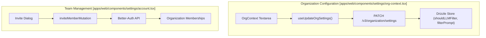
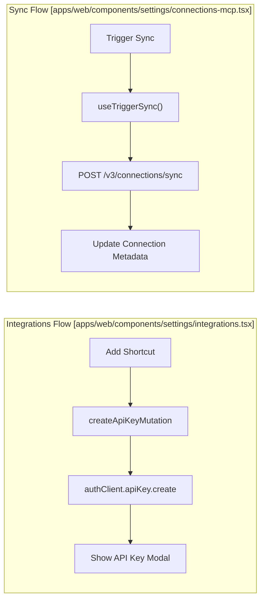

<!-- source: DeepWiki mcp.deepwiki.com · repo supermemoryai/supermemory · page 2.6 Settings & Profile · fetched 2026-10-30 -->

# Settings & Profile

Relevant source files

The following files were used as context for generating this wiki page:

- [apps/web/app/(app)/settings/integrations/page.tsx](apps/web/app/(app)/settings/integrations/page.tsx)
- [apps/web/app/(app)/settings/page.tsx](apps/web/app/(app)/settings/page.tsx)
- [apps/web/components/bottom-nav.tsx](apps/web/components/bottom-nav.tsx)
- [apps/web/components/documents-command-palette.tsx](apps/web/components/documents-command-palette.tsx)
- [apps/web/components/header.tsx](apps/web/components/header.tsx)
- [apps/web/components/integrations/chrome-detail.tsx](apps/web/components/integrations/chrome-detail.tsx)
- [apps/web/components/integrations/raycast-detail.tsx](apps/web/components/integrations/raycast-detail.tsx)
- [apps/web/components/integrations/raycast-setup-modal.tsx](apps/web/components/integrations/raycast-setup-modal.tsx)
- [apps/web/components/integrations/shortcuts-detail.tsx](apps/web/components/integrations/shortcuts-detail.tsx)
- [apps/web/components/org-plan-badge.tsx](apps/web/components/org-plan-badge.tsx)
- [apps/web/components/settings/account.tsx](apps/web/components/settings/account.tsx)
- [apps/web/components/settings/billing.tsx](apps/web/components/settings/billing.tsx)
- [apps/web/components/settings/cancel-reasons.ts](apps/web/components/settings/cancel-reasons.ts)
- [apps/web/components/settings/connections-mcp.tsx](apps/web/components/settings/connections-mcp.tsx)
- [apps/web/components/settings/integrations.tsx](apps/web/components/settings/integrations.tsx)
- [apps/web/components/settings/org-context.tsx](apps/web/components/settings/org-context.tsx)
- [apps/web/components/settings/settings-content.tsx](apps/web/components/settings/settings-content.tsx)
- [apps/web/components/settings/settings-modal.tsx](apps/web/components/settings/settings-modal.tsx)
- [apps/web/components/settings/support.tsx](apps/web/components/settings/support.tsx)
- [apps/web/components/user-profile-menu.tsx](apps/web/components/user-profile-menu.tsx)
- [apps/web/hooks/use-account-settings.ts](apps/web/hooks/use-account-settings.ts)
- [apps/web/hooks/use-delete-organization.ts](apps/web/hooks/use-delete-organization.ts)
- [apps/web/public/images/plugins/cursor.png](apps/web/public/images/plugins/cursor.png)
- [packages/lib/auth.ts](packages/lib/auth.ts)

This page documents the user settings and profile management systems in supermemory, including the multi-tab settings structure, onboarding profile configuration, and the underlying authentication, organization context, and billing integrations.

---

## Settings Interface

The settings experience is a modal-driven interface accessible via the `?settings=<tab>` URL state [apps/web/app/(app)/settings/page.tsx:8-10](). The global state for this modal is managed via the `useSettingsModal` hook, which is consumed by the `Header` and `MobileBottomNav` to trigger the view [apps/web/components/header.tsx:77](), [apps/web/components/bottom-nav.tsx:27]().

### Tab Structure

The settings interface is organized into functional areas defined in the `TABS` constant [apps/web/components/settings/settings-content.tsx:42-49]().

| Tab | Component | Description |
|-----|-----------|-------------|
| **Account** | `Account` | Team management, roles (Owner, Admin, Member), and organization context prompts [apps/web/components/settings/account.tsx:134](). |
| **Billing** | `Billing` | Plan management (Free, Pro, Max, Scale), credit balance, and auto-topup configuration [apps/web/components/settings/billing.tsx:126-210](). |
| **Integrations** | `Integrations` | Setup for Browser Extension, Raycast, and iOS Shortcuts [apps/web/components/settings/integrations.tsx:116](). |
| **Connections** | `ConnectionsMCP` | External data sync (Google Drive, Notion, etc.) and MCP client setup [apps/web/components/settings/connections-mcp.tsx:55-80](). |
| **Support** | `Support` | Help resources, Discord community links, and feedback mechanisms [apps/web/components/settings/support.tsx](). |

### Implementation Detail: URL State
The `SettingsRedirect` component handles legacy `/settings#tab` paths by parsing the hash and replacing it with the query parameter format `/?settings=tab` [apps/web/app/(app)/settings/page.tsx:11-20](). The `parseHashToTab` function ensures that only valid `SettingsTab` values are used [apps/web/components/settings/settings-content.tsx:91-96]().

**Sources:** [apps/web/app/(app)/settings/page.tsx:1-24](), [apps/web/components/settings/settings-content.tsx:42-89](), [apps/web/components/header.tsx:68-105]()

---

## Authentication & Workspace Management

supermemory utilizes the `useAuth` hook (built on `better-auth`) to manage user sessions and the "Active Organization" context, which acts as the primary scoping mechanism for memories.

### User Profile & Display
User information is displayed in the `UserProfileMenu` and the `IdentityCard` within settings [apps/web/components/user-profile-menu.tsx:22](), [apps/web/components/settings/settings-content.tsx:98]().
- **Initials Generation**: The `initials` logic extracts the first letters of the name or email for the avatar fallback [apps/web/components/user-profile-menu.tsx:65-74]().
- **Avatar Color**: A deterministic palette is used based on the user's email hash [apps/web/components/user-profile-menu.tsx:76-92]().

### Workspace Switching
The `SettingsOrgSwitcher` and the `Header` dropdown allow users to switch between different organizations [apps/web/components/settings/settings-content.tsx:239](), [apps/web/components/header.tsx:107](). Switching triggers `setActiveOrg`, which updates the session and reloads the application to ensure data consistency [apps/web/components/header.tsx:100-103]().

**Sources:** [apps/web/components/user-profile-menu.tsx:63-93](), [apps/web/components/header.tsx:69-103](), [apps/web/components/settings/settings-content.tsx:124-183]()

---

## Account & Team Management

The `Account` component provides the interface for managing organization-level configuration and team collaboration.

### Team Roles & Invitations
Organizations support hierarchical roles: `owner`, `admin`, and `member` [apps/web/components/settings/account.tsx:78-82]().
- **Restricted Access**: Admins can invite members with "Restricted" access, scoping their permissions to specific `containerTags` (projects) [apps/web/components/settings/account.tsx:143-148]().
- **Invitations**: Handled via `inviteMemberMutation`, which uses the `authClient.organization.inviteMember` method [apps/web/components/settings/account.tsx:228-245]().

### Organization Context
The `OrgContext` component allows users to define a custom prompt (up to 750 characters) that guides the AI (Nova) on what to focus on or extract during memory creation [apps/web/components/settings/org-context.tsx:22-48]().

**Sources:** [apps/web/components/settings/account.tsx:134-210](), [apps/web/components/settings/org-context.tsx:48-88](), [apps/web/components/settings/org-context.tsx:89-127]()

---

## Integrations & Connections

The settings interface facilitates the connection of external data sources and the configuration of Model Context Protocol (MCP) clients.

### Connection Management
The `ConnectionsMCP` component manages synchronization for various providers [apps/web/components/settings/connections-mcp.tsx:55-80]():
- **Providers**: Google Drive, Notion, OneDrive, and Granola.
- **Metadata**: Tracks `syncInProgress`, `lastSyncedAt`, and `documentCount` [apps/web/components/settings/connections-mcp.tsx:45-53]().
- **Health**: Uses `useConnectionHealth` to detect expired OAuth tokens that require re-authentication [apps/web/components/settings/connections-mcp.tsx:189-195]().

### Integration Setup
The `Integrations` component handles the setup of client-side tools [apps/web/components/settings/integrations.tsx:116]():
- **Browser Extension**: Deep-links to the Chrome Web Store [apps/web/components/settings/integrations.tsx:213-217]().
- **iOS Shortcuts**: Generates API keys specifically tagged with `type: "ios-shortcut"` for use in mobile workflows [apps/web/components/settings/integrations.tsx:145-154]().
- **Raycast**: Provides a setup modal and generates API keys with `type: "raycast-extension"` [apps/web/components/settings/integrations.tsx:170-188]().

**Sources:** [apps/web/components/settings/connections-mcp.tsx:42-83](), [apps/web/components/settings/integrations.tsx:116-168](), [apps/web/components/settings/connections-mcp.tsx:211-245]()

---

## Billing & Plan Configuration

The `Billing` component integrates with **Autumn JS** for usage tracking and plan management [apps/web/components/settings/billing.tsx:4-16]().

### Plan Hierarchy
Plans are ranked to determine feature availability and credit allocations [apps/web/components/settings/billing.tsx:204-210]():
1. **Free**: Includes $5 initial credits [apps/web/components/settings/billing.tsx:128-140]().
2. **Pro**: Includes $20 credits and basic connectors [apps/web/components/settings/billing.tsx:141-156]().
3. **Max**: Includes $130 credits and Gmail connector [apps/web/components/settings/billing.tsx:159-170]().
4. **Scale**: Includes $600 credits, S3, and Web Crawler [apps/web/components/settings/billing.tsx:171-185]().
5. **Enterprise**: Custom deployments and unlimited credits [apps/web/components/settings/billing.tsx:186-202]().

### Usage & Top-ups
- **Credit Feature**: Credits are tracked via the `usd_credits` feature ID [apps/web/components/settings/billing.tsx:73]().
- **Auto Top-up**: Users can configure the `AutoTopupConfig` to automatically purchase credits when the balance hits a threshold [apps/web/components/settings/billing.tsx:92-102]().
- **Invoices**: Recent billing history is fetched and displayed with links to hosted Stripe invoices [apps/web/components/settings/billing.tsx:82-90]().

**Sources:** [apps/web/components/settings/billing.tsx:126-210](), [apps/web/hooks/use-token-usage.ts](), [apps/web/components/user-profile-menu.tsx:35-46]()

---

