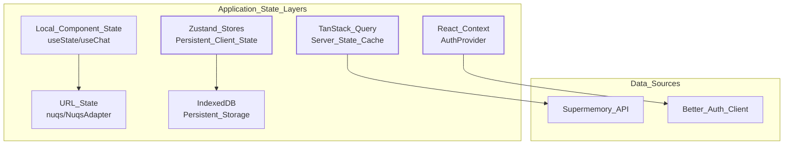
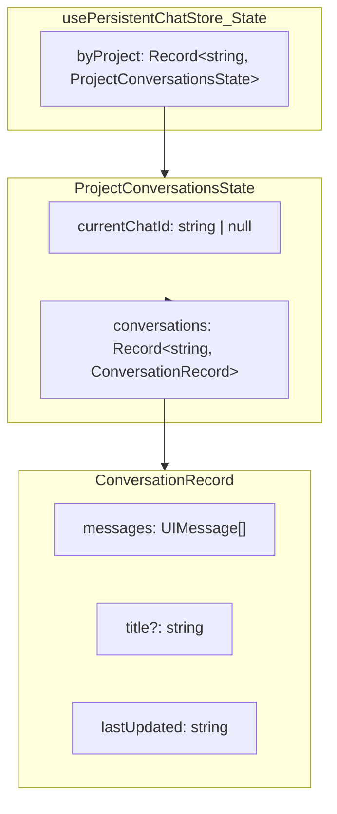
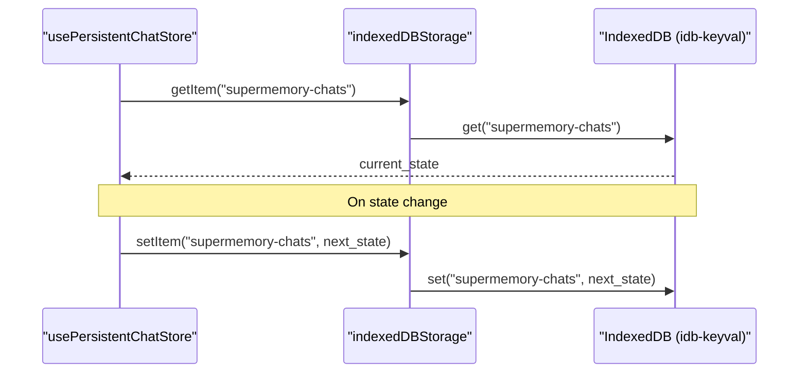

<!-- source: DeepWiki mcp.deepwiki.com · repo supermemoryai/supermemory · page 2.7 State Management · fetched 2026-10-30 -->

# State Management

Relevant source files

The following files were used as context for generating this wiki page:

- [apps/web/app/(app)/layout.tsx](apps/web/app/(app)/layout.tsx)
- [apps/web/components/ensure-workspace.tsx](apps/web/components/ensure-workspace.tsx)
- [apps/web/components/pwa-install-prompt.tsx](apps/web/components/pwa-install-prompt.tsx)
- [apps/web/hooks/use-container-tags.ts](apps/web/hooks/use-container-tags.ts)
- [apps/web/hooks/use-project-mutations.ts](apps/web/hooks/use-project-mutations.ts)
- [apps/web/middleware.ts](apps/web/middleware.ts)
- [apps/web/stores/chat.ts](apps/web/stores/chat.ts)
- [apps/web/stores/index.ts](apps/web/stores/index.ts)
- [apps/web/stores/indexeddb-storage.ts](apps/web/stores/indexeddb-storage.ts)
- [packages/lib/api.ts](packages/lib/api.ts)
- [packages/lib/auth-context.tsx](packages/lib/auth-context.tsx)
- [packages/lib/types.ts](packages/lib/types.ts)
- [packages/ui/components/dialog.tsx](packages/ui/components/dialog.tsx)
- [packages/validation/api.ts](packages/validation/api.ts)

This page documents the client-side state architecture of the Supermemory web application, including persistent Zustand stores, server state synchronization via React Query, and the central authentication context.

## State Architecture Overview

The application employs a layered state management strategy to balance performance, persistence, and developer experience.

**Sources:** [apps/web/stores/chat.ts:73-185](), [apps/web/stores/index.ts:8-40](), [packages/lib/auth-context.tsx:35-37]()

## Authentication Context

The `AuthProvider` serves as the root of the application's identity state, wrapping the `better-auth` client. It manages user sessions, active organizations, and restoration logic.

### Organization Management
The context tracks the `activeOrganizationId` from the session and synchronizes it with a local `Organization` object. It uses `localStorage` (key: `supermemory-consumer-last-org-slug`) to persist the user's last selected organization across sessions [packages/lib/auth-context.tsx:19-21]().

*   **Restoration Logic:** On mount, the provider attempts to restore the organization from `localStorage` or defaults to the first available organization if only one exists [packages/lib/auth-context.tsx:112-171]().
*   **Metadata Updates:** `updateOrgMetadata` allows for optimistic or partial updates to organization-specific settings without a full refetch [packages/lib/auth-context.tsx:75-86]().

**Sources:** [packages/lib/auth-context.tsx:1-234]()

## Zustand Store Architecture

Supermemory uses Zustand for persistent client-side state. The primary store is the `usePersistentChatStore`, which manages chat history across different projects.

### Persistent Chat Store

The chat store is partitioned by `projectId` (container tag) to ensure conversations are scoped correctly. It utilizes a custom `indexedDBStorage` engine to handle large message histories that might exceed `localStorage` limits.

| Function | Description | File Reference |
| :--- | :--- | :--- |
| `setConversation` | Updates messages for a specific chat ID, checking for deep equality via `areUIMessageArraysEqual` before triggering a state update. | [apps/web/stores/chat.ts:93-136]() |
| `setCurrentChatId` | Updates the active chat ID for the specified project. | [apps/web/stores/chat.ts:78-91]() |
| `areUIMessageArraysEqual` | Optimized deep equality check for AI SDK `UIMessage` objects to prevent redundant renders and writes. | [apps/web/stores/chat.ts:10-38]() |
| `usePersistentChat` | A convenience hook that automatically scopes store actions to the `selectedProject` from `useProject`. | [apps/web/stores/chat.ts:190-265]() |

**Sources:** [apps/web/stores/chat.ts:1-265](), [apps/web/stores/index.ts:42-42]()

### IndexedDB Persistence Layer

The `indexedDBStorage` implementation (used by `persist` middleware) handles asynchronous reads and writes to the browser's IndexedDB.

**Sources:** [apps/web/stores/chat.ts:180-184](), [apps/web/stores/indexeddb-storage.ts:1-24]()

## Server State with React Query

Server-side data is managed using `@tanstack/react-query`. This handles caching, invalidation, and optimistic updates for resources like projects and memories.

### Project Mutations

The `useProjectMutations` hook encapsulates logic for modifying project state on the server while keeping the client UI and URL state in sync.

*   **Creation:** `createProjectMutation` calls `@post/projects`, invalidates project queries, and automatically updates the selected project in the URL state via `setSelectedProjects` [apps/web/hooks/use-project-mutations.ts:21-50]().
*   **Deletion:** `deleteProjectMutation` handles removing projects and cleanup of local selection state if the deleted project was active [apps/web/hooks/use-project-mutations.ts:52-105]().
*   **Updating:** `updateProjectMutation` implements optimistic updates, modifying the query cache for `["projects"]` and `["container-tags"]` before the network request completes [apps/web/hooks/use-project-mutations.ts:182-255]().

**Sources:** [apps/web/hooks/use-project-mutations.ts:16-255](), [packages/lib/api.ts:253-259]()

## URL State (Search Parameters)

The application heavily utilizes URL state for navigation and filtering, managed by `nuqs`.

*   **Project Selection:** The `useProject` hook synchronizes the `project` URL parameter with the application's effective container tags used for API requests. It defaults to `DEFAULT_PROJECT_ID` if no project is selected [apps/web/stores/index.ts:8-40]().
*   **Navigation Safety:** The `EnsureWorkspace` component acts as a state gate, checking for an active session and organization before allowing access to app routes. If state is missing, it redirects to `/login` or `/onboarding` [apps/web/components/ensure-workspace.tsx:19-68]().

**Sources:** [apps/web/stores/index.ts:8-40](), [apps/web/components/ensure-workspace.tsx:19-68]()

## PWA and Device State

The application tracks environmental state to provide a native-like experience.

*   **PWA Install Prompt:** Tracks `BeforeInstallPromptEvent` and device info (iOS vs Android) to show contextual installation instructions [apps/web/components/pwa-install-prompt.tsx:168-198]().
*   **Dismissal State:** Persists user dismissal of the PWA prompt in `localStorage` under `pwa-install-dismissed` for a duration of 7 days [apps/web/components/pwa-install-prompt.tsx:11-13]().

**Sources:** [apps/web/components/pwa-install-prompt.tsx:1-232]()

---

