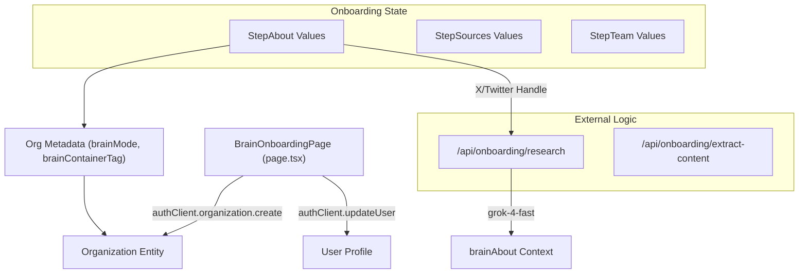
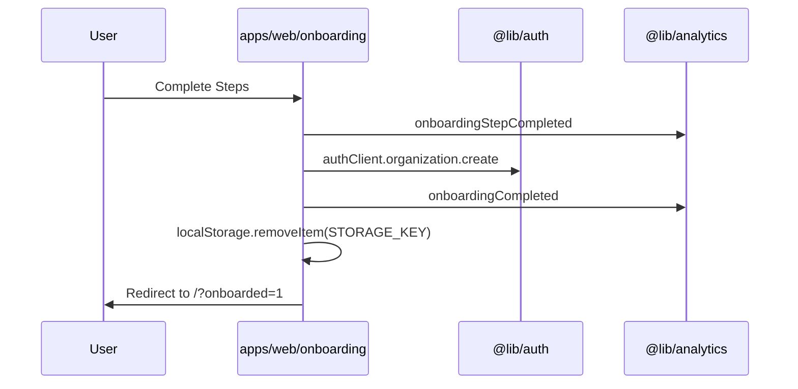

<!-- source: DeepWiki mcp.deepwiki.com · repo supermemoryai/supermemory · page 2.8 Onboarding Flow · fetched 2026-10-30 -->

# Onboarding Flow

Relevant source files

The following files were used as context for generating this wiki page:

- [apps/web/.env.example](apps/web/.env.example)
- [apps/web/app/(app)/brain-home/page.tsx](apps/web/app/(app)/brain-home/page.tsx)
- [apps/web/app/(app)/onboarding/[...slug]/page.tsx](apps/web/app/(app)/onboarding/[...slug]/page.tsx)
- [apps/web/app/(app)/onboarding/page.tsx](apps/web/app/(app)/onboarding/page.tsx)
- [apps/web/app/api/onboarding/extract-content/route.ts](apps/web/app/api/onboarding/extract-content/route.ts)
- [apps/web/app/api/onboarding/research/route.ts](apps/web/app/api/onboarding/research/route.ts)
- [apps/web/components/brain-home/data.ts](apps/web/components/brain-home/data.ts)
- [apps/web/components/brain-home/widgets.tsx](apps/web/components/brain-home/widgets.tsx)
- [apps/web/components/initial-header.tsx](apps/web/components/initial-header.tsx)
- [apps/web/components/onboarding-brain/onboarding-confetti.tsx](apps/web/components/onboarding-brain/onboarding-confetti.tsx)
- [apps/web/components/onboarding-brain/shell.tsx](apps/web/components/onboarding-brain/shell.tsx)
- [apps/web/components/onboarding-brain/step-about.tsx](apps/web/components/onboarding-brain/step-about.tsx)
- [apps/web/components/onboarding-brain/step-ingest.tsx](apps/web/components/onboarding-brain/step-ingest.tsx)
- [apps/web/components/onboarding-brain/step-sources.tsx](apps/web/components/onboarding-brain/step-sources.tsx)
- [apps/web/components/onboarding-brain/step-team.tsx](apps/web/components/onboarding-brain/step-team.tsx)
- [apps/web/lib/analytics.ts](apps/web/lib/analytics.ts)
- [apps/web/lib/constants.ts](apps/web/lib/constants.ts)
- [packages/hooks/use-org-onboarding.ts](packages/hooks/use-org-onboarding.ts)

## Purpose and Scope

The onboarding flow is a sophisticated, multi-step system designed to initialize a user's workspace (Organization), configure their identity, and establish initial data connections. It bridges the gap between a raw authenticated session and a fully functional memory environment by automating organization creation, user profile enrichment via AI, and integration setup for tools like the Browser Extension, MCP, and external connectors (Google Drive, Notion, etc.).

---

## Onboarding Architecture

The onboarding system is primarily contained within `apps/web/app/(app)/onboarding/` and uses a centralized state machine approach managed by the `BrainOnboardingPage`.

### Core Components and Layouts

| Component | File Path | Role |
|:---|:---|:---|
| `BrainOnboardingPage` | [apps/web/app/(app)/onboarding/page.tsx:41-41]() | Main controller; manages step state, `localStorage` persistence, and organization creation. |
| `BrainShell` | [apps/web/components/onboarding-brain/shell.tsx:15-15]() | Visual wrapper providing the layout, background gradients, and the `StepIndicator`. |
| `StepIndicator` | [apps/web/components/onboarding-brain/shell.tsx:75-75]() | Renders progress dots and labels defined in `BRAIN_STEPS`. |
| `StepAbout` | [apps/web/components/onboarding-brain/step-about.tsx:58-58]() | Collects user name, workspace name, and "about" context. |
| `StepSources` | [apps/web/components/onboarding-brain/step-sources.tsx:225-225]() | Configures integrations (Google Drive, Notion, Browser Extension). |
| `StepIngest` | [apps/web/components/onboarding-brain/step-ingest.tsx:108-108]() | Handles MCP setup and tool selection (Cursor, Claude Code, etc.). |
| `StepTeam` | [apps/web/components/onboarding-brain/step-team.tsx:1-1]() | Handles team invitations and visibility settings. |

Sources: [apps/web/app/(app)/onboarding/page.tsx:7-34](), [apps/web/components/onboarding-brain/shell.tsx:7-13]()

---

## Data Flow and Persistence

The onboarding state is persisted in `localStorage` under the key `supermemory-brain-onboarding-v1` [apps/web/app/(app)/onboarding/page.tsx:36-36](). This ensures users can resume if they refresh or navigate away.

### Workspace Initialization Sequence
1. **Detection**: `detectModeFromEmail`, `workspaceNameFromEmail`, and `workspaceDomainFromEmail` suggest initial values based on the user's email domain [apps/web/app/(app)/onboarding/page.tsx:54-65]().
2. **Organization Creation**: Triggered in `handleAboutContinue`. The `ensureOrg` function calls `authClient.organization.create` with metadata including `brainMode` and `brainContainerTag` [apps/web/app/(app)/onboarding/page.tsx:195-213]().
3. **User Profile Update**: `authClient.updateUser` is called to sync the user's display name and generate a username [apps/web/app/(app)/onboarding/page.tsx:215-221]().

### Technical Entity Mapping

Sources: [apps/web/app/(app)/onboarding/page.tsx:195-237](), [apps/web/app/api/onboarding/research/route.ts:65-109]()

---

## Integration and Sources Step

The `StepSources` component handles both OAuth-based connectors and client-side tool installation [apps/web/components/onboarding-brain/step-sources.tsx:225-232]().

### Supported Integrations
- **Cloud Connectors**: Google Drive, Notion, OneDrive, Gmail [apps/web/components/onboarding-brain/step-sources.tsx:114-119]().
- **Developer Tools**: GitHub, MCP (Model Context Protocol).
- **Browsing/Shortcuts**: Chrome Extension, Raycast Extension, Apple Shortcuts [apps/web/components/onboarding-brain/step-sources.tsx:122-124]().

### Plan-Gated Features
Certain connectors are gated by user plans (Pro, Max, Scale). For example, the Gmail connector is noted as a "Max" plan feature [apps/web/components/onboarding-brain/step-sources.tsx:180-180](), while S3 and Web Crawler are "Scale" features [apps/web/components/onboarding-brain/step-sources.tsx:193-193]().

Sources: [apps/web/components/onboarding-brain/step-sources.tsx:114-213]()

---

## MCP and Tool Setup

The `StepIngest` component allows users to connect their memory to external agents via the Model Context Protocol (MCP) [apps/web/components/onboarding-brain/step-ingest.tsx:108-108]().

### Agent Catalog
The system provides tailored setup instructions for various agents:
- **Coding**: Cursor, Claude Code, VS Code, Cline, Codex, Gemini CLI [apps/web/components/onboarding-brain/step-ingest.tsx:41-79]().
- **Productivity**: Claude Desktop, ChatGPT [apps/web/components/onboarding-brain/step-ingest.tsx:81-92]().

### Setup Logic
- **Universal URL**: Users are provided with a `Universal MCP URL` to copy into their agent configuration [apps/web/components/onboarding-brain/step-ingest.tsx:243-247]().
- **Embedded Instructions**: Uses `MCPSteps` from the MCP modal to show step-by-step setup guides [apps/web/components/onboarding-brain/step-ingest.tsx:183-183]().

Sources: [apps/web/components/onboarding-brain/step-ingest.tsx:33-106](), [apps/web/components/onboarding-brain/step-ingest.tsx:209-253]()

---

## AI-Powered Profile Enrichment

Supermemory uses AI during onboarding to research users and extract content to provide an immediate "populated" feel.

### Research API
The route `/api/onboarding/research` uses the `xai` provider with the `grok-4-fast` model [apps/web/app/api/onboarding/research/route.ts:93-94]().
- **Input**: X (Twitter) URL or handle [apps/web/app/api/onboarding/research/route.ts:67-76]().
- **Tools**: It utilizes `xai.tools.webSearch()` and `xai.tools.xSearch()` to analyze the user's professional background and interests [apps/web/app/api/onboarding/research/route.ts:96-101]().

### Content Extraction
The `/api/onboarding/extract-content` route interfaces with the **Exa API** [apps/web/app/api/onboarding/extract-content/route.ts:44-55](). It takes an array of URLs and returns cleaned text and metadata using the `livecrawl: "fallback"` mode [apps/web/app/api/onboarding/extract-content/route.ts:50-54]().

Sources: [apps/web/app/api/onboarding/research/route.ts:93-102](), [apps/web/app/api/onboarding/extract-content/route.ts:19-55]()

---

## Completion and Tracking

### Tracking Progress
Progress is tracked via the `analytics` utility, capturing events for every step viewed or completed:
- `onboardingStarted`: Triggered on mount [apps/web/app/(app)/onboarding/page.tsx:115-118]().
- `onboardingStepViewed`: Triggered whenever the `step` state changes [apps/web/app/(app)/onboarding/page.tsx:133-137]().
- `onboardingStepCompleted`: Triggered when `goNext` is called [apps/web/app/(app)/onboarding/page.tsx:183-183]().

### Final Transition
The `finish` function in `BrainOnboardingPage` clears the local storage and redirects the user to the home dashboard with the success flag `?onboarded=1` [apps/web/app/(app)/onboarding/page.tsx:166-179](). This flag triggers the `OnboardingConfetti` component [apps/web/components/onboarding-brain/onboarding-confetti.tsx:13-15]().

### Skip Logic
Users can bypass the flow via `InitialHeader` which calls `markOrgOnboarded` [apps/web/components/initial-header.tsx:23-27](). If a `PENDING_CONNECT_URL_KEY` exists in `sessionStorage`, the user is redirected back to their original plugin connection intent [apps/web/lib/constants.ts:17-28]().

Sources: [apps/web/app/(app)/onboarding/page.tsx:166-190](), [apps/web/lib/analytics.ts:121-179](), [apps/web/components/initial-header.tsx:23-27]()

---

