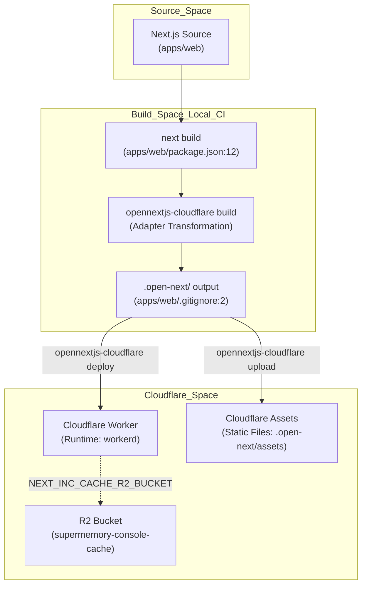
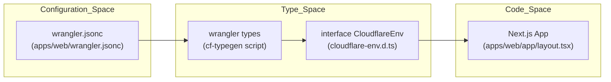

<!-- source: DeepWiki mcp.deepwiki.com · repo supermemoryai/supermemory · page 2.9 Cloudflare Deployment · fetched 2026-10-30 -->

# Cloudflare Deployment

Relevant source files

The following files were used as context for generating this wiki page:

- [.gitignore](.gitignore)
- [apps/web/.gitignore](apps/web/.gitignore)
- [apps/web/app/global-error.tsx](apps/web/app/global-error.tsx)
- [apps/web/app/layout.tsx](apps/web/app/layout.tsx)
- [apps/web/components/next-app-research-cta.tsx](apps/web/components/next-app-research-cta.tsx)
- [apps/web/instrumentation-client.ts](apps/web/instrumentation-client.ts)
- [apps/web/lib/chat-stream-error.ts](apps/web/lib/chat-stream-error.ts)
- [apps/web/next.config.ts](apps/web/next.config.ts)
- [apps/web/package.json](apps/web/package.json)
- [apps/web/public/OG.png](apps/web/public/OG.png)
- [apps/web/tsconfig.json](apps/web/tsconfig.json)
- [apps/web/wrangler.jsonc](apps/web/wrangler.jsonc)
- [bun.lock](bun.lock)
- [package.json](package.json)

This page documents how `apps/web` (the Next.js consumer application) is built and deployed to Cloudflare using the `@opennextjs/cloudflare` adapter. It covers the adapter setup, environment variable typing with `cf-typegen`, and the specific build, deploy, and upload scripts.

---

## Overview

The `apps/web` application is a Next.js project designed to run on Cloudflare's edge infrastructure (Workers and Pages) rather than a standard Node.js environment. This is achieved using the `@opennextjs/cloudflare` adapter, which transforms the Next.js build output into a format compatible with the `workerd` runtime.

The core dependency for this integration is defined in the workspace configuration:
- `@opennextjs/cloudflare`: [apps/web/package.json:34-34]()
- `wrangler`: [apps/web/package.json:131-131]() (Dev dependency for CLI operations)

To support the deployment, the project uses the `wrangler.jsonc` configuration file [apps/web/wrangler.jsonc:1-32]() to define bindings, compatibility flags, and R2 bucket associations.

---

## Build and Deploy Pipeline

The deployment process involves wrapping the standard `next build` with the OpenNext adapter to generate a Cloudflare-ready bundle in the `.open-next/` directory.

### Deployment Flow Diagram

Sources: [apps/web/package.json:12-17](), [apps/web/wrangler.jsonc:14-30](), [apps/web/.gitignore:2-2]()

### Deployment Scripts

The following scripts in `apps/web/package.json` manage the lifecycle of the Cloudflare application:

| Script | Command | Description |
| :--- | :--- | :--- |
| `build` | `next build` | Standard Next.js production build. [apps/web/package.json:12-12]() |
| `preview` | `opennextjs-cloudflare build && opennextjs-cloudflare preview` | Builds for Cloudflare and runs a local emulation of the Worker environment. [apps/web/package.json:15-15]() |
| `deploy` | `opennextjs-cloudflare build && opennextjs-cloudflare deploy` | Full build and deployment to the Cloudflare production environment. [apps/web/package.json:16-16]() |
| `upload` | `opennextjs-cloudflare build && opennextjs-cloudflare upload` | Builds and uploads static assets without updating the Worker logic. [apps/web/package.json:17-17]() |
| `cf-typegen` | `wrangler types --env-interface CloudflareEnv cloudflare-env.d.ts` | Generates TypeScript types for Cloudflare bindings. [apps/web/package.json:18-18]() |

---

## Environment Variable Typing (`cf-typegen`)

Cloudflare Workers do not use `process.env` for secrets and bindings in the same way Node.js does; instead, they inject an environment object into the request handler. To maintain type safety within the Next.js application, the project uses `wrangler types`.

### Type Generation Mapping

Sources: [apps/web/package.json:18-18](), [apps/web/wrangler.jsonc:1-31]()

The `cf-typegen` script reads the local configuration (like the `R2_BUCKET` binding [apps/web/wrangler.jsonc:27-28]()) and produces `apps/web/cloudflare-env.d.ts`. This file defines the `CloudflareEnv` interface, which typically includes definitions for KV Namespaces, R2 Buckets, and other bindings required by the application.

---

## Sentry Integration and Source Maps

Because Cloudflare deployments involve minified code running on the edge, source maps must be uploaded to Sentry to ensure readable stack traces.

### Post-Deployment Hook

The `apps/web` package includes a `postdeploy` hook that triggers automatically after a successful Cloudflare deployment:

- **Script**: `postdeploy` calls `bun run sentry:sourcemaps`. [apps/web/package.json:20-20]()
- **Sentry Upload**: Uses `sentry-cli` to create a new release for project `consumer-app` and upload the maps from the build directory. [apps/web/package.json:19-19]()
- **Global Orchestration**: The root `package.json` also defines `sentry:sourcemaps` and a `postbuild` hook to ensure maps are handled across the monorepo. [package.json:10-11]()

---

## Configuration Reference

### Application Metadata
The root layout defines the `metadataBase` as `https://app.supermemory.ai` [apps/web/app/layout.tsx:21-21]() and specifies various social sharing images and icons [apps/web/app/layout.tsx:23-55]().

### `.gitignore`
The build artifacts for Cloudflare and standard Next.js are specifically ignored to prevent large generated bundles from entering version control:
- `.open-next/`: [apps/web/.gitignore:2-2]()
- `/.next/`: [apps/web/.gitignore:14-14]()
- `dist`: [apps/web/.gitignore:18-18]()

### Development and Runtimes
For local development, the `next.config.ts` initializes OpenNext for Cloudflare emulation [apps/web/next.config.ts:89-91](). The project also enforces a minimum Node.js version of 20 [package.json:14-14]() and uses `bun` as the primary package manager [package.json:16-16]().

Sources: [apps/web/package.json:12-21](), [package.json:10-16](), [apps/web/app/layout.tsx:1-115](), [apps/web/wrangler.jsonc:1-32](), [apps/web/next.config.ts:89-91]()

---

