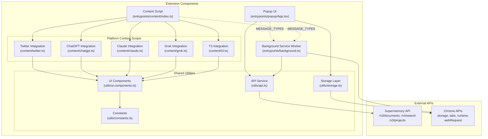
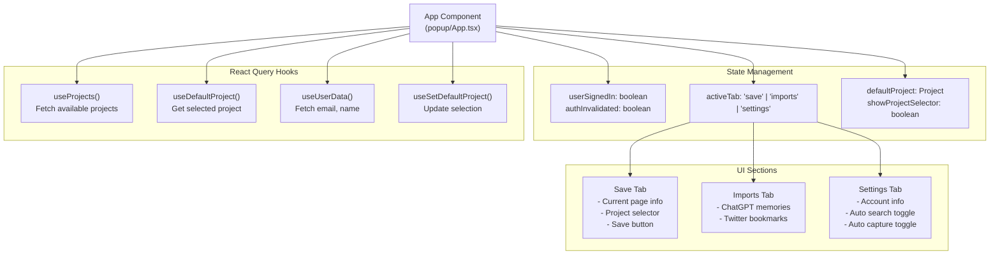

<!-- source: DeepWiki mcp.deepwiki.com · repo supermemoryai/supermemory · page 3 Browser Extension · fetched 2026-10-30 -->

# Browser Extension

Relevant source files

The following files were used as context for generating this wiki page:

- [apps/browser-extension/components/icons.tsx](apps/browser-extension/components/icons.tsx)
- [apps/browser-extension/entrypoints/background.ts](apps/browser-extension/entrypoints/background.ts)
- [apps/browser-extension/entrypoints/content/claude.ts](apps/browser-extension/entrypoints/content/claude.ts)
- [apps/browser-extension/entrypoints/content/grok.ts](apps/browser-extension/entrypoints/content/grok.ts)
- [apps/browser-extension/entrypoints/content/index.ts](apps/browser-extension/entrypoints/content/index.ts)
- [apps/browser-extension/entrypoints/content/twitter.ts](apps/browser-extension/entrypoints/content/twitter.ts)
- [apps/browser-extension/entrypoints/popup/App.tsx](apps/browser-extension/entrypoints/popup/App.tsx)
- [apps/browser-extension/entrypoints/popup/style.css](apps/browser-extension/entrypoints/popup/style.css)
- [apps/browser-extension/entrypoints/welcome/Welcome.tsx](apps/browser-extension/entrypoints/welcome/Welcome.tsx)
- [apps/browser-extension/package.json](apps/browser-extension/package.json)
- [apps/browser-extension/public/claude.png](apps/browser-extension/public/claude.png)
- [apps/browser-extension/public/gemini.png](apps/browser-extension/public/gemini.png)
- [apps/browser-extension/public/icon-48.png](apps/browser-extension/public/icon-48.png)
- [apps/browser-extension/public/logo-fullmark.svg](apps/browser-extension/public/logo-fullmark.svg)
- [apps/browser-extension/utils/api.ts](apps/browser-extension/utils/api.ts)
- [apps/browser-extension/utils/constants.ts](apps/browser-extension/utils/constants.ts)
- [apps/browser-extension/utils/twitter-import.ts](apps/browser-extension/utils/twitter-import.ts)
- [apps/browser-extension/utils/twitter-utils.ts](apps/browser-extension/utils/twitter-utils.ts)
- [apps/browser-extension/utils/types.ts](apps/browser-extension/utils/types.ts)
- [apps/browser-extension/utils/ui-components.ts](apps/browser-extension/utils/ui-components.ts)
- [apps/browser-extension/wxt.config.ts](apps/browser-extension/wxt.config.ts)

The Browser Extension is a WXT-based Chrome/Edge extension that enables users to save web pages, import bookmarks, and integrate Supermemory with AI chat applications. It provides a popup interface for manual page saving, content scripts for platform-specific integrations, and a message-passing system for communication between extension components.

For information about the AI Tools integration used in chat applications, see [AI Tools Package](#4). For details about the backend API endpoints the extension calls, see [API Reference](#6).

## Purpose and Scope

This extension serves multiple functions:
- **Page Saving**: Save any web page to Supermemory with a single click or keyboard shortcut.
- **Twitter Import**: Batch import Twitter/X bookmarks with project selection.
- **AI Chat Integration**: Auto-search memories and capture prompts in ChatGPT, Claude, Grok, and T3.chat.

For detailed sub-system documentation, see: [Extension Architecture](#3.1), [AI Chat Integration](#3.2), [Twitter Bookmark Import](#3.3), and [UI Components & Storage](#3.4).

## Extension Architecture

The extension is built on the [WXT framework](https://wxt.dev/), which provides a modern development experience with Vite integration and TypeScript support [apps/browser-extension/wxt.config.ts:13-14]().

### System Components Diagram

**Sources:** [apps/browser-extension/wxt.config.ts:13-53](), [apps/browser-extension/entrypoints/background.ts:24-172](), [apps/browser-extension/entrypoints/content/index.ts:23-35](), [apps/browser-extension/utils/constants.ts:77-87]()

### Manifest Configuration

The extension requires specific permissions and host access to function across different platforms.

| Permission | Purpose |
|------------|---------|
| `storage` | Persist authentication tokens and user settings [apps/browser-extension/wxt.config.ts:33]() |
| `activeTab` | Access current tab URL and content for saving [apps/browser-extension/wxt.config.ts:33]() |
| `webRequest` | Monitor requests for Twitter token capture [apps/browser-extension/wxt.config.ts:33]() |
| `tabs` | Open new tabs (e.g., welcome page) and query tab state [apps/browser-extension/wxt.config.ts:33]() |

**Host Permissions:**
- `*://x.com/*`, `*://twitter.com/*` - Twitter bookmark import [apps/browser-extension/wxt.config.ts:35-36]()
- `*://chatgpt.com/*`, `*://chat.openai.com/*` - ChatGPT integration [apps/browser-extension/wxt.config.ts:39-40]()
- `*://claude.ai/*` - Claude integration [apps/browser-extension/utils/constants.ts:60]()
- `*://supermemory.ai/*`, `*://api.supermemory.ai/*` - API access [apps/browser-extension/wxt.config.ts:37-38]()
- `https://*.posthog.com/*` - Analytics tracking [apps/browser-extension/wxt.config.ts:45]()

**Sources:** [apps/browser-extension/wxt.config.ts:29-53](), [apps/browser-extension/utils/constants.ts:57-64]()

## Popup Interface

The popup provides the primary user interface for the extension, built with React and Tailwind CSS. It handles authentication state, project selection, and manual saving.

### Popup State & UI Structure

**Sources:** [apps/browser-extension/entrypoints/popup/App.tsx:6-18](), [apps/browser-extension/utils/query-hooks.ts:1-20]()

### Authentication & Token Validation

The popup uses `validateAuthToken` to check the validity of the stored `bearerToken`. If invalid, it clears the local session.

- **Token Valid**: Loads user data and projects via `useProjects` [apps/browser-extension/utils/api.ts:101-105]().
- **Token Invalid/Missing**: Throws `AuthenticationError`, prompting the user to log in via the web application [apps/browser-extension/utils/api.ts:106-112](), [apps/browser-extension/entrypoints/welcome/Welcome.tsx:75-85]().

**Sources:** [apps/browser-extension/utils/api.ts:99-112](), [apps/browser-extension/entrypoints/popup/App.tsx:4-5]()

## Twitter Bookmark Import

The Twitter integration allows for bulk importing bookmarks into specific projects. It utilizes a specialized `TwitterImporter` class and a background service worker to handle authentication headers.

- **Import Intent**: Uses a TTL mechanism (`IMPORT_INTENT_TTL`) in storage to trigger the import modal when a user navigates to the bookmarks page [apps/browser-extension/utils/constants.ts:45](), [apps/browser-extension/entrypoints/content/twitter.ts:34-54]().
- **Folder Import**: Injects "Import Bookmarks" buttons into Twitter's bookmark folder UI [apps/browser-extension/utils/ui-components.ts:166-199]().
- **Background Processing**: The `TwitterImporter` in the background script handles the actual fetching and saving logic [apps/browser-extension/entrypoints/background.ts:176-192](), [apps/browser-extension/utils/twitter-import.ts:16-17]().

For details, see [Twitter Bookmark Import](#3.3).

**Sources:** [apps/browser-extension/entrypoints/content/twitter.ts:84-124](), [apps/browser-extension/entrypoints/background.ts:176-192]()

## AI Chat Integration

The extension enhances AI chat interfaces by injecting memory search and prompt capture capabilities.

- **Auto-Search**: Automatically queries Supermemory as the user types, using a debounce delay defined in `UI_CONFIG.AUTO_SEARCH_DEBOUNCE_DELAY` [apps/browser-extension/utils/constants.ts:48](), [apps/browser-extension/entrypoints/content/claude.ts:159-232]().
- **Auto-Capture**: Saves user prompts as memories upon submission if `autoCapturePromptsEnabled` is active [apps/browser-extension/entrypoints/background.ts:231-251]().
- **Related Memories**: The background script handles the `GET_RELATED_MEMORIES` action by calling the `/v4/search` endpoint [apps/browser-extension/entrypoints/background.ts:146-168](), [apps/browser-extension/utils/api.ts:148-162]().

For details, see [AI Chat Integration](#3.2).

**Sources:** [apps/browser-extension/entrypoints/background.ts:213-229](), [apps/browser-extension/entrypoints/content/claude.ts:34-37](), [apps/browser-extension/utils/constants.ts:83-84]()

## UI Components & Storage

The extension uses a shared utility layer for DOM manipulation, storage access, and API calls.

- **Toasts**: A custom toast system (`createToast`) provides feedback for loading, success, and error states [apps/browser-extension/utils/ui-components.ts:14-159]().
- **Storage Layer**: Uses `wxt/storage` to manage `bearerToken`, `userData`, and `defaultProject` [apps/browser-extension/utils/storage.ts:5-18]().
- **API Endpoints**: Communicates with the Supermemory API via `v3` (documents/projects) and `v4` (search) endpoints [apps/browser-extension/utils/api.ts:4-11]().

For details, see [UI Components & Storage](#3.4).

**Sources:** [apps/browser-extension/utils/ui-components.ts:1-200](), [apps/browser-extension/utils/api.ts:1-162](), [apps/browser-extension/utils/constants.ts:4-11]()

---

