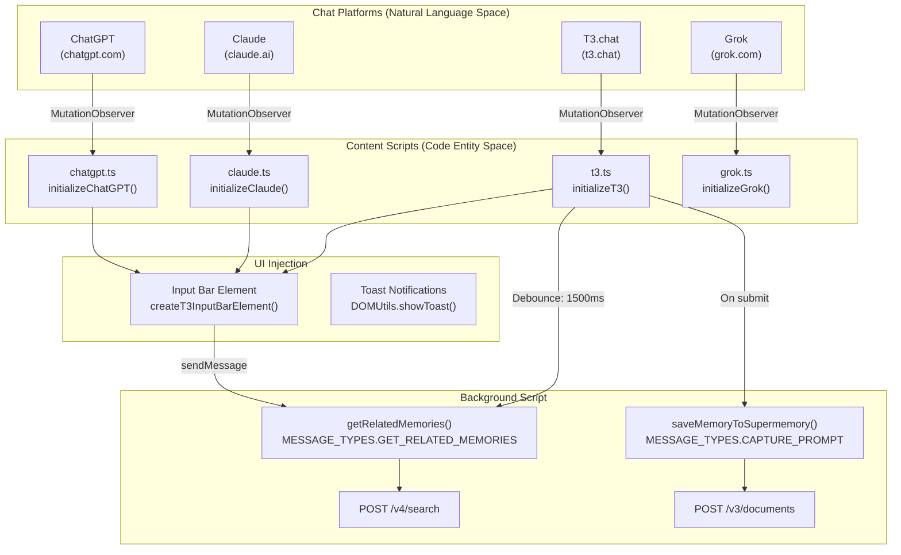
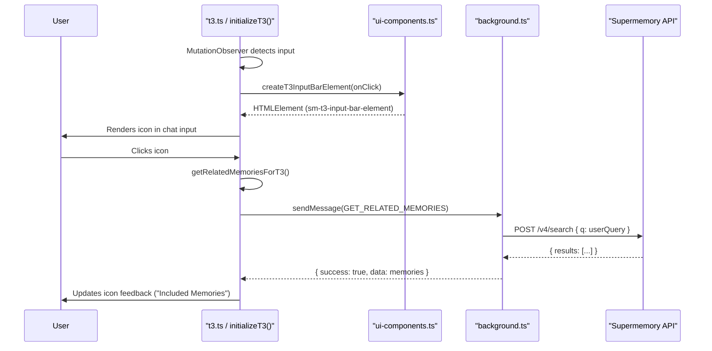

<!-- source: DeepWiki mcp.deepwiki.com · repo supermemoryai/supermemory · page 3.2 AI Chat Integration · fetched 2026-10-30 -->

# AI Chat Integration

Relevant source files

The following files were used as context for generating this wiki page:

- [apps/browser-extension/entrypoints/content/chatgpt.ts](apps/browser-extension/entrypoints/content/chatgpt.ts)
- [apps/browser-extension/entrypoints/content/claude.ts](apps/browser-extension/entrypoints/content/claude.ts)
- [apps/browser-extension/entrypoints/content/grok.ts](apps/browser-extension/entrypoints/content/grok.ts)
- [apps/browser-extension/entrypoints/content/index.ts](apps/browser-extension/entrypoints/content/index.ts)
- [apps/browser-extension/entrypoints/content/shared.ts](apps/browser-extension/entrypoints/content/shared.ts)
- [apps/browser-extension/entrypoints/content/t3.ts](apps/browser-extension/entrypoints/content/t3.ts)
- [apps/browser-extension/entrypoints/popup/App.tsx](apps/browser-extension/entrypoints/popup/App.tsx)
- [apps/browser-extension/public/claude.png](apps/browser-extension/public/claude.png)
- [apps/browser-extension/public/gemini.png](apps/browser-extension/public/gemini.png)
- [apps/browser-extension/utils/constants.ts](apps/browser-extension/utils/constants.ts)
- [apps/browser-extension/utils/storage.ts](apps/browser-extension/utils/storage.ts)
- [apps/browser-extension/utils/twitter-auth.ts](apps/browser-extension/utils/twitter-auth.ts)
- [apps/browser-extension/wxt.config.ts](apps/browser-extension/wxt.config.ts)
- [apps/web/public/images/plugins/codex.png](apps/web/public/images/plugins/codex.png)

This document covers the browser extension's integration with AI chat platforms (ChatGPT, Claude, T3.chat, and Grok), enabling users to search their Supermemory knowledge base from within chat interfaces and automatically capture prompts as memories.

## Purpose and Scope

The AI chat integration system injects UI elements and functionality into AI chat platforms to:
- Provide manual memory search buttons in chat input areas.
- Automatically search memories as users type (with debouncing).
- Capture user prompts as memories for future reference.
- Display relevant memories from the user's knowledge base.
- Import platform-native memories (e.g., ChatGPT "Saved memories", Grok "Memory from your chats").

This system operates via platform-specific content scripts that detect chat interfaces and instrument them with Supermemory functionality.

---

## Architecture Overview

The AI chat integration follows a distributed architecture where content scripts handle DOM manipulation, the background script manages API communication, and the popup UI manages user preferences.

### System Interaction Diagram

**Sources:** [apps/browser-extension/entrypoints/content/chatgpt.ts:22-42](), [apps/browser-extension/entrypoints/content/t3.ts:19-39](), [apps/browser-extension/entrypoints/content/claude.ts:22-41](), [apps/browser-extension/entrypoints/content/grok.ts:10-27](), [apps/browser-extension/entrypoints/content/shared.ts:6-10]()

---

## Supported Platforms

The extension integrates with four major AI chat platforms using domain-specific detection defined in the `DOMAINS` constant.

| Platform | Domain(s) | Injection ID | PostHog Event Key |
|----------|-----------|--------------------|---------------------|
| **ChatGPT** | `chatgpt.com`, `chat.openai.com` | `CHATGPT_INPUT_BAR_ELEMENT` | `CHATGPT_CHAT_MEMORIES_SEARCHED` |
| **Claude** | `claude.ai` | `CLAUDE_INPUT_BAR_ELEMENT` | `CLAUDE_CHAT_MEMORIES_SEARCHED` |
| **T3.chat** | `t3.chat` | `T3_INPUT_BAR_ELEMENT` | `T3_CHAT_MEMORIES_SEARCHED` |
| **Grok** | `grok.com`, `x.ai` | N/A (Dialog injection) | N/A |

**Sources:** [apps/browser-extension/utils/constants.ts:23-25](), [apps/browser-extension/utils/constants.ts:57-64](), [apps/browser-extension/utils/constants.ts:93-100]()

---

## Core Features

### 1. Memory Search Button Injection

Each platform receives a platform-specific search button injected into its chat input area. The initialization functions (e.g., `initializeT3`) detect the input container and prepend the Supermemory icon.

### UI Injection Sequence

**Implementation Details:**
- **ChatGPT:** The script uses a `MutationObserver` to watch for `#prompt-textarea` or `button.composer-btn`. It injects the button via `addSaveChatGPTElementBeforeComposerBtn` [apps/browser-extension/entrypoints/content/chatgpt.ts:72-109](). It also adds a "Save to supermemory" button directly to the ChatGPT "Saved memories" dialog [apps/browser-extension/entrypoints/content/chatgpt.ts:196-228]().
- **T3.chat:** Targets the `.flex.min-w-0.items-center.gap-2` container and prepends the icon using `createT3InputBarElement` [apps/browser-extension/entrypoints/content/t3.ts:119-150]().
- **Claude:** Targets `.relative.flex-1.flex.items-center.gap-2.shrink.min-w-0` and prepends the icon via `createClaudeInputBarElement` [apps/browser-extension/entrypoints/content/claude.ts:121-150]().
- **Grok:** Injects a "Save to supermemory" button into the Grok memory dialog ("Memory from your chats") found via `getGrokMemoryDialog` [apps/browser-extension/entrypoints/content/grok.ts:234-266]().

**Sources:** [apps/browser-extension/entrypoints/content/t3.ts:119-150](), [apps/browser-extension/entrypoints/content/chatgpt.ts:72-109](), [apps/browser-extension/entrypoints/content/claude.ts:121-150](), [apps/browser-extension/entrypoints/content/grok.ts:234-266]()

### 2. Auto-Search with Debouncing

When `autoSearchEnabled` is active in storage, the extension automatically triggers a search as the user types.

- **Debounce:** Uses a platform-specific debounce timeout (e.g., `t3DebounceTimeout`) to prevent excessive API calls [apps/browser-extension/entrypoints/content/t3.ts:14](). The delay is governed by `UI_CONFIG.AUTO_SEARCH_DEBOUNCE_DELAY` (1500ms) [apps/browser-extension/utils/constants.ts:48]().
- **Query Extraction:** The content scripts extract text from `textarea` or `contenteditable` elements. For T3, it checks `textarea` values and fallback `contenteditable` divs [apps/browser-extension/entrypoints/content/t3.ts:154-184](). For Claude, it specifically looks for `p` tags within the input area [apps/browser-extension/entrypoints/content/claude.ts:161-166]().
- **Context Injection:** Upon a successful search, retrieved memories are stored in the input element's `dataset.supermemories` attribute, providing context for the AI [apps/browser-extension/entrypoints/content/t3.ts:241-242]().

**Sources:** [apps/browser-extension/entrypoints/content/t3.ts:152-258](), [apps/browser-extension/entrypoints/content/claude.ts:153-250](), [apps/browser-extension/utils/constants.ts:48](), [apps/browser-extension/utils/storage.ts:13]()

### 3. Automatic Prompt Capture

When `autoCapturePromptsEnabled` is enabled, user prompts are automatically saved to Supermemory.

- **Message Type:** Communication uses `MESSAGE_TYPES.GET_RELATED_MEMORIES` for retrieval and `MESSAGE_TYPES.SAVE_MEMORY` for persistence [apps/browser-extension/utils/constants.ts:83-84]().
- **Processing:** Content scripts listen for input events and trigger `saveMemory` from `shared.ts`, which captures the URL, title, and highlighted text or full page markdown [apps/browser-extension/entrypoints/content/shared.ts:6-71]().
- **Markdown Conversion:** The extension uses `TurndownService` to convert captured HTML into markdown before saving [apps/browser-extension/entrypoints/content/shared.ts:61-64]().

**Sources:** [apps/browser-extension/entrypoints/content/shared.ts:6-71](), [apps/browser-extension/utils/storage.ts:14]()

---

## Data Flow and API Integration

The background script acts as the bridge to the Supermemory API.

### Memory Search Logic (`getRelatedMemories`)
1. Content script sends `MESSAGE_TYPES.GET_RELATED_MEMORIES` with the `userQuery` [apps/browser-extension/entrypoints/content/t3.ts:212-216]().
2. The background script calls the search API (e.g., `api.supermemory.ai/v4/search`).
3. Results are returned to the content script and injected into the DOM `dataset` [apps/browser-extension/entrypoints/content/t3.ts:241-243]().

### Memory Storage Logic (`saveMemory`)
1. Captures metadata: `url`, `ogImage`, `title`, and `highlightedText` [apps/browser-extension/entrypoints/content/shared.ts:10-41]().
2. Sends `MESSAGE_TYPES.SAVE_MEMORY` to the background script [apps/browser-extension/entrypoints/content/shared.ts:67-71]().
3. Background script resolves the `defaultProject` from storage to determine the target container [apps/browser-extension/utils/storage.ts:16]().

**Sources:** [apps/browser-extension/entrypoints/content/shared.ts:6-71](), [apps/browser-extension/entrypoints/content/t3.ts:212-243](), [apps/browser-extension/utils/storage.ts:16]()

---

## Configuration & UI State

The extension manages state using WXT's storage API.

| Key | Description | Type |
|-----------|-------|-------------|
| `autoSearchEnabled` | Toggles automatic memory search as user types. | `StorageItem<boolean>` |
| `autoCapturePromptsEnabled` | Toggles automatic saving of chat prompts. | `StorageItem<boolean>` |
| `defaultProject` | The target project/container for saved memories. | `StorageItem<Project>` |
| `bearerToken` | The authentication token for Supermemory API. | `StorageItem<string>` |

**Sources:** [apps/browser-extension/utils/storage.ts:13-16]()

### Feedback System
The extension provides visual feedback through `DOMUtils`:
- **Toasts:** Displays status notifications (loading, success, error) [apps/browser-extension/entrypoints/content/shared.ts:8-78]().
- **Icon Feedback:** Updates the injected icon text (e.g., "Searching memories...", "Included Memories") to reflect current API status [apps/browser-extension/entrypoints/content/t3.ts:202-245]().

**Sources:** [apps/browser-extension/entrypoints/content/shared.ts:8-78](), [apps/browser-extension/entrypoints/content/t3.ts:202-245]()

---

