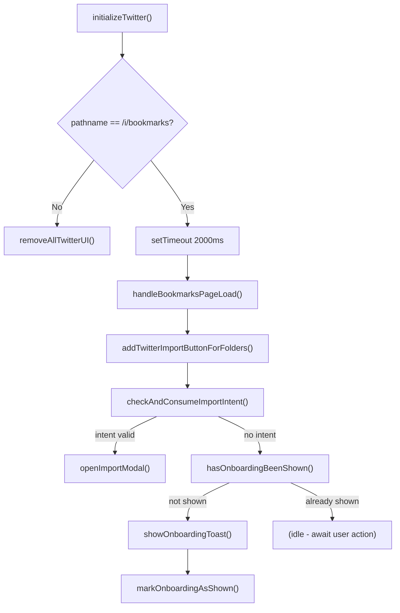
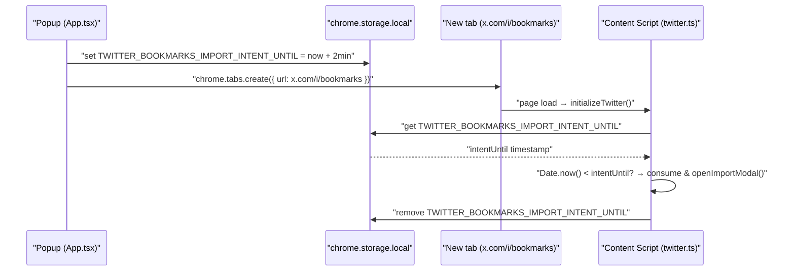
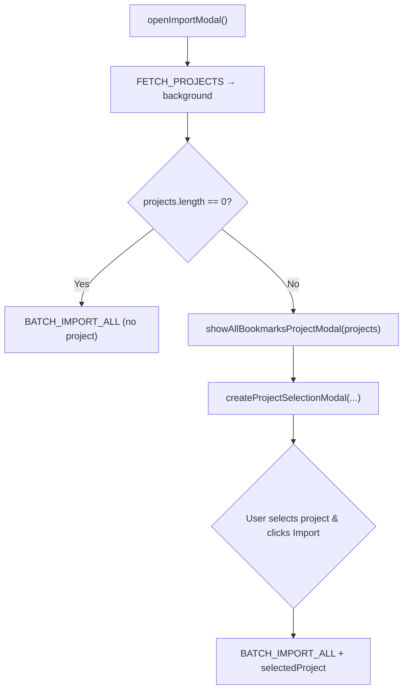
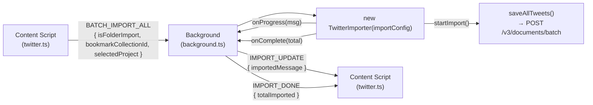

<!-- source: DeepWiki mcp.deepwiki.com · repo supermemoryai/supermemory · page 3.3 Twitter Bookmark Import · fetched 2026-10-30 -->

# Twitter Bookmark Import

<details>
<summary>Relevant source files</summary>

The following files were used as context for generating this wiki page:

- [apps/browser-extension/components/icons.tsx](apps/browser-extension/components/icons.tsx)
- [apps/browser-extension/entrypoints/background.ts](apps/browser-extension/entrypoints/background.ts)
- [apps/browser-extension/entrypoints/content/twitter.ts](apps/browser-extension/entrypoints/content/twitter.ts)
- [apps/browser-extension/entrypoints/popup/style.css](apps/browser-extension/entrypoints/popup/style.css)
- [apps/browser-extension/entrypoints/welcome/Welcome.tsx](apps/browser-extension/entrypoints/welcome/Welcome.tsx)
- [apps/browser-extension/package.json](apps/browser-extension/package.json)
- [apps/browser-extension/public/icon-48.png](apps/browser-extension/public/icon-48.png)
- [apps/browser-extension/public/logo-fullmark.svg](apps/browser-extension/public/logo-fullmark.svg)
- [apps/browser-extension/utils/api.ts](apps/browser-extension/utils/api.ts)
- [apps/browser-extension/utils/twitter-import.ts](apps/browser-extension/utils/twitter-import.ts)
- [apps/browser-extension/utils/twitter-utils.ts](apps/browser-extension/utils/twitter-utils.ts)
- [apps/browser-extension/utils/types.ts](apps/browser-extension/utils/types.ts)
- [apps/browser-extension/utils/ui-components.ts](apps/browser-extension/utils/ui-components.ts)

</details>


This page documents the Twitter/X bookmark import subsystem of the Supermemory browser extension. It covers the full flow from user-initiated import in the popup through content script orchestration, background processing, and progress reporting back to the page.

For general extension architecture and message-passing conventions, see [3.1](). For the UI components (`createProjectSelectionModal`, `createTwitterImportButton`, toast utilities) used here, see [3.4]().

---

## Overview

The Twitter bookmark import subsystem allows users to bulk-import their X/Twitter bookmarks (including folder-scoped bookmark collections) into Supermemory. It is composed of three cooperating parts:

| Part | File | Role |
|---|---|---|
| Popup UI | `entrypoints/popup/App.tsx` | Entry point; triggers navigation or sends modal-open message |
| Content Script | `entrypoints/content/twitter.ts` | DOM orchestration on x.com, modal display, progress toasts |
| Background Worker | `entrypoints/background.ts` | Runs `TwitterImporter`, relays progress to content script |

The `TwitterImporter` class performs the actual Twitter API pagination and Supermemory batch upload. Authentication tokens are captured passively from Twitter's outgoing web requests via `captureTwitterTokens()`.

Sources: [apps/browser-extension/entrypoints/background.ts:16-17](), [apps/browser-extension/entrypoints/background.ts:40-47](), [apps/browser-extension/utils/twitter-import.ts:61-65](), [apps/browser-extension/entrypoints/content/twitter.ts:84-124]()

---

## Import Entry Points

There are two ways to start an import.

### 1. Popup Button

The "Imports" tab in the popup contains an **Import X/Twitter Bookmarks** button.

When clicked, it checks whether the active tab is already on the bookmarks page (`x.com/i/bookmarks`):

- **Already on bookmarks page** → sends `MESSAGE_TYPES.TWITTER_IMPORT_OPEN_MODAL` directly to the content script.
- **Not on bookmarks page** → writes an expiring intent to `chrome.storage.local` under the key `STORAGE_KEYS.TWITTER_BOOKMARKS_IMPORT_INTENT_UNTIL`, then opens `https://x.com/i/bookmarks` in a new tab. The content script reads and consumes this intent on page load.

The intent TTL is defined as `UI_CONFIG.IMPORT_INTENT_TTL = 2 * 60 * 1000` (2 minutes).

Sources: [apps/browser-extension/entrypoints/popup/App.tsx:73-86](), [apps/browser-extension/utils/constants.ts:45-45](), [apps/browser-extension/entrypoints/content/twitter.ts:34-54]()

### 2. Folder-Level Import Buttons

On `/i/bookmarks`, the content script injects a button next to each bookmark folder element via `addTwitterImportButtonForFolders()`. Clicking it opens a project selection modal scoped to that folder's `bookmarkCollectionId`, extracted from the folder's `href` attribute.

Sources: [apps/browser-extension/entrypoints/content/twitter.ts:109-109](), [apps/browser-extension/utils/ui-components.ts:166-166]()

---

## Content Script Initialization Flow

**Diagram: Content script initialization on Twitter/X**



Sources: [apps/browser-extension/entrypoints/content/twitter.ts:84-124]()

The 2-second delay in `initializeTwitter` accommodates Twitter's SPA rendering. The `MutationObserver` in the content script index calls `handleTwitterNavigation()` on DOM changes, which re-runs `handleBookmarksPageLoad()` when the user navigates to the bookmarks route.

Sources: [apps/browser-extension/entrypoints/content/twitter.ts:84-100](), [apps/browser-extension/utils/constants.ts:50-50]()

---

## Import Intent TTL Mechanism

The intent mechanism bridges the popup (which runs in a separate context) to the content script on the newly opened tab.



Sources: [apps/browser-extension/entrypoints/content/twitter.ts:34-54](), [apps/browser-extension/utils/constants.ts:34-36]()

**Storage keys involved:**

| Key constant | `chrome.storage.local` key | Value |
|---|---|---|
| `STORAGE_KEYS.TWITTER_BOOKMARKS_IMPORT_INTENT_UNTIL` | `sm_twitter_bookmarks_import_intent_until` | Unix timestamp (ms) |
| `STORAGE_KEYS.TWITTER_BOOKMARKS_ONBOARDING_SEEN` | `sm_twitter_bookmarks_onboarding_seen` | boolean |

Sources: [apps/browser-extension/utils/constants.ts:32-36]()

---

## Onboarding Toast

When a user lands on `/i/bookmarks` for the first time (no import intent, onboarding not seen), `showOnboardingToast()` displays a one-time notification.

**Features of the onboarding toast:**

- Element ID: `ELEMENT_IDS.TWITTER_ONBOARDING_TOAST` (`sm-twitter-onboarding-toast`)
- Duration: `UI_CONFIG.ONBOARDING_TOAST_DURATION` = **6000ms**
- Animated gradient progress bar at bottom tracks auto-dismiss timer via `smProgressGrow` CSS keyframe
- Stored as seen via `markOnboardingAsShown()` before display, preventing re-show on refresh

Sources: [apps/browser-extension/entrypoints/content/twitter.ts:189-224](), [apps/browser-extension/utils/constants.ts:44-44]()

---

## Modal: `openImportModal()` (All Bookmarks)

`openImportModal()` is the single entry point for starting an import of all bookmarks (non-folder).



Sources: [apps/browser-extension/entrypoints/content/twitter.ts:129-153]()

---

## `BATCH_IMPORT_ALL` Message Flow

**Diagram: BATCH_IMPORT_ALL message from content script to background**



Sources: [apps/browser-extension/entrypoints/background.ts:176-192](), [apps/browser-extension/utils/api.ts:167-192]()

### `TwitterImportConfig` interface

The background worker instantiates `TwitterImporter` using the `TwitterImportConfig` object:

| Field | Type | Source |
|---|---|---|
| `isFolderImport` | `boolean \| undefined` | from `ExtensionMessage` |
| `bookmarkCollectionId` | `string \| undefined` | folder's URL slug |
| `selectedProject` | `Project \| undefined` | from project selection modal |
| `onProgress` | `(msg: string) => Promise<void>` | `sendMessageToCurrentTab` |
| `onComplete` | `(total: number) => Promise<void>` | `sendImportDoneMessage` |

Sources: [apps/browser-extension/entrypoints/background.ts:177-186](), [apps/browser-extension/utils/twitter-import.ts:23-34]()

### Batch upload API call

`saveAllTweets()` posts to `/v3/documents/batch` with a shared metadata group identifier:

```typescript
// apps/browser-extension/utils/api.ts:167-184
export async function saveAllTweets(
	documents: MemoryPayload[],
): Promise<unknown> {
	try {
		const response = await makeAuthenticatedRequest<unknown>(
			"/v3/documents/batch",
			{
				method: "POST",
				body: JSON.stringify({
					documents,
					metadata: {
						sm_source: "consumer",
						sm_internal_group_id: "twitter_bookmarks",
					},
				}),
			},
		)
		return response
	} catch (error) { ... }
}
```

409 Conflict responses (duplicate documents) are silently swallowed in `saveAllTweets`.

Sources: [apps/browser-extension/utils/api.ts:167-192]()

---

## Progress Reporting

Progress is displayed via `showOrUpdateImportProgressToast()` in the content script, which maintains a single persistent toast with element ID `ELEMENT_IDS.TWITTER_IMPORT_PROGRESS_TOAST` (`sm-twitter-import-progress-toast`).

| Message type | Handler | Toast behavior |
|---|---|---|
| `MESSAGE_TYPES.IMPORT_UPDATE` | `onProgress` callback | Creates or updates toast text with current progress message |
| `MESSAGE_TYPES.IMPORT_DONE` | `onComplete` callback | Displays total count and auto-dismisses |

Sources: [apps/browser-extension/entrypoints/background.ts:50-77](), [apps/browser-extension/utils/constants.ts:79-81]()

---

## Cleanup

`removeAllTwitterUI()` removes all injected elements when the user navigates away from `/i/bookmarks`:

| Removed element | Element ID constant |
|---|---|
| Import button | `ELEMENT_IDS.TWITTER_IMPORT_BUTTON` |
| Onboarding toast | `ELEMENT_IDS.TWITTER_ONBOARDING_TOAST` |
| Import progress toast | `ELEMENT_IDS.TWITTER_IMPORT_PROGRESS_TOAST` |

Sources: [apps/browser-extension/utils/constants.ts:16-19](), [apps/browser-extension/entrypoints/content/twitter.ts:97-98]()

---

## Required Permissions

The extension declares the following permissions relevant to Twitter import in `wxt.config.ts`:

| Permission | Purpose |
|---|---|
| `host_permissions: *://x.com/*` | Content script injection and web request interception |
| `host_permissions: *://twitter.com/*` | Legacy domain support |
| `webRequest` | Capturing Twitter auth tokens via `onBeforeSendHeaders` |
| `storage` | Persisting intent TTL and onboarding-seen flag |
| `tabs` | Opening `x.com/i/bookmarks` tab and querying active tab |

Sources: [apps/browser-extension/wxt.config.ts:33-42](), [apps/browser-extension/entrypoints/background.ts:40-47]()

---

