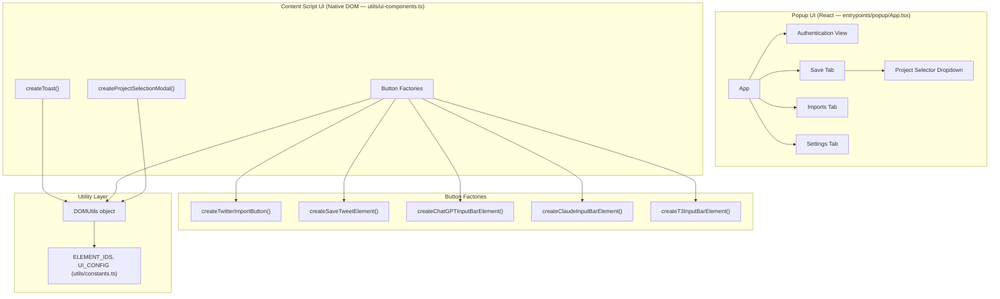
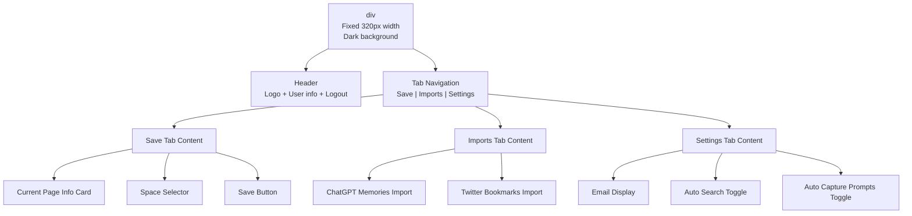
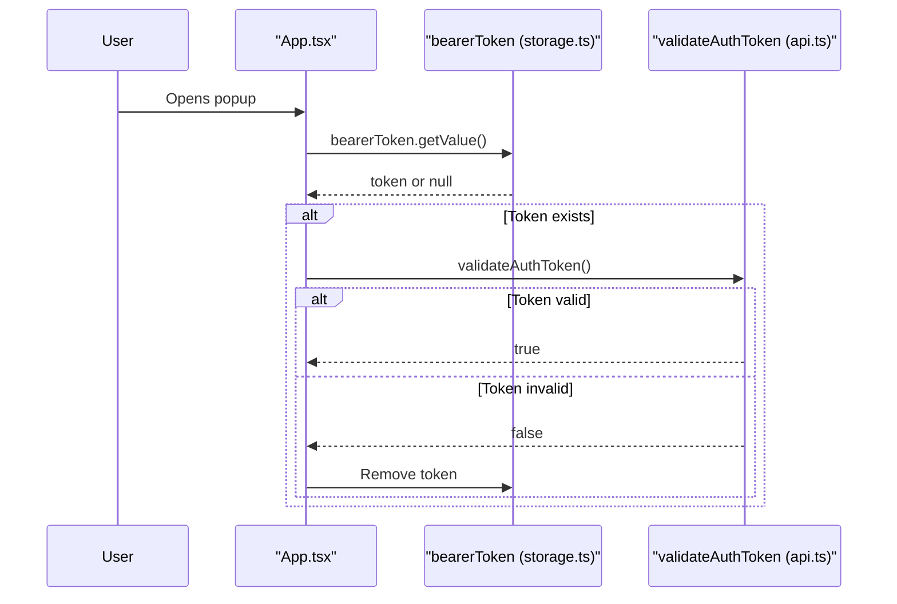
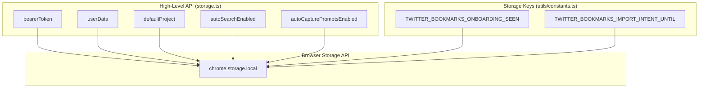

<!-- source: DeepWiki mcp.deepwiki.com · repo supermemoryai/supermemory · page 3.4 UI Components & Storage · fetched 2026-10-30 -->

# UI Components & Storage

Relevant source files

The following files were used as context for generating this wiki page:

- [apps/browser-extension/components/icons.tsx](apps/browser-extension/components/icons.tsx)
- [apps/browser-extension/entrypoints/background.ts](apps/browser-extension/entrypoints/background.ts)
- [apps/browser-extension/entrypoints/content/chatgpt.ts](apps/browser-extension/entrypoints/content/chatgpt.ts)
- [apps/browser-extension/entrypoints/content/shared.ts](apps/browser-extension/entrypoints/content/shared.ts)
- [apps/browser-extension/entrypoints/content/t3.ts](apps/browser-extension/entrypoints/content/t3.ts)
- [apps/browser-extension/entrypoints/content/twitter.ts](apps/browser-extension/entrypoints/content/twitter.ts)
- [apps/browser-extension/entrypoints/popup/style.css](apps/browser-extension/entrypoints/popup/style.css)
- [apps/browser-extension/entrypoints/welcome/Welcome.tsx](apps/browser-extension/entrypoints/welcome/Welcome.tsx)
- [apps/browser-extension/package.json](apps/browser-extension/package.json)
- [apps/browser-extension/public/icon-48.png](apps/browser-extension/public/icon-48.png)
- [apps/browser-extension/public/logo-fullmark.svg](apps/browser-extension/public/logo-fullmark.svg)
- [apps/browser-extension/utils/api.ts](apps/browser-extension/utils/api.ts)
- [apps/browser-extension/utils/storage.ts](apps/browser-extension/utils/storage.ts)
- [apps/browser-extension/utils/twitter-auth.ts](apps/browser-extension/utils/twitter-auth.ts)
- [apps/browser-extension/utils/twitter-import.ts](apps/browser-extension/utils/twitter-import.ts)
- [apps/browser-extension/utils/twitter-utils.ts](apps/browser-extension/utils/twitter-utils.ts)
- [apps/browser-extension/utils/types.ts](apps/browser-extension/utils/types.ts)
- [apps/browser-extension/utils/ui-components.ts](apps/browser-extension/utils/ui-components.ts)
- [apps/web/public/images/plugins/codex.png](apps/web/public/images/plugins/codex.png)

## Purpose and Scope

This document covers the UI component system and browser storage patterns used in the Supermemory browser extension. It details the reusable component factories, popup interface, injected content elements, and persistent storage mechanisms. For information about the extension's overall architecture and message passing, see [Extension Architecture (3.1)](). For AI chat integration functionality, see [AI Chat Integration (3.2)]().

---

## UI Component Architecture

The extension implements a component system that creates DOM elements programmatically rather than using a templating system. Components are divided into two categories: the popup interface rendered in React, and content script components injected into web pages as native DOM elements.

### Component Type Hierarchy

**Popup components** (React, rendered via `entrypoints/popup/App.tsx`) and **content script components** (native DOM, created by `utils/ui-components.ts`) are entirely separate rendering contexts. Popup components use Tailwind CSS utility classes; content script components use inline `style.cssText` strings to avoid host-page style conflicts [apps/browser-extension/utils/ui-components.ts:18-36]().

Sources: [apps/browser-extension/utils/ui-components.ts:14-166](), [apps/browser-extension/utils/ui-components.ts:395-400]()

---

## Popup UI Components

### Main Popup Interface

The popup is a React application rendered when users click the extension icon. It uses a fixed-width container with a dark background [apps/browser-extension/entrypoints/popup/style.css:7-10]() and provides three main tabs: "save", "imports", and "settings".

#### Popup Structure

Sources: [apps/browser-extension/entrypoints/popup/style.css:1-17](), [apps/browser-extension/entrypoints/popup/style.css:7-10]()

### Authentication Flow

The popup validates the user's session using the `validateAuthToken` utility [apps/browser-extension/utils/api.ts:101-112]().

Sources: [apps/browser-extension/utils/api.ts:101-112](), [apps/browser-extension/utils/storage.ts:15]()

---

## Content Script UI Components

### Toast Notifications

Toast notifications appear in the top-right corner of web pages to provide feedback for extension actions. The `createToast()` function generates a toast element with three states [apps/browser-extension/utils/ui-components.ts:14-16]().

#### Toast States

| State | Icon | Text |
|-------|------|------|
| `loading` | Spinning loader (indigo) | "Adding to Memory..." [apps/browser-extension/utils/ui-components.ts:116]() |
| `success` | Extension icon (`/icon-16.png`) | "Added to Memory" [apps/browser-extension/utils/ui-components.ts:122]() |
| `error` | Red X circle | "Failed to save memory" + "Make sure you are logged in" [apps/browser-extension/utils/ui-components.ts:140-145]() |

The toast uses inline styles with animations defined in a dynamically injected `<style>` element with ID `supermemory-toast-styles` [apps/browser-extension/utils/ui-components.ts:41-42](). It also handles font injection for "Space Grotesk" via `chrome.runtime.getURL` [apps/browser-extension/utils/ui-components.ts:43-77]().

Sources: [apps/browser-extension/utils/ui-components.ts:14-159]()

### Injected Button Components

The extension injects save and search buttons into various platforms' UI. Each platform has a dedicated factory function in `utils/ui-components.ts`.

#### Button Factory Functions

| Function | Element ID constant | Platform Target |
|----------|---------------------|-----------------|
| `createTwitterImportButton` | `TWITTER_IMPORT_BUTTON` | Twitter Bookmarks page [apps/browser-extension/utils/ui-components.ts:166-172]() |
| `createChatGPTInputBarElement` | `CHATGPT_INPUT_BAR_ELEMENT` | ChatGPT interface [apps/browser-extension/entrypoints/content/chatgpt.ts:13]() |
| `createT3InputBarElement` | `T3_INPUT_BAR_ELEMENT` | T3.chat interface [apps/browser-extension/entrypoints/content/t3.ts:12]() |
| `createSaveTweetElement` | `SAVE_TWEET_ELEMENT` | Twitter individual tweets [apps/browser-extension/utils/ui-components.ts:245-250]() |

Sources: [apps/browser-extension/utils/ui-components.ts:166-250](), [apps/browser-extension/entrypoints/content/t3.ts:12](), [apps/browser-extension/entrypoints/content/chatgpt.ts:13]()

### Project Selection Modal

The `createProjectSelectionModal()` function creates a full-screen overlay modal for selecting a project/space when importing content [apps/browser-extension/utils/ui-components.ts:395-400](). This is primarily used during the Twitter bookmark import flow in `entrypoints/content/twitter.ts` [apps/browser-extension/entrypoints/content/twitter.ts:160-181]().

**Behavior:**
1. **Dynamic Project Loading**: Initially renders with empty projects array, then updates via `updateModalWithProjects()`.
2. **Selection State**: Import button disabled until user selects a project.
3. **Dismissal**: Clicking overlay, Cancel button, or Escape key closes modal.
4. **Font Loading**: Calls `loadSpaceGroteskFonts()` to ensure consistent typography [apps/browser-extension/entrypoints/content/twitter.ts:16-29]().

Sources: [apps/browser-extension/utils/ui-components.ts:395-644](), [apps/browser-extension/entrypoints/content/twitter.ts:160-181]()

---

## Storage System

### Browser Storage API Usage

The extension uses the WXT storage wrapper around `chrome.storage.local` for persistence [apps/browser-extension/utils/storage.ts:1-20]().

#### Storage Pattern Architecture

Sources: [apps/browser-extension/utils/storage.ts:1-20](), [apps/browser-extension/utils/constants.ts:32-36]()

### Storage Keys Reference

| Key | Type | Purpose |
|-----|------|---------|
| `TWITTER_BOOKMARKS_ONBOARDING_SEEN` | `boolean` | Tracks if onboarding toast was shown [apps/browser-extension/utils/constants.ts:33]() |
| `TWITTER_BOOKMARKS_IMPORT_INTENT_UNTIL` | `number` | TTL for import intent [apps/browser-extension/utils/constants.ts:34-35]() |
| `bearerToken` | `string` | User's JWT authentication token [apps/browser-extension/utils/storage.ts:15]() |
| `userData` | `object` | Cached user profile (email, name) [apps/browser-extension/utils/storage.ts:17]() |
| `defaultProject` | `Project` | Currently selected project for saves [apps/browser-extension/utils/storage.ts:16]() |

Sources: [apps/browser-extension/utils/constants.ts:32-36](), [apps/browser-extension/utils/storage.ts:1-20]()

---

## API Utility Functions

The `utils/api.ts` module provides authenticated wrappers for the Supermemory API using the `makeAuthenticatedRequest` helper [apps/browser-extension/utils/api.ts:30-57]().

| Function | Endpoint | Purpose |
|----------|----------|---------|
| `fetchProjects` | `/v3/projects` | Retrieves list of user projects [apps/browser-extension/utils/api.ts:62-65]() |
| `saveMemory` | `/v3/documents` | POSTs new memory content [apps/browser-extension/utils/api.ts:132-137]() |
| `searchMemories` | `/v4/search` | Performs vector search on memories [apps/browser-extension/utils/api.ts:148-156]() |
| `saveAllTweets` | `/v3/documents/batch` | Batch save for Twitter bookmarks [apps/browser-extension/utils/api.ts:167-173]() |
| `validateAuthToken`| `/v3/projects` | Checks if current token is valid [apps/browser-extension/utils/api.ts:101-112]() |

Sources: [apps/browser-extension/utils/api.ts:1-192]()

---

