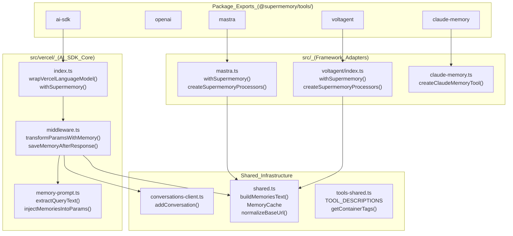
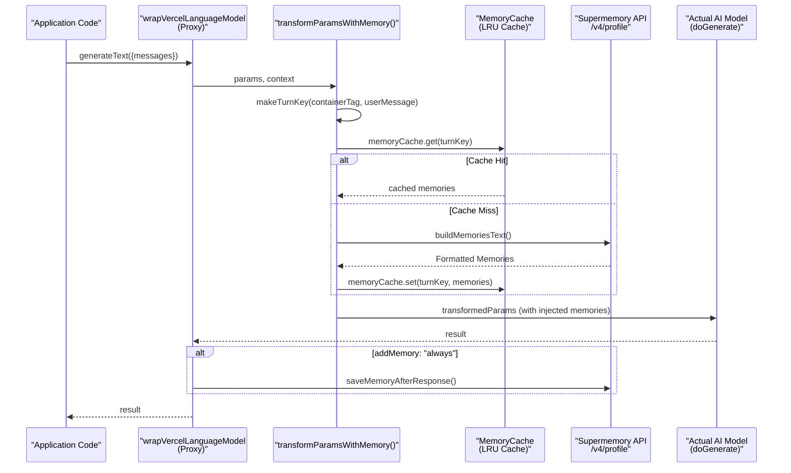

<!-- source: DeepWiki mcp.deepwiki.com · repo supermemoryai/supermemory · page 4 AI Tools Package · fetched 2026-10-30 -->

# AI Tools Package

Relevant source files

The following files were used as context for generating this wiki page:

- [biome.json](biome.json)
- [packages/tools/README.md](packages/tools/README.md)
- [packages/tools/package.json](packages/tools/package.json)
- [packages/tools/src/ai-sdk.ts](packages/tools/src/ai-sdk.ts)
- [packages/tools/src/openai/tools.ts](packages/tools/src/openai/tools.ts)
- [packages/tools/src/tools-shared.ts](packages/tools/src/tools-shared.ts)
- [packages/tools/src/tools.test.ts](packages/tools/src/tools.test.ts)
- [packages/tools/src/types.ts](packages/tools/src/types.ts)
- [packages/tools/src/vercel/index.ts](packages/tools/src/vercel/index.ts)
- [packages/tools/src/vercel/logger.ts](packages/tools/src/vercel/logger.ts)
- [packages/tools/src/vercel/memory-prompt.ts](packages/tools/src/vercel/memory-prompt.ts)
- [packages/tools/src/vercel/middleware.ts](packages/tools/src/vercel/middleware.ts)
- [packages/tools/src/vercel/util.ts](packages/tools/src/vercel/util.ts)

## Purpose and Scope

The `@supermemory/tools` package provides memory enhancement middleware and function-calling tools for AI applications. It serves as a bridge between the Supermemory API and popular AI frameworks, including the **Vercel AI SDK** (v2 and v3), **OpenAI SDK**, **Mastra**, and **VoltAgent** [packages/tools/package.json:5]().

The package enables two primary workflows:
1. **Automatic Injection**: Transparently enhancing AI prompts with relevant user memories via middleware that intercepts LLM calls [packages/tools/src/vercel/index.ts:66-72]().
2. **Explicit Operations**: Providing the AI with function-calling tools to search, add, or manage memories [packages/tools/src/ai-sdk.ts:13-119]().

A key optimization is **per-turn memory caching** implemented via `MemoryCache` [packages/tools/src/vercel/middleware.ts:160-164](), which avoids redundant API calls during multi-step tool interactions or multi-step generation flows by reusing memories within the same user turn [packages/tools/src/vercel/middleware.ts:248-255]().

**Sources:** [packages/tools/package.json:1-21](), [packages/tools/README.md:1-18](), [packages/tools/src/vercel/middleware.ts:160-164]()

---

## Package Architecture

The package is organized around submodule exports to provide tailored integrations for different frameworks while sharing a common core for memory retrieval and formatting.

### Package Exports and File Structure

**Package exports mapped to source files**

**Sources:** [packages/tools/package.json:49-57](), [packages/tools/src/vercel/index.ts:1-12](), [packages/tools/src/ai-sdk.ts:1-10](), [packages/tools/src/tools-shared.ts:6-21]()

### Core Dependencies

| Dependency | Purpose | Version |
|------------|---------|---------|
| `@ai-sdk/provider` | `LanguageModelV2` / `LanguageModelV3` interface types | ^3.0.0 |
| `ai` | Vercel AI SDK core components and `tool()` helper | ^5.0.29 |
| `openai` | Direct OpenAI SDK integration and type definitions | ^4.104.0 |
| `supermemory` | Official Supermemory API client | ^3.0.0-alpha.26 |
| `@mastra/core` | Integration for Mastra AI agents | ^1.0.0 |
| `@voltagent/core` | Integration for VoltAgent agents | ^2.6.12 |

**Sources:** [packages/tools/package.json:13-32]()

---

## Integration Approaches

### 1. Middleware Pattern (Transparent)

The middleware approach intercepts AI calls to automatically enrich prompts with relevant memories. This is implemented via `withSupermemory()` which wraps `LanguageModel` instances for Vercel AI SDK [packages/tools/src/vercel/index.ts:111-144]().

**Middleware Request-Response Flow with Per-Turn Caching**

For detailed implementation of the middleware lifecycle, see [Middleware Integration](#4.1).

**Sources:** [packages/tools/src/vercel/middleware.ts:232-263](), [packages/tools/src/vercel/middleware.ts:248-255](), [packages/tools/src/vercel/index.ts:144-180](), [packages/tools/src/vercel/middleware.ts:78-113]()

### 2. Function Calling Pattern (Explicit)

The function-calling approach provides a suite of tools that the AI can explicitly invoke. This gives the model control over when to query its "long-term memory" or when to save a specific fact.

**Available Tools and Descriptions**

| Tool Name | Purpose | Code Reference |
|-----------|---------|----------------|
| `searchMemories` | Semantic search for specific information | [packages/tools/src/tools-shared.ts:7-8]() |
| `addMemory` | Save a short fact or sentence to memory | [packages/tools/src/tools-shared.ts:9-10]() |
| `getProfile` | Retrieve the full user profile (static/dynamic) | [packages/tools/src/tools-shared.ts:11-12]() |
| `documentList` | List stored documents with filtering | [packages/tools/src/tools-shared.ts:13-14]() |
| `documentAdd` | Queue content/URL for processing | [packages/tools/src/tools-shared.ts:17-18]() |
| `documentDelete` | Permanently delete saved content | [packages/tools/src/tools-shared.ts:15-16]() |
| `memoryForget` | Soft-delete a specific memory entry | [packages/tools/src/tools-shared.ts:19-21]() |

For tool schemas and parameter details, see [Function Calling Tools](#4.2).

**Sources:** [packages/tools/src/ai-sdk.ts:13-119](), [packages/tools/src/openai/tools.ts:67-219](), [packages/tools/src/tools-shared.ts:6-21]()

---

## Memory Enhancement Logic

The middleware uses `transformParamsWithMemory` to fetch and format data. It supports three distinct modes:
- **`profile`**: Default. Retrieves user profile memories (static + dynamic) without query filtering [packages/tools/src/vercel/middleware.ts:129]().
- **`query`**: Searches memories based on semantic similarity to the last user message [packages/tools/src/vercel/middleware.ts:130]().
- **`full`**: Combines both profile and query-based results [packages/tools/src/vercel/middleware.ts:131]().

### Context and State Management
- **`containerTag`**: The primary scoping identifier (e.g., a user ID or project ID) used to isolate memories [packages/tools/src/vercel/middleware.ts:120]().
- **`customId`**: Required ID to group messages into a single document for contextual memory generation [packages/tools/src/vercel/middleware.ts:124]().
- **`addMemory`**: Determines if the middleware should automatically persist the assistant's response and user's prompt via `saveMemoryAfterResponse` [packages/tools/src/vercel/middleware.ts:135-139]().

For configuration options and advanced patterns, see [Configuration & Usage Patterns](#4.3).

**Sources:** [packages/tools/src/vercel/middleware.ts:118-146](), [packages/tools/src/vercel/memory-prompt.ts:23-48](), [packages/tools/src/vercel/index.ts:123-140]()

---

## Specialized Framework Integrations

Beyond the standard Vercel AI SDK and OpenAI integrations, the package provides specialized support for:

- **Mastra & Claude**: Wrappers for Mastra agents and a native Claude memory tool compatible with `memory_20250818`. See [Mastra & Claude Memory Integration](#4.4).
- **VoltAgent**: Hook-based integration using `createSupermemoryProcessors` for input/output transformation. See [VoltAgent Integration](#4.5).

**Sources:** [packages/tools/package.json:52-55](), [packages/tools/README.md:15-18]()

---

