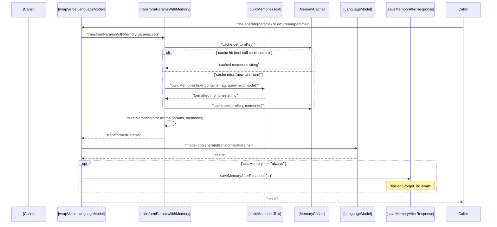
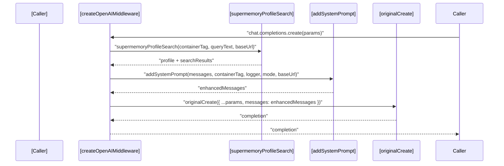
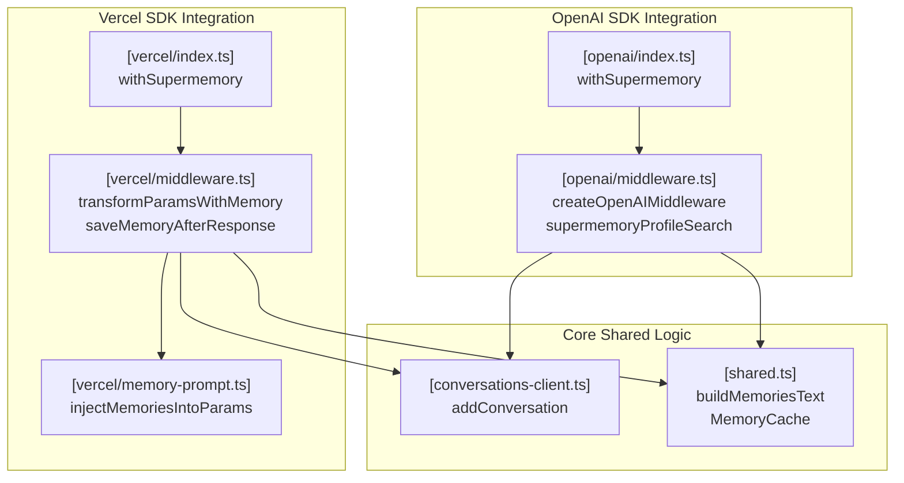

<!-- source: DeepWiki mcp.deepwiki.com · repo supermemoryai/supermemory · page 4.1 Middleware Integration · fetched 2026-10-30 -->

# Middleware Integration

<details>
<summary>Relevant source files</summary>

The following files were used as context for generating this wiki page:

- [packages/tools/README.md](packages/tools/README.md)
- [packages/tools/package.json](packages/tools/package.json)
- [packages/tools/src/openai/index.ts](packages/tools/src/openai/index.ts)
- [packages/tools/src/openai/middleware.ts](packages/tools/src/openai/middleware.ts)
- [packages/tools/src/vercel/index.ts](packages/tools/src/vercel/index.ts)
- [packages/tools/src/vercel/memory-prompt.ts](packages/tools/src/vercel/memory-prompt.ts)
- [packages/tools/src/vercel/middleware.ts](packages/tools/src/vercel/middleware.ts)
- [packages/tools/src/vercel/util.ts](packages/tools/src/vercel/util.ts)
- [packages/tools/test/chatapp/app/api/openai-chat/route.ts](packages/tools/test/chatapp/app/api/openai-chat/route.ts)
- [packages/tools/test/openai-responses-test.ts](packages/tools/test/openai-responses-test.ts)

</details>


This page documents the `withSupermemory` middleware for the **Vercel AI SDK** and the **OpenAI SDK**, both exported from the `@supermemory/tools` package [[packages/tools/package.json:1-5]](). The middleware intercepts outgoing LLM calls, fetches memories from Supermemory, injects them into the system prompt, and optionally saves conversation turns back to Supermemory.

---

## Package Structure

The `@supermemory/tools` package uses submodule exports to provide framework-specific logic while sharing core utilities.

| Export path | File | Description |
|---|---|---|
| `@supermemory/tools/ai-sdk` | [[packages/tools/src/vercel/index.ts:1-110]]() | Vercel AI SDK (`LanguageModelV2`/`V3`) wrapper |
| `@supermemory/tools/openai` | [[packages/tools/src/openai/index.ts:1-131]]() | OpenAI SDK client wrapper |

Sources: [[packages/tools/package.json:49-57]]()

---

## Vercel AI SDK Middleware

### `withSupermemory` (Vercel)

Exported as `wrapVercelLanguageModel` and aliased as `withSupermemory`. It wraps any Vercel AI SDK language model object (compatible with both SDK v5 `LanguageModelV2` and SDK v6 `LanguageModelV3`) by overriding its `doGenerate` and `doStream` methods using a `Proxy` [[packages/tools/src/vercel/index.ts:111-144]]().

**Signature:**
```typescript
withSupermemory(model, options) => WrappedModel
```

Sources: [[packages/tools/src/vercel/index.ts:111-114]]()

---

**Vercel Middleware — Call Flow Diagram**



Sources: [[packages/tools/src/vercel/index.ts:144-187]](), [[packages/tools/src/vercel/middleware.ts:232-321]]()

---

### Context Initialization — `createSupermemoryContext`

`createSupermemoryContext` is called once when `withSupermemory` is invoked. It initializes a `SupermemoryMiddlewareContext` object that is shared across all calls to `doGenerate` and `doStream` on the wrapped model [[packages/tools/src/vercel/middleware.ts:166-206]]().

| Context field | Source / Implementation |
|---|---|
| `client` | `new Supermemory({ apiKey, baseURL? })` [[packages/tools/src/vercel/middleware.ts:184-189]]() |
| `logger` | `createLogger(verbose)` — logs to console when `verbose: true` [[packages/tools/src/vercel/middleware.ts:181]]() |
| `memoryCache` | `new MemoryCache<string>()` — per-instance, keyed by turn [[packages/tools/src/vercel/middleware.ts:204]]() |
| `containerTag` | Identifier for memory search (e.g., user ID) [[packages/tools/src/vercel/middleware.ts:170]]() |
| `mode` | `"profile"`, `"query"`, or `"full"` [[packages/tools/src/vercel/middleware.ts:174]]() |
| `addMemory` | `"always"` or `"never"` [[packages/tools/src/vercel/middleware.ts:175]]() |

Sources: [[packages/tools/src/vercel/middleware.ts:148-164]]()

---

### Memory Injection — `transformParamsWithMemory`

`transformParamsWithMemory` is the core transformation step [[packages/tools/src/vercel/middleware.ts:232-235]]():

1. Extracts the last user message via `getLastUserMessage` [[packages/tools/src/vercel/util.ts:50-74]]().
2. Generates a `turnKey` via `makeTurnKey` which uses `MemoryCache.makeTurnKey` [[packages/tools/src/vercel/middleware.ts:212-222]]().
3. Detects if this is a **new user turn** (last message role is `"user"`) via `isNewUserTurn` [[packages/tools/src/vercel/middleware.ts:227-230]]().
4. On a tool-call continuation with a cached result, skips the API call and reuses the cached string [[packages/tools/src/vercel/middleware.ts:249-255]]().
5. Otherwise, calls `buildMemoriesText` which triggers a request to the Supermemory API [[packages/tools/src/vercel/memory-prompt.ts:109-117]]().
6. Calls `injectMemoriesIntoParams` to modify the system prompt [[packages/tools/src/vercel/memory-prompt.ts:59-88]]().

Sources: [[packages/tools/src/vercel/middleware.ts:232-321]](), [[packages/tools/src/vercel/memory-prompt.ts:59-88]]()

---

### Memory Persistence — `saveMemoryAfterResponse`

When `addMemory: "always"`, the middleware calls `saveMemoryAfterResponse` after the LLM responds [[packages/tools/src/vercel/middleware.ts:78-87]](). This is **fire-and-forget** (no `await`), so it does not block the response stream [[packages/tools/src/vercel/index.ts:180-187]]().

It converts the Vercel `LanguageModelCallOptions` and the assistant response into `ConversationMessage[]` using `convertToConversationMessages` [[packages/tools/src/vercel/middleware.ts:18-76]](), then calls `addConversation` from the `conversations-client` which POSTs to `/v4/conversations` [[packages/tools/src/vercel/middleware.ts:94-100]]().

Sources: [[packages/tools/src/vercel/middleware.ts:78-113]](), [[packages/tools/src/vercel/index.ts:180-187]]()

---

## OpenAI SDK Middleware

### `withSupermemory` (OpenAI)

Exported from [[packages/tools/src/openai/index.ts:62-99]](). It wraps an existing `OpenAI` client instance by calling `createOpenAIMiddleware` [[packages/tools/src/openai/index.ts:87-96]]().

**Signature:**
```typescript
withSupermemory(openaiClient, options) => OpenAI
```

Sources: [[packages/tools/src/openai/index.ts:62-65]]()

---

**OpenAI Middleware — Call Flow Diagram**



Sources: [[packages/tools/src/openai/middleware.ts:158-164]](), [[packages/tools/src/openai/index.ts:87-96]]()

---

## Component Relationship Diagram



Sources: [[packages/tools/src/vercel/index.ts]](), [[packages/tools/src/vercel/middleware.ts]](), [[packages/tools/src/openai/index.ts]](), [[packages/tools/src/openai/middleware.ts]]()

---

## Configuration Options

Both `withSupermemory` variants accept an options object:

| Option | Type | Default | Description |
|---|---|---|---|
| `containerTag` | `string` | (Required) | Identifier for memory search (e.g., user ID, project ID) [[packages/tools/src/vercel/index.ts:19]](). |
| `customId`| `string` | (Required) | Groups messages into one document for contextual memory generation [[packages/tools/src/vercel/index.ts:21]](). |
| `verbose` | `boolean` | `false` | Enables detailed logging of memory search and injection [[packages/tools/src/vercel/index.ts:23]](). |
| `mode` | `"profile" \| "query" \| "full"` | `"profile"` | Retrieval mode: user profile, semantic search, or both [[packages/tools/src/vercel/index.ts:30]](). |
| `addMemory` | `"always" \| "never"` | `"always"` | Automatically save conversations as memories [[packages/tools/src/vercel/index.ts:36]](). |
| `apiKey` | `string` | `env.SUPERMEMORY_API_KEY` | Supermemory API key [[packages/tools/src/vercel/index.ts:38]](). |
| `promptTemplate`| `PromptTemplate` | Default | Custom function to format memory data into the system prompt [[packages/tools/src/vercel/index.ts:56]](). |

Sources: [[packages/tools/src/vercel/index.ts:17-63]](), [[packages/tools/src/vercel/middleware.ts:118-146]](), [[packages/tools/src/openai/middleware.ts:14-23]]()

---

## Memory Modes

| Mode | Behavior |
|---|---|
| `"profile"` | Retrieves user profile memories (static + dynamic) without query filtering [[packages/tools/src/vercel/middleware.ts:129]](). |
| `"query"` | Searches memories based on semantic similarity to the user's message [[packages/tools/src/vercel/middleware.ts:130]](). |
| `"full"` | Combines both profile and query-based results [[packages/tools/src/vercel/middleware.ts:131]](). |

Sources: [[packages/tools/src/vercel/middleware.ts:128-133]](), [[packages/tools/src/openai/middleware.ts:162]]()

---

