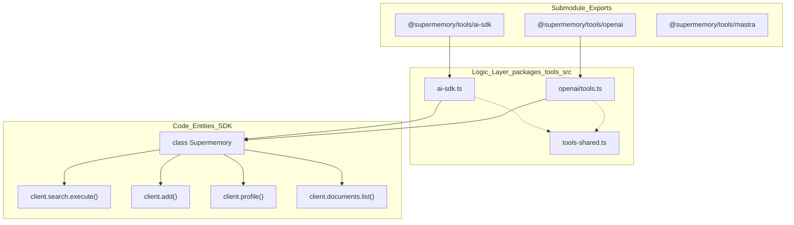
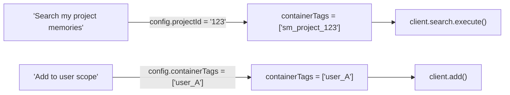
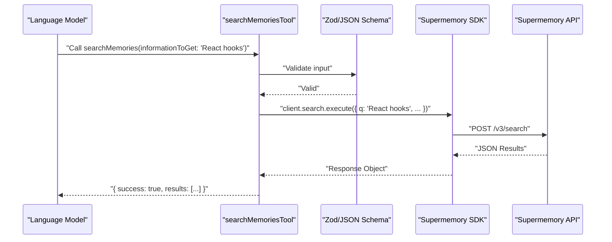

<!-- source: DeepWiki mcp.deepwiki.com · repo supermemoryai/supermemory · page 4.2 Function Calling Tools · fetched 2026-10-30 -->

# Function Calling Tools

<details>
<summary>Relevant source files</summary>

The following files were used as context for generating this wiki page:

- [apps/docs/ai-sdk/examples.mdx](apps/docs/ai-sdk/examples.mdx)
- [apps/docs/ai-sdk/infinite-chat.mdx](apps/docs/ai-sdk/infinite-chat.mdx)
- [apps/docs/ai-sdk/memory-tools.mdx](apps/docs/ai-sdk/memory-tools.mdx)
- [apps/docs/cookbook/ai-sdk-integration.mdx](apps/docs/cookbook/ai-sdk-integration.mdx)
- [apps/docs/cookbook/customer-support.mdx](apps/docs/cookbook/customer-support.mdx)
- [apps/docs/cookbook/document-qa.mdx](apps/docs/cookbook/document-qa.mdx)
- [apps/docs/cookbook/personal-assistant.mdx](apps/docs/cookbook/personal-assistant.mdx)
- [apps/docs/memory-api/sdks/openai-plugins.mdx](apps/docs/memory-api/sdks/openai-plugins.mdx)
- [apps/docs/memory-router/usage.mdx](apps/docs/memory-router/usage.mdx)
- [apps/docs/memory-router/with-memory-api.mdx](apps/docs/memory-router/with-memory-api.mdx)
- [biome.json](biome.json)
- [packages/ai-sdk/README.md](packages/ai-sdk/README.md)
- [packages/ai-sdk/src/tools.test.ts](packages/ai-sdk/src/tools.test.ts)
- [packages/ai-sdk/src/tools.ts](packages/ai-sdk/src/tools.ts)
- [packages/tools/src/ai-sdk.ts](packages/tools/src/ai-sdk.ts)
- [packages/tools/src/openai/tools.ts](packages/tools/src/openai/tools.ts)
- [packages/tools/src/tools-shared.ts](packages/tools/src/tools-shared.ts)
- [packages/tools/src/tools.test.ts](packages/tools/src/tools.test.ts)
- [packages/tools/src/types.ts](packages/tools/src/types.ts)
- [packages/tools/src/vercel/logger.ts](packages/tools/src/vercel/logger.ts)

</details>


This document covers the explicit function calling tools provided by `@supermemory/tools` for AI SDK, OpenAI SDK, and other agent frameworks. These tools give language models the ability to search, add, and manage memories through explicit tool invocations, providing granular control over when the model interacts with the Supermemory knowledge base.

Function calling tools are appropriate when you want the language model to explicitly decide when to search or save memories, rather than having memories automatically injected into every request via middleware.

---

## Tool Architecture

The `@supermemory/tools` package provides a suite of tools that wrap the Supermemory SDK. While `searchMemoriesTool` and `addMemoryTool` are the most common, the package also includes tools for profile retrieval and document management.

**Tool Architecture: Submodule Exports**


Sources: [packages/tools/src/ai-sdk.ts:1-12](), [packages/tools/src/openai/tools.ts:1-8](), [packages/ai-sdk/src/tools.ts:1-34]()

---

## AI SDK Function Tools

The AI SDK tools use the `tool()` function from the `ai` package to create structured function definitions compatible with the Vercel AI SDK's tool calling system. [packages/tools/src/ai-sdk.ts:2](), [packages/ai-sdk/src/tools.ts:1]()

### searchMemoriesTool
Creates a tool that performs semantic search across user memories. It uses `client.search.execute()` with a default `chunkThreshold`. [packages/tools/src/ai-sdk.ts:13-79](), [packages/ai-sdk/src/tools.ts:40-90]()

**Input Schema (Zod/JSON Schema):**
| Parameter | Type | Default | Description |
|-----------|------|---------|-------------|
| `informationToGet` | `string` | required | Terms to search for in the user's memories. |
| `includeFullDocs` | `boolean` | `true` | Whether to include the full document content. |
| `limit` | `number` | `10` | Maximum number of results to return. |

### addMemoryTool
Creates a tool that stores new information by calling `client.add()`. [packages/tools/src/ai-sdk.ts:81-119](), [packages/ai-sdk/src/tools.ts:92-127]()

**Input Schema (Zod/JSON Schema):**
| Parameter | Type | Description |
|-----------|------|-------------|
| `memory` | `string` | The text content of the memory to add. |

### Additional AI SDK Tools
- `getProfileTool`: Retrieves user profile (static and dynamic) via `client.profile()`. [packages/tools/src/ai-sdk.ts:121-163]()
- `documentListTool`: Lists documents in a container using `client.documents.list()`. [packages/tools/src/ai-sdk.ts:165-221]()
- `documentDeleteTool`: Deletes a specific document by ID using `client.documents.delete()`. [packages/tools/src/ai-sdk.ts:223-253]()
- `documentAddTool`: Adds a new document (URL or text) to memory. [packages/tools/src/ai-sdk.ts:255-296]()
- `memoryForgetTool`: Marks a specific memory as forgotten. [packages/tools/src/ai-sdk.ts:298-335]()

Sources: [packages/tools/src/ai-sdk.ts:13-335](), [packages/ai-sdk/src/tools.ts:40-133](), [packages/tools/src/tools-shared.ts:6-21]()

---

## OpenAI SDK Function Tools

The OpenAI implementation provides tools compatible with OpenAI's native `FunctionDefinition` format. [packages/tools/src/openai/tools.ts:67-219]()

### Tool Definitions and Schemas
`memoryToolSchemas` contains raw OpenAI-format schemas for all memory operations, including `searchMemories`, `addMemory`, `getProfile`, `documentList`, and `memoryForget`. [packages/tools/src/openai/tools.ts:67-219]()

**Key OpenAI Utilities:**
| Function | Description |
|----------|-------------|
| `getToolDefinitions()` | Returns an array of `ChatCompletionTool` objects for OpenAI API. [packages/tools/src/openai/tools.ts:311-313]() |
| `createToolCallExecutor()` | Returns an async function that dispatches a `tool_call` to the correct Supermemory method. [packages/tools/src/openai/tools.ts:321-344]() |
| `supermemoryTools()` | Returns a map of individual tool functions for manual execution. [packages/tools/src/openai/tools.ts:302-309]() |

Sources: [packages/tools/src/openai/tools.ts:67-344](), [apps/docs/memory-api/sdks/openai-plugins.mdx:85-119]()

---

## Tool Configuration

Both SDKs utilize the `SupermemoryToolsConfig` to scope operations. [packages/tools/src/types.ts:5-24]()

```typescript
export interface SupermemoryToolsConfig {
	baseUrl?: string
	containerTags?: string[]
	projectId?: string
	strict?: boolean
}
```

### Container Tag Resolution
The tools resolve the target scope using `getContainerTags()`. If a `projectId` is provided, it is automatically transformed into a container tag with the prefix `sm_project_`. [packages/tools/src/tools-shared.ts:62-70]()

**Code Entity Mapping: Natural Language to Code**

Sources: [packages/tools/src/tools-shared.ts:54-70](), [packages/ai-sdk/src/tools.ts:36-39](), [packages/tools/src/ai-sdk.ts:22]()

---

## Execution and Data Flow

The following diagram illustrates the lifecycle of a tool call within the AI SDK environment.

**Tool Execution Sequence**


Sources: [packages/tools/src/ai-sdk.ts:52-77](), [packages/ai-sdk/src/tools.ts:64-89](), [packages/tools/src/openai/tools.ts:244-274]()

---

## Usage Patterns

### AI SDK Integration
The `supermemoryTools` function returns an object containing all available tools for the AI SDK `tools` parameter. [packages/ai-sdk/src/tools.ts:27-133]()

```typescript
import { supermemoryTools } from "@supermemory/tools/ai-sdk"

const result = await generateText({
  model: openai("gpt-4o"),
  tools: {
    ...supermemoryTools(apiKey, { projectId: "my-project" })
  },
  prompt: "What did I say about the project architecture?"
})
```
Sources: [packages/ai-sdk/src/tools.ts:27-133](), [packages/tools/src/tools.test.ts:112-118]()

### OpenAI Integration
OpenAI integration requires handling tool calls returned by the model using the `createToolCallExecutor`. [packages/tools/src/openai/tools.ts:321-344]()

```typescript
import { getToolDefinitions, createToolCallExecutor } from "@supermemory/tools/openai"

const tools = getToolDefinitions()
const executor = createToolCallExecutor(apiKey, { projectId: "my-project" })

// After receiving tool_calls from OpenAI:
for (const toolCall of response.choices[0].message.tool_calls) {
  const result = await executor(toolCall)
  // Send result back to OpenAI as a tool message
}
```
Sources: [apps/docs/memory-api/sdks/openai-plugins.mdx:85-119](), [packages/tools/src/openai/tools.ts:321-344]()

---

