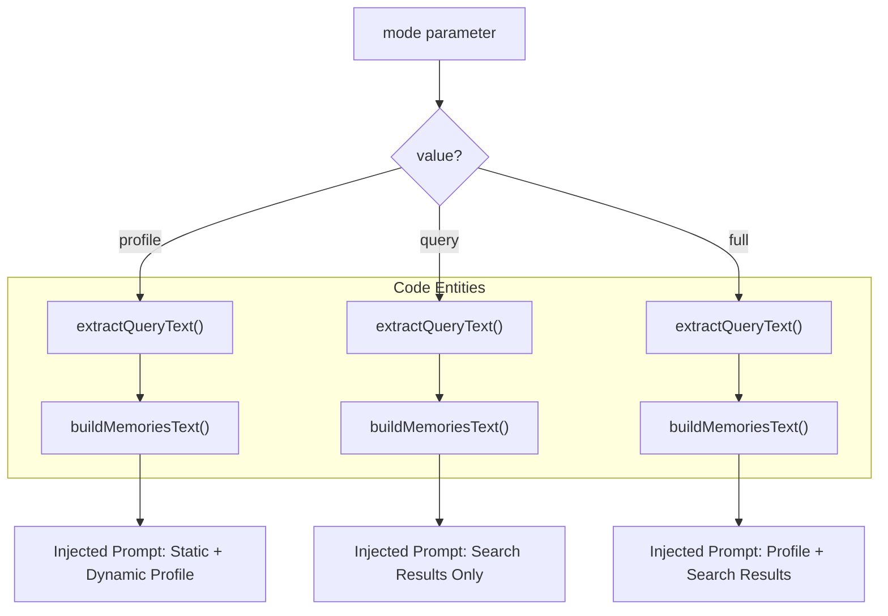
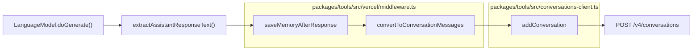

<!-- source: DeepWiki mcp.deepwiki.com · repo supermemoryai/supermemory · page 4.3 Configuration & Usage Patterns · fetched 2026-10-30 -->

# Configuration & Usage Patterns

<details>
<summary>Relevant source files</summary>

The following files were used as context for generating this wiki page:

- [packages/tools/README.md](packages/tools/README.md)
- [packages/tools/package.json](packages/tools/package.json)
- [packages/tools/src/conversations-client.ts](packages/tools/src/conversations-client.ts)
- [packages/tools/src/index.ts](packages/tools/src/index.ts)
- [packages/tools/src/vercel/index.ts](packages/tools/src/vercel/index.ts)
- [packages/tools/src/vercel/memory-prompt.ts](packages/tools/src/vercel/memory-prompt.ts)
- [packages/tools/src/vercel/middleware.ts](packages/tools/src/vercel/middleware.ts)
- [packages/tools/src/vercel/util.ts](packages/tools/src/vercel/util.ts)
- [packages/tools/src/voltagent/hooks.ts](packages/tools/src/voltagent/hooks.ts)
- [packages/tools/src/voltagent/index.ts](packages/tools/src/voltagent/index.ts)
- [packages/tools/src/voltagent/middleware.ts](packages/tools/src/voltagent/middleware.ts)
- [packages/tools/src/voltagent/types.ts](packages/tools/src/voltagent/types.ts)
- [packages/tools/test/ai-sdk-test.ts](packages/tools/test/ai-sdk-test.ts)
- [packages/tools/test/chatapp/app/api/chat/route.ts](packages/tools/test/chatapp/app/api/chat/route.ts)
- [packages/tools/test/chatapp/app/api/stream/route.ts](packages/tools/test/chatapp/app/api/stream/route.ts)
- [packages/tools/test/chatapp/app/stream/page.tsx](packages/tools/test/chatapp/app/stream/page.tsx)
- [packages/tools/test/chatapp/bun.lock](packages/tools/test/chatapp/bun.lock)
- [packages/tools/test/with-supermemory/integration.test.ts](packages/tools/test/with-supermemory/integration.test.ts)
- [packages/tools/test/with-supermemory/unit.test.ts](packages/tools/test/with-supermemory/unit.test.ts)
- [packages/tools/tsdown.config.ts](packages/tools/tsdown.config.ts)

</details>


This page documents the configuration interfaces, memory mode semantics, conversation client behavior, and concrete usage patterns for the `@supermemory/tools` package. It covers the options accepted by `withSupermemory` across supported frameworks (Vercel AI SDK, OpenAI SDK, and Mastra), the `MemoryMode` type, and the internal mechanisms for memory persistence and caching.

---

## Configuration Interfaces

### `WithSupermemoryOptions` (Vercel AI SDK)

The configuration for the Vercel AI SDK middleware is defined as `SupermemoryMiddlewareOptions` in [packages/tools/src/vercel/middleware.ts:118-146]() and utilized by the `withSupermemory` wrapper (aliased from `WrapVercelLanguageModelOptions` in [packages/tools/src/vercel/index.ts:17-63]()).

| Option | Type | Default | Description |
|--------|------|---------|-------------|
| `containerTag` | `string` | — | **Required.** Scopes memories to a specific user or project ID [packages/tools/src/vercel/index.ts:19-19](). |
| `customId` | `string` | — | **Required.** Groups messages into a single document for contextual memory generation [packages/tools/src/vercel/index.ts:21-21](). |
| `verbose` | `boolean` | `false` | Enables detailed logging of memory search and injection steps [packages/tools/src/vercel/index.ts:23-23](). |
| `mode` | `"profile" \| "query" \| "full"` | `"profile"` | Controls the memory retrieval strategy (see [MemoryMode](#memorymode) below) [packages/tools/src/vercel/index.ts:30-30](). |
| `addMemory` | `"always" \| "never"` | `"always"` | When `"always"`, automatically saves conversation turns to Supermemory after each LLM response [packages/tools/src/vercel/index.ts:36-36](). |
| `apiKey` | `string` | `process.env.SUPERMEMORY_API_KEY` | Explicit API key. Required if the environment variable is not set [packages/tools/src/vercel/index.ts:115-121](). |
| `baseUrl` | `string` | `"https://api.supermemory.ai"` | Custom API endpoint. Normalized by `normalizeBaseUrl` [packages/tools/src/vercel/middleware.ts:182-182](). |
| `promptTemplate` | `PromptTemplate` | Default markdown | Custom function to format memory data into the system prompt [packages/tools/src/vercel/index.ts:56-56](). |
| `skipMemoryOnError`| `boolean` | `true` | If `true`, logs errors and continues without memories. If `false`, propagates the error [packages/tools/src/vercel/index.ts:62-62](). |

**Sources:** [packages/tools/src/vercel/index.ts:17-63](), [packages/tools/src/vercel/middleware.ts:118-146]()

---

## MemoryMode

The `MemoryMode` type determines which Supermemory API capabilities are utilized and how the system prompt is augmented.

**Decision diagram: MemoryMode → Code Entity Interaction**



| Mode | Behavior | Implementation Detail |
|------|----------|-----------------------|
| `"profile"` | Retrieves user profile (static + dynamic) without query filtering [packages/tools/src/vercel/middleware.ts:129-130](). | `extractQueryText` returns an empty string [packages/tools/src/vercel/memory-prompt.ts:27-29](). |
| `"query"` | Searches memories based on semantic similarity to the user's message [packages/tools/src/vercel/middleware.ts:131-131](). | `extractQueryText` parses `params.prompt` for the last user message [packages/tools/src/vercel/memory-prompt.ts:31-48](). |
| `"full"` | Combines both profile and query-based results [packages/tools/src/vercel/middleware.ts:132-132](). | Fetches both profile and search data from the API [packages/tools/src/vercel/middleware.ts:132-132](). |

**Sources:** [packages/tools/src/vercel/middleware.ts:128-133](), [packages/tools/src/vercel/memory-prompt.ts:23-48]()

---

## Conversations Client

When `addMemory` is set to `"always"`, the middleware captures the assistant's response and saves the turn using the `addConversation` client [packages/tools/src/vercel/middleware.ts:94-100]().

### Save Flow: `saveMemoryAfterResponse`
The function `saveMemoryAfterResponse` in [packages/tools/src/vercel/middleware.ts:78-113]() orchestrates the persistence:
1. **Conversion**: `convertToConversationMessages` transforms Vercel AI SDK `LanguageModelCallOptions` and the assistant's text into `ConversationMessage[]` [packages/tools/src/vercel/middleware.ts:18-76]().
2. **API Call**: Calls `addConversation` with the `customId` (mapped to `conversationId`), the message array, and the `containerTag` [packages/tools/src/vercel/middleware.ts:94-100]().



**Sources:** [packages/tools/src/vercel/middleware.ts:18-113](), [packages/tools/src/vercel/index.ts:179-195]()

---

## Per-Turn Memory Caching

To prevent redundant API calls during multi-step tool-call sequences (where the AI SDK calls the model multiple times for a single user turn), the middleware implements a `MemoryCache` [packages/tools/src/vercel/middleware.ts:163-163]().

**Cache Logic**:
- **Key Generation**: `makeTurnKey` uses the `containerTag`, `customId`, `mode`, and the user's message text [packages/tools/src/vercel/middleware.ts:212-222]().
- **Hit Detection**: If `isNewUserTurn` is false (meaning the last message is from the assistant or a tool), the middleware retrieves memories from the cache [packages/tools/src/vercel/middleware.ts:250-255]().
- **Fresh Fetch**: A new fetch to the Supermemory API only occurs when a new user message is detected [packages/tools/src/vercel/middleware.ts:257-263]().

**Sources:** [packages/tools/src/vercel/middleware.ts:204-263](), [packages/tools/test/with-supermemory/unit.test.ts:140-246]()

---

## Framework Usage Patterns

### Vercel AI SDK (`@supermemory/tools/ai-sdk`)
The `withSupermemory` wrapper uses a `Proxy` to intercept `doGenerate` and `doStream` calls [packages/tools/src/vercel/index.ts:144-147]().

```typescript
import { withSupermemory } from "@supermemory/tools/ai-sdk"
import { openai } from "@ai-sdk/openai"

const model = withSupermemory(openai("gpt-4"), {
  containerTag: "user-123",
  customId: "session-789",
  mode: "full",
  addMemory: "always"
})
```
**Sources:** [packages/tools/src/vercel/index.ts:111-147](), [packages/tools/README.md:69-80]()

### Function Calling Tools
The package provides `searchMemoriesTool` and `addMemoryTool` which can be used directly with `generateText` or `streamText` [packages/tools/README.md:23-56]().

```typescript
import { supermemoryTools } from "@supermemory/tools/ai-sdk"
import { generateText } from "ai"

const result = await generateText({
  model: openai("gpt-4"),
  tools: supermemoryTools(process.env.SUPERMEMORY_API_KEY!, {
    containerTags: ["user-123"]
  }),
  prompt: "What are my preferences?"
})
```
**Sources:** [packages/tools/README.md:23-56]()

### OpenAI SDK (`@supermemory/tools/openai`)
A similar wrapper exists for the native OpenAI client, enabling memory injection and tool usage patterns for non-Vercel SDK users [packages/tools/README.md:15-18]().

---

## Environment Variables

| Variable | Used by | Description |
|----------|---------|-------------|
| `SUPERMEMORY_API_KEY` | Middleware & Tools | Default authentication key if `apiKey` is not provided in options [packages/tools/src/vercel/index.ts:115-121](). |
| `SUPERMEMORY_BASE_URL` | Middleware & Tools | Default API endpoint (defaults to `https://api.supermemory.ai`) [packages/tools/src/vercel/index.ts:136-136](). |

**Sources:** [packages/tools/src/vercel/index.ts:115-136](), [packages/tools/test/chatapp/app/api/stream/route.ts:13-16]()

---

