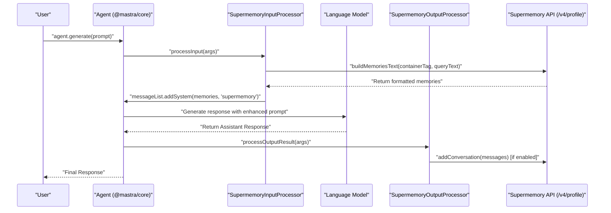
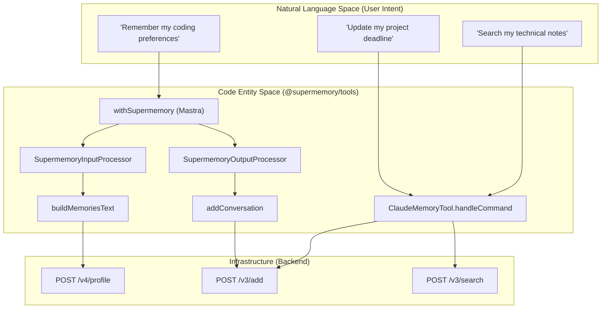

<!-- source: DeepWiki mcp.deepwiki.com · repo supermemoryai/supermemory · page 4.4 Mastra & Claude Memory Integration · fetched 2026-10-30 -->

# Mastra & Claude Memory Integration

Relevant source files

The following files were used as context for generating this wiki page:

- [apps/docs/integrations/mastra.mdx](apps/docs/integrations/mastra.mdx)
- [apps/docs/memory-api/sdks/anthropic-claude-memory.mdx](apps/docs/memory-api/sdks/anthropic-claude-memory.mdx)
- [packages/tools/src/claude-memory-simple-example.ts](packages/tools/src/claude-memory-simple-example.ts)
- [packages/tools/src/claude-memory.test.ts](packages/tools/src/claude-memory.test.ts)
- [packages/tools/src/claude-memory.ts](packages/tools/src/claude-memory.ts)
- [packages/tools/src/mastra/processor.ts](packages/tools/src/mastra/processor.ts)
- [packages/tools/src/mastra/types.ts](packages/tools/src/mastra/types.ts)
- [packages/tools/src/mastra/wrapper.ts](packages/tools/src/mastra/wrapper.ts)
- [packages/tools/test/anthropic-example.ts](packages/tools/test/anthropic-example.ts)
- [packages/tools/test/claude-memory-examples.ts](packages/tools/test/claude-memory-examples.ts)
- [packages/tools/test/claude-memory-real-example.ts](packages/tools/test/claude-memory-real-example.ts)
- [packages/tools/test/claude-memory.test.ts](packages/tools/test/claude-memory.test.ts)
- [packages/tools/test/mastra/integration.test.ts](packages/tools/test/mastra/integration.test.ts)
- [packages/tools/test/mastra/unit.test.ts](packages/tools/test/mastra/unit.test.ts)

This page documents the specialized integrations for the Mastra agent framework and the native Claude memory tool within the `@supermemory/tools` package. These integrations provide deep, framework-specific hooks for memory retrieval and persistence, differing from the generic middleware approach used for the Vercel AI SDK.

## Mastra Agent Integration

The Mastra integration leverages Mastra's native `Processor` architecture to intercept agent inputs and outputs. This allows for seamless memory injection and automatic conversation saving without manual tool calls.

### Core Components

The integration is primarily defined within the `packages/tools/src/mastra/` directory.

1.  **`withSupermemory`**: A high-order function that wraps a Mastra `AgentConfig`. It automatically attaches both input and output processors to the agent configuration [packages/tools/src/mastra/wrapper.ts:69-111]().
2.  **`SupermemoryInputProcessor`**: An `InputProcessor` that fetches relevant memories from Supermemory before LLM calls. It utilizes `buildMemoriesText` to retrieve context based on the chosen `MemoryMode` (`profile`, `query`, or `full`) and injects them into the system prompt [packages/tools/src/mastra/processor.ts:128-202]().
3.  **`SupermemoryOutputProcessor`**: An `OutputProcessor` that runs after the LLM responds. If `addMemory` is set to `"always"`, it saves the resulting conversation back to Supermemory using the `addConversation` client [packages/tools/src/mastra/processor.ts:231-285]().
4.  **`createSupermemoryProcessors`**: A utility function to create both processors simultaneously for manual configuration [packages/tools/src/mastra/index.ts:1-20]().

### Data Flow in Mastra

The following diagram illustrates how Supermemory interacts with the Mastra agent lifecycle via the processor pipeline.

**Mastra Agent Memory Lifecycle**

Sources: [apps/docs/integrations/mastra.mdx:75-94](), [packages/tools/src/mastra/processor.ts:138-194](), [packages/tools/src/mastra/processor.ts:241-260]()

### Configuration Options

The Mastra integration uses `SupermemoryMastraOptions` [packages/tools/src/mastra/types.ts:37-54]():

| Option | Type | Description |
| :--- | :--- | :--- |
| `containerTag` | `string` | **Required**. Scopes memories to a specific user or project [packages/tools/src/mastra/types.ts:39-39](). |
| `customId` | `string` | **Required**. Groups messages into a single document for contextual memory [packages/tools/src/mastra/types.ts:41-41](). |
| `mode` | `"profile" \| "query" \| "full"` | Memory retrieval mode (default: `"profile"`) [packages/tools/src/mastra/types.ts:47-47](). |
| `addMemory` | `"always" \| "never"` | Controls auto-saving of conversations (default: `"always"`) [packages/tools/src/mastra/types.ts:49-49](). |
| `promptTemplate` | `PromptTemplate` | Custom function to format memory data into the system prompt [packages/tools/src/mastra/types.ts:53-53](). |

Sources: [packages/tools/src/mastra/types.ts:37-54](), [apps/docs/integrations/mastra.mdx:98-110]()

---

## Claude Native Memory Tool

The Claude Native Memory integration uses the Anthropic `memory_20250818` tool type. This allows Claude to manage its own long-term memory via file-like operations, acting as a "thinking" memory rather than just static context injection.

### Key Components

*   **`ClaudeMemoryTool`**: A class that maps Claude's filesystem-style commands (`view`, `create`, `str_replace`, `insert`, `delete`, `rename`) to Supermemory document operations [packages/tools/src/claude-memory.ts:44-145]().
*   **`createClaudeMemoryTool`**: Factory function to initialize the tool with specific configuration like `memoryContainerTag` [packages/tools/src/claude-memory.ts:1084-1093]().
*   **Path Normalization**: The tool converts virtual paths (e.g., `/memories/notes.txt`) into Supermemory `customId` strings (e.g., `memories_notes_txt`) for persistent storage [packages/tools/src/claude-memory.ts:53-58]().

### Integration Logic

The Claude integration uses a tool-calling loop:

1.  **Tool Definition**: The model is provided with a tool named `memory` of type `memory_20250818` [packages/tools/test/claude-memory-real-example.ts:94-99]().
2.  **Explicit Command Execution**: When Claude emits a `tool_use` block, the `handleCommand` method executes the specific operation [packages/tools/src/claude-memory.ts:77-138]().
3.  **Line-Range Support**: The `view` command supports `view_range` parameters. An end range of `-1` is handled as "read to end of file" [packages/tools/src/claude-memory.test.ts:41-57]().
4.  **Formatting**: Responses to Claude are formatted as `MemoryToolResult` objects containing `tool_use_id`, `content`, and `is_error` status [packages/tools/src/claude-memory.ts:150-164]().

---

## Comparison of Integration Strategies

| Feature | Vercel AI SDK (`withSupermemory`) | Mastra (`withSupermemory`) | Claude Tool (`ClaudeMemoryTool`) |
| :--- | :--- | :--- | :--- |
| **Mechanism** | Higher-order Model / Proxy | Input/Output Processors | Native Tool Calling (Filesystem) |
| **Control** | Automatic injection | Automatic injection | Model-driven (decides when to read/write) |
| **Persistence** | Auto-saves turns | `SupermemoryOutputProcessor` | Manual `create`/`str_replace` by model |
| **Primary File** | `src/ai-sdk.ts` | `src/mastra/wrapper.ts` | `src/claude-memory.ts` |

### Architecture: Code Entity Space to Natural Language Space

This diagram shows how specific code entities in the `packages/tools` package map to the user's conceptual experience of "Memory".

**Memory Integration Architecture**

Sources: [packages/tools/src/mastra/processor.ts:176-184](), [packages/tools/src/claude-memory.ts:87-138](), [packages/tools/src/mastra/wrapper.ts:88-109]()

### Implementation Detail: Path-to-Memory Mapping

Claude interacts with memory as if it were a filesystem. The `ClaudeMemoryTool` translates these intents into Supermemory API calls:

| Claude Intent | MemoryCommand | Supermemory Action |
| :--- | :--- | :--- |
| List files | `view` (path: `/memories/`) | `client.search.execute` with `q: "*"` and prefix filtering [packages/tools/src/claude-memory.ts:187-195]() |
| Read file | `view` (path: `/file.txt`) | `client.search.execute` for specific `documentId` [packages/tools/src/claude-memory.ts:253-260]() |
| Save fact | `create` | `client.add` with normalized `customId` [packages/tools/src/claude-memory.ts:90-97]() |
| Update fact | `str_replace` | Fetch content, replace string, then `client.add` [packages/tools/src/claude-memory.ts:98-109]() |

Sources: [packages/tools/src/claude-memory.ts:87-138](), [packages/tools/src/claude-memory.test.ts:24-30]()

---

