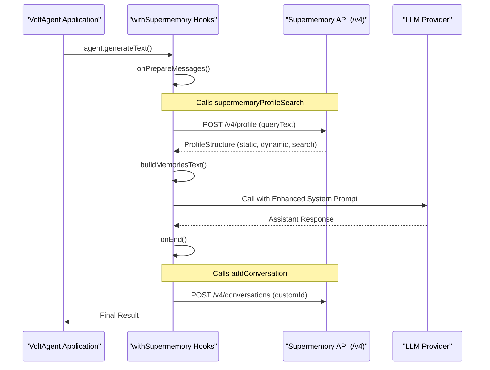
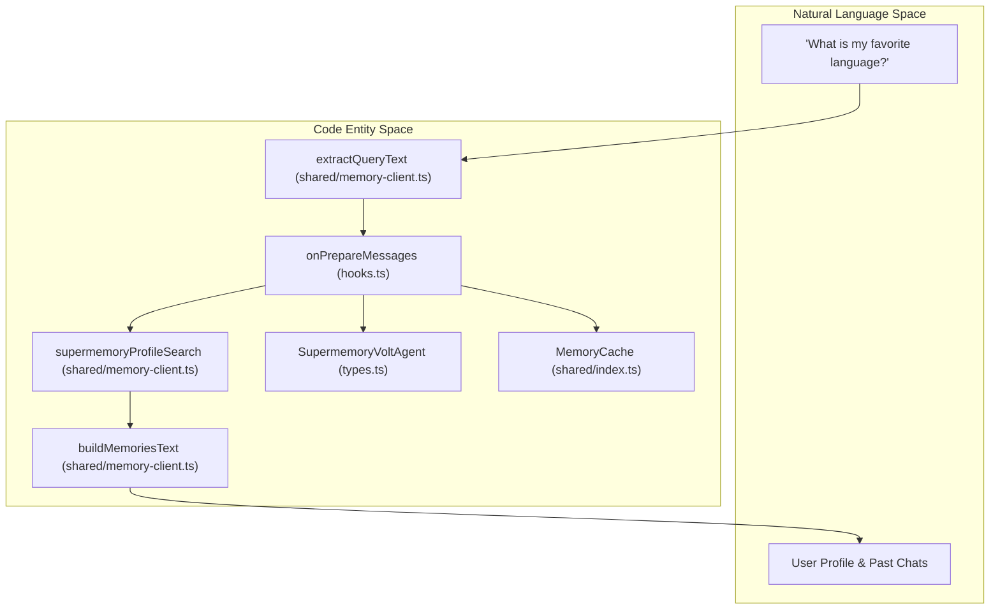
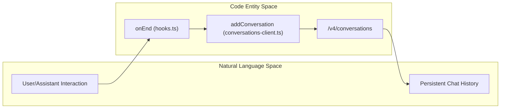

<!-- source: DeepWiki mcp.deepwiki.com · repo supermemoryai/supermemory · page 4.5 VoltAgent Integration · fetched 2026-10-30 -->

# VoltAgent Integration

Relevant source files

The following files were used as context for generating this wiki page:

- [apps/docs/ai-sdk/overview.mdx](apps/docs/ai-sdk/overview.mdx)
- [apps/docs/ai-sdk/user-profiles.mdx](apps/docs/ai-sdk/user-profiles.mdx)
- [apps/docs/integrations/ai-sdk.mdx](apps/docs/integrations/ai-sdk.mdx)
- [apps/docs/integrations/openai.mdx](apps/docs/integrations/openai.mdx)
- [apps/docs/integrations/voltagent.mdx](apps/docs/integrations/voltagent.mdx)
- [apps/docs/migration/tools-v2-upgrade.mdx](apps/docs/migration/tools-v2-upgrade.mdx)
- [packages/tools/src/conversations-client.ts](packages/tools/src/conversations-client.ts)
- [packages/tools/src/index.ts](packages/tools/src/index.ts)
- [packages/tools/src/shared/memory-client.ts](packages/tools/src/shared/memory-client.ts)
- [packages/tools/src/shared/types.ts](packages/tools/src/shared/types.ts)
- [packages/tools/src/voltagent/hooks.ts](packages/tools/src/voltagent/hooks.ts)
- [packages/tools/src/voltagent/index.ts](packages/tools/src/voltagent/index.ts)
- [packages/tools/src/voltagent/middleware.ts](packages/tools/src/voltagent/middleware.ts)
- [packages/tools/src/voltagent/types.ts](packages/tools/src/voltagent/types.ts)
- [packages/tools/tsdown.config.ts](packages/tools/tsdown.config.ts)

Supermemory integrates with [VoltAgent](https://github.com/VoltAgent/voltagent) to provide long-term memory capabilities through a middleware-like hook system. This integration allows agents to automatically retrieve relevant user history and persist new conversation turns as memories.

## Overview

The VoltAgent integration is centered around the `withSupermemory` wrapper, which enhances a standard VoltAgent `AgentConfig` by injecting memory retrieval and storage logic into the agent's lifecycle hooks: `onPrepareMessages` and `onEnd` [packages/tools/src/voltagent/types.ts:165-172]().

### Key Differences from Vercel AI SDK
Unlike the Vercel AI SDK integration which uses a middleware pattern to intercept low-level provider calls [apps/docs/ai-sdk/user-profiles.mdx:39-44](), the VoltAgent integration operates at the **Agent level** using hooks [packages/tools/src/voltagent/types.ts:4-5](). 

*   **Vercel AI SDK**: Intercepts `generateText`/`streamText` at the model provider level [apps/docs/ai-sdk/user-profiles.mdx:22-26]().
*   **VoltAgent**: Intercepts the agent's message preparation phase (`onPrepareMessages`) and completion phase (`onEnd`) [apps/docs/integrations/voltagent.mdx:79-90]().

## Implementation & Data Flow

The integration follows a two-step process: context initialization and hook execution.

### 1. Context Initialization
The `createSupermemoryContext` function validates required parameters like `containerTag` and `customId`, initializes the `Supermemory` client, and sets up a `MemoryCache` to prevent redundant API calls during multi-turn interactions [packages/tools/src/voltagent/middleware.ts:67-134](). It also normalizes the `baseUrl` and prepares the logger [packages/tools/src/voltagent/middleware.ts:103-111]().

### 2. Lifecycle Hooks
The integration implements two primary hooks via `createSupermemoryProcessors` [packages/tools/src/voltagent/middleware.ts:316-353]():
*   **`onPrepareMessages`**: Triggered before the LLM call. It extracts the last user message using `getLastUserMessage`, searches Supermemory for relevant context (static/dynamic profiles or semantic search) via `enhanceMessagesWithMemories`, and injects the results into the system prompt [packages/tools/src/voltagent/middleware.ts:196-229]().
*   **`onEnd`**: Triggered after a successful agent response. If `addMemory` is set to `"always"` (the default for VoltAgent [packages/tools/src/voltagent/middleware.ts:81]()), it sends the updated conversation thread to the `/v4/conversations` endpoint using the `addConversation` client [packages/tools/src/voltagent/middleware.ts:316-353]().

### Data Flow Diagram

The following diagram illustrates how the `withSupermemory` wrapper orchestrates data between the VoltAgent lifecycle and the Supermemory API.

**VoltAgent Integration Data Flow**

Sources: [packages/tools/src/voltagent/middleware.ts:196-353](), [packages/tools/src/shared/memory-client.ts:24-65](), [packages/tools/src/conversations-client.ts:73-102]()

## Key Functions and Classes

### `withSupermemory`
The primary entry point. It takes a `SupermemoryVoltAgent` configuration and returns a modified `VoltAgentConfig` with pre-configured hooks [apps/docs/integrations/voltagent.mdx:34-50]().

### `createSupermemoryProcessors`
Internal utility used to generate the `onPrepareMessages` and `onEnd` logic. It leverages `enhanceMessagesWithMemories` for retrieval and `addConversation` for storage [packages/tools/src/voltagent/middleware.ts:316-353]().

### Configuration Interface: `SupermemoryVoltAgent`
This interface extends base options with VoltAgent-specific search and storage parameters.

| Parameter | Type | Role |
| :--- | :--- | :--- |
| `containerTag` | `string` | **Required**. Scopes memories to a specific user or workspace [packages/tools/src/voltagent/types.ts:20-25](). |
| `customId` | `string` | **Required**. Groups messages into a single document/thread [packages/tools/src/voltagent/types.ts:25](). |
| `mode` | `MemoryMode` | Retrieval strategy: `profile`, `query`, or `full` [packages/tools/src/voltagent/types.ts:98-111](). |
| `searchMode` | `string` | Filters results by `memories`, `documents`, or `hybrid` [packages/tools/src/voltagent/types.ts:81-88](). |
| `addMemory` | `AddMemoryMode` | Defaults to `"always"` to persist conversations [packages/tools/src/voltagent/middleware.ts:81](). |
| `entityContext`| `string` | Guides memory extraction during conversation saving [packages/tools/src/voltagent/types.ts:90-96](). |

Sources: [packages/tools/src/voltagent/types.ts:20-97](), [packages/tools/src/voltagent/middleware.ts:78-92]()

## Code Entity Space Mapping

The following diagrams bridge the conceptual middleware components to the specific code entities in the `@supermemory/tools` package.

**Memory Retrieval Entity Map**

Sources: [packages/tools/src/voltagent/hooks.ts](), [packages/tools/src/voltagent/types.ts:20-97](), [packages/tools/src/shared/memory-client.ts:88-175](), [packages/tools/src/shared/memory-client.ts:197-241]()

**Conversation Storage Entity Map**

Sources: [packages/tools/src/voltagent/hooks.ts](), [packages/tools/src/conversations-client.ts:73-102](), [packages/tools/src/voltagent/middleware.ts:316-353]()

## Advanced Search Configuration

VoltAgent integration supports advanced search parameters that are passed directly to the Supermemory API via `supermemoryProfileSearch` [packages/tools/src/shared/memory-client.ts:24-30](). Note that these are only effective when `mode` is set to `"query"` or `"full"`; they are ignored in `"profile"` mode [packages/tools/src/voltagent/middleware.ts:249-254]().

*   **`threshold`**: Controls similarity sensitivity (0.0 to 1.0). Default is 0.1 [packages/tools/src/voltagent/types.ts:34]().
*   **`rerank`**: If `true`, uses a reranking model to improve relevance [packages/tools/src/voltagent/types.ts:49]().
*   **`rewriteQuery`**: Uses AI to expand the user query for better semantic matching [packages/tools/src/voltagent/types.ts:57]().
*   **`filters`**: Supports complex boolean logic (`AND`/`OR`) on memory metadata [packages/tools/src/voltagent/types.ts:65]().
*   **`include`**: Control inclusion of `chunks`, `documents`, `summaries`, or `relatedMemories` [packages/tools/src/voltagent/types.ts:107-134]().

Sources: [packages/tools/src/voltagent/types.ts:27-72](), [packages/tools/src/voltagent/middleware.ts:238-254](), [packages/tools/src/shared/memory-client.ts:24-65]()

---

