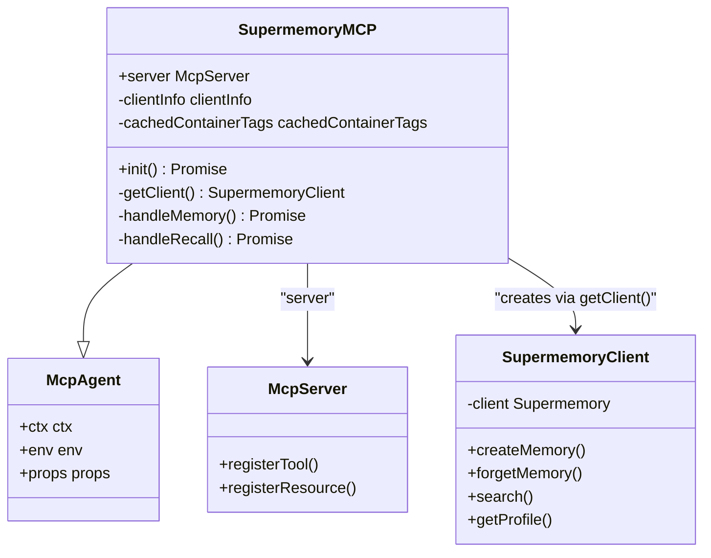
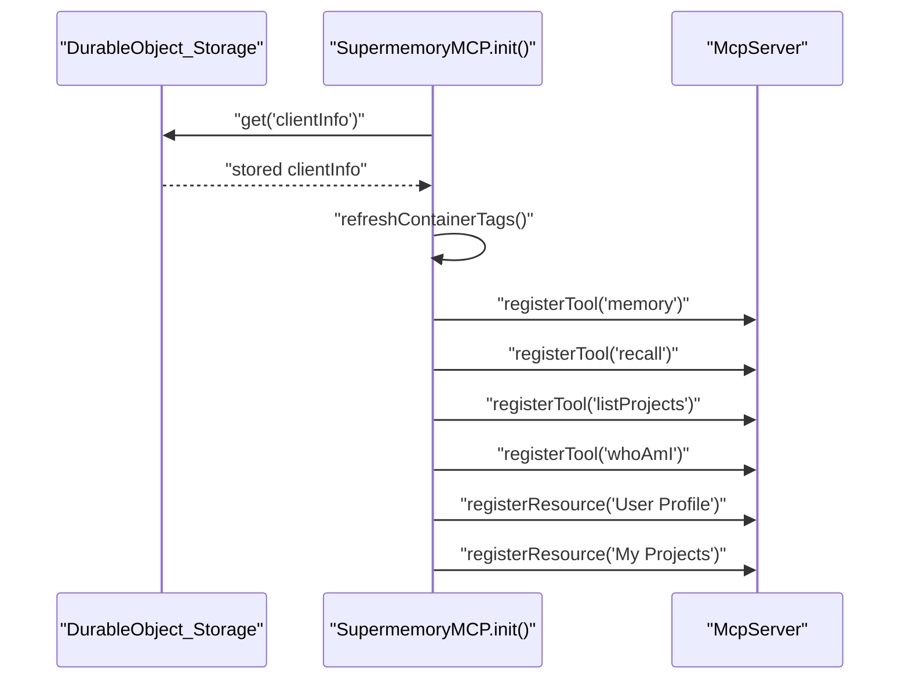

<!-- source: DeepWiki mcp.deepwiki.com · repo supermemoryai/supermemory · page 5 MCP Server · fetched 2026-10-30 -->

# MCP Server

<details>
<summary>Relevant source files</summary>

The following files were used as context for generating this wiki page:

- [CLAUDE.md](CLAUDE.md)
- [apps/mcp/.dev.vars.example](apps/mcp/.dev.vars.example)
- [apps/mcp/.gitignore](apps/mcp/.gitignore)
- [apps/mcp/mcp-app.html](apps/mcp/mcp-app.html)
- [apps/mcp/src/auth.ts](apps/mcp/src/auth.ts)
- [apps/mcp/src/client.ts](apps/mcp/src/client.ts)
- [apps/mcp/src/format.ts](apps/mcp/src/format.ts)
- [apps/mcp/src/html.d.ts](apps/mcp/src/html.d.ts)
- [apps/mcp/src/index.ts](apps/mcp/src/index.ts)
- [apps/mcp/src/posthog.ts](apps/mcp/src/posthog.ts)
- [apps/mcp/src/server.ts](apps/mcp/src/server.ts)
- [apps/mcp/src/ui/global.css](apps/mcp/src/ui/global.css)
- [apps/mcp/src/ui/mcp-app.css](apps/mcp/src/ui/mcp-app.css)
- [apps/mcp/src/ui/mcp-app.ts](apps/mcp/src/ui/mcp-app.ts)
- [apps/mcp/tsconfig.json](apps/mcp/tsconfig.json)
- [apps/mcp/vite.config.ts](apps/mcp/vite.config.ts)
- [apps/mcp/wrangler.jsonc](apps/mcp/wrangler.jsonc)
- [apps/web/components/chat/chat-graph-context-rail.tsx](apps/web/components/chat/chat-graph-context-rail.tsx)
- [apps/web/lib/chat-auto-space.ts](apps/web/lib/chat-auto-space.ts)

</details>


This page covers the `apps/mcp` Cloudflare Worker that implements a [Model Context Protocol (MCP)](https://modelcontextprotocol.io) server, giving AI assistants persistent memory via the Supermemory API. It describes the server's architecture, registered tools and resources, authentication model, and session mechanics.

For how end users connect their AI clients to the MCP server, see [Setup & Installation](#5.1). For the individual MCP tools, resources, and prompts in detail, see [Tools, Resources & Prompts](#5.2). For the authentication and session model, see [Authentication & Session Management](#5.3). For how the web application exposes the MCP connection wizard, see [Integrations & Connections](#2.5).

---

## Role in the System

The MCP server is the bridge between MCP-compatible AI clients (Cursor, Claude Desktop, VS Code, Windsurf, etc.) and the Supermemory memory API. AI clients call it during conversations to save and recall user memories without the client application needing to implement memory logic directly. It is built as a Cloudflare Worker using Durable Objects to maintain session state.

**System placement diagram:**

```mermaid
graph TD
  subgraph "External_AI_Clients"
    ["AI_Client"]
  end

  subgraph "apps/mcp_(Cloudflare_Worker)"
    ["index.ts"]
    ["SupermemoryMCP"]
    ["DurableObject_Storage"]
    ["SupermemoryClient"]
  end

  subgraph "Backend"
    ["Supermemory_REST_API"]
  end

  ["AI_Client"] -->|"MCP protocol"| ["index.ts"]
  ["index.ts"] -->|"mounts"| ["SupermemoryMCP"]
  ["SupermemoryMCP"] -->|"session storage"| ["DurableObject_Storage"]
  ["SupermemoryMCP"] -->|"instantiates"| ["SupermemoryClient"]
  ["SupermemoryClient"] -->|"SDK calls"| ["Supermemory_REST_API"]
```

Sources: [apps/mcp/src/server.ts:32-40](), [apps/mcp/src/index.ts:119-191](), [apps/mcp/wrangler.jsonc:23-30]()

---

## Architecture

The server utilizes the `@modelcontextprotocol/sdk` and a custom `McpAgent` base class from the `agents/mcp` package to handle the protocol lifecycle. It uses a `SupermemoryClient` wrapper around the core `supermemory` SDK to interface with the backend.

**Class and dependency diagram:**



Sources: [apps/mcp/src/server.ts:32-40](), [apps/mcp/src/client.ts:129-147](), [apps/mcp/src/server.ts:1-2]()

### Key Types

| Type | Location | Purpose |
|---|---|---|
| `Env` | `apps/mcp/src/server.ts:14-18` | Cloudflare Worker bindings: `MCP_SERVER`, `API_URL`, `POSTHOG_API_KEY` |
| `Props` | `apps/mcp/src/server.ts:20-26` | Per-session user data injected by auth: `userId`, `apiKey`, `containerTag`, `email`, `name` |
| `SupermemoryMCP` | `apps/mcp/src/server.ts:32` | Main Durable Object class; handles tool/resource registration and execution |

Sources: [apps/mcp/src/server.ts:14-32]()

---

## Initialization Flow

The `init()` method on `SupermemoryMCP` runs once per DurableObject session. It restores client info from durable storage, initializes analytics via PostHog, and registers all tools and resources.

**Initialization sequence:**



Sources: [apps/mcp/src/server.ts:42-131](), [apps/mcp/src/server.ts:133-253](), [apps/mcp/src/server.ts:256-277]()

---

## Registered Tools

Tools are the primary way AI assistants interact with Supermemory.

### `memory`
Saves or forgets information. Uses `SupermemoryClient.createMemory` or `SupermemoryClient.forgetMemory`.
- **Action**: `save` (default) or `forget`.
- **Content**: The text to remember/remove (up to 200,000 characters).
- **Container**: Scoped to `containerTag` if provided.

Sources: [apps/mcp/src/server.ts:109-118](), [apps/mcp/src/client.ts:150-169](), [apps/mcp/src/client.ts:172-239]()

### `recall`
Searches memories. Uses `SupermemoryClient.search` or `SupermemoryClient.getProfile`.
- **Query**: Semantic search string.
- **includeProfile**: Boolean to toggle user preference context.

Sources: [apps/mcp/src/server.ts:121-130](), [apps/mcp/src/client.ts:242-284]()

### `listProjects`
Discovers valid project names (container tags) for the user to help assistants organize memories correctly.
Sources: [apps/mcp/src/server.ts:193-253]()

### `whoAmI`
Returns current session info, including `userId`, `email`, and `sessionId`.
Sources: [apps/mcp/src/server.ts:256-286]()

---

## Registered Resources

Resources provide static or dynamic data as URI-addressable entities.

| Resource Name | URI | Format | Description |
|---|---|---|---|
| `User Profile` | `supermemory://profile` | `text/plain` | Formatted markdown of stable preferences and recent activity. |
| `My Projects` | `supermemory://projects` | `application/json` | JSON list of user projects and container tags. |

Sources: [apps/mcp/src/server.ts:133-190]()

---

## Interactive Visualization

The MCP server includes a built-in interactive memory graph visualization. This is served as a single-file HTML application embedded within the server package via `mcp-app.html`.

- **Implementation**: The server imports `mcpAppHtml` [apps/mcp/src/server.ts:12]() and exposes it for client-side rendering.
- **Client UI**: The UI logic in `apps/mcp/src/ui/mcp-app.ts` uses `force-graph` to render a 2D/3D force-directed graph [apps/mcp/src/ui/mcp-app.ts:12]().
- **Integration**: In the web application, `ChatGraphContextRail` uses the `MemoryGraph` component to show memories used by the AI assistant (Nova) during chat [apps/web/components/chat/chat-graph-context-rail.tsx:12-63]().

**Graph Entity Mapping:**

```mermaid
graph LR
  subgraph "Code_Entity_Space"
    [DocumentNode]
    [MemoryNode]
    [GraphLink]
  end

  subgraph "Visual_Space"
    ["Blue_Circle"]
    ["Hexagon"]
    ["Dashed_Line"]
  end

  [DocumentNode] ---|"renders as"| ["Blue_Circle"]
  [MemoryNode] ---|"renders as"| ["Hexagon"]
  [GraphLink] ---|"renders as"| ["Dashed_Line"]
```

Sources: [apps/mcp/src/ui/mcp-app.ts:60-90](), [apps/mcp/mcp-app.html:50-89]()

---

## Authentication & Routing

The `apps/mcp/src/index.ts` file uses `Hono` to route incoming MCP requests and handle authentication.

1. **Discovery**: Implements `/.well-known/oauth-protected-resource` for MCP client discovery of the authorization server [apps/mcp/src/index.ts:69-81]().
2. **Auth Validation**: Intercepts requests to `/mcp/*`, validating either a Bearer API key (checked via `isApiKey`) or an OAuth token [apps/mcp/src/index.ts:145-151]().
3. **Context Injection**: After validation, it populates `Props` (userId, apiKey, containerTag, etc.) and forwards the request to the `SupermemoryMCP` Durable Object [apps/mcp/src/index.ts:179-192]().

Sources: [apps/mcp/src/index.ts:119-192](), [apps/mcp/src/auth.ts:1-10]()

---

## Analytics

The server integrates with PostHog to track tool usage and session metrics.

- **Initialization**: `initPosthog` is called with `POSTHOG_API_KEY` from environment bindings [apps/mcp/src/server.ts:51]().
- **Client Capture**: Hooks `oninitialized` to capture and store the MCP client name and version in Durable Object storage [apps/mcp/src/server.ts:54-63]().
- **Events**: The server tracks interactions via the `posthog` instance.

Sources: [apps/mcp/src/posthog.ts:14-25](), [apps/mcp/src/server.ts:51-63]()

---

