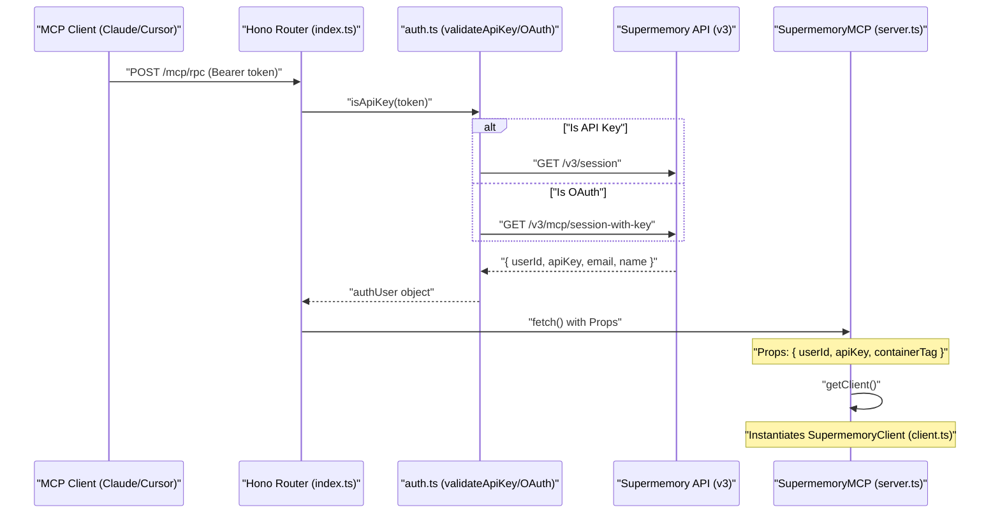
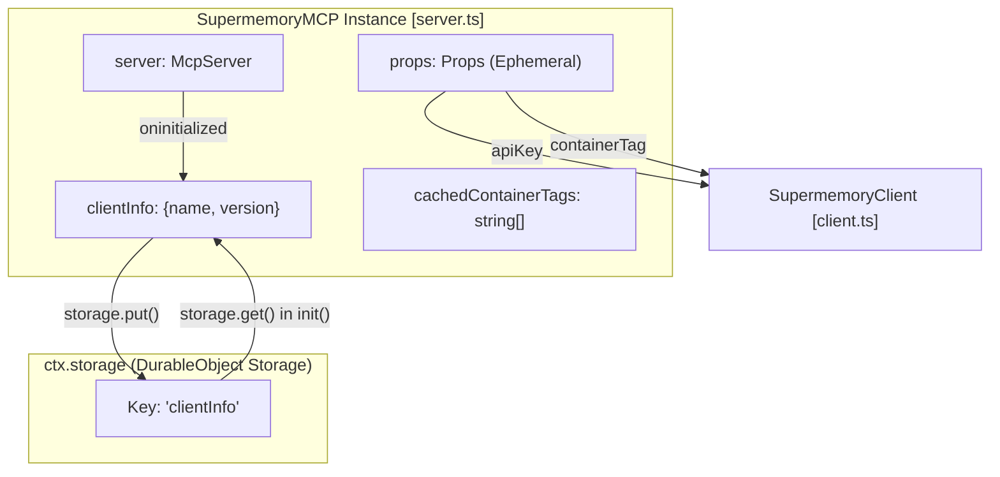

<!-- source: DeepWiki mcp.deepwiki.com · repo supermemoryai/supermemory · page 5.3 Authentication & Session Management · fetched 2026-10-30 -->

# Authentication & Session Management

Relevant source files

The following files were used as context for generating this wiki page:

- [CLAUDE.md](CLAUDE.md)
- [apps/mcp/.dev.vars.example](apps/mcp/.dev.vars.example)
- [apps/mcp/.gitignore](apps/mcp/.gitignore)
- [apps/mcp/README.md](apps/mcp/README.md)
- [apps/mcp/e2e/auth.test.ts](apps/mcp/e2e/auth.test.ts)
- [apps/mcp/e2e/capture-oauth-token.ts](apps/mcp/e2e/capture-oauth-token.ts)
- [apps/mcp/e2e/discovery.test.ts](apps/mcp/e2e/discovery.test.ts)
- [apps/mcp/e2e/graph.test.ts](apps/mcp/e2e/graph.test.ts)
- [apps/mcp/e2e/helpers.ts](apps/mcp/e2e/helpers.ts)
- [apps/mcp/e2e/memory.test.ts](apps/mcp/e2e/memory.test.ts)
- [apps/mcp/e2e/oauth.test.ts](apps/mcp/e2e/oauth.test.ts)
- [apps/mcp/e2e/root-scope.test.ts](apps/mcp/e2e/root-scope.test.ts)
- [apps/mcp/mcp-app.html](apps/mcp/mcp-app.html)
- [apps/mcp/package.json](apps/mcp/package.json)
- [apps/mcp/src/auth.ts](apps/mcp/src/auth.ts)
- [apps/mcp/src/client.ts](apps/mcp/src/client.ts)
- [apps/mcp/src/format.ts](apps/mcp/src/format.ts)
- [apps/mcp/src/html.d.ts](apps/mcp/src/html.d.ts)
- [apps/mcp/src/index.ts](apps/mcp/src/index.ts)
- [apps/mcp/src/posthog.ts](apps/mcp/src/posthog.ts)
- [apps/mcp/src/server.ts](apps/mcp/src/server.ts)
- [apps/mcp/src/ui/global.css](apps/mcp/src/ui/global.css)
- [apps/mcp/src/ui/mcp-app.css](apps/mcp/src/ui/mcp-app.css)
- [apps/mcp/src/ui/mcp-app.ts](apps/mcp/src/ui/mcp-app.ts)
- [apps/mcp/tsconfig.json](apps/mcp/tsconfig.json)
- [apps/mcp/vite.config.ts](apps/mcp/vite.config.ts)
- [apps/mcp/vitest.config.ts](apps/mcp/vitest.config.ts)
- [apps/mcp/wrangler.jsonc](apps/mcp/wrangler.jsonc)
- [apps/web/components/chat/chat-graph-context-rail.tsx](apps/web/components/chat/chat-graph-context-rail.tsx)
- [apps/web/lib/chat-auto-space.ts](apps/web/lib/chat-auto-space.ts)

This page documents the authentication mechanisms and session management implementation within the Supermemory MCP server. The server supports a dual-authentication strategy using both API keys and OAuth 2.0, with session state persisted via Cloudflare Durable Objects to provide stable, stateful connections for AI assistants.

**Sources:** [apps/mcp/src/index.ts:1-178](), [apps/mcp/src/server.ts:27-60]()

## Overview

The MCP server acts as a stateful bridge between MCP clients (like Claude Desktop or Cursor) and the Supermemory API. Authentication is handled at the edge by a Hono router before requests are forwarded to a dedicated Durable Object instance that manages the protocol state. The server is deployed as a Cloudflare Worker using the `SupermemoryMCP` Durable Object class to maintain persistent state for MCP sessions.

**Sources:** [apps/mcp/src/index.ts:119-198](), [apps/mcp/wrangler.jsonc:23-37]()

## Authentication Mechanisms

### API Key Authentication
API keys are the primary method for programmatic or manual configuration. They are identified by the `sm_` prefix via the `isApiKey` utility. When a request includes an `Authorization: Bearer sm_...` header, the server uses `validateApiKey` to verify the credential against the Supermemory API `/v3/session` endpoint.

**Sources:** [apps/mcp/src/index.ts:145-147](), [apps/mcp/src/auth.ts:25-90]()

### OAuth 2.0 Discovery
For interactive clients, the server implements the MCP OAuth discovery specification. It exposes a `.well-known/oauth-protected-resource` endpoint that directs clients to `api.supermemory.ai` for authorization. If a client looks for the authorization server on the MCP domain directly, a proxy endpoint at `.well-known/oauth-authorization-server` fetches metadata from the main API.

**Sources:** [apps/mcp/src/index.ts:69-107]()

### Validation Logic
Both authentication paths resolve to an `authUser` object containing the user's ID and an API key used for subsequent data operations.

| Method | Detection | API Endpoint | Result |
| :--- | :--- | :--- | :--- |
| **API Key** | Starts with `sm_` | `/v3/session` | Validates existing key |
| **OAuth** | No `sm_` prefix | `/v3/mcp/session-with-key` | Exchanges token for API key |

**Sources:** [apps/mcp/src/index.ts:138-151](), [apps/mcp/src/auth.ts:92-161]()

## Request Flow & Data Mapping

The following diagram illustrates how natural language requests from an AI assistant are authenticated and mapped to internal code entities.

**Authentication and Entity Mapping Diagram**

**Sources:** [apps/mcp/src/index.ts:119-192](), [apps/mcp/src/auth.ts:1-161](), [apps/mcp/src/server.ts:362-376]()

## Session Management with Durable Objects

The `SupermemoryMCP` class (extending `McpAgent`) manages the lifecycle of an MCP session. It utilizes Cloudflare Durable Object storage to persist metadata about the connecting client.

### Client Information Storage
During the MCP initialization handshake, the server captures the client's name and version using `this.server.server.oninitialized`. This information is persisted in the Durable Object's storage via `this.ctx.storage.put`. On subsequent loads, `init()` restores this from storage.

**Sources:** [apps/mcp/src/server.ts:42-63](), [apps/mcp/wrangler.jsonc:23-29]()

### Durable Object State Diagram

**Sources:** [apps/mcp/src/server.ts:32-63](), [apps/mcp/src/server.ts:362-376]()

## Container Tag Scoping

The `containerTag` (or Project ID) determines the scope of memories and documents accessible during a session.

### Scoping Priority
1.  **Tool Argument:** A `containerTag` explicitly passed to a tool (e.g., `recall`) overrides all other settings. [apps/mcp/src/server.ts:86-93]()
2.  **Session Header:** The `x-sm-project` HTTP header sets a session-wide default stored in `this.props.containerTag`. [apps/mcp/src/index.ts:122](), [apps/mcp/src/index.ts:185]()
3.  **Global Default:** If neither is provided, the `SupermemoryClient` defaults to `sm_project_default`. [apps/mcp/src/client.ts:4](), [apps/mcp/src/client.ts:146]()

### Dynamic Schema Adjustment
The server dynamically adjusts Zod schemas based on whether a `containerTag` was provided at the session level. If `hasRootContainerTag` is true, the `containerTag` field is omitted from tool schemas to prevent the AI from overriding the user-defined project scope.

**Sources:** [apps/mcp/src/server.ts:67-84]()

## Project Caching & Refreshing

To minimize API calls, the MCP server caches the list of available projects (container tags) for a specific user.

*   **Cache Duration:** Controlled by `CONTAINER_TAGS_TTL_MS`, set to 5 minutes. [apps/mcp/src/server.ts:28-28]()
*   **Freshness Check:** The `ensureContainerTagsFresh` method checks if the cache has expired and triggers a refresh if needed. [apps/mcp/src/server.ts:430-438]()
*   **Manual Refresh:** The `listProjects` tool allows users to force a refresh by passing a `refresh: true` argument. [apps/mcp/src/server.ts:193-212]()

**Sources:** [apps/mcp/src/server.ts:28-28](), [apps/mcp/src/server.ts:430-448]()

## Error Handling & Status Mapping

The authentication layer maps Supermemory API error codes to human-readable messages for the MCP client.

| Status Code | Internal Mapping | User-Facing Message |
| :--- | :--- | :--- |
| **401** | Unauthorized | "Invalid or expired API key/token" |
| **402** | Payment Required | "Memory limit reached. Upgrade at supermemory.ai" |
| **429** | Too Many Requests | "Rate limit exceeded. Please wait a moment" |
| **500+** | Server Error | "Server error. Service may be temporarily unavailable" |

**Sources:** [apps/mcp/src/auth.ts:36-59](), [apps/mcp/src/auth.ts:108-130]()

If authentication fails in the Hono middleware, the server returns a JSON-RPC error response with code `-32000` and includes a `WWW-Authenticate` header pointing to the resource metadata URL for discovery.

**Sources:** [apps/mcp/src/index.ts:158-177]()

---

