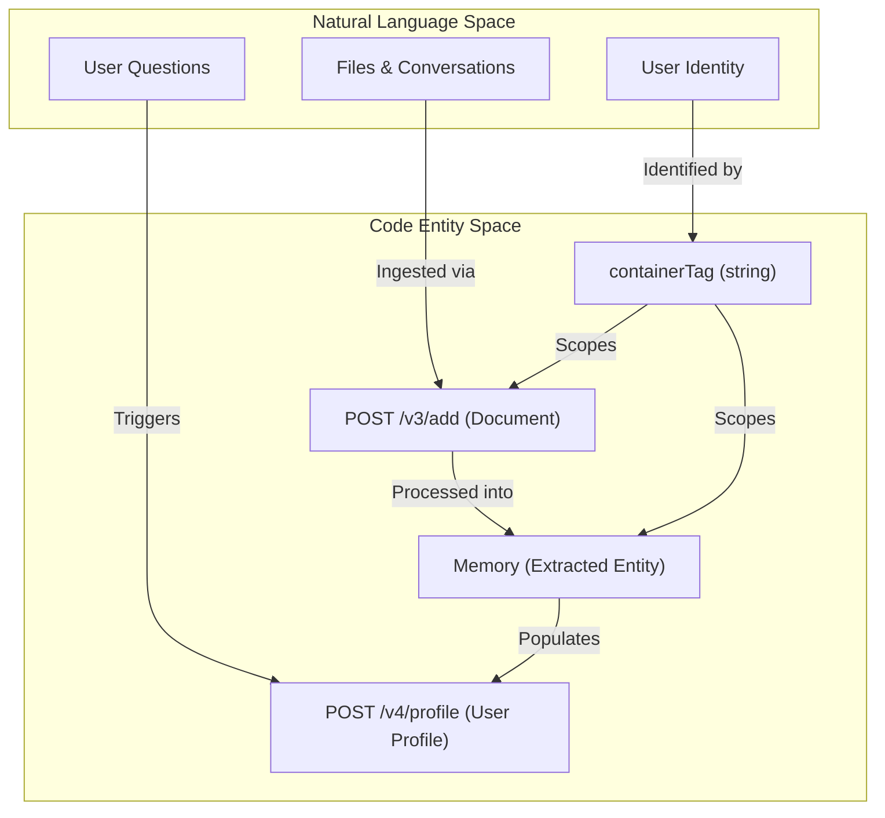
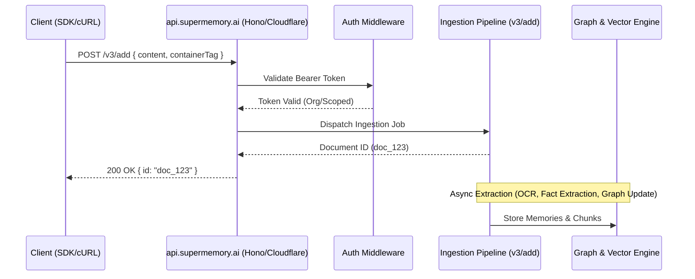

<!-- source: DeepWiki mcp.deepwiki.com · repo supermemoryai/supermemory · page 6 API Reference · fetched 2026-10-30 -->

# API Reference

<details>
<summary>Relevant source files</summary>

The following files were used as context for generating this wiki page:

- [apps/docs/authentication.mdx](apps/docs/authentication.mdx)
- [apps/docs/docs.json](apps/docs/docs.json)
- [apps/docs/integrations/claude-code.mdx](apps/docs/integrations/claude-code.mdx)
- [apps/docs/integrations/codex.mdx](apps/docs/integrations/codex.mdx)
- [apps/docs/integrations/openclaw.mdx](apps/docs/integrations/openclaw.mdx)
- [apps/docs/integrations/opencode.mdx](apps/docs/integrations/opencode.mdx)
- [apps/docs/integrations/supermemory-sdk.mdx](apps/docs/integrations/supermemory-sdk.mdx)
- [apps/docs/intro.mdx](apps/docs/intro.mdx)
- [apps/docs/quickstart.mdx](apps/docs/quickstart.mdx)
- [apps/docs/self-hosting/configuration.mdx](apps/docs/self-hosting/configuration.mdx)
- [apps/docs/self-hosting/local-vs-enterprise.mdx](apps/docs/self-hosting/local-vs-enterprise.mdx)

</details>


This page provides a high-level overview of the Supermemory REST API, including base URLs, versioning conventions, authentication, and the core endpoint groups. Supermemory is designed as a "Memory-as-a-Service" platform, offering a unified interface for ingestion, semantic search, and automated user profiling.

For detailed implementation guides on specific endpoint groups, refer to the child pages linked below.

---

## Base URL and Versioning

All API requests are directed to the root production domain or a self-hosted instance. The API uses path-based versioning to manage feature evolution. [apps/docs/docs.json:8-8]()

| Environment | Base URL |
| :--- | :--- |
| **Production API** | `https://api.supermemory.ai` |
| **Self-Hosted (Local)** | `http://localhost:6767` |
| **OpenAPI Spec** | `https://api.supermemory.ai/v3/openapi` |

### Active Versions

*   **`v3`**: The stable foundation for document ingestion (`/v3/add`), document management (`/v3/documents`), search (`/v3/search`), and connector management (`/v3/connections`). [apps/docs/docs.json:131-132]()
*   **`v4`**: Optimized endpoints for conversational AI and advanced retrieval, including the unified User Profile endpoint (`/v4/profile`) and updated search modes. [apps/docs/quickstart.mdx:96-99]()

Sources: [apps/docs/docs.json:8-8](), [apps/docs/quickstart.mdx:96-99](), [apps/docs/self-hosting/configuration.mdx:16-16]()

---

## Authentication

Supermemory uses Bearer Token authentication. All requests must include an `Authorization` header. [apps/docs/authentication.mdx:7-9]()

```http
Authorization: Bearer <YOUR_SUPERMEMORY_API_KEY>
```

### Key Types
1.  **Organization Keys**: Created via the [Supermemory Console](https://console.supermemory.ai). These have full access to all resources within an organization. [apps/docs/authentication.mdx:7-9]()
2.  **Scoped API Keys**: Created programmatically via `POST /v3/auth/scoped-key`. These are restricted to specific `containerTags`, providing fine-grained access control for multi-tenant applications. [apps/docs/authentication.mdx:60-65]()

For details, see [Authentication & Scoped Keys](#6.5).

Sources: [apps/docs/authentication.mdx:7-9](), [apps/docs/authentication.mdx:60-65](), [apps/docs/quickstart.mdx:17-19]()

---

## Core Concepts: Documents vs. Memories

Understanding the distinction between these two entities is critical for effective API usage.

*   **Documents**: The raw data you ingest (Text, PDFs, Images, Conversations). They serve as the "ground truth." [apps/docs/intro.mdx:29-34]()
*   **Memories**: Automatically extracted by Supermemory from documents and conversations. These are atomic, interconnected facts and preferences inferred from the source data to build a knowledge graph. [apps/docs/intro.mdx:43-46]()

### System Entity Mapping
The following diagram bridges the natural language concepts to the API routes and data structures.


Sources: [apps/docs/quickstart.mdx:96-99](), [apps/docs/authentication.mdx:83-85](), [apps/docs/intro.mdx:43-46]()

---

## Endpoint Groups

The Supermemory API is organized into functional groups. Each group is detailed in its respective child page.

### 1. Memory & Document Endpoints
Handles the ingestion pipeline, including text snippets, file uploads (PDF, Images), and conversation transcripts. It also provides listing and deletion capabilities. [apps/docs/integrations/supermemory-sdk.mdx:38-40]()
*   **Key Routes**: `POST /v3/add`, `GET /v3/documents/list`, `DELETE /v3/documents/delete`.
*   **For details, see [Memory & Document Endpoints](#6.1)**.

### 2. Profile & Search Endpoints
Provides semantic and hybrid search capabilities. The Profile endpoint returns "Static" facts (long-term) and "Dynamic" context (episodic) for LLM system prompts. [apps/docs/intro.mdx:52-58]()
*   **Key Routes**: `POST /v4/profile`, `POST /v3/search`.
*   **For details, see [Profile & Search Endpoints](#6.2)**.

### 3. Connectors API
Manage automated syncing from external platforms like GitHub, Gmail, Google Drive, Notion, and OneDrive. [apps/docs/docs.json:115-132]()
*   **Key Routes**: `POST /v3/connections/{provider}`, `DELETE /v3/connections/{id}`.
*   **For details, see [Connectors API](#6.3)**.

### 4. Projects & Container Tags
Explains the logical isolation of data using `containerTag`. This is the primary mechanism for multi-tenancy and scoping search results. [apps/docs/authentication.mdx:60-61]()
*   **For details, see [Projects & Container Tags](#6.4)**.

### 5. Authentication & Scoped Keys
Technical details on managing API keys and programmatic key rotation, including creating keys restricted to specific containers. [apps/docs/authentication.mdx:58-65]()
*   **For details, see [Authentication & Scoped Keys](#6.5)**.

---

## Request Flow Architecture

This diagram illustrates how a client request moves through the API layers to the underlying storage and processing engines.


Sources: [apps/docs/quickstart.mdx:116-120](), [apps/docs/authentication.mdx:17-22](), [apps/docs/intro.mdx:21-23]()

---

## Standard Responses

### Success
Most POST endpoints return a standard object containing the resource ID.
```json
{
  "id": "doc_123",
  "success": true
}
```

### Errors
The API uses standard HTTP status codes:
*   **400 Bad Request**: Missing parameters (e.g., missing `containerTag`).
*   **401 Unauthorized**: Invalid or expired API key. [apps/docs/authentication.mdx:104-107]()
*   **404 Not Found**: Resource (document or connection) does not exist.
*   **429 Too Many Requests**: Rate limit exceeded for the provided key. [apps/docs/authentication.mdx:86-87]()

Sources: [apps/docs/authentication.mdx:104-107](), [apps/docs/authentication.mdx:86-87](), [apps/docs/quickstart.mdx:17-19]()

---

